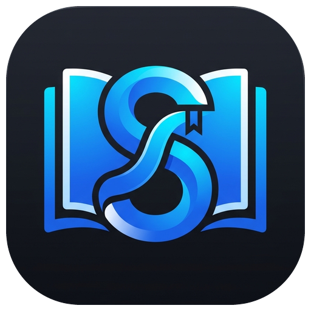
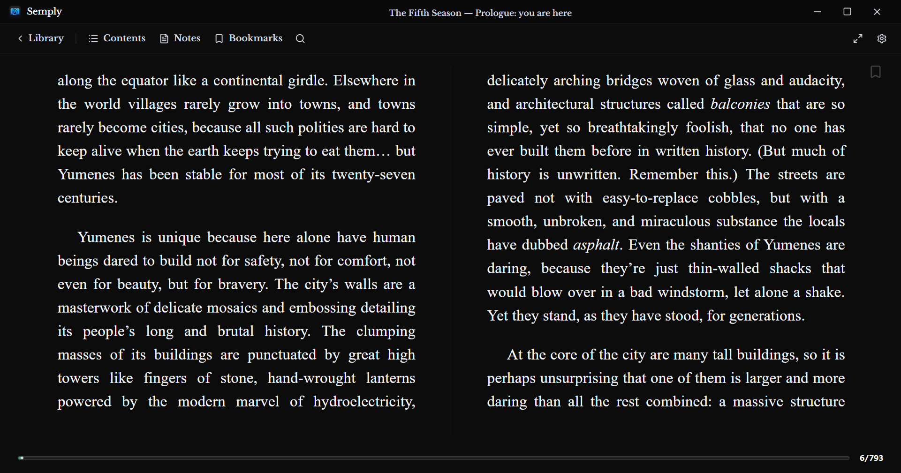

<div align="center">



# Semply

**A quiet desktop sanctuary for those who still read deeply.**  
A fast, private, distraction-free desktop reader for your personal book library. Features 100% offline PDF reflow, hands-free adaptive auto-scroll, thoughtful floating notes, and complete digital sovereignty.

[](https://semply.vercel.app/)
[](./LICENSE)
[](https://github.com/ederaefe/EPUB-Reader-Desktop/releases/latest)
[](https://www.electronjs.org/)
[](https://react.dev/)
[](https://www.typescriptlang.org/)
[]()
[]()

<br />

[Live Web Preview](https://semply.vercel.app/) &bull; [Download App](https://github.com/ederaefe/EPUB-Reader-Desktop/releases/latest) &bull; [Core Moats](#the-five-reading-superpowers) &bull; [Comparison](#why-readers-choose-semply) &bull; [Keyboard Shortcuts](#cursorless-keyboard-navigation) &bull; [Documentation](#documentation)

<br />



<p><em>The Semply reading sanctuary: dual-page spread typography, chapter tracking, subtle progress scrubber, and zero distraction.</em></p>

</div>

---

## The Philosophy: A Sanctuary for Books

Modern reading apps have turned books into rented licenses. Commercial readers track your reading habits, lock your bookmarks inside walled gardens, clutter your screen with store recommendations, and charge monthly fees to access your own files.

**Semply was built on digital sovereignty and sustained focus:**
- **Your Books Stay on Your Computer**: All library files, shelves, annotations, and reading progress reside safely in local storage on your device. Zero telemetry, zero analytics, and zero cloud uploads.
- **100% Offline Forever**: Read on flights, train commutes, and off-grid retreats without ever needing an active internet connection or login check.
- **Zero Paywalls or Subscriptions**: Free and open source under the MIT License. No accounts to create, no passwords to manage, and no locked features.
- **One-Click Portable Freedom**: Export your entire library, notes, and reading history into a single portable backup file and restore it effortlessly on any laptop.

Visit the official website and live preview at **[https://semply.vercel.app/](https://semply.vercel.app/)**.

---

## The Five Reading Superpowers

### 1. Offline PDF Reflow: Turn Rigid Documents into Living Books
Reading static, multi-column PDFs on desktop screens traditionally means tiny fonts, clumsy zoom sliders, and endless horizontal panning. Semply reconstructs complex PDF documents into flowing, resizable book chapters entirely on your local machine using embedded WebAssembly. Adjust font sizes, select classic serif typography, and read in single or dual-page spreads without uploading sensitive files to cloud servers.

### 2. Smart Pace: Adaptive Auto-Scroll That Learns How You Read
Conventional auto-scroll engines rely on rigid pixel timers that force your eyes to race or wait. Semply's adaptive reading engine silently observes your personal reading cadence as you turn pages. It glides swiftly across light dialogue, settles gently into dense descriptive passages, and introduces mindful breathing pauses at chapter dividers so you can read hands-free in deep comfort.

### 3. Floating Notes & Thought Capture
Select any passage to summon a sleek, non-blocking toolbar. Highlight text across six soft paper hues and record thoughts in anchored cards that never obscure your page. When your reading session concludes, export all highlights and reflections directly to Obsidian, Notion, or Markdown with a single click.

### 4. In-Place Footnote Peek: Never Lose Your Page
Traditional readers jolt you hundreds of pages away to an appendix at the back of the book whenever you click a citation. In Semply, citations open in a gentle popover directly above the sentence. Read the reference in place, close it, and continue your reading flow without losing your line.

### 5. Whisper-Quiet Battery Efficiency
Built lean with zero background sync daemons, telemetry loops, or memory leaks. Semply launches in milliseconds, draws minimal system resources, and stays silent between page turns, letting you read for hours on laptop battery without heating your device.

---

## Universal Format Support

Semply opens personal book collections directly with zero proprietary conversion locks:

| Format | Native Capabilities |
| --- | --- |
| **EPUB (`.epub`)** | Reflowable single-page and two-page spreads, custom serif typography, line spacing, margins, floating notes, bookmarks, and in-place footnotes. |
| **PDF (`.pdf`)** | High-DPI canvas rendering, native text selection, outline navigation, zoom (`50%` to `300%`), and one-click offline reflow into resizable book format. |
| **MOBI (`.mobi`)** | Native PalmDB parsing, automatic cover extraction, and chapter navigation. |
| **TXT (`.txt`)** | Warm-paper typographic layout, auto-detected chapter breaks, and customizable fonts. |

---

## Why Readers Choose Semply

| Capability | Semply | Generic Desktop Readers | Closed Hardware Stores (Kindle/Kobo) | Cloud Web Readers |
| --- | --- | --- | --- | --- |
| **Offline PDF Reflow** | Yes (100% Offline WASM) | Format Loss / Conversion | Fixed Layout Only | Requires Cloud Upload |
| **Privacy & Sovereignty** | 100% Offline (No Accounts) | Local Files Only | Tracked by Store Account | Tracked on Cloud Servers |
| **Thought Capture Export** | Markdown, Obsidian, Notion | Basic / Cumbersome | Locked in Store Ecosystem | Proprietary Export |
| **Classic Book Typography** | Curated Offline Serif Fonts | System Fonts Only | 3 to 6 Fonts | 2 to 4 Web Fonts |
| **In-Place Footnote Peek** | Yes (In-Place Popover) | Jumps to back of book | Jumps to back of book | Rare |
| **Hands-Free Auto-Scroll** | Smart Pace (Cadence-Aware) | Rigid Pixel Scroll / None | None | Rare |
| **Pricing & License** | Free Forever (MIT Open Source) | Ad-Supported / Outdated | Store Locked | Monthly Subscription |
| **Distraction-Free Design** | Modern Sanctuary UI | Dated 2000s Interface | Store-First Storefront | Web Clutter & Popups |
| **Library Portability** | Single-File Portable Archive | Manual File Copies | DRM Locked Licenses | Rented Cloud Access |

---

## Download & Installation

Pre-built binaries for every major desktop operating system are available on the [Releases Page](https://github.com/ederaefe/EPUB-Reader-Desktop/releases/latest) and on the [Official Website](https://semply.vercel.app/):

- **Windows**: `Semply-Setup.exe` (Installer) or Portable Executable
- **macOS**: `Semply.dmg` (Universal binary supporting Apple Silicon and Intel)
- **Linux**: `Semply.AppImage` (Self-contained, cross-distribution)

---

## Cursorless Keyboard Navigation

Semply is fully controllable from the keyboard, enabling continuous reading without reaching for a mouse:

| Key | Context | Action |
| --- | --- | --- |
| `Space` | Reader | Advance page (or pause/resume active auto-scroll) |
| `Shift + Space` | Reader | Turn back one page |
| `j` / `k` or `Down` / `Up` | Reader | Smoothly advance / scroll backwards |
| `[` / `]` | Reader | Jump to previous / next chapter |
| `Ctrl + F` | Reader | Open full-book search drawer with instant highlight jumping |
| `Enter` / `Shift + Enter` | Search | Navigate to next / previous search match |
| `Ctrl + B` | Reader | Toggle bookmark with automatic excerpt capture |
| `F9` | Reader | Cycle reading themes (`Obsidian`, `Light`, `Paper`, `Dusk`) |
| `F10` | Reader | Toggle single-page / two-page spread mode |
| `F11` | Global | Toggle true immersive fullscreen (zero distraction) |
| `Alt + Left` or `Alt + <` | Reader | Return to library home |
| `F7` / `F8` | Reader | Play/pause and stop Read Aloud narration |
| `Esc` | Global | Close popovers, dismiss search/settings drawers, or cancel modals |

---

## Architecture & Developer Guide

Beyond serving readers as a standalone application, this repository functions as a reference implementation for high-performance desktop software:

```
+-----------------------------------------------------------------------+
|                    Electron Main Process (Node.js)                    |
|  - Frameless window lifecycle & OS boundary protection                |
|  - Offline Artifex MuPDF WebAssembly 2-Pass Reflow Engine             |
|  - Strict local file authorization & security boundary sandbox        |
+-----------------------------------------------------------------------+
                                   |
                                   v
+-----------------------------------------------------------------------+
|                 Preload Bridge (contextBridge)                        |
|  - Strictly typed desktop API contract (window.api)                   |
|  - Isolated execution context preventing unsafe Node.js access        |
+-----------------------------------------------------------------------+
                                   |
                                   v
+-----------------------------------------------------------------------+
|                 Renderer Process (React 19 + Vite)                    |
|  - State Management: Modular Zustand store slices                     |
|  - Persistence: Dexie.js (IndexedDB zero-native-compilation storage)  |
|  - EPUB Engine: epub.js with normalized typography iframe sandbox     |
|  - PDF Engine: pdfjs-dist HiDPI canvas + aligned text selection layer |
|  - Design System: Monochromatic Geist Obsidian Tailwind tokens        |
+-----------------------------------------------------------------------+
```

### Building from Source

```bash
# 1. Clone the repository
git clone https://github.com/ederaefe/EPUB-Reader-Desktop.git
cd EPUB-Reader-Desktop

# 2. Install dependencies
npm install

# 3. Start development environment with Hot Module Replacement (HMR)
npm run dev

# 4. Typecheck and verify
npm run typecheck

# 5. Build production bundle
npm run build

# 6. Package installer for current operating system
npm run package
```

---

## Documentation

Comprehensive guides are maintained across multiple levels:
- **[Official Website & Web Preview](https://semply.vercel.app/)**: Live demo and product overview.
- **[Interactive Documentation Guide](./documentations/index.html)**: Complete user manual with live topic search and theme preview.
- **[Developer Architecture Guide](./dev-documentations.md)**: Exhaustive technical manual detailing Electron IPC contracts, Dexie database structures, and WASM pipeline internals.
- **[High-Level Technical Reference](./documentation.md)**: Implementation-agnostic technical documentation and system reference.
- **[Design System Specification](./DESIGN.md)**: Visual tokens, Geist Obsidian surface guidelines, and explicit UI anti-pattern rules.

---

## Contributing

Contributions, bug reports, and suggestions are warmly appreciated:
1. Fork the repository.
2. Create your feature branch (`git checkout -b feat/your-feature-name`).
3. Ensure strict type-checking passes: `npm run typecheck`.
4. Commit your changes with clear messages (`git commit -m 'feat: add feature'`).
5. Push to your branch and open a Pull Request.

---

## License

This project is licensed under the [MIT License](./LICENSE). You are free to use, modify, and distribute this software for personal, academic, or commercial purposes.
