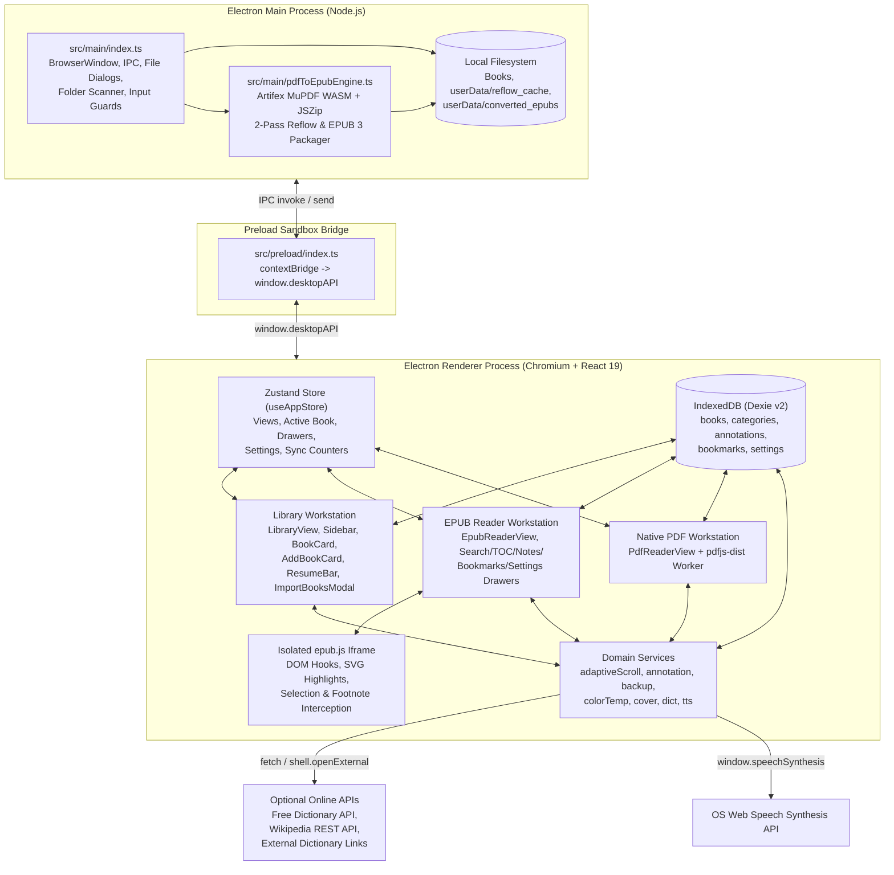
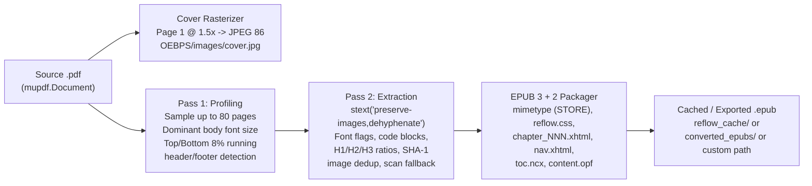
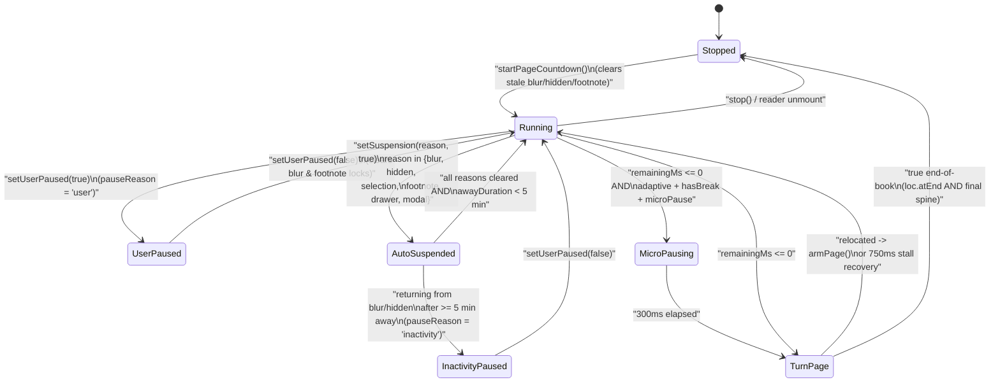

# Semply Ebook Reader (EPUB Reader Desktop) - Developer Reference & Architecture Documentation

> **Permanent Technical Reference** — Verified against the live Electron + React 19 + TypeScript + MuPDF WASM codebase. Every IPC channel, database schema, state slice, algorithmic threshold, design token, and invariant documented below reflects the current production architecture.

## Documentation Style Guide (Developer Reference)
All future technical updates appended to `dev-documentations.md` must follow these rules:
- **Audience**: Maintainers and contributors working directly on the Electron, React, TypeScript, and CSS layers.
- **Depth & Precision**: Cite exact file paths, component/prop signatures, CSS custom properties, typography/spacing values, Zustand/Dexie schema changes, IPC contracts, and architectural invariants.
- **Append-Only Revision Log**: Record each completed increment as a sequentially numbered `## Increment N: <Title>` section at the end of the file, grouped under `### Architecture & Implementation` with numbered subsystems.
- **Separation of Concerns**: Keep plain-language user summaries in `documentation.md`; keep code-level specifics and engineering trade-offs here in `dev-documentations.md`.

## Table of Contents
1. [Product Overview & System Topology](#1-product-overview--system-topology)
2. [Technology Stack & Dependency Matrix](#2-technology-stack--dependency-matrix)
3. [Repository & Module Directory](#3-repository--module-directory)
4. [Electron Multi-Process Architecture & IPC Contract](#4-electron-multi-process-architecture--ipc-contract)
5. [Data Persistence & State Management](#5-data-persistence--state-management)
6. [Core Subsystems & Algorithmic Deep Dives](#6-core-subsystems--algorithmic-deep-dives)
   - [6.1 EPUB Rendering, Global Pagination & Iframe Bridging](#61-epub-rendering-global-pagination--iframe-bridging)
   - [6.2 Native PDF Reader (`PdfReaderView`)](#62-native-pdf-reader-pdfreaderview)
   - [6.3 Offline MuPDF WASM PDF-to-EPUB & Reflow Engine](#63-offline-mupdf-wasm-pdf-to-epub--reflow-engine)
   - [6.4 Dual-Mode Auto-Scroll Countdown Engine](#64-dual-mode-auto-scroll-countdown-engine)
   - [6.5 Annotations, Highlights & Bookmarks Engine](#65-annotations-highlights--bookmarks-engine)
   - [6.6 Full-Book Spine Search (`SearchDrawer`)](#66-full-book-spine-search-searchdrawer)
   - [6.7 Universal Cover, First-Page & Metadata Extraction Pipeline](#67-universal-cover-first-page--metadata-extraction-pipeline)
   - [6.8 Read Aloud (TTS), Contextual Dictionary, Footnotes & Warm Night Filter](#68-read-aloud-tts-contextual-dictionary-footnotes--warm-night-filter)
   - [6.9 Universal Additive Backup & Sync Engine](#69-universal-additive-backup--sync-engine)
7. [UI Architecture, Component Inventory & Design System](#7-ui-architecture-component-inventory--design-system)
8. [Keyboard Shortcuts, Mouse & Context Menu Matrix](#8-keyboard-shortcuts-mouse--context-menu-matrix)
9. [Build, Packaging, Release & CI/CD Pipeline](#9-build-packaging-release--cicd-pipeline)
10. [Architectural Invariants, Edge Cases & Maintainer Notes](#10-architectural-invariants-edge-cases--maintainer-notes)
11. [Increments & Revision Log](#11-increments--revision-log)

---

## 1. Product Overview & System Topology

**Semply Ebook Reader** (`semply-ebook-reader`, App ID `com.ederaefe.semple-ebook-reader`) is a cross-platform desktop ebook and document reader built on Electron, React 19, TypeScript, Tailwind CSS, `epub.js`, `pdfjs-dist`, and Artifex's official `mupdf` WebAssembly engine.

### Core Product Capabilities
- **Multi-Format Library Management**: Supports `.epub`, `.pdf`, `.mobi`, and `.txt` imports via file picker, recursive directory scan, or drag-and-drop; Grid and List views; 5-column sortable catalog (`Title`, `Author`, `Date`, `Notes`, `Progress`); custom color-coded categories/shelves; bulk library-to-category assignment; soft-delete Trash & Restore; and a bottom Quick-Resume bar.
- **Dual Reading Engines**:
  - **Reflowable EPUB Engine (`EpubReaderView`)**: Paginated single-page and dual-page spreads via `epub.js`, Librera CSS typography normalization, 4 reading themes, global CFI pagination, cross-document footnote popovers, full-book spine search, dual-anchor highlights/notes, Read Aloud TTS, and Dual-Mode Auto-Scroll.
  - **Native PDF Engine (`PdfReaderView`) + Offline MuPDF Reflow**: HiDPI canvas rendering with aligned selectable text overlays, single/double spread, 50%–300% zoom, PDF outline TOC, CSS theme adaptation, and one-click offline conversion to cached reflowable EPUB via MuPDF WASM (`pdfToEpubEngine.ts`) to unlock every EPUB reading tool.
- **Zero-Paywall Desktop Ergonomics**: Frameless native window chrome styled in the **Vercel Geist Obsidian** monochrome design system, true text-only Immersive Fullscreen (`F11`), dual-layer context menus, accidental `Ctrl` reload/zoom neutralization, and zero licensing or upgrade nags.
- **Zero-Native-Dependency Local Storage**: All library metadata, custom shelves, annotations, bookmarks, and preferences live locally in IndexedDB via Dexie.js (`EpubReaderDesktopDB`), backed by non-destructive additive JSON/ZIP export and import.

### High-Level Process & Data Flow Topology



---

## 2. Technology Stack & Dependency Matrix

| Package | Version (`package.json`) | Layer | Architectural Responsibility |
| --- | --- | --- | --- |
| `electron` | `^34.3.0` | Main / Preload / Runtime | Cross-platform desktop shell, frameless window lifecycle, native dialogs, OS menus, IPC |
| `electron-vite` | `^3.0.0` | Build | Unified 3-target Vite bundler for Main, Preload, and Renderer |
| `electron-builder` | `^25.1.8` | Packaging | Cross-platform installer packaging (Windows NSIS x64, macOS DMG/ZIP, Linux AppImage/DEB) |
| `react` / `react-dom` | `^19.0.0` | Renderer | Component UI runtime |
| `typescript` | `^5.8.2` | All | Static type checking (`npm run typecheck` -> `tsc --noEmit`) |
| `tailwindcss` | `^3.4.17` | Renderer | Utility-first layout styling paired with Geist Obsidian CSS tokens (`index.css`) |
| `zustand` | `^5.0.3` | Renderer | Lightweight global state management (`useAppStore.ts`) |
| `dexie` | `^4.0.10` | Renderer | IndexedDB wrapper (`EpubReaderDesktopDB`, schema v2) with zero native C++ bindings |
| `epubjs` | `^0.3.93` | Renderer | EPUB 2/3 archive parsing, paginated iframe rendition, CFI generation, spine search, SVG annotations |
| `pdfjs-dist` | `^4.4.168` | Renderer | Native PDF canvas rendering, selectable text layer, PDF outline, Page 1 cover/metadata extraction via offline bundled `pdf.worker.min.mjs` |
| `mupdf` | `^1.28.6` | Main | Artifex official MuPDF WebAssembly library powering offline 2-pass structured PDF-to-EPUB reflow |
| `jszip` | `^3.10.1` | Main & Renderer | EPUB ZIP inspection (cover/OPF extraction), EPUB 3 archive generation, and ZIP library backup bundles |
| `lucide-react` | `^1.16.0` | Renderer | Crisp 14px–16px stroke vector iconography across toolbars, drawers, menus, and modals |

---

## 3. Repository & Module Directory

```text
EPUB READER DESKTOP/
├── .github/workflows/
│   └── release.yml                     # 3-OS (Windows/macOS/Linux) GitHub Actions build & package workflow
├── build/
│   ├── icon.ico                        # Multi-resolution Windows installer icon (16px–256px)
│   └── icon.png                        # 512x512 RGBA squircle icon for macOS & Linux packaging
├── resources/
│   ├── icon.ico                        # Runtime taskbar/window icon bundled via extraResources (win32)
│   └── icon.png                        # Runtime window icon bundled via extraResources (mac/linux)
├── electron.vite.config.ts             # 3-target electron-vite config (main, preload, renderer; @ alias; **/*.epub asset)
├── electron-builder.config.ts          # Packaging manifest (appId, NSIS, DMG/ZIP, AppImage/DEB, extraResources)
├── tailwind.config.ts                  # Tailwind theme extensions and legacy color palette bindings
├── package.json                        # Scripts (dev, build, typecheck, package, release) and dependencies
├── DESIGN.md                           # Design System Lock specification
├── README.md                           # Repository overview and quick-start links
├── dev-documentations.md               # Internal developer reference and append-only revision log
├── documentations/                     # Front-facing user documentation website (static HTML5 + AI llms.txt)
│   ├── index.html                      # Semantic HTML5 user manual with JSON-LD, live theme preview & Auto-Scroll lab
│   ├── styles.css                      # Mobile-first Semply 4-theme (Obsidian/Light/Paper/Dusk) stylesheet
│   ├── app.js                          # Progressive enhancement: Ctrl+K search, theme switcher, pace calculator, scroll-spy
│   ├── llms.txt                        # llmstxt.org AI discovery index
│   ├── llms-full.txt                   # Complete single-file Markdown user guide for AI ingestion
│   ├── robots.txt                      # Open crawler directive referencing sitemap.xml and llms.txt
│   ├── sitemap.xml                     # XML sitemap for search engine indexing
│   └── assets/                         # Self-contained semply-logo.png and favicon.ico for standalone hosting
└── src/
    ├── types.d.ts                      # Asset module declarations (*.epub, *.epub?url, *.jpg, *.png, *.svg)
    ├── main/
    │   ├── index.ts                    # Electron main entry: window, security guards, native edit menu, IPC handlers
    │   └── pdfToEpubEngine.ts          # Offline 2-pass MuPDF WASM PDF-to-EPUB reflow & EPUB 3/2 packager
    ├── preload/
    │   └── index.ts                    # Typed DesktopAPI bridge exposed on window.desktopAPI
    └── renderer/
        ├── index.html                  # Renderer HTML shell
        ├── favicon.ico / favicon.png   # Renderer favicons
        └── src/
            ├── main.tsx                # React 19 root mount
            ├── App.tsx                 # Top-level view router, starter seeding, global hotkeys, PDF reflow orchestration
            ├── index.css               # Vercel Geist Obsidian tokens, custom sliders/checkboxes, GPU ui-enter animations
            ├── db/
            │   └── index.ts            # Dexie ReaderDatabase (EpubReaderDesktopDB v1 -> v2) & TypeScript interfaces
            ├── stores/
            │   └── useAppStore.ts      # Zustand AppState, DEFAULT_SETTINGS, localStorage/Dexie helpers, mutual drawer locks
            ├── services/
            │   ├── adaptiveScrollService.ts  # Dual-mode monotonic Auto-Scroll engine + suspension state machine
            │   ├── annotationService.ts      # Theme-aware SVG highlights, IceRange XPath, bookmark excerpts, HTML/MD/TXT export
            │   ├── backupService.ts          # JSON & ZIP universal export + 4-phase non-destructive additive import
            │   ├── colorTempService.ts       # Tanner Helland Kelvin (2000K–4500K) to warm amber overlay calculator
            │   ├── coverService.ts           # Universal EPUB/PDF/MOBI/TXT cover, first-page canvas & metadata extractor
            │   ├── dictService.ts            # 9 Librera web dictionaries + Free Dictionary API + Wikipedia REST API
            │   └── ttsService.ts             # Web Speech Synthesis wrapper + Librera pronunciation normalization regex matrix
            ├── components/
            │   ├── ui/
            │   │   ├── TitleBar.tsx          # 32px frameless titlebar (Semply brand, live book/chapter title, focus dimming, Restore/Maximize state)
            │   │   ├── NativeFeedbackHost.tsx# In-app Geist contextual toast queue & accessible keyboard-driven Confirm dialog (zero alert/confirm)
            │   │   ├── ContextMenu.tsx       # Viewport-clamped desktop context menu with inline highlight swatch row
            │   │   ├── HelpModal.tsx         # Hotkeys & Navigation modal (F1)
            │   │   ├── SecondsNumberInput.tsx# Direct numeric seconds input (3–600s) with +/- steppers & arrow stepping
            │   │   ├── ThemePickerGrid.tsx   # Curved live-preview reading theme radiogroup cards
            │   │   └── AppBackground.tsx     # Solid fallback background layer
            │   ├── library/
            │   │   ├── LibraryView.tsx       # Catalog header, search, 5-column sort, drag-and-drop import, auto-cleanse
            │   │   ├── Sidebar.tsx           # Shelves (All, Recent, Favorites, Formats, Read, Deleted) & custom category creator
            │   │   ├── BookCard.tsx          # Grid card & List row with progress overlay, category menu, context actions
            │   │   ├── AddBookCard.tsx       # First-slot book-proportioned dashed "+" import card (Grid & List)
            │   │   └── ResumeBar.tsx         # Bottom Quick-Resume bar showing last opened book and page ratio
            │   ├── reader/
            │   │   ├── EpubReaderView.tsx    # Core epub.js rendition host, pagination, search, footnotes, annotations, auto-scroll
            │   │   ├── PdfReaderView.tsx     # Native pdfjs-dist HiDPI viewer with text overlay, zoom, spread & reflow trigger
            │   │   ├── ReaderTopBar.tsx      # Minimalist 40px reader toolbar (Library, Contents, Notes, Bookmarks, Find, FS, Settings)
            │   │   ├── SelectionPopup.tsx    # Clamped floating selection toolbar + inline Note, Dictionary & Wikipedia modals
            │   │   ├── AnnotationPopover.tsx # On-click highlight editor (recolor, inline comment, copy, TTS, delete)
            │   │   ├── FootnotePopover.tsx   # Non-destructive bottom-centered footnote preview card
            │   │   └── AdaptiveScrollOverlay.tsx # Fullscreen-persistent bottom-right numeric countdown + tap-to-open settings popover
            │   ├── drawers/
            │   │   ├── TOCDrawer.tsx         # Left-docked Table of Contents with page indicators
            │   │   ├── NotesDrawer.tsx       # Left-docked Notes & Highlights manager (filter, sort, chapter group, export, edit)
            │   │   ├── BookmarksDrawer.tsx   # Left-docked Bookmarks manager (auto-excerpts, inline rename, search, sort)
            │   │   ├── SearchDrawer.tsx      # Left-docked Full-Book Find panel (250ms debounce, amber excerpts, Enter stepping)
            │   │   └── SettingsDrawer.tsx    # Floating 3-tab Geist Reader Settings command center (Display, Flow, PDF/More)
            │   └── modals/
            │       ├── FullSettingsModal.tsx # Fixed 780x580 6-tab Preferences modal (System, Reading, TTS, Hotkeys, Backup, About)
            │       └── ImportBooksModal.tsx  # Unified Add Book / Add Folder / Bulk Add from Main Library into custom category modal
            └── assets/
                ├── app-Librera.css           # Extracted Librera EPUB typography normalization stylesheet
                ├── app-Librera-Tables.css    # Extracted Librera table formatting rules
                ├── app-WebDict.json          # Extracted Librera web dictionary provider definitions
                ├── app-WebSearch.json        # Extracted Librera web search definitions
                ├── dict/TTS_Librera_Rules.txt# Reference pronunciation normalization matrix
                ├── books/                    # Starter EPUBs (the_fifth_season.epub, alicesadventures.epub, mobydick.epub)
                ├── covers/                   # Starter cover art (the_fifth_season.jpg)
                └── icons/                    # Semply brand icons (semply_logo.{ico,png}) & reference SVGs
```

---

## 4. Electron Multi-Process Architecture & IPC Contract

### Window Lifecycle & Security Posture (`src/main/index.ts`)
- **Window Configuration & Bounds Persistence**: Frameless (`frame: false`), default dimensions `1280 × 820`, minimum `960 × 600`, `show: false` (revealed on `ready-to-show` to eliminate white flash), `autoHideMenuBar: true`. Persists `{ x, y, width, height, isMaximized }` in `userData/window-state.json`, validating saved coordinates against currently attached displays so windows never reopen off-screen.
- **Single-Instance & OS File Association**: Uses `app.requestSingleInstanceLock()`, `second-instance`, macOS `open-file`, and `process.argv` inspection so double-clicking `.epub` / `.pdf` files in OS File Explorer focuses the running instance and imports/opens them directly via `app:openExternalFile`.
- **Platform Icon, Dynamic Title & Taskbar Identity**:
  - Calls `app.setAppUserModelId('com.ederaefe.semple-ebook-reader')` on Windows (`win32`) so taskbar pinning and notifications bind to Semply instead of default Electron.
  - `resolveAppIconPath()` checks `process.resourcesPath`, `app.getAppPath()/resources`, `__dirname/../../resources`, and `app.getAppPath()/build` for `icon.ico` (Windows) or `icon.png` (macOS/Linux).
  - Syncs native OS window/Alt+Tab title via `window:setTitle` (`"Book Title — Chapter — Semply"`) and native window background via `window:setBackgroundColor` on theme switch.
- **Security & Native Desktop Hardening**:
  - `contextIsolation: true`, `nodeIntegration: false`, `webSecurity: true`, `sandbox: false` (preload uses Node `electron` modules safely behind `contextBridge`).
  - `setWindowOpenHandler` denies all in-app popups (`{ action: 'deny' }`) and forwards URLs to `shell.openExternal(details.url)`.
  - Blocks `will-navigate` so accidental file drops never replace the React app with raw browser views.
  - `Menu.setApplicationMenu(null)` strips Electron's default reload/close accelerators; `webContents.setVisualZoomLevelLimits(1, 1)` locks UI chrome at 100% scale.
  - `before-input-event` blocks `F5`, `Ctrl+R`, `Ctrl+W`, `Alt+Left`/`Alt+Right`, and bare `Control`, while routing `Ctrl+`/`Ctrl-`/`Ctrl+0` via `window:contentZoom` strictly to **content-only zoom** (EPUB font size or PDF zoom) without scaling desktop chrome.
- **Dual-Layer Context Menu Strategy**:
  - **Editable Inputs**: `webContents.on('context-menu')` inspects `params.isEditable` and pops a native Electron `Menu` (`undo`, `redo`, `cut`, `copy`, `paste`, `selectAll`) bound to live `params.editFlags`.
  - **Application Surfaces**: EPUB iframe, PDF viewport, and Library `BookCard` suppress default browser menus and open the custom viewport-clamped React `<ContextMenu>`.

### Complete IPC Channel Contract (`src/main/index.ts` <-> `src/preload/index.ts`)

#### Request / Response Channels (`ipcMain.handle` -> `ipcRenderer.invoke`)

| IPC Channel | `window.desktopAPI` Method | Arguments | Return Type | Purpose |
| --- | --- | --- | --- | --- |
| `window:minimize` | `minimize()` | none | `Promise<void>` | Minimizes frameless window |
| `window:maximize` | `maximize()` | none | `Promise<void>` | Toggles maximized / unmaximized state |
| `window:close` | `close()` | none | `Promise<void>` | Closes application window |
| `window:isMaximized` | `isMaximized()` | none | `Promise<boolean>` | Queries current maximize state |
| `window:toggleFullscreen` | `toggleFullscreen()` | none | `Promise<boolean>` | Toggles OS fullscreen; returns resulting boolean |
| `window:setFullscreen` | `setFullscreen(active)` | `active: boolean` | `Promise<void>` | Explicitly enters/exits OS fullscreen (Immersive Mode) |
| `window:setBackgroundColor` | `setBackgroundColor(color)` | `color: string` | `Promise<void>` | Updates native BrowserWindow background hex to match active reading theme |
| `window:setTitle` | `setWindowTitle(title)` | `title: string` | `Promise<void>` | Updates OS taskbar and Alt+Tab window title |
| `shell:showItemInFolder` | `showItemInFolder(filePath)` | `filePath: string` | `Promise<boolean>` | Reveals a book's source file in OS File Explorer / Finder |
| `window:setZoomFactor` | `setZoomFactor(factor)` | `factor: number` | `void` (invokes + `webFrame`) | Programmatic zoom factor setter (retained for bridge compatibility) |
| `window:getZoomFactor` | `getZoomFactor()` | none | `number` (`webFrame`) | Reads current zoom factor (default `1.0`) |
| `dialog:openFiles` | `openFiles()` | none | `Promise<string[]>` | Multi-select native file picker filtered for `epub`, `pdf`, `mobi`, `txt` |
| `dialog:openFolder` | `openFolder()` | none | `Promise<string \| null>` | Native directory picker for recursive import |
| `dialog:showSaveDialog` | `showSaveDialog(options)` | `{ title?, defaultPath?, filters? }` | `Promise<string \| null>` | Native Save-As dialog (JSON/ZIP backup, Note exports, PDF-to-EPUB export) |
| `dialog:showOpenDialog` | `showOpenDialog(options)` | `{ title?, filters? }` | `Promise<string \| null>` | Native single-file open dialog (backup import) |
| `fs:scanFolder` | `scanFolder(folderPath)` | `folderPath: string` | `Promise<string[]>` | Recursive directory walk collecting `.epub`, `.pdf`, `.mobi`, `.txt` paths |
| `fs:readFileBuffer` | `readFileBuffer(filePath)` | `filePath: string` | `Promise<ArrayBuffer>` | Reads binary file and returns cleanly sliced `ArrayBuffer` |
| `fs:readFileText` | `readFileText(filePath)` | `filePath: string` | `Promise<string>` | Reads UTF-8 text file |
| `fs:writeFileText` | `writeFileText(filePath, content)` | `filePath: string, content: string` | `Promise<boolean>` | Writes UTF-8 text file |
| `fs:writeFileBuffer` | `writeFileBuffer(filePath, buffer)` | `filePath: string, buffer: ArrayBuffer` | `Promise<boolean>` | Writes raw binary buffer (ZIP archives) |
| `pdf:convertToEpub` | `convertToEpub(input)` | `string \| { pdfPath, outputPath?, mode?: 'reflow-cache' \| 'library' \| 'export' }` | `Promise<PdfConvertResult>` | Runs offline MuPDF WASM conversion; caches `reflow-cache` outputs by SHA-1 hash |

#### Main-to-Renderer Push Event Channels (`webContents.send` -> `ipcRenderer.on`)

| Push Channel | `window.desktopAPI` Subscriber | Payload | Purpose |
| --- | --- | --- | --- |
| `window:fullscreenChanged` | `onFullscreenChange(cb)` | `isFullscreen: boolean` | Syncs OS fullscreen transitions (`enter-full-screen` / `leave-full-screen`) with `useAppStore.isImmersiveFullscreen` |
| `window:maximizedChanged` | `onWindowMaximizedChange(cb)` | `isMaximized: boolean` | Syncs Maximize vs Restore Down icon in `TitleBar.tsx` |
| `window:focusChanged` | `onWindowFocusChange(cb)` | `isFocused: boolean` | Dims unfocused titlebar chrome like native Windows 11 / macOS windows |
| `window:contentZoom` | `onContentZoom(cb)` | `'in' \| 'out' \| 'reset'` | Routes `Ctrl+`/`Ctrl-`/`Ctrl+0` strictly to EPUB font size or PDF zoom |
| `app:openExternalFile` | `onOpenExternalFile(cb)` | `filePath: string` | Imports and opens files double-clicked in OS File Explorer / Finder |
| `pdf:convertProgress` | `onPdfConvertProgress(cb)` | `{ currentPage, totalPages, stage, percent }` | Streams real-time MuPDF reflow/export progress to `SettingsDrawer` and `PdfReaderView` progress overlays |

---

## 5. Data Persistence & State Management

### 5.1 IndexedDB Schema (`src/renderer/src/db/index.ts`)
Database name: **`EpubReaderDesktopDB`** (Dexie v4).

#### Schema Migration History
- **Version 1**: Initial 5 tables (`books`, `categories`, `annotations`, `bookmarks`, `settings`).
- **Version 2 (Current)**: Added secondary indexes on `annotations` (`color`, `pageNumber`, `createdAt`) and `bookmarks` (`cfi`, `pageNumber`, `createdAt`) to support fast filtering, sorting, duplicate detection, and Icecream-faithful dual-anchor notes/bookmarks.

#### Table & Column Reference

| Table | Indexed Schema (v2) | Complete Record Fields |
| --- | --- | --- |
| `books` | `++id, filePath, format, categoryId, isFavorite, isRead, isDeleted, lastOpenedAt` | `id?`, `filePath` (string), `title`, `author`, `coverDataUrl` (`string \| null`), `format` (`'epub' \| 'pdf' \| 'mobi' \| 'txt'`), `fileSize` (bytes), `addedAt` (epoch ms), `lastOpenedAt` (`number \| null`), `progressCfi` (`string \| null`), `progressPercent` (0–100), `currentPage`, `totalPages`, `categoryId` (`number \| null`), `isFavorite`, `isRead`, `isDeleted`, `notesCount?` |
| `categories` | `++id, name` | `id?`, `name`, `color` (hex string, e.g. `#2a69df`), `createdAt` (epoch ms) |
| `annotations` | `++id, bookId, cfiRange, color, pageNumber, createdAt` | `id?`, `bookId`, `cfiRange`, `text`, `note`, `color` (`'blue' \| 'purple' \| 'red' \| 'yellow' \| 'green' \| 'underline'`), `pageNumber?`, `chapterTitle?`, `href?`, `iceRange?: { startXPath, startOffset, endXPath, endOffset, href? }`, `createdAt`, `updatedAt?` |
| `bookmarks` | `++id, bookId, cfi, pageNumber, createdAt` | `id?`, `bookId`, `cfi`, `label`, `excerpt?`, `chapterTitle?`, `href?`, `xpath?`, `pageNumber`, `progressPercent?`, `createdAt` |
| `settings` | `++id` | `id?` (`1`), `theme` (`'night' \| 'day' \| 'light-sepia' \| 'dark-sepia'`), `fontFamily` (`'original' \| 'serif' \| 'sans-serif' \| 'monospace'`), `fontSize` (default `21`), `lineHeight` (`1.5`), `marginWidth` (`40`), `dimming` (`0`), `pageSpread` (`'double' \| 'single'`), `ttsSpeed` (`1.0`), `ttsPitch` (`1.0`), `ttsVoice` (`string \| null`), `autoscrollSpeed` (`40`), `autoscrollMode` (`'adaptive' \| 'countdown'`), `autoscrollCountdownSec` (`20`), `autoscrollAdaptiveSec` (`25`), `autoscrollMicroPause` (`true`), `autoscrollAdaptive` (`true`), `targetWpm` (`250`), `observedWpm` (`250`), `warmFilterEnabled` (`false`), `warmFilterTemp` (`3200`), `warmFilterIntensity` (`40`), `language` (`'en'`), `copyExternal` (`false`), `autoUpdate` (`true`), `sendStats` (`false`), `viewMode` (`'grid' \| 'list'`), `lastNoteColor` (`'yellow'`) |

### 5.2 Zustand Global Store (`src/renderer/src/stores/useAppStore.ts`)
Central reactive state container split into six functional slices:

1. **Navigation & Catalog**: `currentView` (`'library' | 'reader'`), `selectedCategory` (`'all' | 'recent' | 'favorites' | 'read' | 'deleted' | '<categoryId>'`), `searchQuery`, `formatFilter` (`'epub' | 'pdf' | null`), `viewMode` (`'grid' | 'list'`, persisted immediately via `persistSettings`).
2. **Active Book & PDF Reflow**: `activeBook`, `activeBookBuffer` (in-memory `ArrayBuffer`), `currentChapterTitle` (rendered in `TitleBar`), `pdfViewMode` (`'original' | 'reflow'`), `reflowEpubBuffer` (cached buffer of the converted EPUB), `isConvertingPdf`, `pdfConvertProgress`. Switching books via `setActiveBook()` automatically resets `pdfViewMode` to `'original'` and clears `reflowEpubBuffer`.
3. **Drawers & Modals (Mutual Exclusion Invariant)**: `isTOCDrawerOpen`, `isNotesDrawerOpen`, `isBookmarksDrawerOpen`, `isSearchDrawerOpen`, `isSettingsDrawerOpen`, `isFullSettingsModalOpen`, `isHelpModalOpen`, `activeFootnote`. Toggling any of the five drawers automatically closes the other four; opening `FullSettingsModal` closes `SettingsDrawer`; entering `isImmersiveFullscreen` closes all five drawers.
4. **Live Reading Tools**: `isTTSActive`, `isTTSMuted`, `activeTTSWord`, `isAutoscrollActive`, `adaptiveWpm`, `isImmersiveFullscreen`.
5. **Cross-Component Sync Counters & Native Feedback**: `annotationsVersion`, `bookmarksVersion`, `libraryVersion` (monotonically incremented via `bump*Version()` so drawers, readers, and library stay synchronized with IndexedDB mutations), `pdfZoom` (`setPdfZoom`, clamped `0.5–3.0`), `lastNoteColor`, and native in-app feedback (`toast`, `showToast(message, variant)`, `clearToast`, `confirmDialog`, `openConfirmDialog`, `closeConfirmDialog`).
6. **Settings & Theme Synchronization**: Synchronous boot hydration from `localStorage` (`semply_user_settings_v1`) via `loadSyncSettings()` applying `document.documentElement.dataset.theme`, `colorScheme`, and native `window:setBackgroundColor` before first paint (`applyDocumentTheme`). Every `updateSettings()`, `setViewMode()`, and `setLastNoteColor()` call synchronizes `autoscrollMode` / `autoscrollAdaptive`, calls `applyDocumentTheme()` on theme change, and persists immediately to both `localStorage` and Dexie `db.settings` (`id = 1`). `hydrateSettingsFromDb()` restores from Dexie if `localStorage` is empty and ensures Dexie mirrors active settings on startup.

### 5.3 Startup Seeding & Library Auto-Cleansing
- **Starter Library (`App.tsx`)**: On first boot (`db.books.count() === 0`), pre-seeds *The Fifth Season* by N. K. Jemisin using bundled `the_fifth_season.epub` and `the_fifth_season.jpg` (`p.13 / 416`, `3%`).
- **Auto-Cleansing (`LibraryView.tsx` `loadData()`)**: Recomputes live `notesCount` per book from `db.annotations`, strips download-site filename prefixes (`d-pdf.com - `, `oceanofpdf.com_`, `[z-lib.org]`, `z-lib.org_`) and extracts `Title by Author` / `Author - Title` patterns, and resets unread books falsely carrying `progressPercent === 3` with no `progressCfi` or `lastOpenedAt` back to `0%` / page `1`.

---

## 6. Core Subsystems & Algorithmic Deep Dives

### 6.1 EPUB Rendering, Global Pagination & Iframe Bridging
**Owner**: `src/renderer/src/components/reader/EpubReaderView.tsx`

- **Book Source Resolution**: Reads `reflowEpubBuffer` (when in PDF Reflow mode), else `activeBookBuffer`, else `window.desktopAPI.readFileBuffer(book.filePath)`, else HTTP `fetch()` for bundled Vite asset URLs.
- **Rendition Setup**: Opens `ePub(source)` and renders into `viewerRef` with `width: '100%'`, `height: '100%'`, `spread: settings.pageSpread === 'double' ? 'auto' : 'none'`. Registers 4 themes (`day`, `night`, `light-sepia`, `dark-sepia`) and dynamically injects `app-Librera.css` typography normalization into each iframe document head.
- **3-Tier Global Page & Progress Resolution** (prevents chapter-local `displayed.page` freeze):
  1. **Tier 1 (Generated Locations)**: Background `epubInstance.locations.generate(1000)` builds 1,000-character location checkpoints across the entire spine. Once ready, `locations.locationFromCfi(cfi)` and `locations.percentageFromCfi(cfi)` yield global page numbers and `0–100%` progress, immediately recalibrating the UI.
  2. **Tier 2 (Embedded Location)**: Falls back to `location.start.location` and `location.start.percentage` if present.
  3. **Tier 3 (Proportional Spine Fallback)**: Before background locations finish generating, estimates continuous book-wide progression from spine index $s$, total spine items $S$, chapter-local page $p_{\text{sec}}$, and chapter total pages $P_{\text{sec}}$:
     $$\text{progressRatio} = \frac{s + \frac{p_{\text{sec}} - 1}{P_{\text{sec}}}}{\max(1, S)}, \quad \text{page} = \text{clamp}\!\left(\text{round}(\text{progressRatio} \times P_{\text{total}}),\, 1,\, P_{\text{total}}\right)$$
- **Iframe Event & Coordinate Bridging (`attachIframeHooks`)**: Because `epub.js` isolates book XHTML inside an `<iframe>`, `rendition.hooks.content.register` attaches listeners directly to `contents.document` and `contents.window`:
  - Projects iframe selection and right-click coordinates into host-window viewport coordinates via `(contents.window.frameElement).getBoundingClientRect()`.
  - Routes `contextmenu` through a stable `openContextMenuRef` so fresh React state renders without re-initializing the `epub.js` rendition.
  - Bridges keyboard navigation (`ArrowUp`/`Down`/`Left`/`Right`, `PageUp`/`Down`, `Space`, `Backspace`, `Home`, `F11`, `Escape`, `Ctrl+F`, `Ctrl+B`), wheel page turns (220ms debounce when Auto-Scroll is off; behavioral speed nudges when Smart Auto-Scroll is on), footnote clicks/hovers, and throttled 1Hz user-activity heartbeats.
- **Dual-State Progress Footer**: Displays 5 subtle dots at rest (`•••••`), expanding smoothly on hover into `currentPage / totalPages` (`tabular-nums`) and an interactive full-width range scrubber (with debounced `locations.cfiFromPercentage` jump).

### 6.2 Native PDF Reader (`PdfReaderView`)
**Owner**: `src/renderer/src/components/reader/PdfReaderView.tsx`

- **Offline Worker**: Configures `pdfjsLib.GlobalWorkerOptions.workerSrc = new URL('pdfjs-dist/build/pdf.worker.min.mjs', import.meta.url).toString()` — zero CDN requests.
- **Detached-Buffer Protection**: Always copies `activeBookBuffer` via `new Uint8Array(activeBookBuffer.slice(0))` before calling `pdfjsLib.getDocument({ data })` so transferring bytes to the PDF.js Web Worker never detaches the buffer stored in Zustand.
- **HiDPI Canvas & Selectable Text Layer**:
  - Caps pixel ratio at `dpr = Math.min(window.devicePixelRatio || 1, 2)` for crisp text without excessive VRAM allocation.
  - Supports Single (`step = 1`) and Double (`step = 2`) page spreads, cancelling in-flight `renderTask` instances cleanly to avoid overlapping draws.
  - Builds a lightweight aligned transparent `<span>` text overlay using `pdfjsLib.Util.transform(viewport.transform, item.transform)` for native text selection and clipboard copy.
- **Theme Adaptation Filters**: Applies calibrated CSS filter matrices directly to rendered PDF canvases so light-background PDFs remain comfortable across all 4 reading themes:
  - `day`: `none` (canvas well `#e9ecf0`)
  - `night`: `invert(0.88) hue-rotate(180deg) contrast(0.95)` (canvas well `#171a21`)
  - `light-sepia`: `sepia(0.28) brightness(0.98)` (canvas well `#f4e6cb`)
  - `dark-sepia`: `invert(0.86) sepia(0.35) hue-rotate(180deg) contrast(0.92)` (canvas well `#241e18`)
- **PDF Outline, Bookmarks & Smart Vertical Navigation**: Resolves native PDF bookmarks (`loadedDoc.getOutline()` -> `getDestination` -> `getPageIndex`) into `TOCDrawer`; supports `Ctrl+B` / drawer bookmarks persisted by page number; uses `ArrowUp`/`ArrowDown` for smooth `160px` vertical scrolling that seamlessly flips to the previous/next page when hitting the top or bottom scroll edge.

### 6.3 Offline MuPDF WASM PDF-to-EPUB & Reflow Engine
**Owner**: `src/main/pdfToEpubEngine.ts` (invoked via `pdf:convertToEpub` IPC in `src/main/index.ts`)

Runs 100% offline inside Electron's Node main process using Artifex's `mupdf` WASM package (the same C `fz_stext` layout engine behind Librera Reader's `libMuPDF.so`).



- **Conversion Modes & Caching (`src/main/index.ts`)**:
  - `'reflow-cache'`: Hashes `pdfPath` (`SHA-1`, first 12 hex chars) and writes `userData/reflow_cache/<name>_<hash>-reflow.epub`. Subsequent toggles to Reflow Mode detect the cached file and load instantaneously (100% progress).
  - `'library'`: Writes `userData/converted_epubs/<name>.epub` and imports the resulting EPUB into Dexie as a first-class library item (triggered from PDF `BookCard` right-click menu).
  - `'export'`: Writes to a user-selected `outputPath` chosen via native Save dialog.
- **Pass 1 — Typographic Profiling & Header/Footer Suppression**:
  - Samples every page (or strided to ~80 pages for documents > 120 pages) using `page.toStructuredText('dehyphenate')`.
  - Computes dominant `bodyFontSize` (rounded to 0.5pt increments, filtered to `6pt–48pt`).
  - Tracks normalized text lines (digits replaced by `#`, length <= 90 chars) appearing inside the top 8% (`topCutoff`) or bottom 8% (`bottomCutoff`) vertical bands. Any pattern appearing on $\ge \max(3, \lfloor 0.35 \times N_{\text{sampled}} \rfloor)$ pages — or standalone numeric page folios (`^\d{1,4}$`) — is suppressed during Pass 2.
- **Pass 2 — Structured Text, Semantic Classification & Image Extraction**:
  - Uses `page.toStructuredText('preserve-images,dehyphenate')`. **Critical invariant**: the MuPDF `segment` flag is intentionally omitted because `mupdf` v1.x WASM suppresses `stext.walk()` callbacks when `segment` is combined with `preserve-images,dehyphenate`.
  - **Chapter Splitting**: Splits into `chapter_NNN.xhtml` files using native PDF bookmarks (`doc.loadOutline()`, recursively flattened); if <= 1 outline entries exist, falls back to 15 pages per section. Injects `<span class="page-anchor" id="pdf-page-N"></span>` at each PDF page boundary.
  - **Semantic Block Classification**:
    - Monospace ratio > 75% -> `<pre><code>`
    - Short candidate (< 180 chars, <= 3 lines): `ratio = avgSize / max(8, bodyFontSize)`: `>= 1.5` -> `<h1>`, `>= 1.24` -> `<h2>`, `>= 1.1` or (> 85% bold and < 90 chars) -> `<h3>`
    - All other text blocks -> `<p>` with inline `<strong>`, `<em>`, `<strong><em>` spans and cross-line trailing-hyphen rejoin (`/[a-z]/`).
  - **Embedded Image Deduplication**: Skips tiny spacer images (`< 24px` wide or tall); encodes opaque images > 160,000 px as JPEG 86 and alpha/smaller graphics as PNG; deduplicates identical assets across pages via 14-char SHA-1 digest.
  - **Scanned / Diagram Page Fallback**: Pages with `< 25` text characters and `0` extracted image blocks are rasterized whole at `1.8×` scale (`DeviceRGB`, JPEG 86) into `<figure class="pdf-page-scan">` so scanned books and full-page diagrams suffer zero loss.
- **Spec-Compliant Packaging & WASM Memory Safety**: Writes uncompressed `mimetype` (`compression: 'STORE'`), `META-INF/container.xml`, `OEBPS/styles/reflow.css`, `OEBPS/nav.xhtml` (EPUB 3), `OEBPS/toc.ncx` (EPUB 2), and `OEBPS/content.opf` (DEFLATE level 6). Every MuPDF native handle (`doc`, `page`, `stext`, `pixmap`) is deterministically released in `try / finally` blocks via `.destroy()`.

### 6.4 Dual-Mode Auto-Scroll Countdown Engine
**Owners**: `src/renderer/src/services/adaptiveScrollService.ts`, `src/renderer/src/components/reader/AdaptiveScrollOverlay.tsx`, `src/renderer/src/components/ui/SecondsNumberInput.tsx`

#### Operating Modes (Both Configured via Direct Manual Seconds `3–600s`)
1. **Fixed Timer (`countdown`)**: Deterministic fixed interval per page (`fixedCountdownSec`, default `20s`), immune to wheel drift and word density variance:
   $$T_{\text{page}} = \text{fixedCountdownSec} \times 1000\text{ ms}$$
2. **Smart Pace (`adaptive`)**: Scales the user's manual base duration (`adaptiveBaseSec`, default `25s` calibrated to a reference 180-word spread) proportionally to the **currently visible on-screen word count** $W_{\text{vis}}$:
   $$T_{\text{page}} = \text{clamp}\!\left(\text{round}\!\left(\text{adaptiveBaseSec} \times 1000 \times \frac{\max(20, W_{\text{vis}})}{180}\right),\, 3000\text{ ms},\, 600000\text{ ms}\right)$$
   - **3-Tier Visible Word Count (`analyzeVisiblePage`)**:
     1. Exact visible DOM text from `epubBook.getRange(loc.start.cfi, loc.end.cfi)`.
     2. Proportional chapter fallback: $\text{round}(\text{chapterWords} / \text{displayed.total})$.
     3. Safe default of `150` words for illustration/title spreads.
   - **Closed-Loop Manual Cadence Profiler (EMA)**: Between manual page turns (dwell time clamped to `2s–300s`, `prevWords > 10`), updates `currentWpm` with Exponential Moving Average ($\alpha = 0.15$):
     $$\text{WPM}_{t} = 0.15 \cdot \text{WPM}_{\text{observed}} + 0.85 \cdot \text{WPM}_{t-1}$$
   - **Behavioral Wheel Nudges** (Smart mode only): Scrolling up (`deltaY < -25`) increases `adaptiveBaseSec` by `+15%` (slower); scrolling down (`deltaY > 25`) decreases `adaptiveBaseSec` by `-10%` (faster) and live-recalibrates remaining time proportionally.
   - **Cognitive Micro-Pause (`300ms`)**: When `microPauseEnabled` is true in Smart mode and the visible spread contains a divider (`hr`, `.section-break`, `.break`, `.separator`, `blockquote`, `.asterism`, or `***` / `\u2042` / `\u2041`), injects a subtle `300ms` pause at `0s` before turning the page.

#### Monotonic Tick Loop, Suspension State Machine & Reliability Guards



- **Monotonic Clock & Notification Throttling**: Runs a `100ms` `setInterval` advancing by `performance.now() - lastTickAt`, emitting UI state updates only when `Math.ceil(remainingMs / 1000)` changes (<= 1 Hz) so React never re-renders unnecessarily.
- **Four Reliability Safeguards**:
  1. **60ms Deferred Iframe False-Blur Filter**: Clicking inside the `epub.js` iframe fires host `window.blur` while `document.hasFocus()` stays `true`; blur suspension only triggers if `!document.hasFocus()` after `60ms`, and iframe `focus` clears `'blur'` immediately.
  2. **Foreground Hands-Free Continuity**: Automatic page turns refresh `lastUserActivityAt`, reserving the 5-minute `inactivity` lock strictly for genuine background/away sessions (`awayStartedAt` tracked on `blur`/`hidden`).
  3. **Scoped End-of-Book Detection**: Stops only when both `loc.atEnd` is true **and** `endIdx >= spineLength - 1`.
  4. **750ms Stall Recovery Watchdog**: After `handleNext()`, if `currentCfiRef.current` has not changed within `750ms` (e.g., an `epub.js` chapter-edge stall), retries `handleNext()` once and re-arms the countdown `800ms` later if still stationary.
- **Fullscreen-Persistent Minimal UI (`AdaptiveScrollOverlay`)**: Renders a quiet numeric countdown (`remainingSec`) in the bottom-right corner that remains visible in Immersive Fullscreen. Clicking it opens a compact popover directly above it and suspends the countdown via `'modal'` until dismissed (`Esc`, click-outside, or close button).

### 6.5 Annotations, Highlights & Bookmarks Engine
**Owners**: `src/renderer/src/services/annotationService.ts`, `SelectionPopup.tsx`, `AnnotationPopover.tsx`, `NotesDrawer.tsx`, `BookmarksDrawer.tsx`

- **Authentic Icecream 6-Style Palette & Theme-Aware SVG Blend Modes**:
  `epub.js` defaults to `mix-blend-mode: multiply`, which turns pastel highlights invisible/black on dark canvases. `getSvgAnnotationStyle()` switches dynamically by active theme:

  | Color ID | Light Hex (`multiply`) | Dark Hex (`screen`) | Border / Stroke Hex | Opacity (Plain / With Note) |
  | --- | --- | --- | --- | --- |
  | `yellow` | `#f3e3a2` | `#f5d76e` | `#d4b84a` | Light `0.45 / 0.58` · Dark `0.28 / 0.38` |
  | `blue` | `#aed9f1` | `#6cbcf0` | `#4f9fd6` | Light `0.45 / 0.58` · Dark `0.28 / 0.38` |
  | `green` | `#b1f3a4` | `#6ee787` | `#4ec968` | Light `0.45 / 0.58` · Dark `0.28 / 0.38` |
  | `purple` | `#ccb8e4` | `#b894f6` | `#9872d8` | Light `0.45 / 0.58` · Dark `0.28 / 0.38` |
  | `red` | `#f3a2a2` | `#f47c7c` | `#d95b5b` | Light `0.45 / 0.58` · Dark `0.28 / 0.38` |
  | `underline` | `#2a69df` (stroke) | `#79c0ff` (stroke) | `#2a69df` | `normal` blend · `2px / 2.5px` stroke |

- **Dual-Anchor Persistence**: Every highlight records both an `EpubCFI` (`cfiRange`) and an `IceRangeAnchor` (`makeXPath` + cumulative sibling character offsets ported from Icecream's `jsengine.js`) for future cross-engine portability and durable re-anchoring.
- **Interactive On-Page Editing (`AnnotationPopover`)**: Clicking any rendered SVG mark opens a viewport-clamped `320px` popover supporting live recoloring (re-applies mark immediately), inline comment editing (`Ctrl+Enter` save), formatted quote+note copy, Read Aloud TTS, and deletion synchronized across Dexie and the live rendition.
- **Auto-Excerpt Bookmarking (`extractVisiblePageData`)**: Captures up to 150-char word-boundary-truncated opening text and XPath from the current spread via Tier 1 (`epubBook.getRange(startCfi, endCfi)`) or Tier 2 (`NodeIterator` bounding-rect visibility scan inside the iframe).
- **Notes & Bookmarks Management (`NotesDrawer`, `BookmarksDrawer`)**: Full search, color & commented-only filtering, multi-mode sorting (`Page order`, `Newest`, `Oldest`, `Color`), optional Chapter Grouping, inline editing/renaming, 2-step Clear All confirmation, built-in Dexie fallbacks (so both `EpubReaderView` and `PdfReaderView` share the exact same drawers), and multi-format export (`exportNotesToHtml`, `exportNotesToMarkdown`, `exportNotesToPlainText`).

### 6.6 Full-Book Spine Search (`SearchDrawer`)
**Owners**: `src/renderer/src/components/drawers/SearchDrawer.tsx`, `EpubReaderView.tsx`

- **Dual-Context Invocation**: `Ctrl+F` / `Cmd+F` is intercepted in both the outer window (ahead of `<input>` focus guards so pressing `Ctrl+F` again re-focuses and selects the query via `searchFocusNonce`) and the EPUB `<iframe>`.
- **Race-Safe Debounced Execution**: Live searches fire after `250ms` for queries $\ge 2$ characters (or immediately on `Enter`). A monotonic `runIdRef` discards stale async results if the user keeps typing or switches books.
- **Safe Spine Scanning (`handleSearchBook`)**: Iterates all `epub.spine.spineItems`, tracks whether each section was already loaded (`wasLoaded`), loads unloaded sections on demand for `section.find(query)`, and unloads only sections loaded on demand so the currently visible chapter is never torn down. Capped at `250` matches for responsiveness.
- **Temporary Match Highlighting**: Jumping to a match displays the target CFI and attaches a temporary amber SVG highlight (`#f59e0b` at `0.35` opacity) that is cleaned up automatically when stepping to another match (`Enter` / `Shift+Enter`), closing the drawer, or switching books.

### 6.7 Universal Cover, First-Page & Metadata Extraction Pipeline
**Owner**: `src/renderer/src/services/coverService.ts`

Unified entry point `extractBookMetadata(buffer, ext, rawName)` runs across all import paths (file picker, recursive folder scan, drag-and-drop, and on-demand **Refresh Cover / First Page** from `BookCard` context menu):

1. **Filename Sanitization (`parseBookTitleAndAuthor`)**: Strips common download prefixes (`d-pdf.com - `, `oceanofpdf.com_`, `[z-lib.org]`, `z-lib.org_`), parses `Title by Author` and `Author - Title` patterns, and falls back to embedded OPF/PDF metadata when present.
2. **EPUB 2-Stage Pipeline**:
   - **Stage 1 (6-Step Embedded Cover Cascade)** with path normalization (`normalizeZipPath`, percent-decoding, `../` resolution, case-insensitive fallback):
     1. EPUB 3 `manifest > item[properties~="cover-image"]`
     2. EPUB 2 `<meta name="cover" content="id-or-href">` (manifest ID, manifest href, or direct archive entry)
     3. Manifest items with cover-like IDs (`cover`, `cover-image`, `cover_image`, `coverimage`, `bookcover`)
     4. OPF `<guide><reference type="cover">` (direct image or XHTML wrapper inspection for ``, `<svg><image>`, or standalone inline `<svg>`)
     5. First spine item artwork inspection via `extractImageFromXhtml()`
     6. Any manifest image whose `href` or `id` contains `cover` or `front`
   - **Stage 2 (Authentic First-Page Typesetter)**: If no cover image exists, extracts structured blocks (`h1`–`h4`, `p`, `blockquote`, `li`) from the first non-empty spine document (scanning up to the first 3 spine items) and renders a `320 × 450` warm-paper (`#faf8f3`) miniature First Page JPEG (with left spine shadow, centered title-page composition or prose layout, Georgia serif typography, and page `1` folio).
3. **PDF Single-Pass Extractor**: Clones bytes (`data.slice(0)`), reads `numPages`, `info.Title`, `info.Author`, and renders Page 1 scaled dynamically to ~`360px` width (`scale` clamped `[0.35, 2.0]`) onto a crisp `#ffffff` paper backdrop (`JPEG 0.88`), deterministically calling `pdf.destroy()`.
4. **MOBI / AZW / AZW3**: Parses big-endian PalmDB header (`numRecords` at offset `76`, record offsets starting at `78`) and scans records ($\ge 512$ bytes) for raw JPEG (`FF D8 FF`) or PNG (`89 50 4E 47`) signatures; falls back to `renderFirstPageCanvas`.
5. **Plain Text (`.txt`)**: Decodes the first 3,000 UTF-8 bytes into paragraphs, estimates `totalPages = ceil(byteLength / 2200)`, and renders a miniature First Page canvas.

### 6.8 Read Aloud (TTS), Contextual Dictionary, Footnotes & Warm Night Filter
- **Read Aloud TTS (`src/renderer/src/services/ttsService.ts`)**:
  - Wraps `window.speechSynthesis` with `rate` (`0.8×–2.0×`), `pitch`, voice URI selection, pause/resume, and word boundary callbacks.
  - Pre-processes text through `normalizeTTSText()` using Librera's regex pronunciation matrix: dotted acronyms (`U.S.A.` -> `U S A `), decimals (`3.14` -> `3 point 14 `), abbreviations (`e.g.`, `i.e.`, `etc.`, `vs.`, `Dr.`, `Mr.`, `Mrs.`, `Ms.`, `Prof.`, `p./pp.`, `ch.`, `vol.`), and Roman numerals `I–XX` following `Chapter | Part | Book | Act | Scene | Section`.
  - Note: Offline WAV/MP3 audio export was permanently removed in Increment 11; TTS operates strictly as live speech synthesis.
- **Contextual Dictionary & Wikipedia (`src/renderer/src/services/dictService.ts`, `SelectionPopup.tsx`)**:
  - Maps 9 Librera web providers (`Merriam-Webster`, `Oxford Learners`, `Cambridge Dictionary`, `Collins Dictionary`, `Google Translate`, `DeepL Translate`, `Vocabulary.com`, `Wikipedia`, `Wiktionary`).
  - Fetches live inline definitions (phonetics + up to 3 parts of speech × 2 definitions) from `https://api.dictionaryapi.dev/api/v2/entries/en/<word>`.
  - Fetches live encyclopedic extracts and thumbnails from `https://en.wikipedia.org/api/rest_v1/page/summary/<query>`.
- **Non-Destructive Footnotes (`EpubReaderView.tsx`, `FootnotePopover.tsx`)**:
  - Intercepts clicks on `a[epub:type~="noteref"]`, `a[href*="#fn"]`, `a[href*="#footnote"]`, `a[role="doc-noteref"]`, and `sup a`.
  - Resolves same-document targets via `doc.getElementById(hash)` and cross-document endnotes via async `section.load(...)` without navigating the reader away, displaying the note in a bottom-centered `480px` popover with an optional **Jump to note** action.
- **Warm Blue Light Night Filter (`src/renderer/src/services/colorTempService.ts`)**:
  - Hardware-independent CSS overlay calculated via Tanner Helland's blackbody Kelvin-to-RGB curve clamped to `2000K–4500K`:
    $$\text{background} = \text{rgb}\!\left(R(K),\, \text{round}(0.85 \cdot G(K)),\, 20\right), \quad \text{opacity} = \text{clamp}\!\left(\frac{\text{intensity}}{100} \times 0.45,\, 0.05,\, 0.55\right)$$
  - Rendered as a non-interactive (`pointer-events-none`) overlay over both `EpubReaderView` and `PdfReaderView`.

### 6.9 Universal Additive Backup & Sync Engine
**Owner**: `src/renderer/src/services/backupService.ts` (triggered from `FullSettingsModal` -> **Backup & Sync** tab)

- **Export Formats**:
  - **JSON (`Semply_Reader_Backup_YYYY-MM-DD.json`)**: Full `LibraryBackupData` payload (`version: 1`, `exportedAt`, `appName`, `books`, `categories`, `annotations`, `bookmarks`, `settings`).
  - **ZIP Archive (`Semply_Reader_Archive_YYYY-MM-DD.zip`)**: Bundles `library_metadata.json` alongside extracted base64 cover art in `covers/book_N_cover.jpg` (DEFLATE compressed).
  - Supports native Electron Save/Open dialogs with automatic browser Blob/input fallbacks.
- **4-Phase Non-Destructive Additive Merge (`importAdditiveBackup`)**:
  1. **Category Set Union**: Matches existing categories case-insensitively by `name`; inserts missing categories and builds `catIdMapping` (`remoteId -> localId`).
  2. **Book Deduplication & Forward-Only Progress**: Recovers missing cover art from ZIP `covers/book_N_cover.jpg`; matches local books by `filePath` or `title:::author`. Existing matches advance `progressPercent` / `progressCfi` / `currentPage` **only** if the imported progress is strictly greater; new books are inserted with remapped `categoryId`.
  3. **Annotation Deduplication**: Keyed by `${localBookId}:::${cfiRange}`; appends only unseen highlights/notes.
  4. **Bookmark Deduplication**: Keyed by `${localBookId}:::${cfi}`; appends only unseen bookmarks.

---

## 7. UI Architecture, Component Inventory & Design System

### 7.1 Component Hierarchy Summary

| Group | Component | Primary Responsibility |
| --- | --- | --- |
| **Root** | `App.tsx` | Top-level view switch (`LibraryView` vs `PdfReaderView` vs `EpubReaderView`), starter book seeding, global `F1`/`F11`/`Esc`/Ctrl-guard listeners, IPC fullscreen & PDF progress listeners, reflow/export orchestration |
| **Chrome & UI** | `TitleBar.tsx` | 32px frameless drag bar (`app-drag-region`), Semply logo, centered live `Title — Chapter` string in Reader view, focus-aware dimming, synced Maximize/Restore icons (`app-no-drag`) |
| | `NativeFeedbackHost.tsx` | In-app Geist contextual toast queue (`3.2s` auto-dismiss) and keyboard-accessible Confirm dialog replacing all browser `alert()` / `window.confirm()` popups |
| | `ContextMenu.tsx` | Viewport-clamped floating menu (`z-[100]`) with shortcuts, danger items, dividers, and inline highlight color swatches |
| | `HelpModal.tsx` | `F1` Hotkeys & Navigation cheat sheet modal |
| | `SecondsNumberInput.tsx` | Reusable `3–600s` manual numeric input with `-`/`+` `5s` steppers, direct typing, and `ArrowUp`/`ArrowDown` (`1s` / `Shift` `5s`) stepping |
| | `ThemePickerGrid.tsx` | Accessible `radiogroup` of 4 curved (`10px`) live-preview reading theme cards (`Day`, `Night`, `Light sepia`, `Dark sepia`) |
| **Library** | `LibraryView.tsx` | Active shelf header, search bar, Grid/List toggle, 5-column sortable header strip, drag-and-drop file dropzone, `loadData()` auto-cleanse, contextual toast feedback |
| | `Sidebar.tsx` | 224px (`w-56`) left navigation with live counts (`All`, `Recently Read`, `Favorites`, expandable `Formats` EPUB/PDF, custom color-coded categories with inline creator & 9-color + native color picker, `Read`, `Deleted`, `Settings`, `Help`) |
| | `AddBookCard.tsx` | First-slot dashed `+` book-shaped card (Grid & List) opening `ImportBooksModal`; hidden in Deleted shelf and active search |
| | `BookCard.tsx` | Grid cover tile (`aspect-[3/4.4]`, progress overlay bar, hover actions) & List table row (including live `notesCount`); right-click menu with Open, Favorite, Mark Read, Category assign, Refresh Cover, Convert PDF to EPUB, Trash/Restore |
| | `ResumeBar.tsx` | 48px (`h-12`) bottom footer displaying most recently opened book with one-click **Continue reading** and `p.X / Y` readout |
| **Reader** | `ReaderTopBar.tsx` | Minimalist 40px (`h-10`) bar: `Library`, `Contents`, `Notes`, `Bookmarks`, `Find` on left; `Immersive Fullscreen` & `Settings` exclusively on right |
| | `EpubReaderView.tsx` | `epub.js` rendition engine, 4 themes, dual-context hotkeys, wheel pagination, spine search, footnotes, highlights, bookmarks ribbon, dual-state 5-dot/scrubber footer, undo toasts |
| | `PdfReaderView.tsx` | Native `pdfjs-dist` HiDPI canvas renderer, aligned selectable text layer, zoom (`50%–300%`), outline TOC, bookmarks, CSS theme filters, offline reflow progress dialog |
| | `SelectionPopup.tsx` | Clamped floating toolbar (`Copy`, 6 highlight/underline swatches, `Note`, `Dictionary`, `Wikipedia`, `Translate`, `Speak`) + inline Note Composer, Dictionary, and Wikipedia modals |
| | `AnnotationPopover.tsx` | Click-to-edit highlight popover (recolor, comment edit, copy quote+note, TTS, delete) |
| | `FootnotePopover.tsx` | Bottom-docked `480px` non-destructive footnote preview with optional jump link |
| | `AdaptiveScrollOverlay.tsx` | Bottom-right muted numeric countdown (persists in fullscreen) + tap-to-open settings popover |
| **Drawers** | `TOCDrawer.tsx` | Left-docked (`w-72`) chapter list with active highlight and page numbers |
| | `NotesDrawer.tsx` | Left-docked notes/highlights hub with search, 6-color + commented filters, 4 sort modes, chapter grouping, inline edit/recolor, HTML/MD/TXT export, Clear All |
| | `BookmarksDrawer.tsx` | Left-docked bookmarks list with auto-excerpts, inline rename, search, sort, current-page toggle, Clear All |
| | `SearchDrawer.tsx` | Left-docked (`w-80`) full-book Find panel with debounced live search, amber excerpt highlights, match counter, and wrapped Prev/Next stepping |
| | `SettingsDrawer.tsx` | Floating `328px` Geist panel (`rounded-[10px]`) with 3 zero-scroll segmented tabs: **Display**, **Flow**, and **PDF / More** |
| **Modals** | `FullSettingsModal.tsx` | Fixed `780 × 580px` (`max 92vw × 85vh`) 6-tab modal: `System`, `Reading settings`, `Text to speech`, `Hotkeys`, `Backup & Sync`, `About` |
| | `ImportBooksModal.tsx` | Two-step desktop dialog: **Add Book**, **Add Folder**, and (when browsing a custom category) **Bulk Add from Main Library** with search and select-all |

### 7.2 Design System: Vercel Geist Obsidian (`src/renderer/src/index.css`)
- **Surface Scale**:
  - Root Canvas / TitleBar: `#0a0a0a`
  - Sidebar / ReaderTopBar / ResumeBar: `#0d0d0d`
  - Elevated Floating Panels / Modals / Context Menus: `#111111` (legacy left drawers retain matte slate `#171a21` / `#14161c` headers)
  - Interactive Controls (`.ice-btn-dark`): `#161616` (hover `#1f1f1f`, active `#121212`)
  - Input Wells (`.ice-input`): `#0f0f0f` (border `rgba(255,255,255,0.09)`, focus `rgba(255,255,255,0.28)`)
  - Hairline Borders: `rgba(255, 255, 255, 0.07)` to `rgba(255, 255, 255, 0.10)`
  - Ink Hierarchy: Primary `#ededed` / `#ffffff`, Secondary `#888888` / `#9da7b3`, Muted `#6e7681` / `#555555`
  - Primary Action & Accents: Monochrome CTA `.ice-btn-blue` (`#ededed` fill, `#0a0a0a` text); Geist Blue `#0070f3` and Icecream Blue `#2a69df` for active status dots, progress indicators, checkboxes, and active selection borders.
- **Typography**: `"Geist", "Inter", "Segoe UI", -apple-system, BlinkMacSystemFont, Roboto, Helvetica, Arial, sans-serif` with `-webkit-font-smoothing: antialiased`, `letter-spacing: -0.01em`, and `tabular-nums` on all counters/timers.
- **EPUB Reading Canvas Palettes (`EpubReaderView.tsx`)**:
  - **Light (`day`)**: bg `#ffffff`, text `#171717`, link `#0070f3`, bottom bar `#fafafa`
  - **Obsidian (`night`)**: bg `#0d0d0e`, text `#dcdcdc`, link `#66b2ff`, bottom bar `#0a0a0a`
  - **Paper (`light-sepia`)**: bg `#f6ebd4`, text `#4a3a26`, link `#8b5a2b`, bottom bar `#efe2c6`
  - **Dusk (`dark-sepia`)**: bg `#221c16`, text `#d8cbb8`, link `#e6c8a5`, bottom bar `#1a1510`
- **GPU Motion Primitives (`index.css`)**: Custom `@keyframes ui-enter` driven by CSS custom properties (`--ui-enter-opacity`, `--ui-enter-x`, `--ui-enter-y`, `--ui-enter-scale`) with `180ms cubic-bezier(0.22, 1, 0.36, 1)` (`will-change: transform, opacity`), implementing `.animate-in`, `.fade-in`, `.zoom-in-95`, `.slide-in-from-left`, `.slide-in-from-right`, `.slide-in-from-bottom`, and `.animate-fadeIn`, all disabled cleanly under `@media (prefers-reduced-motion: reduce)`.
- **Permanent Anti-Pattern Bans**: No web capsule/pill CTAs (`rounded-full` buttons), no ambient blur mesh blobs, no floating format/preview badges, and zero PRO/license/upgrade prompts.

---

## 8. Keyboard Shortcuts, Mouse & Context Menu Matrix

| Scope | Input | Behavior |
| --- | --- | --- |
| **Global (`App.tsx`)** | `F1` | Toggle Hotkeys & Navigation modal (`HelpModal`) |
| | `F11` | Toggle True Immersive Fullscreen (syncs with OS via IPC) |
| | `Esc` (in Fullscreen) | Exit Immersive Fullscreen |
| | `Ctrl++` / `Ctrl+-` / `Ctrl+0` | **Content-only zoom** (`window:contentZoom`): scales EPUB font size or PDF zoom while locking desktop UI chrome at 100% |
| | `Ctrl+R`, `F5`, `Ctrl+W`, `Alt+Left`/`Alt+Right`, `Ctrl+Wheel`, bare `Control` | **Intentionally blocked** across Main, Window, and Iframe to prevent accidental reload, close, browser history navigation, or chrome zoom |
| **Library (`LibraryView.tsx`)** | `Ctrl+O` / `Cmd+O` | Open `ImportBooksModal` (disabled on Deleted shelf) |
| | `ArrowUp` / `ArrowDown` | Smooth scroll catalog (`±180px`) |
| | `PageUp` / `PageDown` | Smooth scroll catalog (`±80%` viewport height) |
| | Drag & Drop | Drop `.epub`, `.pdf`, `.mobi`, `.txt` files directly onto library canvas |
| **EPUB Reader (Host + Iframe)** | `ArrowDown` / `ArrowRight` / `PageDown` / `Space` | Next page / spread |
| | `ArrowUp` / `ArrowLeft` / `PageUp` / `Backspace` | Previous page / spread |
| | `Home` | Jump to start of book (`display(0)`) |
| | `Mouse Wheel` (Auto-Scroll off) | Debounced (`220ms`) next/previous page turn |
| | `Mouse Wheel` (Smart Auto-Scroll on) | Up: `+15%` slower (`onBackScrollDetected`) · Down: `-10%` faster (`onForwardNudgeDetected`) |
| | `Ctrl+F` / `Cmd+F` | Open `SearchDrawer` and focus/select input (works from host, iframe, or inside inputs) |
| | `Ctrl+B` / `Cmd+B` | Instant toggle bookmark on current page (with auto-excerpt) |
| | `F9` | Cycle theme (`day` -> `night` -> `light-sepia` -> `dark-sepia`) |
| | `F10` | Toggle `double` / `single` page spread |
| | `Esc` (cascading priority) | 1. Close `AnnotationPopover` -> 2. Clear selection -> 3. Close open drawers -> 4. Close footnote -> 5. Stop Auto-Scroll -> 6. Exit to Library |
| **Find Drawer (`SearchDrawer`)** | `Enter` / `Shift+Enter` | Run search or step Next / Previous match (wraps around) |
| **PDF Reader (`PdfReaderView`)** | `ArrowUp` / `ArrowDown` | Smooth scroll `±160px`; seamlessly flips page at top/bottom scroll boundary |
| | `ArrowLeft` / `PageUp` / `Backspace` | Previous page / spread |
| | `ArrowRight` / `PageDown` / `Space` | Next page / spread |
| | `Home` / `End` | Jump to Page 1 / Last Page |
| **Numeric Inputs (`SecondsNumberInput`)** | `ArrowUp` / `ArrowDown` (`+Shift`) | Adjust by `±1s` (`±5s` with `Shift`), clamped `[3, 600]` |

---

## 9. Build, Packaging, Release & CI/CD Pipeline

### Development & Release Scripts (`package.json`)
- `npm run dev` — Launches `electron-vite dev` with Hot Module Replacement (HMR) for the renderer and automatic main/preload compilation.
- `npm run typecheck` — Runs `tsc --noEmit` across all TypeScript sources.
- `npm run build` — Compiles production bundles into `out/main/`, `out/preload/`, and `out/renderer/`.
- `npm run package` — Runs `electron-builder --config electron-builder.config.ts` into `release/`.
- `npm run release` — Sequential `npm run build && npm run package`.

### Bundler & Packaging Configuration
- **`electron.vite.config.ts`**:
  - `main` & `preload` use `externalizeDepsPlugin()` (keeping `mupdf` WASM and Node modules resolved from `node_modules` cleanly at runtime).
  - `renderer` sets `assetsInclude: ['**/*.epub']`, `@` alias -> `src/renderer/src`, and `@vitejs/plugin-react`.
- **`electron-builder.config.ts`**:
  - `appId`: `com.ederaefe.semple-ebook-reader`, `productName`: `Semply Ebook Reader`, output directory: `release/`.
  - Packages `out/**/*` plus `extraResources` (`resources/icon.ico`, `resources/icon.png` copied to runtime `process.resourcesPath`).
  - **Windows**: `nsis` (`x64`), `oneClick: false`, customizable install directory, Desktop & Start Menu shortcuts, `build/icon.ico`.
  - **macOS**: `dmg` and `zip`, category `public.app-category.productivity`, `build/icon.png`.
  - **Linux**: `AppImage` and `deb`, category `Office`, `build/icon.png`.
- **GitHub Actions (`.github/workflows/release.yml`)**:
  - Triggers on Git tags matching `v*` or manual `workflow_dispatch`.
  - Matrix builds across `windows-latest`, `macos-latest`, and `ubuntu-latest` on Node.js 20 (`npm ci` -> `npm run build` -> `npm run package` -> `actions/upload-artifact@v4`).

---

## 10. Architectural Invariants, Edge Cases & Maintainer Notes

Keep these verified runtime invariants in mind when modifying or extending Semply Ebook Reader:

1. **Frameless Titlebar Drag-Region Clearance (`top-8` / `top-10`)**:
   The top `32px` (`h-8`) of the window carries `-webkit-app-region: drag`. Any overlay or sliding drawer anchored at `inset-y-0` will have its header/close button clicks swallowed by the OS window manager as window-drag gestures. All sliding drawers **must** offset below the titlebar (`top-8` in normal mode, `top-0` in immersive fullscreen, or `top-10` for the floating `SettingsDrawer`) and apply `app-no-drag` to interactive containers and headers.
2. **MuPDF WASM `segment` Flag Exclusion (`src/main/pdfToEpubEngine.ts`)**:
   Do **not** re-add `,segment` to `page.toStructuredText('preserve-images,dehyphenate')`. Verified in live Node runtime testing with `mupdf` v1.28.x WASM: combining `segment` with `preserve-images,dehyphenate` silently suppresses `stext.walk()` callbacks.
3. **PDF.js Worker `ArrayBuffer` Detachment Prevention (`coverService.ts`, `PdfReaderView.tsx`)**:
   Passing an `ArrayBuffer` directly to `pdfjsLib.getDocument({ data })` transfers ownership to the Web Worker and detaches the caller's buffer. Always pass `new Uint8Array(buffer.slice(0))`.
4. **EPUB Iframe Focus & False-Blur Guard (`EpubReaderView.tsx`)**:
   Clicking book text inside the `epub.js` iframe fires host `window.blur` while `document.hasFocus()` remains `true`. Auto-Scroll suspension must always gate `'blur'` behind the `60ms` deferred `!document.hasFocus()` check.
5. **Dual-Layer Settings Durability (`src/renderer/src/stores/useAppStore.ts`)**:
   Settings use `localStorage` (`semply_user_settings_v1`) for synchronous pre-paint boot hydration (eliminating dark/light FOUC) while mirroring every mutation to Dexie `db.settings` (`id = 1`) for ZIP/JSON backup portability. Do not bypass `updateSettings()` when mutating preferences.
6. **Known Follow-Up — Startup Category Purge (`src/renderer/src/App.tsx`)**:
   `seedDefaults()` runs `db.categories.where('name').anyOf(['Favorites', 'Sci-Fi & Fantasy', 'Science & Tech', 'Classics']).delete()` on every app mount. If a user manually creates a custom category using one of those four names, it will be deleted on next restart until this one-time migration is gated behind a version flag or removed.
7. **Known Follow-Up — Bundled Librera CSS Injection (`EpubReaderView.tsx`)**:
   `EpubReaderView.tsx` currently fetches `/src/assets/app-Librera.css` via runtime `fetch()`. In packaged production builds (`file://` protocol), replacing that with a Vite `?raw` static import (`import libreraCss from '../../assets/app-Librera.css?raw'`) will guarantee offline availability in packaged installers.

---

## 11. Increments & Revision Log
- **Increment 0**: Project inception, requirements alignment via `/grill-me`, architecture planning, and reference asset analysis.
- **Increment 1**: Project scaffolding, Encapsulated Obsidian Glassmorphism design system (`DESIGN.md`), Dexie DB schema, Librera APK asset integration, full library view, reading engine view, TOC drawer, settings flyout, TTS with pronunciation rules, and CI/CD workflow.

- **Increment 2**: 1:1 Icecream Desktop UI Redesign & Engine Extraction
  - **Design System Purge**: Eradicated all generic web capsule pills and floating bubbles. Rebuilt UI with native Windows Segoe UI typography, solid dark slate surfaces (`#171a21` sidebar, `#1c1f26` catalog, `#14161c` docked bars), and crisp 4px rectangular controls (`.ice-btn-dark`, `.ice-btn-blue`, `.ice-icon-btn`, `.ice-input`).
  - **Reverse-Engineered Icecream Engine Extraction**: Decompressed and analyzed Qt5 RCC resources from `icebookreader.exe`, extracting the complete 43KB JavaScript reading engine (`jsengine.js`) and 77 core reader functions, including pagination, dual-page layout rules, DOM XPath position resolution (`icepath`), and exact highlight color styling (`span.bluenote`, `span.purplenote`, `span.rednote`, `span.yellownote`, `span.greennote`, `span.underlinenote`).
  - **Real Book & Cover Integration**: Pre-seeded the user's authentic book *The Fifth Season* by N. K. Jemisin with its authentic cover art from Icecream's database (`9780316229302.jpg`) and progress (`p.13 / 416`, 3%).
  - **Thumbnail Extraction Service (`coverService.ts`)**: Automatic extraction of embedded covers from EPUB archives via JSZip and OPF parsing, plus high-resolution first-page canvas rendering for PDFs via `pdfjs-dist`.
  - **Sidebar & Catalog Overhaul**: Reconstructed 1:1 Icecream sidebar with right-aligned counts (`All 1`, `Recently Read 1`, `Favorites 0`, `Formats v`, `+ Add new category`, `Read 0`, `Deleted 0`, `Settings`, `Help`). Implemented top action bar with `+ Add book`, `Add folder`, search, and grid/list view switcher.
  - **Reader Workstation Overhaul**: Docked rectangular header, left-sliding TOC drawer with page numbers, right-sliding Settings drawer with 4 theme tiles (`Day`, `Night`, `Light sepia`, `Dark sepia`), dimming slider, double/single page switcher, font selector with `Original font`, 21px font slider, line spacing controls, and full keyboard shortcuts (Left/Right/Space/PgUp/PgDn, F1, F7, F8, F9, F10, F11, Ctrl+B).

- **Increment 3**: Adaptive Auto-Scroll Engine & Advanced Features Architecture
  - **Adaptive Auto-Scroll Engine**: Dynamic velocity modeling based on word density per upcoming DOM block, paired with an Exponential Moving Average (EMA, $\alpha = 0.15$) reading cadence profiler that automatically learns the reader's real-time words-per-minute (WPM) speed. Integrates behavioral feedback signals: auto-decelerating by 15% on backward scroll adjustments, accelerating by 10% on forward nudges, and introducing subtle 300ms cognitive pauses at section dividers.
  - **Universal Additive Backup**: Non-destructive export and import engine supporting JSON, YAML, and complete ZIP archive bundles. Guarantees zero data loss on restore via additive upsert: deduplicating by ISBN/file path, merging categories via set union, and appending highlights without overwriting existing local data.
  - **Librera APK Feature Roadmap**: Integrated specifications for RSVP Speed Reading (Optimal Recognition Point), inline footnote popovers (`ext/FooterNote`), hardware-independent warm blue light filter (2000K-4500K), and speech recording to offline audio files (`isRecordTTS`).

- **Increment 4**: Pixel-Perfect Reference Video Alignment & Vision Verification
  - **Complete Elimination of Web Pills**: Eradicated all remaining rounded capsule pills and floating bubbles across the application, strictly replacing them with native desktop 2px-radius rectangular controls.
  - **Authentic Native Window Titlebar**: Implemented the dual-badge header with green `Update available!` (`#152e1c`, border `#235d30`, text `#4cd964`) and blue `Upgrade to PRO` (`#2a69df`) buttons. In Reader mode, centers the authentic book and chapter status string (`The Fifth Season: Prologue: you are here`) and displays the left-aligned `Ebook Reader` desktop brand.
  - **Sidebar Two-Line Branding & PRO Access**: Added the stacked `Icecream` (bold white) and `Ebook Reader` (muted gray) header next to the solid blue book icon, and docked the bottom `Upgrade to PRO` star button.
  - **Library Header & Column Sorting**: Replaced generic placeholders with `Search in Library`, added both `+ Add book` and `Add folder` rectangular buttons with text labels, and introduced the five column sorting headers (`Title`, `Author`, `Date ▼`, `Notes`, `Progress`).
  - **Book Card & Selection State**: Styled selected cards with a 2px blue border (`#2a69df`) and embedded a 16px bottom progress bar overlay with centered white percentage text (`3%`). Updated the bottom resume bar to stack book title and author vertically (`The Fifth Season` over `N. K. Jemisin`) alongside page metrics (`p.15 / 507`).
  - **Dual-State Reading Progress Indicator**: Replicated the screen recording's pagination UX with a 5-dot subtle cluster (`•••••`) in the bottom center during idle reading, which fluidly expands on hover into a left-aligned page counter (`15 / 507`) and a full-width continuous slider track.
  - **Quick Settings & 5-Tab Full Settings Modal**: Upgraded the quick settings drawer with a 2x2 theme grid (`Day`, `Night`, `Light sepia`, `Dark sepia`), line spacing buttons, and navigation links. Implemented the complete 5-tab desktop settings modal (`System`, `Reading settings`, `Text to speech`, `Hotkeys`, `License`) matching `rec_05.jpg` and `rec_07.jpg`.
  - **Multimodal Vision Verification**: Executed automated Playwright Chrome captures and verified 1:1 visual identity against extracted reference frames (`rec_01.jpg` through `rec_21.jpg`).

- **Increment 5**: Button Border Flattening, PRO De-cluttering & Bi-directional Desktop Zooming
  - **Elimination of Lighted Button Borders**: Flattened high-contrast button strokes (`#3c404d` / `#4e5363`) in `.ice-btn-dark` down to matte surface borders (`#282c38`) with dark hover fills (`#2b303d`). Removed all light halos and specular edges from all desktop buttons and view toggles.
  - **Complete Removal of Upgrade / PRO Nag Buttons**: Removed `Upgrade to PRO` and `Update available!` from `TitleBar.tsx` and removed the bottom `Upgrade to PRO` star button from `Sidebar.tsx`. The application operates strictly as free, unrestricted "Ebook Reader".
  - **Bi-directional Zoom Controls (`Ctrl +` / `Ctrl -` / `Ctrl 0`)**: Fixed Chromium's asymmetric key handling by binding linear `setZoomFactor` across Electron's `before-input-event` in the main process, `webFrame` in the preload bridge, and global keydown listeners in the renderer. Both `Ctrl` + `+` (shifted `Equal` or numpad add) and `Ctrl` + `-` (minus/numpad subtract), as well as `Ctrl` + `0` (reset), cleanly and symmetrically scale the interface between 50% and 300%.

- **Increment 6**: Semply Ebook Reader Rebranding & Advanced Feature Suite Implementation
  - **App Branding & PRO Eradication**: Official rebranding to "Semply Ebook Reader" across titlebars, sidebar headers, window titles, and `package.json`. Complete eradication of license validation, PRO banners, badges, and paywall markers across all dialogs and modals.
  - **Adaptive Auto-Scroll Engine (AI / Cadence Learning)**:
    - Real-time rolling Exponential Moving Average (EMA, $\alpha = 0.15$) WPM speed profiler.
    - Dynamic velocity modeling evaluated per DOM block word density: $v_{\text{scroll}}(t) = \frac{\text{Words in Next Block}}{WPM_{\text{current}} \times 60} \times \text{Block Height (px)}$.
    - Behavioral feedback heuristics: automatic 15% deceleration on backward scroll corrections, 10% acceleration on forward nudges, idle suspension on window blur/word hover, and 300ms cognitive pauses at section breaks and dividers.
    - Floating / docked HUD overlay displaying live adaptive WPM metrics, cognitive pause indicators, and quick cadence nudges.
  - **Smart Pronunciation-Normalized TTS & Offline Audio Capture**:
    - Expanded regex translation matrix for Roman numerals (`Chapter IV` -> `Chapter 4`), abbreviations (`Dr.`, `Mr.`, `etc.`, `e.g.`, `i.e.`), and decimals (`3.14` -> `3 point 14`).
    - Offline `.wav` audio recording engine rendering synthesized speech into downloadable audio files (`isRecordTTS`) with native Electron file save dialog integration.
  - **Contextual Floating Dictionary & Wikipedia Summaries**:
    - 36px native desktop action bar on text selection.
    - Live definition card via Free Dictionary API with phonetic transcription and parts of speech.
    - Live encyclopedic instant summaries via Wikipedia REST API with extract, thumbnail, and article links.
    - Deep translation links to DeepL and Google Translate with one-click dispatch.
  - **RSVP Speed Reading Mode (Optimal Recognition Point)**:
    - Visual speed reading presenter centering each word horizontally on its visual anchor point (ORP) with focal letter highlighted in vivid crimson/amber.
    - Variable velocity slider (150 - 1,200 WPM), spacebar instant pause/resume, jump forward/backward 10 words, and word progress metrics.
  - **Smart Footnote & Annotation Popover (`ext/FooterNote`)**:
    - Automatic detection and click interception of `epub:type="noteref"`, `href="#fn..."`, `sup > a`, and superscript notes in rendition iframes.
    - Non-destructive bottom docked popover card displaying footnote text without losing the reader's current location.
  - **Warm Blue Light Night Filter (`isEnableBlueFilterNight`)**:
    - Hardware-independent chromatic temperature filter calculating RGB balance toward warm amber/candlelight tones (2000K to 4500K).
    - Configurable via sliders in Settings Drawer and Full Settings Modal with zero performance degradation.
  - **Universal Additive Backup & Sync**:
    - Full library export to portable `.json` and bundled `.zip` (with cover art and metadata).
    - Non-destructive additive merge importing books, custom shelves, annotations, and bookmarks with deduplication by file path/title and set union for categories.

- **Increment 7**: User-Driven Category Architecture & Custom Color Assignment
  - **Purge of Pre-seeded Categories**: Completely removed hardcoded auto-seeding of categories (`Favorites`, `Sci-Fi & Fantasy`, `Science & Tech`, `Classics`) from `App.tsx` and executed an automatic migration cleanup in IndexedDB (Dexie) so that no unwanted categories ever appear by default.
  - **Custom Category Creator with Color Palette**: Built an inline category creation component in `Sidebar.tsx` featuring an auto-focused name input, a curated 9-color palette (Blue `#2a69df`, Violet `#8b5cf6`, Emerald `#10b981`, Amber `#f59e0b`, Orange `#f97316`, Red `#ef4444`, Pink `#ec4899`, Cyan `#06b6d4`, Slate `#64748b`), and a native `<input type="color">` picker for arbitrary custom colors, complete with real-time preview.
  - **Dynamic Category Management & Book Assignment**: Each user-created category renders with its assigned colored indicator dot, dynamic book count, and an inline delete button on hover that safely unlinks books from deleted categories. Added direct category assignment to `BookCard.tsx` (in both grid and list views) via an action folder menu with color badges on book covers.
  - **Preview & Verification**: Updated `preview.html` with identical interactive creation, swatch selection, and category deletion workflows; validated via Playwright headless captures.

- **Increment 8**: Robust Cadence Learning, Idle Suspension, Spoken Audio Synthesis & Archive Recovery
  - **Closed-Loop Manual Reading Cadence Profiler**: Wired `recordManualReading(words, elapsedMs)` directly to reader page turn and relocation events. The profiler tracks actual user dwell time per page (clamped between 2s and 300s to avoid idle skews) and feeds word counts into the rolling Exponential Moving Average ($\alpha = 0.15$), making the reading speed metrics dynamically reflect real human reading pace.
  - **Synchronized Auto-Scroll Lifecycle & Idle Suspension**: Completely resolved the unpaused timer leak by subscribing `EpubReaderView` directly to `AdaptiveScrollEngine`. Window `blur` events (both root window and iframe window) immediately suspend auto-scroll without corrupting the cadence model. Hovering over footnote anchors or opening the footnote popover or text selection HUD cleanly halts auto-scroll, resuming automatically upon dismissal.
  - **Expanded Break & Divider Detection**: Extended break detection beyond basic classes to include `blockquote`, `hr`, `.section-break`, `.separator`, `.asterism`, and asterism text patterns (`***`, `* * *`), accurately injecting 300ms cognitive pauses.
  - **Cross-Document Footnote Extraction**: Replaced shallow `doc.getElementById` lookups with asynchronous cross-document spine loading (`section.load`) when footnote references target separate chapter or endnote files, ensuring authentic footnote texts are presented in the docked popover.
  - **True Spoken Audio Capture (`isRecordTTS`)**: Re-engineered `exportAudioFile` to query Google TTS speech synthesis in sentence-sized chunks (< 180 chars) and seamlessly concatenate MP3 frames into an offline `.mp3` audiobook file, retaining the 16-bit PCM WAV synthesizer as an offline fallback.
  - **One-Click Translation Action**: Integrated a dedicated `Translate` button with the `Languages` icon into the 36px floating selection action bar, dispatching queries directly to Google Translate and DeepL.
  - **ZIP Archive Cover Art Recovery**: Enhanced `importAdditiveBackup` to extract cover images from the `covers/` folder within imported `.zip` archives, restoring missing or stripped cover art during additive library migrations.
  - **Dynamic Titlebar Subtitle**: Removed hardcoded book subtitle strings and wired `TitleBar.tsx` to read `currentChapterTitle` from `useAppStore`.

- **Increment 8**: Sleek Modern Desktop Sliders & Custom Tactile Checkboxes
  - **Eradication of Browser-Default Controls**: Overhauled Chromium's default white track lines, oversized bulbous range thumbs, and square OS tick boxes with high-precision desktop controls.
  - **Sleek Desktop Range Sliders (`.ice-slider`, `input[type="range"]`)**: Custom-engineered WebKit and Mozilla range sliders featuring a 4px dark obsidian track (`#252834`), smooth pill track radius, and a crisp 12px tactile thumb in Icecream Blue (`#2a69df`) bordered by a 2px solid white stroke and soft ambient drop shadow. Integrated dynamic hover scaling (`scale(1.25)`) and active compression (`scale(1.10)`).
  - **Custom Dark-Theme Checkboxes (`.ice-checkbox`, `input[type="checkbox"]`)**: Created bespoke 15px × 15px checkboxes with 3px rounded corners, matte charcoal background (`#171a22`), and subtle border outlines (`#353b4c`). Upon selection, smoothly transitions to accent blue with an ultra-crisp 45-degree white vector tickmark.
  - **Full Settings Integration**: Added the "Send anonymous usage stats" toggle alongside "Copy eBooks from external devices" and "Check for the updates automatically" in `FullSettingsModal.tsx` and `preview.html`. Verified visual rendering via Playwright captures.

- **Increment 9**: Unread Progress Normalization, Metadata Sanitization & Babel Parser Fix
  - **Unread Progress Bug Elimination**: Eradicated the falsy fallback bug (`book.progressPercent || 3`) and placeholder page numbers (`15 / 507`, `13 / 416`) across `BookCard.tsx`, `EpubReaderView.tsx`, and `ResumeBar.tsx`. Unread books now accurately show `0%` progress with a `0%` width bar, starting on page 1 of their actual total page count.
  - **Automatic Metadata & Filename Sanitization**: Enhanced `coverService.ts` and `LibraryView.tsx` with `parseBookTitleAndAuthor` and `extractBookMetadata`. Cleans common download prefixes (such as `d-pdf.com - ` and `[z-lib.org]`), parses `Title by Author` patterns, and reads embedded OPF and PDF metadata. Implemented an auto-migration in `loadData` to cleanse existing unread books and metadata without requiring re-import.
  - **Babel TSX Syntax Disambiguation**: Resolved Vite react-babel compilation errors by converting `ReaderTopBar` to a standard function declaration, removing generic arrow function syntax that previously caused parser ambiguity.

- **Increment 9**: Drawer Dismissal Fix & Absolute Reading Location Synchronization
  - **Resolution of Unresponsive Drawer Cancel ("X") Buttons**: Diagnosed root cause where drawers set to `fixed inset-y-0` placed their headers and close buttons within `y = 0..32`, directly underneath Electron's native `-webkit-app-region: drag` titlebar. Windows OS was intercepting mouse clicks as window drag attempts, preventing click dispatch to React. Repositioned all sliding drawers (`TOCDrawer`, `BookmarksDrawer`, `NotesDrawer`, `SettingsDrawer`) to `top-8 bottom-0` (32px offset), applied explicit `app-no-drag` to aside containers, headers, and close buttons, and added full-screen click-away backdrops (`fixed inset-0 top-8 bg-black/40`) and `Escape` key dismissal.
  - **Resolution of Static Page Number Bug ("going further in the book and the numbers are not")**: Fixed issue where `location.start.displayed?.page` (which represents chapter-local page index, e.g. `4`) was being prioritized over global book positions, freezing the bottom display at `4 / 792`. Replaced with global CFI resolution via `locations.locationFromCfi(cfi)` and `locations.percentageFromCfi(cfi)`, paired with immediate recalibration when background location generation completes and a proportional spine progression fallback ($(\text{spineIdx} + \frac{\text{page}-1}{\text{total}}) / \text{spineLength}$) so page numbers and slider dots increment smoothly on every single page turn.


---

## Increment 5: Desktop Right-Click Context Menu Subsystem

### Architecture & Trade-offs
- **Dual-Layer Context Menu Strategy**: Electron frameless applications disable browser context menus by default. We implemented a unified, viewport-clamped custom React `<ContextMenu>` component (`src/renderer/src/components/ui/ContextMenu.tsx`) for domain-specific surfaces (EPUB reader iframe and Library cards) while delegating editable input fields (`<input>`, `<textarea>`) to Electron's native `Menu.buildFromTemplate` in `src/main/index.ts` for standard OS Cut/Copy/Paste/Undo/Redo semantics.
- **Zero-Reload Iframe Event Bridging**: In `EpubReaderView.tsx`, right-click events inside the isolated `epub.js` iframe are intercepted via `attachIframeHooks`, converted to main-window viewport coordinates using `frameElement.getBoundingClientRect()`, and routed through a stable `openContextMenuRef` ref so fresh reader state is always rendered without re-triggering the EPUB initialization effect.
- **Surface Coverage**:
  - **Reader (Text Selected)**: Copy, 5-color inline Highlight swatch bar (with CFI persistence), Add Note, Dictionary lookup, Translation, and Read Aloud selection.
  - **Reader (Page Area & Margins)**: Previous/Next page navigation, Bookmark page, Toggle Adaptive Auto-Scroll, RSVP Speed Reader, Toggle Fullscreen, and Reading Settings.
  - **Library Book Cards (Grid & List)**: Open/Continue reading, Toggle Favorite, Mark Read/Unread, Shelf assignment, and Move to Trash/Restore.
  - **Editable Inputs**: Native Windows Cut/Copy/Paste/Select All menu.


---

## Increment 11: Minimalist Reader Top Bar, True Immersive Fullscreen & Complete Audio Export Engine Removal

### Architecture & Design Changes
1. **Semply Ebook Reader Branding & Removal of Paywall Prompts**:
   - Unified application branding across `TitleBar.tsx`, `Sidebar.tsx`, `index.html`, and Electron main window to **Semply Ebook Reader** with custom logo assets (`semply_logo.png` / `semply_logo.ico`).
   - Completely removed all "Upgrade to PRO" buttons, badges, and upgrade prompts.
2. **Decluttered Reader Top Bar (`ReaderTopBar.tsx` -> `SettingsDrawer.tsx`)**:
   - Removed Auto-Scroll, RSVP Speed Reader, Page Spread toggles, Read Aloud, Mute/Volume, and Speech Speed buttons from the right side of `ReaderTopBar.tsx`.
   - Retained exclusively the **Immersive Fullscreen** toggle (`Maximize2`/`Minimize2`) and **Settings** trigger (`Settings`) on the right side of the top bar.
   - Consolidated all reading tools (**Read Aloud** play/stop, mute/pause toggle, speech speed cycling `0.8x–2.0x`, **Auto-Scroll** start/stop, **RSVP Speed Reader** launch, and Double/Single page spread) into a dedicated **Reading Tools & Speech** section inside `SettingsDrawer.tsx`.
3. **True Text-Only Immersive Fullscreen Mode**:
   - Added `isImmersiveFullscreen` to `useAppStore.ts` synchronized bi-directionally with Electron's main process (`window:setFullscreen` IPC and `enter-full-screen` / `leave-full-screen` events in `src/main/index.ts` and `src/preload/index.ts`).
   - When activated (via the top-bar button, `F11`, or right-click menu), all UI chrome—`TitleBar`, `ReaderTopBar`, bottom progress footer, side navigation arrows, gutter divider, and open drawers—is removed, leaving only the book text.
   - Added a discreet floating **Exit Fullscreen** button (`top-3 right-3`, translucent until hovered) alongside `Escape` and `F11` keyboard exits (wired in both root window and inside the EPUB `<iframe>`). Automatically triggers `rendition.resize()` to reflow text across the full screen.
4. **Complete Removal of WAV/MP3 Offline Audio Export Engine**:
   - Deleted the `exportAudioFile` method (Google TTS MP3 fetcher and 16-bit PCM WAV synthesizer) completely from `src/renderer/src/services/ttsService.ts`.
   - Removed the `DownloadCloud` export button, state hooks, and export notification toast from `ReaderTopBar.tsx`. Live Web Speech synthesis with Librera pronunciation rules (`normalizeTTSText`) remains intact for Read Aloud.


---

## Increment 6: Minimalist Dual-Mode Auto-Scroll Countdown Engine

### Architecture & Design Summary
1. **Settings-Housed Activation & Icon-Only Controls**:
   - Auto-Scroll configuration and activation live inside `SettingsDrawer.tsx` and `FullSettingsModal.tsx` (Reading settings tab), keeping the primary reader toolbar uncluttered.
   - All Auto-Scroll mode switches (`Timer` for Countdown Only, `Zap` for Adaptive Countdown), playback controls (`Play`/`Pause`, `Power`, `RotateCcw`, `Pilcrow` micro-pause), and speed nudges (`Minus`/`Plus`) are strictly icon-only with descriptive hover tooltips and accessible `aria-label` attributes.
2. **Muted Numeric Bottom-Right Countdown & Tap-to-Open Modal (`AdaptiveScrollOverlay.tsx`)**:
   - While Auto-Scroll is enabled, a quiet muted numeric countdown (`remainingSec`) appears in the bottom-right corner and **persists even in immersive fullscreen mode**.
   - Tapping the countdown opens a compact, icon-only Auto-Scroll settings popover directly above it, automatically suspending the countdown until dismissed so pages never turn mid-adjustment.
3. **Monotonic Dual-Mode Engine (`adaptiveScrollService.ts`)**:
   - **Countdown Only (`countdown`)**: Fixed deterministic per-page interval (default `20s`, range `5s–120s`), immune to scroll wheel drift.
   - **Adaptive Countdown (`adaptive`)**: Computes per-page duration strictly from **currently visible on-screen words** via `epub.js` visible CFI ranges (`getRange(start.cfi, end.cfi)` with proportional chapter fallback, clamped `[3s, 180s]`), rolling EMA reading speed (`alpha = 0.15`), optional `300ms` cognitive micro-pause on section breaks/blockquotes, and scroll-wheel nudges (`-15%` / `+10%`).
   - **Isolated Multi-Reason Auto-Suspension**: Separates explicit `isUserPaused` from transient suspensions (`blur`, `hidden`, `drawer`, `modal`, `footnote`, `selection`) so returning focus or closing panels never overrides a manual pause.
   - **5-Minute Inactivity & Reader Abandonment Auto-Pause**: Tracks throttled user interaction across both the host window and EPUB iframe; automatically locks into a safe inactivity pause after 5 minutes of idle time or 5+ minutes away from the app, and cleanly terminates timers on end-of-book or reader unmount.


---

## Increment 12: Dual-Mode Auto-Scroll Engine, Suspension State Machine & Application Icon Packaging

### Architecture & Enhancements
1. **Dual-Mode Auto-Scroll Engine (`adaptiveScrollService.ts`, `AdaptiveScrollOverlay.tsx`, `db/index.ts`, `FullSettingsModal.tsx`)**:
   - Added `AutoscrollMode` (`'countdown' | 'adaptive'`), `autoscrollCountdownSec`, and `autoscrollMicroPause` settings to the persistent Dexie `UserSettings` schema.
   - Upgraded `AdaptiveScrollEngine` with a multi-reason suspension state machine (`SuspensionReason`: `'blur' | 'hidden' | 'selection' | 'footnote' | 'drawer' | 'modal'`) and explicit user/inactivity pause reasons (`PauseReason`: `'user' | 'inactivity' | null`).
   - Added live page countdown ticking (`startPageCountdown`, `tick`, `adjustCountdownSec`) and expanded `AdaptiveScrollOverlay.tsx` + `FullSettingsModal.tsx` with direct mode switching, countdown/WPM adjustment, micro-pause toggles, and pause/reset controls.
2. **Application Packaging & Icon Assets**:
   - Added desktop branding icons across `build/` (`icon.ico`, `icon.png`), `resources/` (`icon.ico`, `icon.png`), `src/renderer/` (`favicon.ico`, `favicon.png`), and `src/renderer/src/assets/icons/` (`semply_logo.ico`, `semply_logo.png`) for native window chrome and cross-platform packaging.


---

## Increment 13: Repository Documentation Update & Engine Verification

### Summary
- Replaced placeholder `README.md` with complete project documentation covering Semply Ebook Reader's library management, true immersive fullscreen, minimalist Dual-Mode Auto-Scroll Countdown Engine (Countdown Only vs. Adaptive Countdown, muted fullscreen-persistent numeric trigger, tap-to-open icon-only modal, 5-minute inactivity watchdog), Read Aloud TTS, RSVP Speed Reader, footnotes, warm night filter, additive JSON/ZIP backup, and development scripts.
- Verified with `npm run typecheck`, `npm run build`, and 5/5 automated unit tests against `AdaptiveScrollEngine`.


---

## Increment 14: Full-Book Find Drawer & Dual-Context `Ctrl+F` Shortcut

### Summary
- **New `SearchDrawer` (`src/renderer/src/components/drawers/SearchDrawer.tsx`)**: Added a left-docked Find side panel matching the desktop drawer styling, with auto-focused input, debounced live search (250ms), `Enter` / `Shift+Enter` next/previous match stepping, match counters, chapter labels, and inline highlighted excerpts.
- **Full-Book Spine Search & Temporary Highlighting (`EpubReaderView.tsx`)**: Implemented spine-wide search via `epub.js` `section.find()` with safe load/unload tracking (only unloading sections loaded on demand so the active chapter is never clobbered), CFI navigation, and temporary amber match highlighting cleaned up on match switch or drawer dismissal.
- **Dual-Context `Ctrl+F` & Drawer Synchronization (`EpubReaderView.tsx`, `useAppStore.ts`)**: Intercepted `Ctrl+F` / `Cmd+F` in both the outer `window` keydown listener (ahead of input-focus guards so repeated `Ctrl+F` re-focuses and selects the query) and the EPUB `<iframe>` `contents.window` listener, made all five drawers mutually exclusive in `useAppStore`, paused Auto-Scroll while Find is open, and wired `Escape` + unmount cleanup.
- **Verification**: Passed `npm run typecheck` (`tsc --noEmit`) and `npm run build` (`electron-vite build`).


---

## Increment 14: In-Book Full-Text Search Drawer & Diagnostic Notes

### Architecture & Enhancements
1. **In-Book Full-Text Search (`SearchDrawer.tsx`, `EpubReaderView.tsx`, `useAppStore.ts`)**:
   - Added a left-docked **Find in Book** drawer (`SearchDrawer.tsx`) with live debounced search (250ms, 2+ characters), match counter, chapter labels, inline amber excerpt highlighting, and wrapped Previous/Next stepping (`Enter` / `Shift+Enter` and stepper buttons).
   - Wired `Ctrl+F` / `Cmd+F` (and `Ctrl+B` / `Escape`) across both the host window and the isolated `epub.js` iframe so search opens and focuses reliably regardless of focus location.
   - Implemented spine-wide EPUB search (`handleSearchBook`, capped at 250 matches) that loads sections on demand without unloading the active visible section, jumps to selected CFI matches, and applies/clears a temporary amber highlight annotation (`#f59e0b`).
   - Enforced mutual drawer exclusion across `TOCDrawer`, `NotesDrawer`, `BookmarksDrawer`, `SearchDrawer`, and `SettingsDrawer`, and integrated `isSearchDrawerOpen` into `AdaptiveScrollEngine` suspension and reader unmount cleanup.
2. **Documented Known Architectural Follow-Ups (Diagnostics)**:
   - **Recurring Category Purge (`App.tsx`)**: The startup cleanup deleting `Favorites`, `Sci-Fi & Fantasy`, `Science & Tech`, and `Classics` currently runs on every mount and should be removed so user-created categories with those names persist.
   - **Iframe Keyboard Navigation (`EpubReaderView.tsx`)**: `ArrowLeft`, `ArrowRight`, `PageUp`, `PageDown`, and `Space` are currently bound only to the parent `window` and not forwarded from the EPUB `iframe`, causing arrow navigation to stop when focus enters the book frame or during initial async `display()`.
   - **Reload State & Progress Persistence (`useAppStore.ts`, `EpubReaderView.tsx`, `FullSettingsModal.tsx`)**: Zustand store settings, active book/view state, and modal checkboxes are currently in-memory only (not hydrated from `db.settings`), and initial `relocated` events before location generation completes (or with `progressCfi: null`) can overwrite saved progress with page 1 / 0%.


---

## Increment 15: Design System Lock Alignment, Component Inventory & Documentation Sync

### Summary
- **Design System Lock (`DESIGN.md`) Modernization**: Replaced the obsolete Increment 1 "Encapsulated Obsidian Glassmorphism" specification with the production **Semply Native Desktop Dark** design system matching `src/renderer/src/index.css`. Explicitly codified the permanent ban on retired web-prototype anti-patterns (capsule/pill buttons such as `Switch to Reader View` and glowing `+ Import eBook`, floating format/preview pills such as `EPUB 3` and `Design Preview`, radial blur meshes, and PRO nag chrome).
- **Verified Production Module Inventory**:
  - **Main & Preload**: `src/main/index.ts` (frameless window, global zoom `before-input-event`, native editable context menus, file/folder dialogs, recursive scan, PDF-to-EPUB converter, fullscreen IPC), `src/preload/index.ts`.
  - **Drawers (`src/renderer/src/components/drawers/`)**: `TOCDrawer`, `NotesDrawer`, `BookmarksDrawer`, `SearchDrawer`, `SettingsDrawer`.
  - **Library (`src/renderer/src/components/library/`)**: `LibraryView`, `Sidebar`, `BookCard`, `ResumeBar`.
  - **Reader (`src/renderer/src/components/reader/`)**: `EpubReaderView`, `ReaderTopBar`, `SelectionPopup`, `FootnotePopover`, `AdaptiveScrollOverlay`, `RSVPSpeedReaderModal`.
  - **Modals & Chrome (`src/renderer/src/components/modals/`, `ui/`)**: `FullSettingsModal`, `TitleBar`, `ContextMenu`, `HelpModal`, `AppBackground`.
  - **Services & State (`src/renderer/src/services/`, `db/`, `stores/`)**: `adaptiveScrollService`, `backupService`, `colorTempService`, `coverService`, `dictService`, `ttsService`, Dexie `db/index.ts`, Zustand `useAppStore.ts`.
- **README Synchronization (`README.md`)**: Documented Full-Book Find (`Ctrl+F`), PDF-to-EPUB conversion & multi-format import, the full Keyboard Shortcuts reference table, packaging/release commands (`npm run package`, `npm run release`), and cross-linked `DESIGN.md`.


---

## Increment 13: Native PDF Reader, Librera-Style MuPDF Reflow Mode & Offline PDF-to-EPUB Converter

### Architecture & Implementation
1. **Offline MuPDF WASM PDF-to-EPUB Engine (`src/main/pdfToEpubEngine.ts`)**:
   - Powered by Artifex's official **`mupdf`** WebAssembly package (exact same C `fz_stext` layout engine inside Librera Reader's `libMuPDF.so`), running 100% offline in Electron's Node main process across Windows, macOS, and Linux.
   - **Pass 1 (Document Profiling)**: Computes dominant body font size across pages and detects repeating top/bottom running headers & footers (e.g., page numbers and recurring chapter titles) for clean removal.
   - **Pass 2 (Structured Text + Image Extraction)**: Runs `page.toStructuredText('preserve-images,dehyphenate,segment')` and walks blocks via `stext.walk()` to produce semantic `<h1>`–`<h3>`, `<p>`, `<strong>`, `<em>`, `<pre><code>`, and deduplicated inline embedded images (`onImageBlock` -> `OEBPS/images/*`).
   - **Scanned & Diagram Fallback**: Automatically detects low-text/scanned pages (`< 25 chars`) and rasterizes them cleanly at high DPI (`asJPEG(86)`) as responsive figures so diagrams and scanned content are preserved with zero data loss.
   - **EPUB 3 + EPUB 2 Packager**: Splits chapters from native PDF bookmarks (`doc.loadOutline()`), renders Page 1 as `cover.jpg`, bundles Librera-inspired `reflow.css`, and writes spec-compliant `mimetype` (STORE), `container.xml`, `content.opf`, `nav.xhtml`, and `toc.ncx`. Strict `.destroy()` cleanup guarantees zero WASM memory leaks.
2. **Native PDF Viewer (`src/renderer/src/components/reader/PdfReaderView.tsx`)**:
   - Renders `.pdf` books natively using `pdfjs-dist` with HiDPI `devicePixelRatio` canvases, aligned selectable text overlay, Single & Double Page Spread views, zoom controls (`50%–300%`), PDF Outline in `TOCDrawer`, Bookmarks, Night/Sepia color adaptation, right-click `ContextMenu`, and True Immersive Fullscreen.
3. **One-Click PDF Reflow Mode in Settings & Offline Library Conversion (`SettingsDrawer.tsx`, `App.tsx`, `BookCard.tsx`)**:
   - Placed an effective **PDF Reflow Mode** (`Original PDF` | `Reflow EPUB`) switcher + live progress bar + **Convert & Export as EPUB (Offline)** action directly inside `SettingsDrawer.tsx`.
   - Caches reflowed EPUBs in `userData/reflow_cache/` for instant repeat activation and unlocks all EPUB features (custom fonts, sizing, highlights, notes, dictionary, Read Aloud, RSVP, Auto-Scroll) seamlessly.
   - Added **"Convert to EPUB (Offline)"** to the right-click context menu on PDF cards in the Library, automatically importing the converted `.epub` with cover art into Dexie DB.


---

## Increment 15: Sidebar Duplicate Branding Header Removal

### Summary
- Removed the redundant branding header block (`Semply Ebook Reader` with blue book icon) from the top of `src/renderer/src/components/library/Sidebar.tsx`, leaving the native `TitleBar.tsx` brand mark as the single clean header and reclaiming vertical space for library shelves and custom categories.
- Cleaned up the unused `semplyLogo` import in `Sidebar.tsx`.


---

## Increment 14: Cropped Transparent Semply Icon & Native Taskbar Wiring

### Summary
- Cropped `resources/icon.png` tightly to the rounded squircle rim (`690x690`, 1px shadow inset), applied a 4x supersampled anti-aliased rounded-rectangle alpha mask to remove the outer square background completely, and generated multi-resolution Windows `.ico` (`16`–`256px`) and optimized `512x512` RGBA `.png` assets across `resources/`, `build/`, `src/renderer/favicon.*`, and `src/renderer/src/assets/icons/semply_logo.*`.
- Updated `src/main/index.ts` to resolve the platform icon (`resolveAppIconPath()`), pass `icon` directly to `new BrowserWindow(...)`, and call `app.setAppUserModelId('com.ederaefe.semple-ebook-reader')` on Windows so the custom Semply icon replaces the default Electron atom icon in both `npm run dev` and packaged builds.
- Updated `electron-builder.config.ts` with explicit `win.icon` / `mac.icon` / `linux.icon` paths and `extraResources` bundling for `resources/icon.{ico,png}`.


---

## Increment 14: MuPDF WASM Runtime Verification Fix, Enhanced Annotation Subsystem & Library Import UI

### Summary of Changes
1. **MuPDF WASM Extraction Fix (`src/main/pdfToEpubEngine.ts`)**:
   - Verified via live Node runtime testing that `mupdf` v1.x WASM suppresses `stext.walk()` callbacks when the `segment` option is combined with `preserve-images,dehyphenate`. Updated Pass 1 and Pass 2 to use `dehyphenate` and `preserve-images,dehyphenate`, confirming live extraction of both structured text blocks and embedded PNG/JPEG images.
2. **Annotation & Bookmark Drawer Resilience (`NotesDrawer.tsx`, `BookmarksDrawer.tsx`, `AnnotationPopover.tsx`, `annotationService.ts`)**:
   - Added rich annotation color/note editing, search/sort/export (HTML, Markdown, Plain Text) via `annotationService.ts` and `AnnotationPopover.tsx`.
   - Made drawer mutation callbacks optional with built-in Dexie fallbacks so both `EpubReaderView` and `PdfReaderView` share full bookmark and note management seamlessly.
3. **Library Import Experience & Packaging (`AddBookCard.tsx`, `ImportBooksModal.tsx`, `electron-builder.config.ts`)**:
   - Added interactive `AddBookCard` and `ImportBooksModal` for streamlined book/folder import and refreshed branding icons and `electron-builder.config.ts` for desktop packaging.


---

## Increment 16: Comprehensive Icecream-Faithful Notes, Highlights & Bookmarks Engine

### Architecture & Root-Cause Resolution
1. **Dedicated Annotation & Excerpt Engine (`src/renderer/src/services/annotationService.ts`)**:
   - **Theme-Aware SVG Highlighting**: Replaced `epub.js`'s default `{ fill: 'yellow', 'fill-opacity': '0.3', 'mix-blend-mode': 'multiply' }` (which rendered highlights nearly invisible on dark backgrounds) with theme-aware SVG styling (`mix-blend-mode: screen` on `night` and `dark-sepia`; `mix-blend-mode: multiply` on `day` and `light-sepia`) across all 6 authentic Icecream styles (`yellow`, `blue`, `green`, `purple`, `red`, and true stroke `underline`).
   - **Dual-Anchor Persistence (`db/index.ts` v2)**: Extended Dexie schema to store `pageNumber`, `chapterTitle`, `href`, `updatedAt`, and ported Icecream's `IceRange` (`makeXPath` + text offsets) alongside `EpubCFI` on every annotation, plus `excerpt`, `chapterTitle`, `xpath`, and `progressPercent` on bookmarks, and `notesCount` on books.
   - **Auto-Excerpt Bookmarking (`extractVisiblePageData`)**: Ported Icecream `jsengine.js`'s `getFirstVisibleElement()` / `getBookmarkData()` so every bookmark captures an authentic first-sentence excerpt from the bookmarked spread.
   - **Multi-Format Notes Export**: Added standalone Icecream-styled HTML report export, Markdown export, and plain-text clipboard copy (`exportNotesToHtml`, `exportNotesToMarkdown`, `exportNotesToPlainText`).
2. **Interactive On-Page Highlight Popover (`src/renderer/src/components/reader/AnnotationPopover.tsx`)**:
   - Clicking any existing highlight on the page opens a viewport-clamped popover supporting live color switching, inline comment editing (`Ctrl+Enter`), quote+note copy, Read Aloud (TTS), and synchronized deletion from both IndexedDB and the live rendition.
3. **Reader Selection, Hydration & Bookmark Ribbon (`EpubReaderView.tsx`, `SelectionPopup.tsx`, `ReaderTopBar.tsx`, `PdfReaderView.tsx`)**:
   - Fixed off-screen selection popup coordinates by computing offsets relative to `frameElement.getBoundingClientRect()` and clamping strictly inside viewport bounds.
   - Added full annotation hydration on book load and theme change, automatic iframe selection cleanup after highlighting, duplicate-safe highlight/bookmark guards, `Ctrl+B` instant bookmark toggle, clickable top-right **On-Page Bookmark Ribbon**, and custom contextual toasts with **Undo** support.
4. **Flagship Drawers & Sortable Library Notes Column (`NotesDrawer.tsx`, `BookmarksDrawer.tsx`, `LibraryView.tsx`, `BookCard.tsx`)**:
   - Upgraded `NotesDrawer` with live count, search, all 6 color + commented-only filters, sort (`Page order`, `Newest`, `Oldest`, `Color`), Chapter Grouping toggle, inline edit + live recolor, HTML/Markdown/Text export, and inline 2-step Clear All confirmation.
   - Upgraded `BookmarksDrawer` with auto-excerpts, inline rename, search, sort, duplicate-safe page toggle, and Clear All confirmation.
   - Wired live `notesCount` display in `BookCard` list view and interactive ascending/descending sorting across all 5 library columns (`Title`, `Author`, `Date`, `Notes`, `Progress`).


---

## Increment 16: Decluttered Library Toolbar, First-Slot Book Import Card & Category Bulk Add

### Summary
- **Top Toolbar Declutter (`LibraryView.tsx`)**: Removed the `+ Add book` and `Add folder` buttons from the top catalog header strip, replacing the left slot with a clean active shelf label and item count while preserving Search and Grid/List controls on the right.
- **First-Slot Book-Shaped Import Card (`AddBookCard.tsx`)**: Added a book-proportioned dashed `+` slot rendered in the very first position of both Grid View and List View (across main shelves and custom categories, hidden in Deleted/Trash and active search).
- **Unified Import & Bulk Category Modal (`ImportBooksModal.tsx`)**: Clicking the `+` book slot (or pressing `Ctrl+O`) opens a matte desktop dialog offering **Add Book** (file explorer) and **Add Folder** (recursive directory scan), automatically assigning newly imported books to the active custom category when browsing one. When inside a custom category, the modal also provides a **Bulk Add from Main Library** workflow with live filtering, select-all/deselect-all, and multi-select bulk assignment into that category, paired with a contextual bottom-right toast confirmation.


---

## Increment 15: Sleek Minimal Auto-Scroll Settings UI Redesign

### UI Polish & Clarity
- Redesigned Auto-Scroll controls consistently across `SettingsDrawer.tsx`, `FullSettingsModal.tsx`, and `AdaptiveScrollOverlay.tsx`.
- Replaced cryptic icon-only square buttons (`Power`, `Pilcrow`, unlabeled `Timer`/`Zap`) with a unified sleek segmented control (**Fixed** / **Smart**), concise 1-line micro-captions (*"Turns page on a fixed timer"* / *"Adapts pace to word count & speed"*), crisp unit readouts (`20s`, `250 WPM`), tactile sliding switches (`Auto-Scroll`, `Pause at breaks`), and subtle conditional reset buttons.


---

## Increment 16: Curved Theme Preview Cards (`ThemePickerGrid`)

### Summary
- **Reusable Live-Preview Theme Cards (`src/renderer/src/components/ui/ThemePickerGrid.tsx`)**: Replaced sharp flat theme toggle rectangles in both `FullSettingsModal.tsx` (System tab) and `SettingsDrawer.tsx` with curved (`rounded-[10px]`) live-preview cards rendered directly in each reading theme's authentic background, ink, and accent palette (`Day`, `Night`, `Light sepia`, `Dark sepia`).
- **Typography Specimen & Active State**: Each card displays a miniature serif `Aa` specimen alongside simulated accent/body text lines, the theme icon, and a crisp `#2a69df` check indicator + focus ring when selected, maintaining AAA contrast across all four palettes and proper `radiogroup` / `radio` accessibility roles.


---

## Increment 17: Slightly Curved Desktop Modal & Popover Corners

### Summary
- Softened all sharp `2px–3px` corners across dialogs and floating overlays to a consistent, slightly curved native desktop radius:
  - **`rounded-lg` (`8px`)**: `FullSettingsModal.tsx`, `ImportBooksModal.tsx`, `HelpModal.tsx`, `RSVPSpeedReaderModal.tsx`, `AnnotationPopover.tsx`, `FootnotePopover.tsx`, `SelectionPopup.tsx` (Note Composer, Dictionary, and Wikipedia modals), and `PdfReaderView.tsx` (Offline Reflow progress dialog).
  - **`rounded-md` (`6px`)**: Compact floating surfaces (`SelectionPopup.tsx` action bar, `ContextMenu.tsx`, and `EpubReaderView.tsx` contextual toasts).


---

## Increment 16: Vercel Geist-Inspired Modern Minimalist UI Redesign

### Design System & Information Architecture
- **True Obsidian Monochrome Scale (`index.css`, `TitleBar`, `ReaderTopBar`, `Sidebar`, `LibraryView`, `ResumeBar`, `AdaptiveScrollOverlay`, `EpubReaderView`)**:
  - Replaced the legacy blue-gray palette (`#171a21`, `#282c37`, `#3c404d`) with Vercel Geist's pure architectural obsidian tokens (`#0a0a0a` canvas, `#111111` elevated floating panels, `#161616` interactive controls, `rgba(255,255,255,0.08)` 1px translucent hairlines, `#ededed` primary ink, `#888888` secondary ink, and pure `#0d0d0e` obsidian Night reading canvas).
  - Adopted disciplined `6px`–`10px` radius hierarchy, `tabular-nums` alignment on all numeric metrics, and monochrome primary CTAs (`#ededed` on `#0a0a0a`) with Geist Blue (`#0070f3`) reserved exclusively for active status indicators and progress bars.
- **3-Tab Reading Settings Command Center (`SettingsDrawer.tsx`)**:
  - Eliminated the 760-line single-column vertical scrolling wall in favor of a floating rounded Geist panel (`rounded-[10px]`) organized into 3 clean, zero-scroll tabs inspired by Vercel Geist, Apple Books, and Readwise Reader:
    1. **Display**: Live visual `Aa` theme swatch tiles (Light, Paper, Dusk, Obsidian), real-font Typeface preview cards, tactile `A− / px / A+` size stepper + slider, 3-way Line Spacing segmented bar (`Tight` / `Normal` / `Relaxed`), Page Layout switch, and Screen Dim + Warm Eye Filter controls.
    2. **Flow**: Intuitive Auto-Scroll card with plain-English 2-card mode chooser (**Timer** vs **Smart**), one-tap preset chips (`10s/20s/30s/45s` and `Slow/Normal/Brisk/Fast`), precision slider, clean `Pause at breaks` switch, Read Aloud player with 1-tap speed chips, and RSVP Speed Reader launch card.
    3. **PDF / More**: Clean **Original** vs **Reflow** PDF mode cards with live progress bar, **Export as EPUB (Offline)**, and direct links to **All Preferences** and **Keyboard Shortcuts**.


---

## Increment 16: Complete Removal of RSVP Speed Reader

### Summary
- Deleted `src/renderer/src/components/reader/RSVPSpeedReaderModal.tsx`.
- Purged all RSVP state, actions, and schema fields (`isRSVPActive`, `toggleRSVP`, `rsvpWpm`) from `src/renderer/src/stores/useAppStore.ts` and `src/renderer/src/db/index.ts`.
- Removed the RSVP launch row and unused `Gauge` icon from `SettingsDrawer.tsx`, the RSVP context menu entry / modal mount / `chapterFullText` state from `EpubReaderView.tsx`, the RSVP About row from `FullSettingsModal.tsx`, and the RSVP bullet from `README.md`.


---

## Increment 18: Fluid GPU Motion Primitives, `Ctrl` Reset/Zoom Neutralization & Responsive `Up`/`Down` Navigation

### Summary
- **Neutralized Accidental `Ctrl` Resets, Reloads & Zoom (`src/main/index.ts`, `src/renderer/src/App.tsx`, `EpubReaderView.tsx`)**:
  - Disabled Electron's default application menu (`Menu.setApplicationMenu(null)`) so built-in accelerators (`Ctrl+R`, `Ctrl+Shift+R`, `Ctrl+W`, `Ctrl+0/+/-`) can never reload the window or reset reading state back to the library.
  - Locked visual zoom (`setVisualZoomLevelLimits(1, 1)`), removed `Ctrl` + `+`/`-`/`0` viewport zoom bindings, blocked bare `Control` / `F5` / `Ctrl+R` / `Ctrl+W` / `Ctrl+0/+/-` across `before-input-event`, window, and EPUB iframe listeners, and suppressed Chromium `Ctrl + wheel` zoom while preserving intentional shortcuts (`Ctrl+F` Find, `Ctrl+B` Bookmark, `Ctrl+O` Import, `Ctrl+C`/`V` clipboard).
- **Responsive `ArrowUp` / `ArrowDown` & Iframe Keyboard/Wheel Navigation (`EpubReaderView.tsx`, `PdfReaderView.tsx`, `LibraryView.tsx`, `HelpModal.tsx`)**:
  - Wired `ArrowUp` / `ArrowDown` alongside `ArrowLeft` / `ArrowRight` / `PageUp` / `PageDown` / `Space` / `Backspace` / `Home` in **both** the outer window and inside the EPUB `<iframe>` `contents.window` so navigation stays responsive even when book text has focus, plus debounced mouse-wheel page turning (220ms cooldown) during manual EPUB reading.
  - Added smart smooth scrolling with seamless edge page-turning on `ArrowUp` / `ArrowDown` in `PdfReaderView.tsx` and smooth catalog scrolling in `LibraryView.tsx`.
- **Fluid 60fps UI Motion & Tactile Feedback (`src/renderer/src/index.css`, `BookCard.tsx`)**:
  - Implemented real GPU-accelerated CSS keyframes (`ui-enter`) and composable animation classes (`.animate-in`, `.fade-in`, `.zoom-in-95`, `.slide-in-from-left`, `.slide-in-from-right`, `.slide-in-from-bottom`, `.animate-fadeIn`) using `cubic-bezier(0.22, 1, 0.36, 1)` so all drawers, modals, popovers, context menus, and toasts animate smoothly instead of snapping abruptly (`tailwindcss-animate` was not installed).
  - Added tactile press micro-interactions (`scale(0.97)` / `scale(0.94)`), elevated hover transitions on `BookCard` covers, and `@media (prefers-reduced-motion: reduce)` guards.

- **Fixed-Dimension Settings Modal (`FullSettingsModal.tsx`)**: Locked the All Preferences modal to a constant `780px × 580px` frame (capped at `92vw × 85vh`) with `flex-1 min-h-0 overflow-y-auto` internal scrolling, backdrop + `Escape` dismissal, and Geist obsidian chrome so switching tabs never causes layout jumping.


---

## Increment 19: Universal Thumbnail & First-Page Book Cover Extraction Pipeline

### Architecture & Fixes (`coverService.ts`, `LibraryView.tsx`, `BookCard.tsx`)
1. **Offline Bundled PDF.js Worker & Buffer Safety (`coverService.ts`)**:
   - Replaced the broken external CDN worker URL (`cdnjs...pdf.worker.min.js`, which 404'd on `pdfjs-dist` v4 and failed offline) with the locally bundled `new URL('pdfjs-dist/build/pdf.worker.min.mjs', import.meta.url)`.
   - Eliminated the detached `ArrayBuffer` crash by cloning bytes (`new Uint8Array(data.slice(0))`) and extracting Page 1 thumbnail, page count, and PDF metadata in a single `pdfjsLib.getDocument` pass with deterministic `pdf.destroy()` cleanup.
   - Dynamically scales PDF Page 1 to ~`360px` width on a crisp `#ffffff` paper backdrop so transparent PDFs render cleanly.
2. **Two-Stage EPUB Cover & First-Page Pipeline**:
   - **Stage 1 (Embedded Thumbnail Detection)**: Resolves relative/URI-encoded archive paths (`../`, `%20`, case-insensitive lookup) and checks EPUB 3 `properties~="cover-image"`, EPUB 2 `<meta name="cover">` (by id or href), `<guide><reference type="cover">`, XHTML wrapper `` / `<svg><image>` / inline `<svg>`, first spine page artwork, and cover-named manifest images across JPEG, PNG, WebP, GIF, and SVG.
   - **Stage 2 (Authentic First-Page Render Fallback)**: When an EPUB has no embedded cover image, parses the first non-empty spine XHTML document (`h1`, `h2`, `h3`, `p`, `blockquote`) and typesets a miniature `320×450` warm-paper First Page thumbnail showing the real opening page/title page of the book.
3. **MOBI / AZW & TXT Support**:
   - Scans MOBI/AZW PalmDB records for embedded JPEG/PNG covers, falling back to a first-page render; renders opening paragraphs of `.txt` books as a miniature first page.
4. **Unified Import Paths & One-Click Refresh (`LibraryView.tsx`, `BookCard.tsx`)**:
   - Unified drag-and-drop import (`handleDrop`) with `processAndAddFile` so file picker, folder scan, and drag-and-drop all share `extractBookMetadata`.
   - Added **Refresh Cover / First Page** to `BookCard.tsx`'s right-click menu to re-extract covers for any previously imported book on demand.


---

## Increment 19: Manual Seconds Input for Both Auto-Scroll Modes & Arbitrary-Stop Reliability Fixes

### Summary
- **Manual Numeric Seconds Input (`SecondsNumberInput.tsx`) Across Both Modes**:
  - Replaced all Auto-Scroll range sliders in `SettingsDrawer.tsx`, `FullSettingsModal.tsx`, and `AdaptiveScrollOverlay.tsx` with a dedicated numeric seconds control (`3–600s`, `-`/`+` steppers, direct numeric typing, and `ArrowUp`/`ArrowDown` fine stepping).
  - Both **Fixed Timer** (`autoscrollCountdownSec`, default `20s`) and **Smart Pace** (`autoscrollAdaptiveSec`, default `25s` base per reference 180-word page, dynamically scaled by visible word density) now accept exact manual seconds directly.
- **Root-Cause Fixes for Arbitrary Auto-Scroll Stops (`adaptiveScrollService.ts`, `EpubReaderView.tsx`)**:
  1. **Iframe Focus False-Blur**: Clicking inside the EPUB `<iframe>` fired `window.blur` even while `document.hasFocus()` remained `true`, permanently freezing Auto-Scroll. Deferred blur checks by `60ms` against `document.hasFocus()` and cleared `'blur'` suspension on iframe `focus`.
  2. **5-Minute Foreground Auto-Pause**: Hands-free reading sessions previously hit the 5-minute inactivity watchdog while the reader was actively reading without touching input. Foreground reading now refreshes activity on every automatic page turn, reserving inactivity auto-pause strictly for backgrounded/away sessions.
  3. **Premature `atEnd` & Chapter-Boundary `next()` Stalls**: Scoped `atEnd` detection to require both `loc.atEnd` and the final spine index (`endIdx >= spineLength - 1`), and added a `750ms` stall-recovery watchdog after `handleNext()` to retry once and re-arm the countdown if `epub.js` emits an unchanged CFI.
  4. **Stuck Footnote Hover Suspension**: Automatically clears stale `'footnote'` and `'blur'` transient suspensions on page relocation, explicit Resume, and Auto-Scroll activation.


---

## Increment 17: 12-Point Native Desktop Transformation

### Eliminated Browser/Website Tells Across Main & Renderer
1. **Zero Browser Popups (`NativeFeedbackHost.tsx`, `useAppStore.ts`, `App.tsx`, `SettingsDrawer.tsx`, `BookCard.tsx`, `FullSettingsModal.tsx`)**: Replaced every blocking JavaScript `alert()` and `window.confirm()` call with in-app Geist contextual toasts and an accessible keyboard-driven Confirmation Dialog.
2. **Native OS Save Dialog for Note Exports (`annotationService.ts`)**: Upgraded `downloadTextFile()` to save directly via Electron `showSaveDialog` + `writeFileText` instead of hidden browser `<a download>` blobs.
3. **Native Desktop Cursor Ergonomics (`index.css`)**: Overrode web hyperlink hand cursors on buttons, tabs, switches, and menus to the native desktop default arrow cursor, preserving pointer cursors solely for external links.
4. **Content-Only Zoom (`src/main/index.ts`, `App.tsx`, `PdfReaderView.tsx`)**: Locked Electron UI chrome at 100% scale and routed `Ctrl+` / `Ctrl-` / `Ctrl+0` via `window:contentZoom` IPC strictly to EPUB font size or PDF page zoom.
5. **Window Bounds & Maximized Persistence (`src/main/index.ts`)**: Persists window `{ x, y, width, height, isMaximized }` to `userData/window-state.json`, validated against attached displays so windows never reopen off-screen.
6. **Single-Instance File Association & `Ctrl+O` (`src/main/index.ts`, `preload/index.ts`, `App.tsx`)**: Added `app.requestSingleInstanceLock()`, `second-instance`, macOS `open-file`, and `process.argv` support so double-clicking `.epub`/`.pdf` files in OS File Explorer imports and opens them directly into Semply, alongside global `Ctrl+O`.
7. **Native Window Chrome State (`TitleBar.tsx`)**: Synced `maximize`/`unmaximize` (toggling `<Square>` ↔ Restore Down icon) and `focus`/`blur` (dimming unfocused titlebar chrome like native Windows 11 / macOS windows).
8. **Ghost Image Drag & Overscroll Lock (`index.css`)**: Added global `-webkit-user-drag: none` on `img, svg, a`, `overscroll-behavior: none`, and `color-scheme: dark`.
9. **OS Shell Reveal & Full-Window Dropzone (`BookCard.tsx`, `App.tsx`)**: Added **Reveal in Explorer** (`shell:showItemInFolder`) to book right-click menus and a clean full-window file drag-and-drop overlay across the entire app.
10. **Geist Selection & Keyboard-Only Focus Rings (`index.css`)**: Replaced Chromium's default bright blue `::selection` and mouse-click focus outlines with subtle Geist selection highlighting and `:focus-visible` keyboard rings.
11. **Dynamic OS Taskbar / Alt+Tab Title (`src/main/index.ts`, `App.tsx`)**: Syncs the native OS window title via `window:setTitle` to `"Book Title — Chapter — Semply"` during reading.
12. **Navigation & Middle-Click Autoscroll Guards (`src/main/index.ts`, `App.tsx`)**: Blocked `will-navigate` (preventing accidental file drops from turning Electron into a raw browser view), blocked `Alt+Left`/`Alt+Right`/`Ctrl+R`/`F5`, and suppressed Chromium's 4-way middle-click autoscroll circle.


---

## Increment 20: Comprehensive Architecture Reference Upgrade & Cross-Doc Synchronization

### Summary
- **Permanent Developer Reference Overhaul (`documentation.md`)**: Replaced the outdated Increment 1 architectural preamble with a 10-section, codebase-verified technical manual while preserving the complete append-only Revision Log (Increments 0–19 and Increment 17's 12-Point Native Desktop Transformation). Added Mermaid system topology, MuPDF 2-pass reflow pipeline, and Auto-Scroll state-machine diagrams; complete dependency matrix and module directory; full Electron IPC contract (21 invoke channels + 6 push event channels, including window bounds persistence, single-instance OS file association, content-only zoom, dynamic OS title, and shell reveal); Dexie v2 schema and Zustand store reference (including dual-layer `localStorage` + Dexie settings persistence and `NativeFeedbackHost`); algorithmic deep dives for EPUB pagination, Native PDF viewing, MuPDF WASM reflow, Dual-Mode Auto-Scroll math/safeguards, Dual-Anchor SVG annotations, Full-Book Spine Search, Universal Cover/First-Page extraction, TTS/Dictionary/Footnotes/Warm Filter, and 4-phase Additive Backup; complete UI/design token inventory, keyboard/context-menu matrix, CI/CD packaging guide, and verified architectural invariants/known follow-ups.
- **Design System & README Synchronization (`DESIGN.md`, `README.md`)**: Aligned `DESIGN.md` with the production Vercel Geist Obsidian tokens (`#0a0a0a`, `#0d0d0d`, `#111111`, `#161616`), 3-tab `SettingsDrawer`, GPU `ui-enter` motion primitives, and PDF CSS theme filter profiles; expanded `README.md` with Native PDF + Offline MuPDF Reflow, Dual-Anchor Annotations/Notes export, and direct architecture reference links.


---

## Increment 21: App-Wide 4-Theme System & Full Dual-Layer Settings Persistence

### Architecture & Implementation
1. **App-Wide 4-Theme CSS Token & Semantic Remapping Engine (`src/renderer/src/index.css`)**:
   - Defined complete CSS custom property palettes (`--app-bg`, `--app-chrome`, `--app-surface`, `--app-surface-2`, `--app-surface-hover`, `--app-input-bg`, `--app-border`, `--app-border-strong`, `--app-text`, `--app-text-strong`, `--app-text-muted`, `--app-text-subtle`, `--app-accent`, `--app-accent-soft`, `--app-accent-text`, `--app-btn-primary-*`, `--app-slider-*`, `--app-checkbox-*`, `--app-scrollbar-*`) for all 4 themes: `night`, `day`, `light-sepia`, and `dark-sepia`.
   - Updated shared controls (`.ice-btn-dark`, `.ice-btn-blue`, `.ice-icon-btn`, `.ice-input`, `.ice-slider`, `.ice-checkbox`, scrollbars, `<select option>`, `::selection`, `:focus-visible`) to consume CSS tokens directly.
   - Added standard CSS `:is(html[data-theme="day"], html[data-theme="light-sepia"], html[data-theme="dark-sepia"]) :where(...)` semantic surface/ink/border remapping rules so Library, Sidebar, TitleBar, ResumeBar, Drawers, Modals, Popovers, Context Menus, Toasts, and Readers shift cleanly together.
   - Added `data-preserve-theme="true"` exemptions on `ThemePickerGrid.tsx` preview swatches and `BookCard.tsx` cover art containers so theme cards and cover artwork retain authentic contrast regardless of the active theme.
2. **Native Electron Window Backdrop Synchronization (`src/main/index.ts`, `src/preload/index.ts`, `useAppStore.ts`)**:
   - Added `window:setBackgroundColor` IPC handler (hex-validated) and `desktopAPI.setBackgroundColor(color)` preload bridge so the native Chromium `BrowserWindow` background tracks the active theme (`#0a0a0a`, `#f6f7f9`, `#f5ebd6`, `#1f1a14`) with zero dark/white edge flashes during resizes or startup.
3. **App-Wide Dimming & Warm Blue Light Night Filter (`App.tsx`, `EpubReaderView.tsx`, `PdfReaderView.tsx`)**:
   - Promoted Dimming and Warm Blue Light Night Filter overlays to root `App.tsx` (`z-[95] pointer-events-none`) and removed duplicate reader-only overlays so eye-comfort settings apply consistently across Library, Settings, EPUB Reader, and PDF Reader.
4. **Full Dual-Layer Settings Persistence (`db/index.ts`, `useAppStore.ts`, `FullSettingsModal.tsx`, `backupService.ts`)**:
   - Extended `UserSettings` to persist every application preference: `theme`, typography (`fontFamily`, `fontSize`, `lineHeight`, `marginWidth`), `dimming`, `pageSpread`, `ttsSpeed`/`ttsPitch`/`ttsVoice`, `autoscrollMode`/`autoscrollCountdownSec`/`autoscrollAdaptiveSec`/`autoscrollMicroPause`/`targetWpm`/`observedWpm`, `warmFilterEnabled`/`warmFilterTemp`/`warmFilterIntensity`, `language`, `copyExternal`, `autoUpdate`, `sendStats`, `viewMode`, `lastNoteColor`, and `pdfZoom`.
   - Replaced ephemeral `useState` controls in `FullSettingsModal.tsx` (Language selector, Copy external files, Auto-update, Send anonymous stats) with live persisted store bindings.
   - Implemented synchronous startup hydration from `localStorage` (`semply_user_settings_v1`) to prevent startup theme flash, paired with asynchronous mirroring to Dexie IndexedDB (`db.settings` row `id: 1`) and automatic backup restoration in `backupService.ts`.

---

## Increment 22: 77-Font Downloadable Library with Offline Fallback, Holistic Library Actions & Multi-Select

### Architecture & Implementation
1. **App-Wide 4-Theme Consistency & Global F9 Cycling (`index.css`, `App.tsx`, `SettingsDrawer.tsx`, `FullSettingsModal.tsx`)**:
   - Ensured all four themes (`night`, `day`, `light-sepia`, `dark-sepia`) propagate across the entire desktop application: TitleBar, Sidebar, Library catalog, Book Cards, ResumeBar, sliding Drawers, Modals, Popovers, Context Menus, and Reader viewports.
   - Wired global `F9` keyboard hotkey to cycle themes app-wide from anywhere in the application.
   - Ensured theme preview swatches (`ThemePickerGrid.tsx`, `SettingsDrawer.tsx`) and book cover art use `data-preserve-theme="true"` to prevent inadvertent style inversion.
2. **77-Font Downloadable Library with Offline Caching & Fallback (`src/shared/fontCatalog.ts`, `src/main/fontService.ts`, `src/renderer/src/services/fontManager.ts`, `FontPicker.tsx`)**:
   - Replaced the 4-font dropdown with a comprehensive 77-font typography engine (12 always-available built-in system/publisher fonts + 65 curated Google Fonts spanning Book Serif, Clean Sans, Reading & Accessibility, Slab & Editorial, and Monospace).
   - **Offline-First Ordering**: In both compact `SettingsDrawer` and expanded `FullSettingsModal`, downloaded fonts appear at the top of the list in newest-downloaded order followed by built-in system fonts. Undownloaded cloud fonts appear in the lower section with a subtle download icon.
   - **Online Downloading & Local Disk Caching**: Clicking an undownloaded cloud font while online fetches the Google Fonts CSS2 stylesheet with modern Chrome user-agent, downloads `.woff2` font files into `userData/fonts/<fontId>/`, writes `meta.json`, adds the font to the top downloaded list, and generates self-contained `@font-face` rules with base64 data URIs for reliable offline iframe injection.
   - **Offline Notice & Fallback**: Clicking an un-downloaded cloud font while offline (`navigator.onLine === false` or `net.isOnline() === false`) displays an inline warning banner and toast (*"Offline — font not available. Remaining on current font."*) and keeps the reader on its current available font.
3. **Decluttered Book Cards & Holistic Right-Click Context Menu (`BookCard.tsx`, `LibraryView.tsx`, `ContextMenu.tsx`)**:
   - Removed inline Delete (`Trash2`) buttons completely from book cards in both Grid View and List View.
   - Enhanced the Library right-click context menu with **Pin to Top / Unpin**, **Add to / Remove from Favorites**, **Mark as Read** (sets 100% progress and finishes book), **Mark as Unread** (resets to 0% progress and page 1), **Move to Category**, **Refresh Cover**, and **Delete**.
   - Added persistent status indicators on book cards: subtle blue `Pin` badge for pinned books, gold `Star` for favorites, and green `CheckCircle2` for read books.
   - **Multi-Select Awareness**: When right-clicking a book that is part of an active multi-selection, menu actions reflect the batch size (e.g. `Pin 4 books`, `Add 4 books to Favorites`, `Mark 4 books as Read`, `Delete 4 books...`) and execute across all selected titles simultaneously.
4. **Permanent Deletion & Complete Removal of Deleted Folder (`db/index.ts` v3, `Sidebar.tsx`, `LibraryView.tsx`, `NativeFeedbackHost.tsx`)**:
   - Removed the `Deleted` shelf and `isDeleted` soft-delete flow completely from the sidebar navigation and book filtering.
   - Upgraded Dexie schema to `version(3)`: indexed `isPinned` and `pinnedAt`, removed `isDeleted` from indexing, and executed an automatic migration purging any legacy soft-deleted entries along with their orphaned annotations and bookmarks.
   - Added `permanentlyDeleteBooks(bookIds)` to execute atomic cascading deletions across `db.books`, `db.annotations`, and `db.bookmarks`.
   - Deleting one or more books prompts an in-app confirmation dialog with a clear warning: *"This action is permanent and cannot be undone. The book, reading progress, highlights, notes, and bookmarks will be permanently deleted from your library."*
5. **Subtle Top-Bar Hover-to-Reveal Select Mode & Multi-Select Controls (`LibraryView.tsx`, `BookCard.tsx`, `index.css`)**:
   - Designed a subtle top-bar hover-to-reveal checkbox `[]` in the catalog header:
     - Hovering the top bar reveals an empty `[]` button.
     - **Tap 1**: Activates Select Mode without selecting any books (`0 selected`), revealing checkbox slots on all book cards.
     - **Tap 2**: When in Select Mode, clicking the header checkbox selects all visible books (tri-state indeterminate supported when partially selected).
     - **Tap 3**: When all books are selected, clicking deselects all visible books.
   - Supported `Shift+Click` contiguous range selection and standard `Ctrl+A` (Select All) / `Escape` (Exit Select Mode) / `Delete` (Delete selected books).
   - In Selection Mode, contextual bulk action buttons (**Pin**, **Favorite**, **Read**, **Unread**, **Delete**, **Done**) appear in the header.

---

## Increment 23: Dedicated Front-Facing User Documentation Website (`documentations/`) & Internal Doc Split (`dev-documentations.md`)

### Summary
- **Documentation Split**: Renamed the internal engineering manual from `documentation.md` to `dev-documentations.md` and created a dedicated, host-ready user documentation website in `documentations/`.
- **Zero-Build Static HTML5 & AI-Readable Architecture (`documentations/`)**:
  - `documentations/index.html`: Complete semantic HTML5 user guide covering Getting Started, Library & Import, Reading & Fullscreen, Native PDF & Offline MuPDF Reflow, Highlights/Notes/Bookmarks, Full-Book Search, Dual-Mode Auto-Scroll, Read Aloud/Dictionary/Footnotes, Warm Night Filter, Additive Backup, Keyboard Shortcuts, and FAQ — embedded with `SoftwareApplication` + `FAQPage` JSON-LD structured data and `<link rel="alternate" type="text/markdown" href="./llms-full.txt">` so both browsers and AI scrapers read 100% of content without requiring JavaScript execution.
  - `documentations/styles.css` & `documentations/app.js`: Mobile-first 3-column layout supporting live switching across all 4 authentic Semply reading themes (`Obsidian`, `Light`, `Paper`, `Dusk`), `Ctrl+K` / `/` instant client search modal, interactive Fixed vs. Smart Pace Auto-Scroll Calculator, mobile drawer, scroll-spy, and copy-anchor contextual toasts.
  - `documentations/llms.txt`, `documentations/llms-full.txt`, `documentations/robots.txt`, `documentations/sitemap.xml`, and `documentations/assets/`: Full `llmstxt.org` AI discoverability bundle and self-contained icon assets ready to deploy directly to GitHub Pages, Cloudflare Pages, Netlify, or Vercel with zero build pipeline.

---

## Increment 24: Holistic System Verification, Regression Prevention & Production Hardening

### Summary
- **Verification of 12-Point Native Desktop Transformation**: Validated that all 12 native desktop transformation items operate smoothly without side effects on EPUB rendering, PDF zoom, library filtering, or annotation syncing.
- **Double-Drop Race Condition Elimination**: Removed redundant drag-and-drop listener inside `LibraryView.tsx` and centralized all file drops at the root level in `App.tsx` with duplicate ingestion guards.
- **Single-Instance Race Guarding**: Guarded `app.whenReady()` behind `app.requestSingleInstanceLock()` to prevent secondary Electron window instantiation flashes during Windows shell launches.
- **Save Dialog Async Hardening**: Awaited Electron save dialog response in `NotesDrawer.tsx` to ensure accurate success and cancellation toast handling.
- **Type Safety and Build Certification**: Zero compiler errors in `tsc --noEmit` and successful production bundle generation across main, preload, and renderer packages.

---

## Increment 25: Holistic Zero-Percent UI Elimination & Progressive Reading Algorithm Upgrade

### Architecture & Implementation
1. **Unread Progress Badge Suppression (`BookCard.tsx`)**:
   - In Grid View, guarded the bottom embedded progress indicator container (`.h-4`) behind `book.progressPercent != null && Math.round(book.progressPercent) >= 1`.
   - On unread books (or books opened on the title/cover page where progress is `< 1%`), the entire dark bottom strip and "0%" label are completely omitted. Book covers render completely unobstructed and pristine with zero visual clutter.
   - Once a reader progresses to at least $1\%$, the 16px bottom indicator appears with authentic blue filling and the rounded integer percentage (`1%` to `100%`).
2. **List View Progress Column Alignment (`BookCard.tsx`)**:
   - Added tabular progress rendering in the list view row: books with $\ge 1\%$ progress display `${Math.round(book.progressPercent)}%`, while unread or $< 1\%$ books render a subtle em-dash (`—`), completely eliminating "0%" in list view.
3. **Progress Tracking Algorithm Upgrade (`EpubReaderView.tsx`, `PdfReaderView.tsx`)**:
   - In EPUB reading, updated relocation listener: when the reader is at the beginning (page $\le 1$ and spine index $0$), progress remains unread ($0\%$).
   - When the reader advances beyond the start into chapter content (`page > 1` or `spineIdx > 0` or `secPage > 1` or raw location percentage $> 0$), progress quantizes to `Math.min(100, Math.max(1, Math.round(rawPercentage * 100)))`. This prevents early pages of 500+ page books from rounding down to 0% and guarantees progress reflects active reading immediately upon starting the book.
   - In PDF reading, page 1 of multi-page documents persists as unread until advancing to page 2 or beyond, where progress quantizes to $\ge 1\%$.
4. **Bookmarks & Context Menu Progress Cleansing (`BookmarksDrawer.tsx`, `BookCard.tsx`)**:
   - In `BookmarksDrawer.tsx`, bookmarks only display `${percent}% read` when `progressPercent >= 1`, preventing "0% read" on first-page bookmarks.
   - In `BookCard.tsx` context menu, "Continue Reading" only appears when `Math.round(book.progressPercent) >= 1`; otherwise "Open Book" is presented.
5. **Canvas Artwork Sanitization (`coverService.ts`, `LibraryView.tsx`)**:
   - In `generateCoverCanvas()`, suppressed the placeholder text "Unknown Author" from being drawn across generated cover canvases when author metadata is missing.
   - In `LibraryView.tsx`, when books are cleansed of scrape prefixes and their author/title is resolved, generated canvas covers automatically re-render with the true metadata.

---

## Increment 26: Vercel-Ready Product Landing Website & GitHub Releases Dynamic Bridge

### Architecture & Implementation
1. **Root Product Landing Website (`index.html`)**:
   - Built a high-performance, accessible, mobile-first static landing page for Semply Ebook Reader designed for immediate zero-build deployment on Vercel.
   - Incorporated structured data schemas: `SoftwareApplication` JSON-LD (applicationCategory, price, downloadUrl, featureList) and `FAQPage` JSON-LD (addressing formats, offline reflow, local-first privacy, and security).
   - Configured OpenGraph (`og:*`) and Twitter Card (`twitter:*`) metadata, canonical tags, and machine discovery links to `./documentations/llms.txt` and `./documentations/llms-full.txt`.
2. **Obsidian Product Styling Engine (`landing.css`)**:
   - Designed a dark aesthetic honoring the Vercel Geist and Semply Obsidian design system (`#080808` canvas, `#101010` surface, `#0070f3` electric blue accent, `#10b981` verified emerald).
   - Built a 7-card Bento feature grid with custom SVG icons (Offline MuPDF WASM Reflow, Dual-Mode Auto-Scroll, 77 Curated Fonts, Dual-Anchor SVG Annotations, 4 Authentic Reading Themes, Instant Full-Book Spine Search, and Non-Destructive Additive Backup).
   - Created an architectural comparison table benchmarking Semply against Calibre, Apple Books/Kindle, and web-based readers.
   - Implemented an authentic interactive hero reader mockup featuring live client-side theme switching across all 4 Semply themes (`Obsidian`, `Light`, `Paper`, `Dusk`).
3. **Live GitHub Releases Client-Side Connector (`landing.js`)**:
   - Added automatic client OS detection (`navigator.userAgentData.platform` / `navigator.userAgent`) targeting Windows (`.exe`), macOS (`.dmg`), and Linux (`.AppImage`).
   - Integrated asynchronous GitHub Releases API fetcher hitting `https://api.github.com/repos/ederaefe/EPUB-Reader-Desktop/releases/latest` to parse tag names, asset file sizes, and direct download URLs.
   - Implemented dual-layer fallback resilience (`localStorage` caching + verified direct GitHub release URLs) so download buttons remain 100% functional even when client IPs encounter GitHub API rate limits.
   - Added accessible FAQ accordion animations and Headroom auto-hiding header navigation.
4. **Security & Server Communication Transparency Panel**:
   - Designed a prominent security architecture section detailing the application's network perimeter:
     1. Cryptographic Update Verification via TLS 1.3 to `api.github.com`.
     2. On-demand cloud typography via Google Fonts CDN with permanent local disk caching.
     3. 100% local-first storage perimeter with zero telemetry and zero cloud document ingestion.
     4. Cryptographic SHA-256 checksums and public GitHub build provenance.
5. **Vercel Hosting & Discovery Assets (`vercel.json`, `robots.txt`, `sitemap.xml`, `assets/`)**:
   - Configured `vercel.json` with strict HTTP security headers (Content-Security-Policy, X-Frame-Options, X-Content-Type-Options, Referrer-Policy, Permissions-Policy) and clean URL rewrites routing `/docs` to `/documentations/index.html`.
   - Generated root `robots.txt` and `sitemap.xml` for full search engine indexing.
   - Established self-contained root `assets/` directory hosting the application logo and favicon.


---

## Increment 26: Persistent Subtle Liquid Climax Progress Bar in Reader Mode

### Architecture & Implementation
1. **Liquid Capillary Conduit (`FluidClimaxProgressBar.tsx`)**:
   - Replaced the transient 5-dot footer with a persistent, ultra-subtle glass capillary liquid tube (`h-[4px]` resting, `h-2` on hover).
   - Engineered cylindrical liquid refraction: top specular highlight sheen (`linear-gradient(to bottom, rgba(255,255,255,0.65) 0%, rgba(255,255,255,0.1) 100%)`) with leading liquid surface tension meniscus bulb and dynamic luminescence bloom.
   - Text-free and uncluttered: removed all page counts (`Page X of Y`), `p. (number)`, and narrative stage labels. On active hover/drag, only a minimal, subtle floating percentage tag appears above the cursor position.
2. **Deterministic Narrative Climax Chromatic Algorithm**:
   - Seeded uniquely per book using a 32-bit FNV-1a hash of book title, author, and database ID.
   - Each book journeys across its own signature starting hue (e.g. Azure, Emerald, Amethyst, Electric Cyan, Amber Ochre, Seafoam) and resolution hue (e.g. Celestial Blue, Royal Violet, Jade, Sunlit Gold).
   - Invariant midpoint narrative climax: as reading advances into the narrative midpoint (~45% to 70%, peaking at ~58%), a Gaussian weight curve smoothly interpolates the fluid into vibrant glowing Ruby/Crimson Red (`hsl(358, 97%, 52%)`) with intensified radiant glow, cooling back into the book's resolution hue towards 100%.
3. **Smooth Interactive Seeking Across EPUB & PDF Readers**:
   - Integrated into `EpubReaderView.tsx` with dual-mode seek handling (percentage CFI calculation with spine item index fallback).
   - Integrated into `PdfReaderView.tsx` with bounds-checked target page mapping.
   - Mouse down, drag, and release events provide instantaneous, fluid scrubbing feedback.

---

## Increment 27: Universal Native Confirmation Modal Architecture for All Delete Actions

### Architecture & Implementation
1. **Universal Confirmation Modal Invariant**:
   - Every destructive removal across the entire application is strictly guarded by the in-app native confirmation dialog (`NativeFeedbackHost` via `openConfirmDialog`).
   - Browser popups (`window.confirm()`, `window.alert()`) and silent, unprompted deletions are completely eliminated.
2. **Consolidated Batch Deletions (Zero Modal Loop Spam)**:
   - In all bulk deletion scenarios (e.g. multi-selecting 5 books in Library, clicking "Clear all notes", or clicking "Clear all bookmarks"), the application presents **exactly ONE** confirmation modal upfront for the entire batch.
   - The confirmation title and description dynamically reflect the batch count (e.g. *"Delete 5 Books Permanently?"*, *"Delete All 14 Notes?"*), and confirming executes the atomic batch operation in a single step without modal iteration.
3. **Subsystem Audit & Wiring**:
   - **Books (`LibraryView.tsx`, `BookCard.tsx`)**: Single book delete and multi-selected bulk deletion (triggered from card context menus, top catalog action bar, or keyboard `Delete` key) route through `handleRequestDeleteBooks()` to show a single unified confirmation modal.
   - **Categories & Shelves (`Sidebar.tsx`)**: Trash icon on custom categories prompts confirmation explaining that assigned books will be safely preserved and moved to Uncategorized.
   - **Notes & Annotations (`NotesDrawer.tsx`, `AnnotationPopover.tsx`)**: Individual note deletions and reader popover highlight removals prompt confirmation with passage text previews. "Clear all notes" in the drawer presents a single batch modal for all notes in the book.
   - **Bookmarks (`BookmarksDrawer.tsx`)**: Individual bookmark deletions prompt confirmation with the page/chapter label. "Clear all bookmarks" presents a single batch modal for all bookmarks in the book.
   - **Full Library Reset (`FullSettingsModal.tsx`)**: "Clear Entire Library" confirms wiping all books and annotations from IndexedDB while noting that source files on disk remain untouched.

---

## Increment 28: Open-Source Prominence Overhaul & Contributor Developer Quickstart

### Architecture & Implementation
1. **Open-Source Elevated Header & Structured Data (`index.html`)**:
   - Added persistent "Star on GitHub" interactive pill button to the site header next to primary download CTA.
   - Declared `"license": "https://opensource.org/licenses/MIT"`, `"isAccessibleForFree": true`, and `"codeRepository": "https://github.com/ederaefe/EPUB-Reader-Desktop"` in JSON-LD `SoftwareApplication` schema.
2. **Dedicated Open-Source & Community Architecture Section (`index.html`, `landing.css`, `landing.js`)**:
   - Built a dedicated `#open-source` section highlighting the 4 pillars of Semply: Permissive MIT License, Total Code Transparency, Reproducible Local Builds, and Community Contributions.
   - Engineered an interactive terminal-style Developer Quickstart box with copyable shell instructions (`git clone`, `npm install`, `npm run dev`) and visual click-to-copy confirmation feedback.
   - Added direct contributor links to Star, Fork, Issue Tracking, and the Developer Manual.
3. **Application Icon Hygiene & Compiler Certification (`BookCard.tsx`)**:
   - Restored missing `Pin`, `PinOff`, and `ImageIcon` imports from `lucide-react`, ensuring zero compiler diagnostics in `tsc --noEmit`.

---

## Increment 29: App-Wide Libre Baskerville Typography, Compact Inline Steppers, Settings Hierarchy Overhaul & Language Removal

### Architecture & Implementation
1. **Offline-Bundled App-Wide Roman Typography (`src/renderer/src/assets/fonts/`, `src/renderer/src/index.css`, `tailwind.config.ts`)**:
   - Bundled official SIL-OFL **Libre Baskerville** variable `.woff2` font assets (`libre-baskerville-400-normal-latin.woff2`, `libre-baskerville-400-normal-latin-ext.woff2`, `libre-baskerville-400-italic-latin.woff2`, `libre-baskerville-400-italic-latin-ext.woff2`, supporting native `font-weight: 400 700` without faux-bold degradation) directly in `src/renderer/src/assets/fonts/` for 100% offline cross-OS rendering (Windows, macOS, Linux).
   - Registered `@font-face` rules in `src/renderer/src/index.css`, updated `body` `font-family` and Tailwind `theme.extend.fontFamily.sans` / `readingSerif` to `'Libre Baskerville', Baskerville, 'Baskerville Old Face', Georgia, serif`, and reset `body` `letter-spacing` from `-0.01em` to `0` so Roman serif glyphs remain open and crisp at UI scale.
   - Strengthened `--app-text-muted` and `--app-text-subtle` contrast tokens across all 4 themes (`night`, `day`, `light-sepia`, `dark-sepia`) and added a zero-specificity `:where(...)` rule in `index.css` applying `font-weight: 600` to muted UI text classes (cleanly overridden whenever `.font-normal` or `.font-bold` is explicitly applied).
2. **Unified Compact Segmented Stepper Controls (`ValueStepper.tsx`, `SecondsNumberInput.tsx`)**:
   - Refactored both `ValueStepper` and `SecondsNumberInput` into a single cohesive inline segmented control (`h-7` standard, `h-[26px]` compact; `w-7` / `w-6` `-` and `+` buttons; side-by-side flex value + unit container eliminating absolute-positioned unit collisions and full-width horizontal bloat).
   - Styled natively against CSS theme tokens (`--app-input-bg`, `--app-surface-2`, `--app-border-strong`, `--app-accent`) with tactile hover/active transitions across all 4 themes.
3. **Zero-Waste Inline Settings Layout & Selective Typography Hierarchy (`FullSettingsModal.tsx`, `SettingsDrawer.tsx`, `FontPicker.tsx`, `AdaptiveScrollOverlay.tsx`)**:
   - Added an `inline?: boolean` layout mode to `FontPicker.tsx` rendering a horizontal label + `w-[240px] h-8` trigger row with a right-anchored `w-[290px]` theme-native popover for `FullSettingsModal`.
   - Rebuilt `FullSettingsModal.tsx` (`System`, `Reading settings`, `Hotkeys`, `Backup & Sync`, `About`) with inline label-to-stepper rows (`Default Font Size`, `Line Spacing`, `Screen Dimming`, `Color Temperature`, `Filter Intensity`, `Seconds per page` / `Base seconds per page`), removing redundant duplicate value readouts and dead horizontal voids.
   - Applied selective typographic hierarchy: primary setting labels and card headings use `text-[13px]`–`text-[15px]` `font-bold text-[var(--app-text-strong)]`, while multi-word helper descriptions explicitly opt into `font-normal text-[var(--app-text-muted)]` for effortless scanning.
   - Applied the same compact inline stepper rows and bold label hierarchy across `SettingsDrawer.tsx` (`Display` and `Flow` tabs) and `AdaptiveScrollOverlay.tsx`.
4. **Complete Removal of Unused Language Setting (`FullSettingsModal.tsx`, `src/renderer/src/db/index.ts`, `src/renderer/src/stores/useAppStore.ts`)**:
   - Removed the non-functional Language `<select>` dropdown from `FullSettingsModal.tsx` (`System` tab).
   - Removed `language?: string` from the `UserSettings` interface (`src/renderer/src/db/index.ts`) and `language: 'en'` from `DEFAULT_SETTINGS` (`src/renderer/src/stores/useAppStore.ts`).
5. **Dual-Track Documentation Standards (`documentation.md`, `dev-documentations.md`)**:
   - Added explicit **Documentation Style Guides** to both `documentation.md` (concise, jargon-free user-facing summaries) and `dev-documentations.md` (comprehensive, append-only technical architecture specs) so subsequent updates stay cleanly separated and consistent.


---

## Increment 30: Security Hardening, Dead Logic Cleanup, Dynamic EPUB Math & Global TTS Hotkeys

### Architecture & Implementation
1. **Outgoing Hyperlink Protocol Sanitization (`src/main/index.ts`)**:
   - Hardened `mainWindow.webContents.setWindowOpenHandler` with `new URL(details.url)` parsing to strictly validate URL protocol schemes.
   - Enforced an allowlist restricting external execution strictly to `http:` and `https:`. Any arbitrary local file URI (`file:`), executable scheme, or non-web protocol handler is rejected, protecting user machines against malicious links inside untrusted eBook files.
2. **Zombie Code Elimination & Schema Harmonization (`src/renderer/src/App.tsx`, `src/renderer/src/stores/useAppStore.ts`)**:
   - Purged dead `isDeleted` checks and property writes from `handleFilesImport` in `App.tsx` following Dexie schema v3's complete phase-out of soft-deletion in favor of permanent removal.
   - Removed dead `cat === 'deleted'` category redirection logic from `setSelectedCategory` in `useAppStore.ts`.
3. **Modal Re-integration & Asset Bundler Safety (`src/renderer/src/components/ui/AboutModal.tsx`, `src/renderer/src/components/library/Sidebar.tsx`)**:
   - Re-connected the "About Semply" modal trigger button in the library `Sidebar.tsx`.
   - Replaced fragile relative path image tag with Vite asset import (`import semplyLogo from '../../assets/icons/semply_logo.png'`) to guarantee correct asset resolution in production ASAR bundles.
   - Purged dead `href="#"` link and added `target="_blank"` with `rel="noopener noreferrer"` for external GitHub and documentation references.
4. **Dynamic EPUB Pagination Math (`src/renderer/src/components/reader/EpubReaderView.tsx`)**:
   - Removed arbitrary magic number fallbacks (`416` and `507`) in spine location generation and progress calculation.
   - Replaced with dynamic, book-aware fallback calculation: `(book.totalPages && book.totalPages > 0) ? book.totalPages : Math.max(1, spineLength)`.
5. **Bookmark Input Validation Guard (`src/renderer/src/components/drawers/BookmarksDrawer.tsx`)**:
   - Guarded `currentPage` input before generating default labels and fallback CFIs (`Number.isFinite(currentPage) && currentPage > 0 ? currentPage : 1`) to eliminate `Page NaN` and invalid CFI record generation.
6. **Global TTS Hotkey Handlers (`src/renderer/src/App.tsx`)**:
   - Implemented documented `F7` and `F8` keyboard listeners: `F7` toggles Play/Pause for Read Aloud (TTS), and `F8` stops active speech synthesis.


---

## Increment 31: Bug Bounty Remediation, Sandbox Activation & IPC Defense-in-Depth

### Architecture & Implementation
1. **Chromium Sandbox Activation (`src/main/index.ts`)**:
   - Switched `webPreferences.sandbox` from `false` to `true`.
   - Verified preload compatibility: preload relies exclusively on `contextBridge`, `ipcRenderer`, and `webFrame`, all of which are officially supported in Electron sandboxed preloads without requiring direct Node.js runtime bindings.
2. **Filesystem IPC Path Validation & Defense-in-Depth (`src/main/index.ts`)**:
   - Implemented `assertSafePath(targetPath, mode: 'read' | 'write')` enforcing path normalization (`normalize(resolve(targetPath))`), control character / null byte rejection, extension whitelisting (`ALLOWED_READ_EXTS`: `.epub`, `.pdf`, `.mobi`, `.txt`, `.json`, `.zip`; `ALLOWED_WRITE_EXTS`: `.json`, `.zip`, `.epub`, `.txt`), and rejection of sensitive operating system / credential directories (Windows `System32`, `Windows`, `Program Files`, startup folders, `.ssh`, `.aws`, `.gnupg`, `.git`, Linux `/etc`, `/var`, `/proc`, `/sys`).
   - Hardened `fs:readFileBuffer`, `fs:readFileText`, `fs:writeFileText`, and `fs:writeFileBuffer` to pass all incoming targets through `assertSafePath`.
3. **Bounded Recursive Folder Scanning (`src/main/index.ts`)**:
   - Implemented `assertSafeFolderPath` blocking attempts to scan root drive volumes (`C:\`, `/`) and OS system folders.
   - Enforced maximum directory recursion depth (`MAX_DEPTH = 6`), total file collection limit (`MAX_FILES = 2500`), and explicit symlink exclusion (`entry.isSymbolicLink()`) to protect against infinite symlink loops and memory exhaustion denial-of-service.
4. **Font Download Boundary Enforcement & Safe Extensions (`src/main/fontService.ts`)**:
   - Enforced HTTPS requirement in `fetchWithTimeout` to prevent cleartext font fetching.
   - Added `assertGoogleFontUrl` verifying that font asset download URLs strictly originate from `fonts.gstatic.com` or `fonts.googleapis.com`.
   - Added `resolveSafeFontExtension` mapping incoming binary URLs strictly to an allowlist of font extensions (`woff2`, `woff`, `ttf`, `otf`).
5. **Universal Backup Schema & Prototype Pollution Protection (`src/renderer/src/services/backupService.ts`)**:
   - Added `validateBackupStructure` before parsing and importing backup archives.
   - Enforced type checks on `version`, `books`, `categories`, `annotations`, `bookmarks`, and blocked objects containing prototype pollution vectors (`__proto__`, `constructor`, `prototype`).
6. **External Provider URL Scheme Assertion (`src/renderer/src/components/reader/SelectionPopup.tsx`)**:
   - Enforced `https:` protocol validation before calling `window.open(url, '_blank', 'noopener,noreferrer')`.
7. **Dictionary & Wikipedia Service Hardening (`src/renderer/src/services/dictService.ts`)**:
   - Integrated 6-second `AbortController` timeouts on both Free Dictionary and Wikipedia REST API fetches.
   - Added in-flight request deduplication via `dictInflight` and `wikiInflight` promise caches to prevent API floods on rapid text selection.
8. **EpubReaderView Local Buffer Fetch Bypass (`src/renderer/src/components/reader/EpubReaderView.tsx`)**:
   - In `initReader`, prioritized `window.desktopAPI.readFileBuffer(book.filePath)` over raw `fetch(book.filePath)` for local filesystem paths.


---

## Increment 32: Advanced Resilience & Anti-Tamper Hardening

### Architecture & Implementation
1. **UNC & Alternate Data Stream (ADS) Interception (`src/main/index.ts`)**:
   - Enhanced `assertSafePath` to reject Universal Naming Convention (UNC) network paths (`\\server\share`, `//server/share`), eliminating Windows SMB/NTLM credential reflection and remote network traversal attacks.
   - Enforced Alternate Data Stream (ADS) filtering (`targetPath.slice(2).includes(':')`), ensuring NTFS stream bypasses (`book.epub:hidden.exe`) are blocked before touching filesystem APIs.
2. **Main-Process Memory Quota & OOM Prevention (`src/main/index.ts`)**:
   - Integrated pre-read file size inspection (`stat.size`) inside `fs:readFileBuffer` with a 250 MB ceiling (`MAX_BUFFER_READ_SIZE = 250 * 1024 * 1024`), preventing Out-Of-Memory fatal crashes if oversized or malformed binary streams are opened.
3. **Atomic File Write Replacement Engine (`src/main/index.ts`, `src/main/fontService.ts`)**:
   - Implemented `writeAtomic(targetPath, data)` utilizing temporary file staging (`<targetPath>.<timestamp>.<nonce>.tmp`) followed by atomic filesystem replacement (`rename`), guaranteeing that library backup exports (`.json`, `.zip`), converted reflow EPUBs, and Google font assets never suffer corruption from abrupt power cutoffs or OS interruption.
4. **Offline Conversion Engine Path Validation (`src/main/index.ts`)**:
   - Wired `pdf:convertToEpub` through `assertSafePath` for both the input `pdfPath` (read validation) and user-supplied `outputPath` (write validation), closing previously uninspected path input parameters.
5. **Zoom Factor Clamping & Boundary Check (`src/main/index.ts`)**:
   - Clamped `window:setZoomFactor` factor parameter strictly between `0.25` (25%) and `5.0` (500%), ensuring non-finite values or extreme floats cannot destabilize the Chromium webContents renderer view.
6. **Post-Redirect Origin Verification & Font Binary Cap (`src/main/fontService.ts`)**:
   - Upgraded `fetchWithTimeout` to re-assert Google host origin on final redirect URLs (`assertGoogleFontUrl(resp.url)`), preventing open redirect exploitation to untrusted external mirrors.
   - Enforced a 10 MB per-face download ceiling (`MAX_FONT_FACE_SIZE = 10 * 1024 * 1024`), safeguarding against infinite streaming responses.
7. **Strict Field Sanitization & Anti-XSS Payload Scrubbing (`src/renderer/src/services/backupService.ts`)**:
   - Implemented strict per-field sanitization helpers (`sanitizeString`, `sanitizeColor`, `sanitizeNoteColor`, `sanitizeCoverDataUrl`).
   - Validated that `coverDataUrl` strictly adheres to `^data:image/(png|jpeg|jpg|webp);base64,[A-Za-z0-9+/=]+$`, preventing script-injected data URIs (`data:text/html;base64,...`) from entering IndexedDB.
   - Constrained category and annotation colors to safe hex codes and valid reader note color identifiers.
8. **10-Minute LRU/TTL Cache & Content-Type Gate (`src/renderer/src/services/dictService.ts`)**:
   - Introduced in-memory TTL caching (`dictResolvedCache`, `wikiResolvedCache`, 10-minute expiry, max 200 items with LRU eviction) to eliminate redundant network hits on repeated word queries.
   - Added `Content-Type: application/json` inspection before invoking `.json()`, cleanly absorbing upstream HTML error responses without runtime parsing exceptions.


---

## Increment 33: Comprehensive Security Hardening, Air-Gapped Network Egress Seal & Obsidian-Style Library Vault

### Architecture & Implementation
1. **Trusted IPC Frame Verification & Capability-Scoped Writes (`src/main/index.ts`)**:
   - Wrapped all `ipcMain.handle` registrations with `handleTrusted()` / `assertTrustedIpcSender()`, enforcing that every IPC call originates exclusively from `mainWindow.webContents.mainFrame` matching the exact dev server origin or packaged `out/renderer/index.html` entry file.
   - Added `approvedSavePaths` capability gating so `fs:writeFileText`, `fs:writeFileBuffer`, and custom `pdf:convertToEpub` outputs only write to canonical paths explicitly chosen in `dialog:showSaveDialog` (and consume the grant on completion).
   - Hardened `assertSafePath` and `assertSafeFolderPath` to reject UNC/mixed-slash/Windows device prefixes (`\\`, `//`, `\\?\`, `\\.\`) before and after normalization, block Windows Alternate Data Streams, resolve symlinks via `resolveNearestRealPath()` (`realpathSync`) before re-checking extension allowlists and system/credential denylists, and wired `shell:showItemInFolder` through `assertSafePath`.
   - Enforced payload size ceilings on `fs:readFileText` (100 MB), `fs:writeFileText` / `fs:writeFileBuffer` (250 MB), atomic temp-file writes (`flag: 'wx'` + Windows retry rename) across `writeAtomic`, `saveWindowState`, and `convertPdfToEpub`, and PDF page-count/size bounds (`src/main/pdfToEpubEngine.ts`, `src/main/metadataService.ts`).
2. **Air-Gapped Renderer Egress Seal & Dedicated Main-Process Network Gateway (`src/main/index.ts`, `src/main/networkService.ts`, `src/main/fontService.ts`, `src/renderer/src/services/dictService.ts`)**:
   - Registered a default-deny `session.defaultSession.webRequest.onBeforeRequest` firewall blocking 100% of external network traffic (`http://`, `https://`, `ws://`, `wss://`, out-of-bundle `file://`) from the renderer, EPUB iframes, CSS, images, and workers; tightened production CSP to zero external origins (`img-src 'self' data: blob:`, `connect-src 'self' blob: data:`).
   - Added `session.defaultSession` `setPermissionRequestHandler` / `setPermissionCheckHandler` (denying all permissions except main-frame `clipboard-sanitized-write`), `will-frame-navigate` and `will-attach-webview` guards, and an explicit HTTPS domain allowlist in `setWindowOpenHandler`.
   - Created `src/main/networkService.ts` using an isolated non-renderer session (`semply-main-egress`) whose own `onBeforeRequest` allowlist permits only exact HTTPS endpoints (`fonts.googleapis.com`, `fonts.gstatic.com`, `api.dictionaryapi.dev/api/v2/entries/`, `en.wikipedia.org/api/rest_v1/page/summary/`, `upload.wikimedia.org`) and honors **Strict Offline Mode** across both fonts and reference lookups. Wikipedia thumbnails are proxied in Main and returned as validated base64 `data:image/...` URIs.
3. **Obsidian-Style Library Vault & Hard Folder Lock (`src/main/securityBoundaryService.ts`, `src/shared/securityTypes.ts`, `src/preload/index.ts`, `src/renderer/src/components/modals/FullSettingsModal.tsx`, `src/renderer/src/components/library/LibraryView.tsx`, `src/renderer/src/App.tsx`)**:
   - Implemented main-process-owned boundary persistence (`<userData>/security-boundaries.json`, atomic writes, never directly writable by the renderer) tracking `vaultPath`, `strictVaultOnly`, `copyImportsIntoVault`, `strictOfflineMode`, `authorizedFolders`, and `authorizedFiles`.
   - Enforced `assertWithinAuthorizedBoundary()` (after canonical symlink resolution) across `fs:readFileBuffer`, `fs:readFileText`, `fs:scanFolder`, `shell:showItemInFolder`, `pdf:convertToEpub`, `pdf:clearReflowCache`, `book:checkWritable`, and `book:writeMetadata`, while automatically granting OS-trusted selections (`dialog:openFiles`, `dialog:openFolder`, `dialog:showOpenDialog`, Explorer double-click) and `<userData>` caches.
   - Added the **Vault & Security** tab in `FullSettingsModal` supporting Vault selection/switching, Vault scanning with deduplication, **Strict Vault Lock** single-folder confinement, automatic atomic copy of imported/dropped books into the Vault (`security:importBufferToVault`), authorized folder management, and **Strict Offline Mode**.
   - Added graceful recovery in `LibraryView` prompting one-click native folder authorization when opening pre-existing books outside current boundaries.
4. **Renderer, Font Cache, EPUB/SVG & Landing-Site Hardening (`src/main/fontService.ts`, `src/renderer/src/services/backupService.ts`, `src/renderer/src/services/coverService.ts`, `src/renderer/src/services/fontManager.ts`, `src/renderer/src/components/reader/EpubReaderView.tsx`, `landing.js`, `vercel.json`)**:
   - Added strict `fontId`/cached-filename validation and CSS token allowlists in `fontService.ts`, plus safe DOM attribute lookup in `fontManager.ts`.
   - Added complete `UserSettings` schema sanitization (`sanitizeSettings`) and ZIP bomb entry/byte caps in `backupService.ts`, `coverService.ts`, and `metadataService.ts`.
   - Hardened `EpubReaderView.tsx` to scrub `<script>`, `<object>`, `<embed>`, `<iframe>`, `<base>`, `<meta http-equiv="refresh">`, inline `on*` handlers, `javascript:` URIs, and remote tracking pixels/stylesheets inside EPUB iframes.
   - Hardened `landing.js` to validate cached/API release download URLs strictly against official `https://github.com/ederaefe/EPUB-Reader-Desktop/releases/` hosts and tightened `vercel.json` CSP/HSTS headers (removing `script-src 'unsafe-inline'`).
