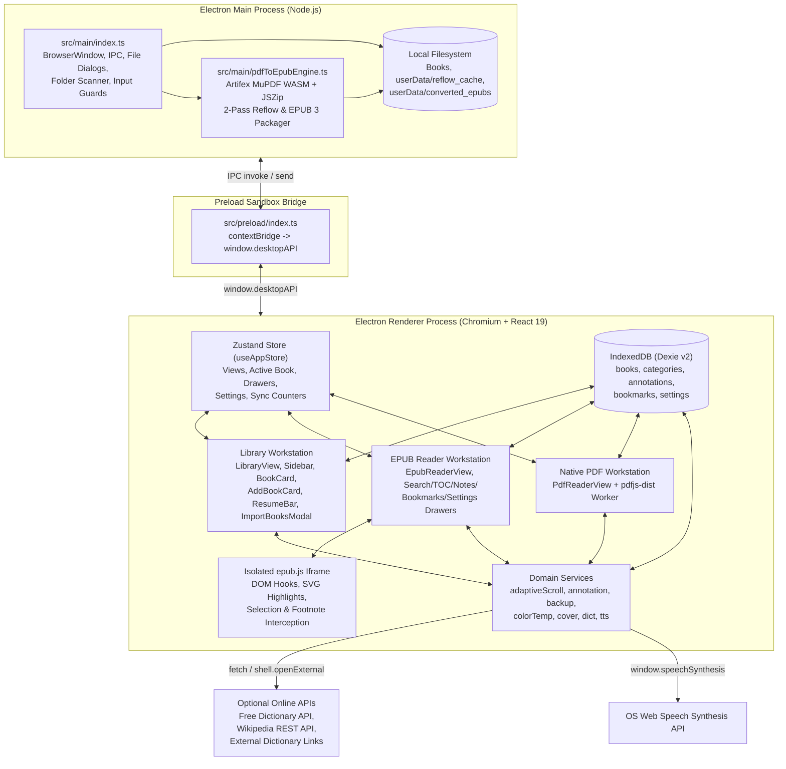
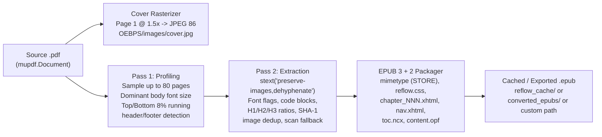
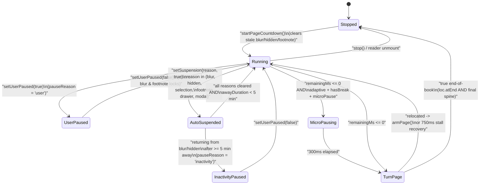

# Semply Ebook Reader (EPUB Reader Desktop) - Developer Reference & Architecture Documentation

> [!IMPORTANT]
> **Instructions for AI Agents Appending to this Document**
> Do NOT read the entire document before appending. Read only this header section (Rules, Template, and Example), then jump straight to the end of the file and append your entry as the next sequentially numbered `## Increment N: <Title>`.

### Appending Rules
1. **Audience**: Software engineers and future AI agents working on Electron, React, TypeScript, and CSS.
2. **Multi-Agent Coordination Protocol**: All agents across different conversations must consult the latest increments in this document before starting tasks to verify active locks, recent architectural invariants, and handoff directives.
3. **Depth & Precision**: Must cite exact file paths (`src/...`), component names, function signatures, data structures/schemas, state stores, and architectural trade-offs.
4. **Append-Only Sequence**: Check the last increment number at the end of the file, and title your section `## Increment N+1: <Descriptive Title>`.
5. **Mandatory Sections**: Every increment and issue handoff must include:
   - **Agent Handle & Status**: Header declaring `@<username> | Status: [IN PROGRESS / COMPLETED]`.
   - **Problem Statement**: Clear numbered list of root causes, bugs, or feature requirements addressed.
   - **Technical Fix**: Concrete breakdown of how each problem was solved with file citations and code mechanics.
   - **Touched Files**: Exact list of files created or modified.
   - **Verification Matrix**: Exact commands run and pass criteria (`npm run typecheck`, `npm run build`).
   - **Handoff Notes**: Critical invariants preserved and instructions for subsequent agents.

### Append Template
```markdown
---

## Increment <N>: <Feature / Fix Title>
> **Agent**: @<username> | **Status**: COMPLETED

### Problem Statement
1. **<Issue / Requirement Name>**: Detail the exact defect, race condition, state leak, or feature request. Cite files where the issue manifested.
2. **<Second Issue Name>**: Detail additional bugs or requirements.

### Technical Fix
1. **<Subsystem / Component Name>** (`path/to/File.tsx`): Describe the architectural resolution, exact state changes, and component lifecycle fixes.
2. **<Second Subsystem>** (`path/to/OtherFile.ts`): Describe further changes and cross-process telemetry synchronization.

### Touched Files
- `path/to/file1.ts`
- `path/to/file2.tsx`

### Verification Matrix
- `npm run typecheck`: Passed with 0 errors (`tsc --noEmit`).
- `npm run build`: Production bundle (`electron-vite build`) generated cleanly with zero warnings or errors.

### Handoff Notes
- Invariants preserved, potential side effects, or directives for the next agent.
```

### Example Entry
```markdown
---

## Increment 31: PDF Autoscroll Dwell Engine, Neo-Styled Zoom Presets & Dual-Page Hardening

### Problem Description
1. **Missing Text Layer on Right Page in Dual PDF View**: In `PdfReaderView.tsx`, `renderSingleCanvas` was invoked with `textLayerDiv = null` for `currentPage + 1`, and the secondary canvas lacked a corresponding DOM text layer container. Consequently, text selection, copying, highlights, and note creation were impossible on the right page in dual spread mode.

### Architectural Solution
1. **Dual-Page Text Layer Architecture** (`PdfReaderView.tsx`): Added `textLayerRightRef` alongside `canvasRightRef`. Both left and right canvases now mount absolute selectable text layers populated via `page.getTextContent()`, granting full annotation parity across dual pages.

### Verification Matrix
- `npm run typecheck`: Passed with 0 errors (`tsc --noEmit`).
- `npm run build`: Production bundle (`electron-vite build`) generated cleanly with zero warnings or errors.
```

---

## Table of Contents
1. [Product Overview & System Topology](#1-product-overview--system-topology)
2. [Technology Stack & Dependency Matrix](#2-technology-stack--dependency-matrix)
3. [Repository & Module Directory](#3-repository--module-directory)
4. [Electron Multi-Process Architecture & IPC Contract](#4-electron-multi-process-architecture--ipc-contract)
5. [Data Persistence & State Management](#5-data-persistence--state-management)
6. [Core Subsystems & Algorithmic Deep Dives](#6-core-subsystems--algorithmic-deep-dives)
   - [6.1 EPUB Rendering, Global Pagination & Iframe Bridging](#61-epub-rendering-global-pagination--iframe-bridging)
   - [6.2 Native PDF Reader (`PdfReaderView`)](#62-native-pdf-reader-pdfreaderview)
   - [6.3 Offline MuPDF WASM PDF-to-EPUB & Reflow Engine](#63-offline-mupdf-wasm-pdf-to-epub--reflow-engine)
   - [6.4 Dual-Mode Auto-Scroll Countdown Engine](#64-dual-mode-auto-scroll-countdown-engine)
   - [6.5 Annotations, Highlights & Bookmarks Engine](#65-annotations-highlights--bookmarks-engine)
   - [6.6 Full-Book Spine Search (`SearchDrawer`)](#66-full-book-spine-search-searchdrawer)
   - [6.7 Universal Cover, First-Page & Metadata Extraction Pipeline](#67-universal-cover-first-page--metadata-extraction-pipeline)
   - [6.8 Read Aloud (TTS), Contextual Dictionary, Footnotes & Warm Night Filter](#68-read-aloud-tts-contextual-dictionary-footnotes--warm-night-filter)
   - [6.9 Universal Additive Backup & Sync Engine](#69-universal-additive-backup--sync-engine)
7. [UI Architecture, Component Inventory & Design System](#7-ui-architecture-component-inventory--design-system)
8. [Keyboard Shortcuts, Mouse & Context Menu Matrix](#8-keyboard-shortcuts-mouse--context-menu-matrix)
9. [Build, Packaging, Release & CI/CD Pipeline](#9-build-packaging-release--cicd-pipeline)
10. [Architectural Invariants, Edge Cases & Maintainer Notes](#10-architectural-invariants-edge-cases--maintainer-notes)
11. [Increments & Revision Log](#11-increments--revision-log)

---

## 1. Product Overview & System Topology

**Semply Ebook Reader** (`semply-ebook-reader`, App ID `com.ederaefe.semple-ebook-reader`) is a cross-platform desktop ebook and document reader built on Electron, React 19, TypeScript, Tailwind CSS, `epub.js`, `pdfjs-dist`, and Artifex's official `mupdf` WebAssembly engine.

### Core Product Capabilities
- **Multi-Format Library Management**: Supports `.epub`, `.pdf`, `.mobi`, and `.txt` imports via file picker, recursive directory scan, or drag-and-drop; Grid and List views; 5-column sortable catalog (`Title`, `Author`, `Date`, `Notes`, `Progress`); custom color-coded categories/shelves; bulk library-to-category assignment; soft-delete Trash & Restore; and a bottom Quick-Resume bar.
- **Dual Reading Engines**:
  - **Reflowable EPUB Engine (`EpubReaderView`)**: Paginated single-page and dual-page spreads via `epub.js`, Librera CSS typography normalization, 4 reading themes, global CFI pagination, cross-document footnote popovers, full-book spine search, dual-anchor highlights/notes, Read Aloud TTS, and Dual-Mode Auto-Scroll.
  - **Native PDF Engine (`PdfReaderView`) + Offline MuPDF Reflow**: HiDPI canvas rendering with aligned selectable text overlays, single/double spread, 50%–300% zoom, PDF outline TOC, CSS theme adaptation, and one-click offline conversion to cached reflowable EPUB via MuPDF WASM (`pdfToEpubEngine.ts`) to unlock every EPUB reading tool.
- **Zero-Paywall Desktop Ergonomics**: Frameless native window chrome styled in the **Vercel Geist Obsidian** monochrome design system, true text-only Immersive Fullscreen (`F11`), dual-layer context menus, accidental `Ctrl` reload/zoom neutralization, and zero licensing or upgrade nags.
- **Zero-Native-Dependency Local Storage**: All library metadata, custom shelves, annotations, bookmarks, and preferences live locally in IndexedDB via Dexie.js (`EpubReaderDesktopDB`), backed by non-destructive additive JSON/ZIP export and import.

### High-Level Process & Data Flow Topology



---

## 2. Technology Stack & Dependency Matrix

| Package | Version (`package.json`) | Layer | Architectural Responsibility |
| --- | --- | --- | --- |
| `electron` | `^34.3.0` | Main / Preload / Runtime | Cross-platform desktop shell, frameless window lifecycle, native dialogs, OS menus, IPC |
| `electron-vite` | `^3.0.0` | Build | Unified 3-target Vite bundler for Main, Preload, and Renderer |
| `electron-builder` | `^25.1.8` | Packaging | Cross-platform installer packaging (Windows NSIS x64, macOS DMG/ZIP, Linux AppImage/DEB) |
| `react` / `react-dom` | `^19.0.0` | Renderer | Component UI runtime |
| `typescript` | `^5.8.2` | All | Static type checking (`npm run typecheck` -> `tsc --noEmit`) |
| `tailwindcss` | `^3.4.17` | Renderer | Utility-first layout styling paired with Geist Obsidian CSS tokens (`index.css`) |
| `zustand` | `^5.0.3` | Renderer | Lightweight global state management (`useAppStore.ts`) |
| `dexie` | `^4.0.10` | Renderer | IndexedDB wrapper (`EpubReaderDesktopDB`, schema v2) with zero native C++ bindings |
| `epubjs` | `^0.3.93` | Renderer | EPUB 2/3 archive parsing, paginated iframe rendition, CFI generation, spine search, SVG annotations |
| `pdfjs-dist` | `^4.4.168` | Renderer | Native PDF canvas rendering, selectable text layer, PDF outline, Page 1 cover/metadata extraction via offline bundled `pdf.worker.min.mjs` |
| `mupdf` | `^1.28.6` | Main | Artifex official MuPDF WebAssembly library powering offline 2-pass structured PDF-to-EPUB reflow |
| `jszip` | `^3.10.1` | Main & Renderer | EPUB ZIP inspection (cover/OPF extraction), EPUB 3 archive generation, and ZIP library backup bundles |
| `lucide-react` | `^1.16.0` | Renderer | Crisp 14px–16px stroke vector iconography across toolbars, drawers, menus, and modals |

---

## 3. Repository & Module Directory

```text
EPUB READER DESKTOP/
├── .github/workflows/
│   └── release.yml                     # 3-OS (Windows/macOS/Linux) GitHub Actions build & package workflow
├── build/
│   ├── icon.ico                        # Multi-resolution Windows installer icon (16px–256px)
│   └── icon.png                        # 512x512 RGBA squircle icon for macOS & Linux packaging
├── resources/
│   ├── icon.ico                        # Runtime taskbar/window icon bundled via extraResources (win32)
│   └── icon.png                        # Runtime window icon bundled via extraResources (mac/linux)
├── electron.vite.config.ts             # 3-target electron-vite config (main, preload, renderer; @ alias; **/*.epub asset)
├── electron-builder.config.ts          # Packaging manifest (appId, NSIS, DMG/ZIP, AppImage/DEB, extraResources)
├── tailwind.config.ts                  # Tailwind theme extensions and legacy color palette bindings
├── package.json                        # Scripts (dev, build, typecheck, package, release) and dependencies
├── DESIGN.md                           # Design System Lock specification
├── README.md                           # Repository overview and quick-start links
├── dev-documentations.md               # Internal developer reference and append-only revision log
├── documentations/                     # Front-facing user documentation website (static HTML5 + AI llms.txt)
│   ├── index.html                      # Semantic HTML5 user manual with JSON-LD, live theme preview & Auto-Scroll lab
│   ├── styles.css                      # Mobile-first Semply 4-theme (Obsidian/Light/Paper/Dusk) stylesheet
│   ├── app.js                          # Progressive enhancement: Ctrl+K search, theme switcher, pace calculator, scroll-spy
│   ├── llms.txt                        # llmstxt.org AI discovery index
│   ├── llms-full.txt                   # Complete single-file Markdown user guide for AI ingestion
│   ├── robots.txt                      # Open crawler directive referencing sitemap.xml and llms.txt
│   ├── sitemap.xml                     # XML sitemap for search engine indexing
│   └── assets/                         # Self-contained semply-logo.png and favicon.ico for standalone hosting
└── src/
    ├── types.d.ts                      # Asset module declarations (*.epub, *.epub?url, *.jpg, *.png, *.svg)
    ├── main/
    │   ├── index.ts                    # Electron main entry: window, security guards, native edit menu, IPC handlers
    │   └── pdfToEpubEngine.ts          # Offline 2-pass MuPDF WASM PDF-to-EPUB reflow & EPUB 3/2 packager
    ├── preload/
    │   └── index.ts                    # Typed DesktopAPI bridge exposed on window.desktopAPI
    └── renderer/
        ├── index.html                  # Renderer HTML shell
        ├── favicon.ico / favicon.png   # Renderer favicons
        └── src/
            ├── main.tsx                # React 19 root mount
            ├── App.tsx                 # Top-level view router, starter seeding, global hotkeys, PDF reflow orchestration
            ├── index.css               # Vercel Geist Obsidian tokens, custom sliders/checkboxes, GPU ui-enter animations
            ├── db/
            │   └── index.ts            # Dexie ReaderDatabase (EpubReaderDesktopDB v1 -> v2) & TypeScript interfaces
            ├── stores/
            │   └── useAppStore.ts      # Zustand AppState, DEFAULT_SETTINGS, localStorage/Dexie helpers, mutual drawer locks
            ├── services/
            │   ├── adaptiveScrollService.ts  # Dual-mode monotonic Auto-Scroll engine + suspension state machine
            │   ├── annotationService.ts      # Theme-aware SVG highlights, IceRange XPath, bookmark excerpts, HTML/MD/TXT export
            │   ├── backupService.ts          # JSON & ZIP universal export + 4-phase non-destructive additive import
            │   ├── colorTempService.ts       # Tanner Helland Kelvin (2000K–4500K) to warm amber overlay calculator
            │   ├── coverService.ts           # Universal EPUB/PDF/MOBI/TXT cover, first-page canvas & metadata extractor
            │   ├── dictService.ts            # 9 Librera web dictionaries + Free Dictionary API + Wikipedia REST API
            │   └── ttsService.ts             # Web Speech Synthesis wrapper + Librera pronunciation normalization regex matrix
            ├── components/
            │   ├── ui/
            │   │   ├── TitleBar.tsx          # 32px frameless titlebar (Semply brand, live book/chapter title, focus dimming, Restore/Maximize state)
            │   │   ├── NativeFeedbackHost.tsx# In-app Geist contextual toast queue & accessible keyboard-driven Confirm dialog (zero alert/confirm)
            │   │   ├── ContextMenu.tsx       # Viewport-clamped desktop context menu with inline highlight swatch row
            │   │   ├── HelpModal.tsx         # Hotkeys & Navigation modal (F1)
            │   │   ├── SecondsNumberInput.tsx# Direct numeric seconds input (3–600s) with +/- steppers & arrow stepping
            │   │   ├── ThemePickerGrid.tsx   # Curved live-preview reading theme radiogroup cards
            │   │   └── AppBackground.tsx     # Solid fallback background layer
            │   ├── library/
            │   │   ├── LibraryView.tsx       # Catalog header, search, 5-column sort, drag-and-drop import, auto-cleanse
            │   │   ├── Sidebar.tsx           # Shelves (All, Recent, Favorites, Formats, Read, Deleted) & custom category creator
            │   │   ├── BookCard.tsx          # Grid card & List row with progress overlay, category menu, context actions
            │   │   ├── AddBookCard.tsx       # First-slot book-proportioned dashed "+" import card (Grid & List)
            │   │   └── ResumeBar.tsx         # Bottom Quick-Resume bar showing last opened book and page ratio
            │   ├── reader/
            │   │   ├── EpubReaderView.tsx    # Core epub.js rendition host, pagination, search, footnotes, annotations, auto-scroll
            │   │   ├── PdfReaderView.tsx     # Native pdfjs-dist HiDPI viewer with text overlay, zoom, spread & reflow trigger
            │   │   ├── ReaderTopBar.tsx      # Minimalist 40px reader toolbar (Library, Contents, Notes, Bookmarks, Find, FS, Settings)
            │   │   ├── SelectionPopup.tsx    # Clamped floating selection toolbar + inline Note, Dictionary & Wikipedia modals
            │   │   ├── AnnotationPopover.tsx # On-click highlight editor (recolor, inline comment, copy, TTS, delete)
            │   │   ├── FootnotePopover.tsx   # Non-destructive bottom-centered footnote preview card
            │   │   └── AdaptiveScrollOverlay.tsx # Fullscreen-persistent bottom-right numeric countdown + tap-to-open settings popover
            │   ├── drawers/
            │   │   ├── TOCDrawer.tsx         # Left-docked Table of Contents with page indicators
            │   │   ├── NotesDrawer.tsx       # Left-docked Notes & Highlights manager (filter, sort, chapter group, export, edit)
            │   │   ├── BookmarksDrawer.tsx   # Left-docked Bookmarks manager (auto-excerpts, inline rename, search, sort)
            │   │   ├── SearchDrawer.tsx      # Left-docked Full-Book Find panel (250ms debounce, amber excerpts, Enter stepping)
            │   │   └── SettingsDrawer.tsx    # Floating 3-tab Geist Reader Settings command center (Display, Flow, PDF/More)
            │   └── modals/
            │       ├── FullSettingsModal.tsx # Fixed 780x580 6-tab Preferences modal (System, Reading, TTS, Hotkeys, Backup, About)
            │       └── ImportBooksModal.tsx  # Unified Add Book / Add Folder / Bulk Add from Main Library into custom category modal
            └── assets/
                ├── app-Librera.css           # Extracted Librera EPUB typography normalization stylesheet
                ├── app-Librera-Tables.css    # Extracted Librera table formatting rules
                ├── app-WebDict.json          # Extracted Librera web dictionary provider definitions
                ├── app-WebSearch.json        # Extracted Librera web search definitions
                ├── dict/TTS_Librera_Rules.txt# Reference pronunciation normalization matrix
                ├── books/                    # Starter EPUBs (the_fifth_season.epub, alicesadventures.epub, mobydick.epub)
                ├── covers/                   # Starter cover art (the_fifth_season.jpg)
                └── icons/                    # Semply brand icons (semply_logo.{ico,png}) & reference SVGs
```

---

## 4. Electron Multi-Process Architecture & IPC Contract

### Window Lifecycle & Security Posture (`src/main/index.ts`)
- **Window Configuration & Bounds Persistence**: Frameless (`frame: false`), default dimensions `1280 × 820`, minimum `960 × 600`, `show: false` (revealed on `ready-to-show` to eliminate white flash), `autoHideMenuBar: true`. Persists `{ x, y, width, height, isMaximized }` in `userData/window-state.json`, validating saved coordinates against currently attached displays so windows never reopen off-screen.
- **Single-Instance & OS File Association**: Uses `app.requestSingleInstanceLock()`, `second-instance`, macOS `open-file`, and `process.argv` inspection so double-clicking `.epub` / `.pdf` files in OS File Explorer focuses the running instance and imports/opens them directly via `app:openExternalFile`.
- **Platform Icon, Dynamic Title & Taskbar Identity**:
  - Calls `app.setAppUserModelId('com.ederaefe.semple-ebook-reader')` on Windows (`win32`) so taskbar pinning and notifications bind to Semply instead of default Electron.
  - `resolveAppIconPath()` checks `process.resourcesPath`, `app.getAppPath()/resources`, `__dirname/../../resources`, and `app.getAppPath()/build` for `icon.ico` (Windows) or `icon.png` (macOS/Linux).
  - Syncs native OS window/Alt+Tab title via `window:setTitle` (`"Book Title — Chapter — Semply"`) and native window background via `window:setBackgroundColor` on theme switch.
- **Security & Native Desktop Hardening**:
  - `contextIsolation: true`, `nodeIntegration: false`, `webSecurity: true`, `sandbox: false` (preload uses Node `electron` modules safely behind `contextBridge`).
  - `setWindowOpenHandler` denies all in-app popups (`{ action: 'deny' }`) and forwards URLs to `shell.openExternal(details.url)`.
  - Blocks `will-navigate` so accidental file drops never replace the React app with raw browser views.
  - `Menu.setApplicationMenu(null)` strips Electron's default reload/close accelerators; `webContents.setVisualZoomLevelLimits(1, 1)` locks UI chrome at 100% scale.
  - `before-input-event` blocks `F5`, `Ctrl+R`, `Ctrl+W`, `Alt+Left`/`Alt+Right`, and bare `Control`, while routing `Ctrl+`/`Ctrl-`/`Ctrl+0` via `window:contentZoom` strictly to **content-only zoom** (EPUB font size or PDF zoom) without scaling desktop chrome.
- **Dual-Layer Context Menu Strategy**:
  - **Editable Inputs**: `webContents.on('context-menu')` inspects `params.isEditable` and pops a native Electron `Menu` (`undo`, `redo`, `cut`, `copy`, `paste`, `selectAll`) bound to live `params.editFlags`.
  - **Application Surfaces**: EPUB iframe, PDF viewport, and Library `BookCard` suppress default browser menus and open the custom viewport-clamped React `<ContextMenu>`.

### Complete IPC Channel Contract (`src/main/index.ts` <-> `src/preload/index.ts`)

#### Request / Response Channels (`ipcMain.handle` -> `ipcRenderer.invoke`)

| IPC Channel | `window.desktopAPI` Method | Arguments | Return Type | Purpose |
| --- | --- | --- | --- | --- |
| `window:minimize` | `minimize()` | none | `Promise<void>` | Minimizes frameless window |
| `window:maximize` | `maximize()` | none | `Promise<void>` | Toggles maximized / unmaximized state |
| `window:close` | `close()` | none | `Promise<void>` | Closes application window |
| `window:isMaximized` | `isMaximized()` | none | `Promise<boolean>` | Queries current maximize state |
| `window:toggleFullscreen` | `toggleFullscreen()` | none | `Promise<boolean>` | Toggles OS fullscreen; returns resulting boolean |
| `window:setFullscreen` | `setFullscreen(active)` | `active: boolean` | `Promise<void>` | Explicitly enters/exits OS fullscreen (Immersive Mode) |
| `window:setBackgroundColor` | `setBackgroundColor(color)` | `color: string` | `Promise<void>` | Updates native BrowserWindow background hex to match active reading theme |
| `window:setTitle` | `setWindowTitle(title)` | `title: string` | `Promise<void>` | Updates OS taskbar and Alt+Tab window title |
| `shell:showItemInFolder` | `showItemInFolder(filePath)` | `filePath: string` | `Promise<boolean>` | Reveals a book's source file in OS File Explorer / Finder |
| `window:setZoomFactor` | `setZoomFactor(factor)` | `factor: number` | `void` (invokes + `webFrame`) | Programmatic zoom factor setter (retained for bridge compatibility) |
| `window:getZoomFactor` | `getZoomFactor()` | none | `number` (`webFrame`) | Reads current zoom factor (default `1.0`) |
| `dialog:openFiles` | `openFiles()` | none | `Promise<string[]>` | Multi-select native file picker filtered for `epub`, `pdf`, `mobi`, `txt` |
| `dialog:openFolder` | `openFolder()` | none | `Promise<string \| null>` | Native directory picker for recursive import |
| `dialog:showSaveDialog` | `showSaveDialog(options)` | `{ title?, defaultPath?, filters? }` | `Promise<string \| null>` | Native Save-As dialog (JSON/ZIP backup, Note exports, PDF-to-EPUB export) |
| `dialog:showOpenDialog` | `showOpenDialog(options)` | `{ title?, filters? }` | `Promise<string \| null>` | Native single-file open dialog (backup import) |
| `fs:scanFolder` | `scanFolder(folderPath)` | `folderPath: string` | `Promise<string[]>` | Recursive directory walk collecting `.epub`, `.pdf`, `.mobi`, `.txt` paths |
| `fs:readFileBuffer` | `readFileBuffer(filePath)` | `filePath: string` | `Promise<ArrayBuffer>` | Reads binary file and returns cleanly sliced `ArrayBuffer` |
| `fs:readFileText` | `readFileText(filePath)` | `filePath: string` | `Promise<string>` | Reads UTF-8 text file |
| `fs:writeFileText` | `writeFileText(filePath, content)` | `filePath: string, content: string` | `Promise<boolean>` | Writes UTF-8 text file |
| `fs:writeFileBuffer` | `writeFileBuffer(filePath, buffer)` | `filePath: string, buffer: ArrayBuffer` | `Promise<boolean>` | Writes raw binary buffer (ZIP archives) |
| `pdf:convertToEpub` | `convertToEpub(input)` | `string \| { pdfPath, outputPath?, mode?: 'reflow-cache' \| 'library' \| 'export' }` | `Promise<PdfConvertResult>` | Runs offline MuPDF WASM conversion; caches `reflow-cache` outputs by SHA-1 hash |

#### Main-to-Renderer Push Event Channels (`webContents.send` -> `ipcRenderer.on`)

| Push Channel | `window.desktopAPI` Subscriber | Payload | Purpose |
| --- | --- | --- | --- |
| `window:fullscreenChanged` | `onFullscreenChange(cb)` | `isFullscreen: boolean` | Syncs OS fullscreen transitions (`enter-full-screen` / `leave-full-screen`) with `useAppStore.isImmersiveFullscreen` |
| `window:maximizedChanged` | `onWindowMaximizedChange(cb)` | `isMaximized: boolean` | Syncs Maximize vs Restore Down icon in `TitleBar.tsx` |
| `window:focusChanged` | `onWindowFocusChange(cb)` | `isFocused: boolean` | Dims unfocused titlebar chrome like native Windows 11 / macOS windows |
| `window:contentZoom` | `onContentZoom(cb)` | `'in' \| 'out' \| 'reset'` | Routes `Ctrl+`/`Ctrl-`/`Ctrl+0` strictly to EPUB font size or PDF zoom |
| `app:openExternalFile` | `onOpenExternalFile(cb)` | `filePath: string` | Imports and opens files double-clicked in OS File Explorer / Finder |
| `pdf:convertProgress` | `onPdfConvertProgress(cb)` | `{ currentPage, totalPages, stage, percent }` | Streams real-time MuPDF reflow/export progress to `SettingsDrawer` and `PdfReaderView` progress overlays |

---

## 5. Data Persistence & State Management

### 5.1 IndexedDB Schema (`src/renderer/src/db/index.ts`)
Database name: **`EpubReaderDesktopDB`** (Dexie v4).

#### Schema Migration History
- **Version 1**: Initial 5 tables (`books`, `categories`, `annotations`, `bookmarks`, `settings`).
- **Version 2 (Current)**: Added secondary indexes on `annotations` (`color`, `pageNumber`, `createdAt`) and `bookmarks` (`cfi`, `pageNumber`, `createdAt`) to support fast filtering, sorting, duplicate detection, and Icecream-faithful dual-anchor notes/bookmarks.

#### Table & Column Reference

| Table | Indexed Schema (v2) | Complete Record Fields |
| --- | --- | --- |
| `books` | `++id, filePath, format, categoryId, isFavorite, isRead, isDeleted, lastOpenedAt` | `id?`, `filePath` (string), `title`, `author`, `coverDataUrl` (`string \| null`), `format` (`'epub' \| 'pdf' \| 'mobi' \| 'txt'`), `fileSize` (bytes), `addedAt` (epoch ms), `lastOpenedAt` (`number \| null`), `progressCfi` (`string \| null`), `progressPercent` (0–100), `currentPage`, `totalPages`, `categoryId` (`number \| null`), `isFavorite`, `isRead`, `isDeleted`, `notesCount?` |
| `categories` | `++id, name` | `id?`, `name`, `color` (hex string, e.g. `#2a69df`), `createdAt` (epoch ms) |
| `annotations` | `++id, bookId, cfiRange, color, pageNumber, createdAt` | `id?`, `bookId`, `cfiRange`, `text`, `note`, `color` (`'blue' \| 'purple' \| 'red' \| 'yellow' \| 'green' \| 'underline'`), `pageNumber?`, `chapterTitle?`, `href?`, `iceRange?: { startXPath, startOffset, endXPath, endOffset, href? }`, `createdAt`, `updatedAt?` |
| `bookmarks` | `++id, bookId, cfi, pageNumber, createdAt` | `id?`, `bookId`, `cfi`, `label`, `excerpt?`, `chapterTitle?`, `href?`, `xpath?`, `pageNumber`, `progressPercent?`, `createdAt` |
| `settings` | `++id` | `id?` (`1`), `theme` (`'night' \| 'day' \| 'light-sepia' \| 'dark-sepia'`), `fontFamily` (`'original' \| 'serif' \| 'sans-serif' \| 'monospace'`), `fontSize` (default `21`), `lineHeight` (`1.5`), `marginWidth` (`40`), `dimming` (`0`), `pageSpread` (`'double' \| 'single'`), `ttsSpeed` (`1.0`), `ttsPitch` (`1.0`), `ttsVoice` (`string \| null`), `autoscrollSpeed` (`40`), `autoscrollMode` (`'adaptive' \| 'countdown'`), `autoscrollCountdownSec` (`20`), `autoscrollAdaptiveSec` (`25`), `autoscrollMicroPause` (`true`), `autoscrollAdaptive` (`true`), `targetWpm` (`250`), `observedWpm` (`250`), `warmFilterEnabled` (`false`), `warmFilterTemp` (`3200`), `warmFilterIntensity` (`40`), `language` (`'en'`), `copyExternal` (`false`), `autoUpdate` (`true`), `sendStats` (`false`), `viewMode` (`'grid' \| 'list'`), `lastNoteColor` (`'yellow'`) |

### 5.2 Zustand Global Store (`src/renderer/src/stores/useAppStore.ts`)
Central reactive state container split into six functional slices:

1. **Navigation & Catalog**: `currentView` (`'library' | 'reader'`), `selectedCategory` (`'all' | 'recent' | 'favorites' | 'read' | 'deleted' | '<categoryId>'`), `searchQuery`, `formatFilter` (`'epub' | 'pdf' | null`), `viewMode` (`'grid' | 'list'`, persisted immediately via `persistSettings`).
2. **Active Book & PDF Reflow**: `activeBook`, `activeBookBuffer` (in-memory `ArrayBuffer`), `currentChapterTitle` (rendered in `TitleBar`), `pdfViewMode` (`'original' | 'reflow'`), `reflowEpubBuffer` (cached buffer of the converted EPUB), `isConvertingPdf`, `pdfConvertProgress`. Switching books via `setActiveBook()` automatically resets `pdfViewMode` to `'original'` and clears `reflowEpubBuffer`.
3. **Drawers & Modals (Mutual Exclusion Invariant)**: `isTOCDrawerOpen`, `isNotesDrawerOpen`, `isBookmarksDrawerOpen`, `isSearchDrawerOpen`, `isSettingsDrawerOpen`, `isFullSettingsModalOpen`, `isHelpModalOpen`, `activeFootnote`. Toggling any of the five drawers automatically closes the other four; opening `FullSettingsModal` closes `SettingsDrawer`; entering `isImmersiveFullscreen` closes all five drawers.
4. **Live Reading Tools**: `isTTSActive`, `isTTSMuted`, `activeTTSWord`, `isAutoscrollActive`, `adaptiveWpm`, `isImmersiveFullscreen`.
5. **Cross-Component Sync Counters & Native Feedback**: `annotationsVersion`, `bookmarksVersion`, `libraryVersion` (monotonically incremented via `bump*Version()` so drawers, readers, and library stay synchronized with IndexedDB mutations), `pdfZoom` (`setPdfZoom`, clamped `0.5–3.0`), `lastNoteColor`, and native in-app feedback (`toast`, `showToast(message, variant)`, `clearToast`, `confirmDialog`, `openConfirmDialog`, `closeConfirmDialog`).
6. **Settings & Theme Synchronization**: Synchronous boot hydration from `localStorage` (`semply_user_settings_v1`) via `loadSyncSettings()` applying `document.documentElement.dataset.theme`, `colorScheme`, and native `window:setBackgroundColor` before first paint (`applyDocumentTheme`). Every `updateSettings()`, `setViewMode()`, and `setLastNoteColor()` call synchronizes `autoscrollMode` / `autoscrollAdaptive`, calls `applyDocumentTheme()` on theme change, and persists immediately to both `localStorage` and Dexie `db.settings` (`id = 1`). `hydrateSettingsFromDb()` restores from Dexie if `localStorage` is empty and ensures Dexie mirrors active settings on startup.

### 5.3 Startup Seeding & Library Auto-Cleansing
- **Starter Library (`App.tsx`)**: On first boot (`db.books.count() === 0`), pre-seeds *The Fifth Season* by N. K. Jemisin using bundled `the_fifth_season.epub` and `the_fifth_season.jpg` (`p.13 / 416`, `3%`).
- **Auto-Cleansing (`LibraryView.tsx` `loadData()`)**: Recomputes live `notesCount` per book from `db.annotations`, strips download-site filename prefixes (`d-pdf.com - `, `oceanofpdf.com_`, `[z-lib.org]`, `z-lib.org_`) and extracts `Title by Author` / `Author - Title` patterns, and resets unread books falsely carrying `progressPercent === 3` with no `progressCfi` or `lastOpenedAt` back to `0%` / page `1`.

---

## 6. Core Subsystems & Algorithmic Deep Dives

### 6.1 EPUB Rendering, Global Pagination & Iframe Bridging
**Owner**: `src/renderer/src/components/reader/EpubReaderView.tsx`

- **Book Source Resolution**: Reads `reflowEpubBuffer` (when in PDF Reflow mode), else `activeBookBuffer`, else `window.desktopAPI.readFileBuffer(book.filePath)`, else HTTP `fetch()` for bundled Vite asset URLs.
- **Rendition Setup**: Opens `ePub(source)` and renders into `viewerRef` with `width: '100%'`, `height: '100%'`, `spread: settings.pageSpread === 'double' ? 'auto' : 'none'`. Registers 4 themes (`day`, `night`, `light-sepia`, `dark-sepia`) and dynamically injects `app-Librera.css` typography normalization into each iframe document head.
- **3-Tier Global Page & Progress Resolution** (prevents chapter-local `displayed.page` freeze):
  1. **Tier 1 (Generated Locations)**: Background `epubInstance.locations.generate(1000)` builds 1,000-character location checkpoints across the entire spine. Once ready, `locations.locationFromCfi(cfi)` and `locations.percentageFromCfi(cfi)` yield global page numbers and `0–100%` progress, immediately recalibrating the UI.
  2. **Tier 2 (Embedded Location)**: Falls back to `location.start.location` and `location.start.percentage` if present.
  3. **Tier 3 (Proportional Spine Fallback)**: Before background locations finish generating, estimates continuous book-wide progression from spine index $s$, total spine items $S$, chapter-local page $p_{\text{sec}}$, and chapter total pages $P_{\text{sec}}$:
     $$\text{progressRatio} = \frac{s + \frac{p_{\text{sec}} - 1}{P_{\text{sec}}}}{\max(1, S)}, \quad \text{page} = \text{clamp}\!\left(\text{round}(\text{progressRatio} \times P_{\text{total}}),\, 1,\, P_{\text{total}}\right)$$
- **Iframe Event & Coordinate Bridging (`attachIframeHooks`)**: Because `epub.js` isolates book XHTML inside an `<iframe>`, `rendition.hooks.content.register` attaches listeners directly to `contents.document` and `contents.window`:
  - Projects iframe selection and right-click coordinates into host-window viewport coordinates via `(contents.window.frameElement).getBoundingClientRect()`.
  - Routes `contextmenu` through a stable `openContextMenuRef` so fresh React state renders without re-initializing the `epub.js` rendition.
  - Bridges keyboard navigation (`ArrowUp`/`Down`/`Left`/`Right`, `PageUp`/`Down`, `Space`, `Backspace`, `Home`, `F11`, `Escape`, `Ctrl+F`, `Ctrl+B`), wheel page turns (220ms debounce when Auto-Scroll is off; behavioral speed nudges when Smart Auto-Scroll is on), footnote clicks/hovers, and throttled 1Hz user-activity heartbeats.
- **Dual-State Progress Footer**: Displays 5 subtle dots at rest (`•••••`), expanding smoothly on hover into `currentPage / totalPages` (`tabular-nums`) and an interactive full-width range scrubber (with debounced `locations.cfiFromPercentage` jump).

### 6.2 Native PDF Reader (`PdfReaderView`)
**Owner**: `src/renderer/src/components/reader/PdfReaderView.tsx`

- **Offline Worker**: Configures `pdfjsLib.GlobalWorkerOptions.workerSrc = new URL('pdfjs-dist/build/pdf.worker.min.mjs', import.meta.url).toString()` — zero CDN requests.
- **Detached-Buffer Protection**: Always copies `activeBookBuffer` via `new Uint8Array(activeBookBuffer.slice(0))` before calling `pdfjsLib.getDocument({ data })` so transferring bytes to the PDF.js Web Worker never detaches the buffer stored in Zustand.
- **HiDPI Canvas & Selectable Text Layer**:
  - Caps pixel ratio at `dpr = Math.min(window.devicePixelRatio || 1, 2)` for crisp text without excessive VRAM allocation.
  - Supports Single (`step = 1`) and Double (`step = 2`) page spreads, cancelling in-flight `renderTask` instances cleanly to avoid overlapping draws.
  - Builds a lightweight aligned transparent `<span>` text overlay using `pdfjsLib.Util.transform(viewport.transform, item.transform)` for native text selection and clipboard copy.
- **Theme Adaptation Filters**: Applies calibrated CSS filter matrices directly to rendered PDF canvases so light-background PDFs remain comfortable across all 4 reading themes:
  - `day`: `none` (canvas well `#e9ecf0`)
  - `night`: `invert(0.88) hue-rotate(180deg) contrast(0.95)` (canvas well `#171a21`)
  - `light-sepia`: `sepia(0.28) brightness(0.98)` (canvas well `#f4e6cb`)
  - `dark-sepia`: `invert(0.86) sepia(0.35) hue-rotate(180deg) contrast(0.92)` (canvas well `#241e18`)
- **PDF Outline, Bookmarks & Smart Vertical Navigation**: Resolves native PDF bookmarks (`loadedDoc.getOutline()` -> `getDestination` -> `getPageIndex`) into `TOCDrawer`; supports `Ctrl+B` / drawer bookmarks persisted by page number; uses `ArrowUp`/`ArrowDown` for smooth `160px` vertical scrolling that seamlessly flips to the previous/next page when hitting the top or bottom scroll edge.

### 6.3 Offline MuPDF WASM PDF-to-EPUB & Reflow Engine
**Owner**: `src/main/pdfToEpubEngine.ts` (invoked via `pdf:convertToEpub` IPC in `src/main/index.ts`)

Runs 100% offline inside Electron's Node main process using Artifex's `mupdf` WASM package (the same C `fz_stext` layout engine behind Librera Reader's `libMuPDF.so`).



- **Conversion Modes & Caching (`src/main/index.ts`)**:
  - `'reflow-cache'`: Hashes `pdfPath` (`SHA-1`, first 12 hex chars) and writes `userData/reflow_cache/<name>_<hash>-reflow.epub`. Subsequent toggles to Reflow Mode detect the cached file and load instantaneously (100% progress).
  - `'library'`: Writes `userData/converted_epubs/<name>.epub` and imports the resulting EPUB into Dexie as a first-class library item (triggered from PDF `BookCard` right-click menu).
  - `'export'`: Writes to a user-selected `outputPath` chosen via native Save dialog.
- **Pass 1 — Typographic Profiling & Header/Footer Suppression**:
  - Samples every page (or strided to ~80 pages for documents > 120 pages) using `page.toStructuredText('dehyphenate')`.
  - Computes dominant `bodyFontSize` (rounded to 0.5pt increments, filtered to `6pt–48pt`).
  - Tracks normalized text lines (digits replaced by `#`, length <= 90 chars) appearing inside the top 8% (`topCutoff`) or bottom 8% (`bottomCutoff`) vertical bands. Any pattern appearing on $\ge \max(3, \lfloor 0.35 \times N_{\text{sampled}} \rfloor)$ pages — or standalone numeric page folios (`^\d{1,4}$`) — is suppressed during Pass 2.
- **Pass 2 — Structured Text, Semantic Classification & Image Extraction**:
  - Uses `page.toStructuredText('preserve-images,dehyphenate')`. **Critical invariant**: the MuPDF `segment` flag is intentionally omitted because `mupdf` v1.x WASM suppresses `stext.walk()` callbacks when `segment` is combined with `preserve-images,dehyphenate`.
  - **Chapter Splitting**: Splits into `chapter_NNN.xhtml` files using native PDF bookmarks (`doc.loadOutline()`, recursively flattened); if <= 1 outline entries exist, falls back to 15 pages per section. Injects `<span class="page-anchor" id="pdf-page-N"></span>` at each PDF page boundary.
  - **Semantic Block Classification**:
    - Monospace ratio > 75% -> `<pre><code>`
    - Short candidate (< 180 chars, <= 3 lines): `ratio = avgSize / max(8, bodyFontSize)`: `>= 1.5` -> `<h1>`, `>= 1.24` -> `<h2>`, `>= 1.1` or (> 85% bold and < 90 chars) -> `<h3>`
    - All other text blocks -> `<p>` with inline `<strong>`, `<em>`, `<strong><em>` spans and cross-line trailing-hyphen rejoin (`/[a-z]/`).
  - **Embedded Image Deduplication**: Skips tiny spacer images (`< 24px` wide or tall); encodes opaque images > 160,000 px as JPEG 86 and alpha/smaller graphics as PNG; deduplicates identical assets across pages via 14-char SHA-1 digest.
  - **Scanned / Diagram Page Fallback**: Pages with `< 25` text characters and `0` extracted image blocks are rasterized whole at `1.8×` scale (`DeviceRGB`, JPEG 86) into `<figure class="pdf-page-scan">` so scanned books and full-page diagrams suffer zero loss.
- **Spec-Compliant Packaging & WASM Memory Safety**: Writes uncompressed `mimetype` (`compression: 'STORE'`), `META-INF/container.xml`, `OEBPS/styles/reflow.css`, `OEBPS/nav.xhtml` (EPUB 3), `OEBPS/toc.ncx` (EPUB 2), and `OEBPS/content.opf` (DEFLATE level 6). Every MuPDF native handle (`doc`, `page`, `stext`, `pixmap`) is deterministically released in `try / finally` blocks via `.destroy()`.

### 6.4 Dual-Mode Auto-Scroll Countdown Engine
**Owners**: `src/renderer/src/services/adaptiveScrollService.ts`, `src/renderer/src/components/reader/AdaptiveScrollOverlay.tsx`, `src/renderer/src/components/ui/SecondsNumberInput.tsx`

#### Operating Modes (Both Configured via Direct Manual Seconds `3–600s`)
1. **Fixed Timer (`countdown`)**: Deterministic fixed interval per page (`fixedCountdownSec`, default `20s`), immune to wheel drift and word density variance:
   $$T_{\text{page}} = \text{fixedCountdownSec} \times 1000\text{ ms}$$
2. **Smart Pace (`adaptive`)**: Scales the user's manual base duration (`adaptiveBaseSec`, default `25s` calibrated to a reference 180-word spread) proportionally to the **currently visible on-screen word count** $W_{\text{vis}}$:
   $$T_{\text{page}} = \text{clamp}\!\left(\text{round}\!\left(\text{adaptiveBaseSec} \times 1000 \times \frac{\max(20, W_{\text{vis}})}{180}\right),\, 3000\text{ ms},\, 600000\text{ ms}\right)$$
   - **3-Tier Visible Word Count (`analyzeVisiblePage`)**:
     1. Exact visible DOM text from `epubBook.getRange(loc.start.cfi, loc.end.cfi)`.
     2. Proportional chapter fallback: $\text{round}(\text{chapterWords} / \text{displayed.total})$.
     3. Safe default of `150` words for illustration/title spreads.
   - **Closed-Loop Manual Cadence Profiler (EMA)**: Between manual page turns (dwell time clamped to `2s–300s`, `prevWords > 10`), updates `currentWpm` with Exponential Moving Average ($\alpha = 0.15$):
     $$\text{WPM}_{t} = 0.15 \cdot \text{WPM}_{\text{observed}} + 0.85 \cdot \text{WPM}_{t-1}$$
   - **Behavioral Wheel Nudges** (Smart mode only): Scrolling up (`deltaY < -25`) increases `adaptiveBaseSec` by `+15%` (slower); scrolling down (`deltaY > 25`) decreases `adaptiveBaseSec` by `-10%` (faster) and live-recalibrates remaining time proportionally.
   - **Cognitive Micro-Pause (`300ms`)**: When `microPauseEnabled` is true in Smart mode and the visible spread contains a divider (`hr`, `.section-break`, `.break`, `.separator`, `blockquote`, `.asterism`, or `***` / `\u2042` / `\u2041`), injects a subtle `300ms` pause at `0s` before turning the page.

#### Monotonic Tick Loop, Suspension State Machine & Reliability Guards



- **Monotonic Clock & Notification Throttling**: Runs a `100ms` `setInterval` advancing by `performance.now() - lastTickAt`, emitting UI state updates only when `Math.ceil(remainingMs / 1000)` changes (<= 1 Hz) so React never re-renders unnecessarily.
- **Four Reliability Safeguards**:
  1. **60ms Deferred Iframe False-Blur Filter**: Clicking inside the `epub.js` iframe fires host `window.blur` while `document.hasFocus()` stays `true`; blur suspension only triggers if `!document.hasFocus()` after `60ms`, and iframe `focus` clears `'blur'` immediately.
  2. **Foreground Hands-Free Continuity**: Automatic page turns refresh `lastUserActivityAt`, reserving the 5-minute `inactivity` lock strictly for genuine background/away sessions (`awayStartedAt` tracked on `blur`/`hidden`).
  3. **Scoped End-of-Book Detection**: Stops only when both `loc.atEnd` is true **and** `endIdx >= spineLength - 1`.
  4. **750ms Stall Recovery Watchdog**: After `handleNext()`, if `currentCfiRef.current` has not changed within `750ms` (e.g., an `epub.js` chapter-edge stall), retries `handleNext()` once and re-arms the countdown `800ms` later if still stationary.
- **Fullscreen-Persistent Minimal UI (`AdaptiveScrollOverlay`)**: Renders a quiet numeric countdown (`remainingSec`) in the bottom-right corner that remains visible in Immersive Fullscreen. Clicking it opens a compact popover directly above it and suspends the countdown via `'modal'` until dismissed (`Esc`, click-outside, or close button).

### 6.5 Annotations, Highlights & Bookmarks Engine
**Owners**: `src/renderer/src/services/annotationService.ts`, `SelectionPopup.tsx`, `AnnotationPopover.tsx`, `NotesDrawer.tsx`, `BookmarksDrawer.tsx`

- **Authentic Icecream 6-Style Palette & Theme-Aware SVG Blend Modes**:
  `epub.js` defaults to `mix-blend-mode: multiply`, which turns pastel highlights invisible/black on dark canvases. `getSvgAnnotationStyle()` switches dynamically by active theme:

  | Color ID | Light Hex (`multiply`) | Dark Hex (`screen`) | Border / Stroke Hex | Opacity (Plain / With Note) |
  | --- | --- | --- | --- | --- |
  | `yellow` | `#f3e3a2` | `#f5d76e` | `#d4b84a` | Light `0.45 / 0.58` · Dark `0.28 / 0.38` |
  | `blue` | `#aed9f1` | `#6cbcf0` | `#4f9fd6` | Light `0.45 / 0.58` · Dark `0.28 / 0.38` |
  | `green` | `#b1f3a4` | `#6ee787` | `#4ec968` | Light `0.45 / 0.58` · Dark `0.28 / 0.38` |
  | `purple` | `#ccb8e4` | `#b894f6` | `#9872d8` | Light `0.45 / 0.58` · Dark `0.28 / 0.38` |
  | `red` | `#f3a2a2` | `#f47c7c` | `#d95b5b` | Light `0.45 / 0.58` · Dark `0.28 / 0.38` |
  | `underline` | `#2a69df` (stroke) | `#79c0ff` (stroke) | `#2a69df` | `normal` blend · `2px / 2.5px` stroke |

- **Dual-Anchor Persistence**: Every highlight records both an `EpubCFI` (`cfiRange`) and an `IceRangeAnchor` (`makeXPath` + cumulative sibling character offsets ported from Icecream's `jsengine.js`) for future cross-engine portability and durable re-anchoring.
- **Interactive On-Page Editing (`AnnotationPopover`)**: Clicking any rendered SVG mark opens a viewport-clamped `320px` popover supporting live recoloring (re-applies mark immediately), inline comment editing (`Ctrl+Enter` save), formatted quote+note copy, Read Aloud TTS, and deletion synchronized across Dexie and the live rendition.
- **Auto-Excerpt Bookmarking (`extractVisiblePageData`)**: Captures up to 150-char word-boundary-truncated opening text and XPath from the current spread via Tier 1 (`epubBook.getRange(startCfi, endCfi)`) or Tier 2 (`NodeIterator` bounding-rect visibility scan inside the iframe).
- **Notes & Bookmarks Management (`NotesDrawer`, `BookmarksDrawer`)**: Full search, color & commented-only filtering, multi-mode sorting (`Page order`, `Newest`, `Oldest`, `Color`), optional Chapter Grouping, inline editing/renaming, 2-step Clear All confirmation, built-in Dexie fallbacks (so both `EpubReaderView` and `PdfReaderView` share the exact same drawers), and multi-format export (`exportNotesToHtml`, `exportNotesToMarkdown`, `exportNotesToPlainText`).

### 6.6 Full-Book Spine Search (`SearchDrawer`)
**Owners**: `src/renderer/src/components/drawers/SearchDrawer.tsx`, `EpubReaderView.tsx`

- **Dual-Context Invocation**: `Ctrl+F` / `Cmd+F` is intercepted in both the outer window (ahead of `<input>` focus guards so pressing `Ctrl+F` again re-focuses and selects the query via `searchFocusNonce`) and the EPUB `<iframe>`.
- **Race-Safe Debounced Execution**: Live searches fire after `250ms` for queries $\ge 2$ characters (or immediately on `Enter`). A monotonic `runIdRef` discards stale async results if the user keeps typing or switches books.
- **Safe Spine Scanning (`handleSearchBook`)**: Iterates all `epub.spine.spineItems`, tracks whether each section was already loaded (`wasLoaded`), loads unloaded sections on demand for `section.find(query)`, and unloads only sections loaded on demand so the currently visible chapter is never torn down. Capped at `250` matches for responsiveness.
- **Temporary Match Highlighting**: Jumping to a match displays the target CFI and attaches a temporary amber SVG highlight (`#f59e0b` at `0.35` opacity) that is cleaned up automatically when stepping to another match (`Enter` / `Shift+Enter`), closing the drawer, or switching books.

### 6.7 Universal Cover, First-Page & Metadata Extraction Pipeline
**Owner**: `src/renderer/src/services/coverService.ts`

Unified entry point `extractBookMetadata(buffer, ext, rawName)` runs across all import paths (file picker, recursive folder scan, drag-and-drop, and on-demand **Refresh Cover / First Page** from `BookCard` context menu):

1. **Filename Sanitization (`parseBookTitleAndAuthor`)**: Strips common download prefixes (`d-pdf.com - `, `oceanofpdf.com_`, `[z-lib.org]`, `z-lib.org_`), parses `Title by Author` and `Author - Title` patterns, and falls back to embedded OPF/PDF metadata when present.
2. **EPUB 2-Stage Pipeline**:
   - **Stage 1 (6-Step Embedded Cover Cascade)** with path normalization (`normalizeZipPath`, percent-decoding, `../` resolution, case-insensitive fallback):
     1. EPUB 3 `manifest > item[properties~="cover-image"]`
     2. EPUB 2 `<meta name="cover" content="id-or-href">` (manifest ID, manifest href, or direct archive entry)
     3. Manifest items with cover-like IDs (`cover`, `cover-image`, `cover_image`, `coverimage`, `bookcover`)
     4. OPF `<guide><reference type="cover">` (direct image or XHTML wrapper inspection for ``, `<svg><image>`, or standalone inline `<svg>`)
     5. First spine item artwork inspection via `extractImageFromXhtml()`
     6. Any manifest image whose `href` or `id` contains `cover` or `front`
   - **Stage 2 (Authentic First-Page Typesetter)**: If no cover image exists, extracts structured blocks (`h1`–`h4`, `p`, `blockquote`, `li`) from the first non-empty spine document (scanning up to the first 3 spine items) and renders a `320 × 450` warm-paper (`#faf8f3`) miniature First Page JPEG (with left spine shadow, centered title-page composition or prose layout, Georgia serif typography, and page `1` folio).
3. **PDF Single-Pass Extractor**: Clones bytes (`data.slice(0)`), reads `numPages`, `info.Title`, `info.Author`, and renders Page 1 scaled dynamically to ~`360px` width (`scale` clamped `[0.35, 2.0]`) onto a crisp `#ffffff` paper backdrop (`JPEG 0.88`), deterministically calling `pdf.destroy()`.
4. **MOBI / AZW / AZW3**: Parses big-endian PalmDB header (`numRecords` at offset `76`, record offsets starting at `78`) and scans records ($\ge 512$ bytes) for raw JPEG (`FF D8 FF`) or PNG (`89 50 4E 47`) signatures; falls back to `renderFirstPageCanvas`.
5. **Plain Text (`.txt`)**: Decodes the first 3,000 UTF-8 bytes into paragraphs, estimates `totalPages = ceil(byteLength / 2200)`, and renders a miniature First Page canvas.

### 6.8 Read Aloud (TTS), Contextual Dictionary, Footnotes & Warm Night Filter
- **Read Aloud TTS (`src/renderer/src/services/ttsService.ts`)**:
  - Wraps `window.speechSynthesis` with `rate` (`0.8×–2.0×`), `pitch`, voice URI selection, pause/resume, and word boundary callbacks.
  - Pre-processes text through `normalizeTTSText()` using Librera's regex pronunciation matrix: dotted acronyms (`U.S.A.` -> `U S A `), decimals (`3.14` -> `3 point 14 `), abbreviations (`e.g.`, `i.e.`, `etc.`, `vs.`, `Dr.`, `Mr.`, `Mrs.`, `Ms.`, `Prof.`, `p./pp.`, `ch.`, `vol.`), and Roman numerals `I–XX` following `Chapter | Part | Book | Act | Scene | Section`.
  - Note: Offline WAV/MP3 audio export was permanently removed in Increment 11; TTS operates strictly as live speech synthesis.
- **Contextual Dictionary & Wikipedia (`src/renderer/src/services/dictService.ts`, `SelectionPopup.tsx`)**:
  - Maps 9 Librera web providers (`Merriam-Webster`, `Oxford Learners`, `Cambridge Dictionary`, `Collins Dictionary`, `Google Translate`, `DeepL Translate`, `Vocabulary.com`, `Wikipedia`, `Wiktionary`).
  - Fetches live inline definitions (phonetics + up to 3 parts of speech × 2 definitions) from `https://api.dictionaryapi.dev/api/v2/entries/en/<word>`.
  - Fetches live encyclopedic extracts and thumbnails from `https://en.wikipedia.org/api/rest_v1/page/summary/<query>`.
- **Non-Destructive Footnotes (`EpubReaderView.tsx`, `FootnotePopover.tsx`)**:
  - Intercepts clicks on `a[epub:type~="noteref"]`, `a[href*="#fn"]`, `a[href*="#footnote"]`, `a[role="doc-noteref"]`, and `sup a`.
  - Resolves same-document targets via `doc.getElementById(hash)` and cross-document endnotes via async `section.load(...)` without navigating the reader away, displaying the note in a bottom-centered `480px` popover with an optional **Jump to note** action.
- **Warm Blue Light Night Filter (`src/renderer/src/services/colorTempService.ts`)**:
  - Hardware-independent CSS overlay calculated via Tanner Helland's blackbody Kelvin-to-RGB curve clamped to `2000K–4500K`:
    $$\text{background} = \text{rgb}\!\left(R(K),\, \text{round}(0.85 \cdot G(K)),\, 20\right), \quad \text{opacity} = \text{clamp}\!\left(\frac{\text{intensity}}{100} \times 0.45,\, 0.05,\, 0.55\right)$$
  - Rendered as a non-interactive (`pointer-events-none`) overlay over both `EpubReaderView` and `PdfReaderView`.

### 6.9 Universal Additive Backup & Sync Engine
**Owner**: `src/renderer/src/services/backupService.ts` (triggered from `FullSettingsModal` -> **Backup & Sync** tab)

- **Export Formats**:
  - **JSON (`Semply_Reader_Backup_YYYY-MM-DD.json`)**: Full `LibraryBackupData` payload (`version: 1`, `exportedAt`, `appName`, `books`, `categories`, `annotations`, `bookmarks`, `settings`).
  - **ZIP Archive (`Semply_Reader_Archive_YYYY-MM-DD.zip`)**: Bundles `library_metadata.json` alongside extracted base64 cover art in `covers/book_N_cover.jpg` (DEFLATE compressed).
  - Supports native Electron Save/Open dialogs with automatic browser Blob/input fallbacks.
- **4-Phase Non-Destructive Additive Merge (`importAdditiveBackup`)**:
  1. **Category Set Union**: Matches existing categories case-insensitively by `name`; inserts missing categories and builds `catIdMapping` (`remoteId -> localId`).
  2. **Book Deduplication & Forward-Only Progress**: Recovers missing cover art from ZIP `covers/book_N_cover.jpg`; matches local books by `filePath` or `title:::author`. Existing matches advance `progressPercent` / `progressCfi` / `currentPage` **only** if the imported progress is strictly greater; new books are inserted with remapped `categoryId`.
  3. **Annotation Deduplication**: Keyed by `${localBookId}:::${cfiRange}`; appends only unseen highlights/notes.
  4. **Bookmark Deduplication**: Keyed by `${localBookId}:::${cfi}`; appends only unseen bookmarks.

---

## 7. UI Architecture, Component Inventory & Design System

### 7.1 Component Hierarchy Summary

| Group | Component | Primary Responsibility |
| --- | --- | --- |
| **Root** | `App.tsx` | Top-level view switch (`LibraryView` vs `PdfReaderView` vs `EpubReaderView`), starter book seeding, global `F1`/`F11`/`Esc`/Ctrl-guard listeners, IPC fullscreen & PDF progress listeners, reflow/export orchestration |
| **Chrome & UI** | `TitleBar.tsx` | 32px frameless drag bar (`app-drag-region`), Semply logo, centered live `Title — Chapter` string in Reader view, focus-aware dimming, synced Maximize/Restore icons (`app-no-drag`) |
| | `NativeFeedbackHost.tsx` | In-app Geist contextual toast queue (`3.2s` auto-dismiss) and keyboard-accessible Confirm dialog replacing all browser `alert()` / `window.confirm()` popups |
| | `ContextMenu.tsx` | Viewport-clamped floating menu (`z-[100]`) with shortcuts, danger items, dividers, and inline highlight color swatches |
| | `HelpModal.tsx` | `F1` Hotkeys & Navigation cheat sheet modal |
| | `SecondsNumberInput.tsx` | Reusable `3–600s` manual numeric input with `-`/`+` `5s` steppers, direct typing, and `ArrowUp`/`ArrowDown` (`1s` / `Shift` `5s`) stepping |
| | `ThemePickerGrid.tsx` | Accessible `radiogroup` of 4 curved (`10px`) live-preview reading theme cards (`Day`, `Night`, `Light sepia`, `Dark sepia`) |
| **Library** | `LibraryView.tsx` | Active shelf header, search bar, Grid/List toggle, 5-column sortable header strip, drag-and-drop file dropzone, `loadData()` auto-cleanse, contextual toast feedback |
| | `Sidebar.tsx` | 224px (`w-56`) left navigation with live counts (`All`, `Recently Read`, `Favorites`, expandable `Formats` EPUB/PDF, custom color-coded categories with inline creator & 9-color + native color picker, `Read`, `Deleted`, `Settings`, `Help`) |
| | `AddBookCard.tsx` | First-slot dashed `+` book-shaped card (Grid & List) opening `ImportBooksModal`; hidden in Deleted shelf and active search |
| | `BookCard.tsx` | Grid cover tile (`aspect-[3/4.4]`, progress overlay bar, hover actions) & List table row (including live `notesCount`); right-click menu with Open, Favorite, Mark Read, Category assign, Refresh Cover, Convert PDF to EPUB, Trash/Restore |
| | `ResumeBar.tsx` | 48px (`h-12`) bottom footer displaying most recently opened book with one-click **Continue reading** and `p.X / Y` readout |
| **Reader** | `ReaderTopBar.tsx` | Minimalist 40px (`h-10`) bar: `Library`, `Contents`, `Notes`, `Bookmarks`, `Find` on left; `Immersive Fullscreen` & `Settings` exclusively on right |
| | `EpubReaderView.tsx` | `epub.js` rendition engine, 4 themes, dual-context hotkeys, wheel pagination, spine search, footnotes, highlights, bookmarks ribbon, dual-state 5-dot/scrubber footer, undo toasts |
| | `PdfReaderView.tsx` | Native `pdfjs-dist` HiDPI canvas renderer, aligned selectable text layer, zoom (`50%–300%`), outline TOC, bookmarks, CSS theme filters, offline reflow progress dialog |
| | `SelectionPopup.tsx` | Clamped floating toolbar (`Copy`, 6 highlight/underline swatches, `Note`, `Dictionary`, `Wikipedia`, `Translate`, `Speak`) + inline Note Composer, Dictionary, and Wikipedia modals |
| | `AnnotationPopover.tsx` | Click-to-edit highlight popover (recolor, comment edit, copy quote+note, TTS, delete) |
| | `FootnotePopover.tsx` | Bottom-docked `480px` non-destructive footnote preview with optional jump link |
| | `AdaptiveScrollOverlay.tsx` | Bottom-right muted numeric countdown (persists in fullscreen) + tap-to-open settings popover |
| **Drawers** | `TOCDrawer.tsx` | Left-docked (`w-72`) chapter list with active highlight and page numbers |
| | `NotesDrawer.tsx` | Left-docked notes/highlights hub with search, 6-color + commented filters, 4 sort modes, chapter grouping, inline edit/recolor, HTML/MD/TXT export, Clear All |
| | `BookmarksDrawer.tsx` | Left-docked bookmarks list with auto-excerpts, inline rename, search, sort, current-page toggle, Clear All |
| | `SearchDrawer.tsx` | Left-docked (`w-80`) full-book Find panel with debounced live search, amber excerpt highlights, match counter, and wrapped Prev/Next stepping |
| | `SettingsDrawer.tsx` | Floating `328px` Geist panel (`rounded-[10px]`) with 3 zero-scroll segmented tabs: **Display**, **Flow**, and **PDF / More** |
| **Modals** | `FullSettingsModal.tsx` | Fixed `780 × 580px` (`max 92vw × 85vh`) 6-tab modal: `System`, `Reading settings`, `Text to speech`, `Hotkeys`, `Backup & Sync`, `About` |
| | `ImportBooksModal.tsx` | Two-step desktop dialog: **Add Book**, **Add Folder**, and (when browsing a custom category) **Bulk Add from Main Library** with search and select-all |

### 7.2 Design System: Vercel Geist Obsidian (`src/renderer/src/index.css`)
- **Surface Scale**:
  - Root Canvas / TitleBar: `#0a0a0a`
  - Sidebar / ReaderTopBar / ResumeBar: `#0d0d0d`
  - Elevated Floating Panels / Modals / Context Menus: `#111111` (legacy left drawers retain matte slate `#171a21` / `#14161c` headers)
  - Interactive Controls (`.ice-btn-dark`): `#161616` (hover `#1f1f1f`, active `#121212`)
  - Input Wells (`.ice-input`): `#0f0f0f` (border `rgba(255,255,255,0.09)`, focus `rgba(255,255,255,0.28)`)
  - Hairline Borders: `rgba(255, 255, 255, 0.07)` to `rgba(255, 255, 255, 0.10)`
  - Ink Hierarchy: Primary `#ededed` / `#ffffff`, Secondary `#888888` / `#9da7b3`, Muted `#6e7681` / `#555555`
  - Primary Action & Accents: Monochrome CTA `.ice-btn-blue` (`#ededed` fill, `#0a0a0a` text); Geist Blue `#0070f3` and Icecream Blue `#2a69df` for active status dots, progress indicators, checkboxes, and active selection borders.
- **Typography**: `"Geist", "Inter", "Segoe UI", -apple-system, BlinkMacSystemFont, Roboto, Helvetica, Arial, sans-serif` with `-webkit-font-smoothing: antialiased`, `letter-spacing: -0.01em`, and `tabular-nums` on all counters/timers.
- **EPUB Reading Canvas Palettes (`EpubReaderView.tsx`)**:
  - **Light (`day`)**: bg `#ffffff`, text `#171717`, link `#0070f3`, bottom bar `#fafafa`
  - **Obsidian (`night`)**: bg `#0d0d0e`, text `#dcdcdc`, link `#66b2ff`, bottom bar `#0a0a0a`
  - **Paper (`light-sepia`)**: bg `#f6ebd4`, text `#4a3a26`, link `#8b5a2b`, bottom bar `#efe2c6`
  - **Dusk (`dark-sepia`)**: bg `#221c16`, text `#d8cbb8`, link `#e6c8a5`, bottom bar `#1a1510`
- **GPU Motion Primitives (`index.css`)**: Custom `@keyframes ui-enter` driven by CSS custom properties (`--ui-enter-opacity`, `--ui-enter-x`, `--ui-enter-y`, `--ui-enter-scale`) with `180ms cubic-bezier(0.22, 1, 0.36, 1)` (`will-change: transform, opacity`), implementing `.animate-in`, `.fade-in`, `.zoom-in-95`, `.slide-in-from-left`, `.slide-in-from-right`, `.slide-in-from-bottom`, and `.animate-fadeIn`, all disabled cleanly under `@media (prefers-reduced-motion: reduce)`.
- **Permanent Anti-Pattern Bans**: No web capsule/pill CTAs (`rounded-full` buttons), no ambient blur mesh blobs, no floating format/preview badges, and zero PRO/license/upgrade prompts.

---

## 8. Keyboard Shortcuts, Mouse & Context Menu Matrix

| Scope | Input | Behavior |
| --- | --- | --- |
| **Global (`App.tsx`)** | `F1` | Toggle Hotkeys & Navigation modal (`HelpModal`) |
| | `F11` | Toggle True Immersive Fullscreen (syncs with OS via IPC) |
| | `Esc` (in Fullscreen) | Exit Immersive Fullscreen |
| | `Ctrl++` / `Ctrl+-` / `Ctrl+0` | **Content-only zoom** (`window:contentZoom`): scales EPUB font size or PDF zoom while locking desktop UI chrome at 100% |
| | `Ctrl+R`, `F5`, `Ctrl+W`, `Alt+Left`/`Alt+Right`, `Ctrl+Wheel`, bare `Control` | **Intentionally blocked** across Main, Window, and Iframe to prevent accidental reload, close, browser history navigation, or chrome zoom |
| **Library (`LibraryView.tsx`)** | `Ctrl+O` / `Cmd+O` | Open `ImportBooksModal` (disabled on Deleted shelf) |
| | `ArrowUp` / `ArrowDown` | Smooth scroll catalog (`±180px`) |
| | `PageUp` / `PageDown` | Smooth scroll catalog (`±80%` viewport height) |
| | Drag & Drop | Drop `.epub`, `.pdf`, `.mobi`, `.txt` files directly onto library canvas |
| **EPUB Reader (Host + Iframe)** | `ArrowDown` / `ArrowRight` / `PageDown` / `Space` | Next page / spread |
| | `ArrowUp` / `ArrowLeft` / `PageUp` / `Backspace` | Previous page / spread |
| | `Home` | Jump to start of book (`display(0)`) |
| | `Mouse Wheel` (Auto-Scroll off) | Debounced (`220ms`) next/previous page turn |
| | `Mouse Wheel` (Smart Auto-Scroll on) | Up: `+15%` slower (`onBackScrollDetected`) · Down: `-10%` faster (`onForwardNudgeDetected`) |
| | `Ctrl+F` / `Cmd+F` | Open `SearchDrawer` and focus/select input (works from host, iframe, or inside inputs) |
| | `Ctrl+B` / `Cmd+B` | Instant toggle bookmark on current page (with auto-excerpt) |
| | `F9` | Cycle theme (`day` -> `night` -> `light-sepia` -> `dark-sepia`) |
| | `F10` | Toggle `double` / `single` page spread |
| | `Esc` (cascading priority) | 1. Close `AnnotationPopover` -> 2. Clear selection -> 3. Close open drawers -> 4. Close footnote -> 5. Stop Auto-Scroll -> 6. Exit to Library |
| **Find Drawer (`SearchDrawer`)** | `Enter` / `Shift+Enter` | Run search or step Next / Previous match (wraps around) |
| **PDF Reader (`PdfReaderView`)** | `ArrowUp` / `ArrowDown` | Smooth scroll `±160px`; seamlessly flips page at top/bottom scroll boundary |
| | `ArrowLeft` / `PageUp` / `Backspace` | Previous page / spread |
| | `ArrowRight` / `PageDown` / `Space` | Next page / spread |
| | `Home` / `End` | Jump to Page 1 / Last Page |
| **Numeric Inputs (`SecondsNumberInput`)** | `ArrowUp` / `ArrowDown` (`+Shift`) | Adjust by `±1s` (`±5s` with `Shift`), clamped `[3, 600]` |

---

## 9. Build, Packaging, Release & CI/CD Pipeline

### Development & Release Scripts (`package.json`)
- `npm run dev` — Launches `electron-vite dev` with Hot Module Replacement (HMR) for the renderer and automatic main/preload compilation.
- `npm run typecheck` — Runs `tsc --noEmit` across all TypeScript sources.
- `npm run build` — Compiles production bundles into `out/main/`, `out/preload/`, and `out/renderer/`.
- `npm run package` — Runs `electron-builder --config electron-builder.config.ts` into `release/`.
- `npm run release` — Sequential `npm run build && npm run package`.

### Bundler & Packaging Configuration
- **`electron.vite.config.ts`**:
  - `main` & `preload` use `externalizeDepsPlugin()` (keeping `mupdf` WASM and Node modules resolved from `node_modules` cleanly at runtime).
  - `renderer` sets `assetsInclude: ['**/*.epub']`, `@` alias -> `src/renderer/src`, and `@vitejs/plugin-react`.
- **`electron-builder.config.ts`**:
  - `appId`: `com.ederaefe.semple-ebook-reader`, `productName`: `Semply Ebook Reader`, output directory: `release/`.
  - Packages `out/**/*` plus `extraResources` (`resources/icon.ico`, `resources/icon.png` copied to runtime `process.resourcesPath`).
  - **Windows**: `nsis` (`x64`), `oneClick: false`, customizable install directory, Desktop & Start Menu shortcuts, `build/icon.ico`.
  - **macOS**: `dmg` and `zip`, category `public.app-category.productivity`, `build/icon.png`.
  - **Linux**: `AppImage` and `deb`, category `Office`, `build/icon.png`.
- **GitHub Actions (`.github/workflows/release.yml`)**:
  - Triggers on Git tags matching `v*` or manual `workflow_dispatch`.
  - Matrix builds across `windows-latest`, `macos-latest`, and `ubuntu-latest` on Node.js 20 (`npm ci` -> `npm run build` -> `npm run package` -> `actions/upload-artifact@v4`).

---

## 10. Architectural Invariants, Edge Cases & Maintainer Notes

Keep these verified runtime invariants in mind when modifying or extending Semply Ebook Reader:

1. **Frameless Titlebar Drag-Region Clearance (`top-8` / `top-10`)**:
   The top `32px` (`h-8`) of the window carries `-webkit-app-region: drag`. Any overlay or sliding drawer anchored at `inset-y-0` will have its header/close button clicks swallowed by the OS window manager as window-drag gestures. All sliding drawers **must** offset below the titlebar (`top-8` in normal mode, `top-0` in immersive fullscreen, or `top-10` for the floating `SettingsDrawer`) and apply `app-no-drag` to interactive containers and headers.
2. **MuPDF WASM `segment` Flag Exclusion (`src/main/pdfToEpubEngine.ts`)**:
   Do **not** re-add `,segment` to `page.toStructuredText('preserve-images,dehyphenate')`. Verified in live Node runtime testing with `mupdf` v1.28.x WASM: combining `segment` with `preserve-images,dehyphenate` silently suppresses `stext.walk()` callbacks.
3. **PDF.js Worker `ArrayBuffer` Detachment Prevention (`coverService.ts`, `PdfReaderView.tsx`)**:
   Passing an `ArrayBuffer` directly to `pdfjsLib.getDocument({ data })` transfers ownership to the Web Worker and detaches the caller's buffer. Always pass `new Uint8Array(buffer.slice(0))`.
4. **EPUB Iframe Focus & False-Blur Guard (`EpubReaderView.tsx`)**:
   Clicking book text inside the `epub.js` iframe fires host `window.blur` while `document.hasFocus()` remains `true`. Auto-Scroll suspension must always gate `'blur'` behind the `60ms` deferred `!document.hasFocus()` check.
5. **Dual-Layer Settings Durability (`src/renderer/src/stores/useAppStore.ts`)**:
   Settings use `localStorage` (`semply_user_settings_v1`) for synchronous pre-paint boot hydration (eliminating dark/light FOUC) while mirroring every mutation to Dexie `db.settings` (`id = 1`) for ZIP/JSON backup portability. Do not bypass `updateSettings()` when mutating preferences.
6. **Known Follow-Up — Startup Category Purge (`src/renderer/src/App.tsx`)**:
   `seedDefaults()` runs `db.categories.where('name').anyOf(['Favorites', 'Sci-Fi & Fantasy', 'Science & Tech', 'Classics']).delete()` on every app mount. If a user manually creates a custom category using one of those four names, it will be deleted on next restart until this one-time migration is gated behind a version flag or removed.
7. **Known Follow-Up — Bundled Librera CSS Injection (`EpubReaderView.tsx`)**:
   `EpubReaderView.tsx` currently fetches `/src/assets/app-Librera.css` via runtime `fetch()`. In packaged production builds (`file://` protocol), replacing that with a Vite `?raw` static import (`import libreraCss from '../../assets/app-Librera.css?raw'`) will guarantee offline availability in packaged installers.

---

## 11. Increments & Revision Log
- **Increment 0**: Project inception, requirements alignment via `/grill-me`, architecture planning, and reference asset analysis.
- **Increment 1**: Project scaffolding, Encapsulated Obsidian Glassmorphism design system (`DESIGN.md`), Dexie DB schema, Librera APK asset integration, full library view, reading engine view, TOC drawer, settings flyout, TTS with pronunciation rules, and CI/CD workflow.

- **Increment 2**: 1:1 Icecream Desktop UI Redesign & Engine Extraction
  - **Design System Purge**: Eradicated all generic web capsule pills and floating bubbles. Rebuilt UI with native Windows Segoe UI typography, solid dark slate surfaces (`#171a21` sidebar, `#1c1f26` catalog, `#14161c` docked bars), and crisp 4px rectangular controls (`.ice-btn-dark`, `.ice-btn-blue`, `.ice-icon-btn`, `.ice-input`).
  - **Reverse-Engineered Icecream Engine Extraction**: Decompressed and analyzed Qt5 RCC resources from `icebookreader.exe`, extracting the complete 43KB JavaScript reading engine (`jsengine.js`) and 77 core reader functions, including pagination, dual-page layout rules, DOM XPath position resolution (`icepath`), and exact highlight color styling (`span.bluenote`, `span.purplenote`, `span.rednote`, `span.yellownote`, `span.greennote`, `span.underlinenote`).
  - **Real Book & Cover Integration**: Pre-seeded the user's authentic book *The Fifth Season* by N. K. Jemisin with its authentic cover art from Icecream's database (`9780316229302.jpg`) and progress (`p.13 / 416`, 3%).
  - **Thumbnail Extraction Service (`coverService.ts`)**: Automatic extraction of embedded covers from EPUB archives via JSZip and OPF parsing, plus high-resolution first-page canvas rendering for PDFs via `pdfjs-dist`.
  - **Sidebar & Catalog Overhaul**: Reconstructed 1:1 Icecream sidebar with right-aligned counts (`All 1`, `Recently Read 1`, `Favorites 0`, `Formats v`, `+ Add new category`, `Read 0`, `Deleted 0`, `Settings`, `Help`). Implemented top action bar with `+ Add book`, `Add folder`, search, and grid/list view switcher.
  - **Reader Workstation Overhaul**: Docked rectangular header, left-sliding TOC drawer with page numbers, right-sliding Settings drawer with 4 theme tiles (`Day`, `Night`, `Light sepia`, `Dark sepia`), dimming slider, double/single page switcher, font selector with `Original font`, 21px font slider, line spacing controls, and full keyboard shortcuts (Left/Right/Space/PgUp/PgDn, F1, F7, F8, F9, F10, F11, Ctrl+B).

- **Increment 3**: Adaptive Auto-Scroll Engine & Advanced Features Architecture
  - **Adaptive Auto-Scroll Engine**: Dynamic velocity modeling based on word density per upcoming DOM block, paired with an Exponential Moving Average (EMA, $\alpha = 0.15$) reading cadence profiler that automatically learns the reader's real-time words-per-minute (WPM) speed. Integrates behavioral feedback signals: auto-decelerating by 15% on backward scroll adjustments, accelerating by 10% on forward nudges, and introducing subtle 300ms cognitive pauses at section dividers.
  - **Universal Additive Backup**: Non-destructive export and import engine supporting JSON, YAML, and complete ZIP archive bundles. Guarantees zero data loss on restore via additive upsert: deduplicating by ISBN/file path, merging categories via set union, and appending highlights without overwriting existing local data.
  - **Librera APK Feature Roadmap**: Integrated specifications for RSVP Speed Reading (Optimal Recognition Point), inline footnote popovers (`ext/FooterNote`), hardware-independent warm blue light filter (2000K-4500K), and speech recording to offline audio files (`isRecordTTS`).

- **Increment 4**: Pixel-Perfect Reference Video Alignment & Vision Verification
  - **Complete Elimination of Web Pills**: Eradicated all remaining rounded capsule pills and floating bubbles across the application, strictly replacing them with native desktop 2px-radius rectangular controls.
  - **Authentic Native Window Titlebar**: Implemented the dual-badge header with green `Update available!` (`#152e1c`, border `#235d30`, text `#4cd964`) and blue `Upgrade to PRO` (`#2a69df`) buttons. In Reader mode, centers the authentic book and chapter status string (`The Fifth Season: Prologue: you are here`) and displays the left-aligned `Ebook Reader` desktop brand.
  - **Sidebar Two-Line Branding & PRO Access**: Added the stacked `Icecream` (bold white) and `Ebook Reader` (muted gray) header next to the solid blue book icon, and docked the bottom `Upgrade to PRO` star button.
  - **Library Header & Column Sorting**: Replaced generic placeholders with `Search in Library`, added both `+ Add book` and `Add folder` rectangular buttons with text labels, and introduced the five column sorting headers (`Title`, `Author`, `Date ▼`, `Notes`, `Progress`).
  - **Book Card & Selection State**: Styled selected cards with a 2px blue border (`#2a69df`) and embedded a 16px bottom progress bar overlay with centered white percentage text (`3%`). Updated the bottom resume bar to stack book title and author vertically (`The Fifth Season` over `N. K. Jemisin`) alongside page metrics (`p.15 / 507`).
  - **Dual-State Reading Progress Indicator**: Replicated the screen recording's pagination UX with a 5-dot subtle cluster (`•••••`) in the bottom center during idle reading, which fluidly expands on hover into a left-aligned page counter (`15 / 507`) and a full-width continuous slider track.
  - **Quick Settings & 5-Tab Full Settings Modal**: Upgraded the quick settings drawer with a 2x2 theme grid (`Day`, `Night`, `Light sepia`, `Dark sepia`), line spacing buttons, and navigation links. Implemented the complete 5-tab desktop settings modal (`System`, `Reading settings`, `Text to speech`, `Hotkeys`, `License`) matching `rec_05.jpg` and `rec_07.jpg`.
  - **Multimodal Vision Verification**: Executed automated Playwright Chrome captures and verified 1:1 visual identity against extracted reference frames (`rec_01.jpg` through `rec_21.jpg`).

- **Increment 5**: Button Border Flattening, PRO De-cluttering & Bi-directional Desktop Zooming
  - **Elimination of Lighted Button Borders**: Flattened high-contrast button strokes (`#3c404d` / `#4e5363`) in `.ice-btn-dark` down to matte surface borders (`#282c38`) with dark hover fills (`#2b303d`). Removed all light halos and specular edges from all desktop buttons and view toggles.
  - **Complete Removal of Upgrade / PRO Nag Buttons**: Removed `Upgrade to PRO` and `Update available!` from `TitleBar.tsx` and removed the bottom `Upgrade to PRO` star button from `Sidebar.tsx`. The application operates strictly as free, unrestricted "Ebook Reader".
  - **Bi-directional Zoom Controls (`Ctrl +` / `Ctrl -` / `Ctrl 0`)**: Fixed Chromium's asymmetric key handling by binding linear `setZoomFactor` across Electron's `before-input-event` in the main process, `webFrame` in the preload bridge, and global keydown listeners in the renderer. Both `Ctrl` + `+` (shifted `Equal` or numpad add) and `Ctrl` + `-` (minus/numpad subtract), as well as `Ctrl` + `0` (reset), cleanly and symmetrically scale the interface between 50% and 300%.

- **Increment 6**: Semply Ebook Reader Rebranding & Advanced Feature Suite Implementation
  - **App Branding & PRO Eradication**: Official rebranding to "Semply Ebook Reader" across titlebars, sidebar headers, window titles, and `package.json`. Complete eradication of license validation, PRO banners, badges, and paywall markers across all dialogs and modals.
  - **Adaptive Auto-Scroll Engine (AI / Cadence Learning)**:
    - Real-time rolling Exponential Moving Average (EMA, $\alpha = 0.15$) WPM speed profiler.
    - Dynamic velocity modeling evaluated per DOM block word density: $v_{\text{scroll}}(t) = \frac{\text{Words in Next Block}}{WPM_{\text{current}} \times 60} \times \text{Block Height (px)}$.
    - Behavioral feedback heuristics: automatic 15% deceleration on backward scroll corrections, 10% acceleration on forward nudges, idle suspension on window blur/word hover, and 300ms cognitive pauses at section breaks and dividers.
    - Floating / docked HUD overlay displaying live adaptive WPM metrics, cognitive pause indicators, and quick cadence nudges.
  - **Smart Pronunciation-Normalized TTS & Offline Audio Capture**:
    - Expanded regex translation matrix for Roman numerals (`Chapter IV` -> `Chapter 4`), abbreviations (`Dr.`, `Mr.`, `etc.`, `e.g.`, `i.e.`), and decimals (`3.14` -> `3 point 14`).
    - Offline `.wav` audio recording engine rendering synthesized speech into downloadable audio files (`isRecordTTS`) with native Electron file save dialog integration.
  - **Contextual Floating Dictionary & Wikipedia Summaries**:
    - 36px native desktop action bar on text selection.
    - Live definition card via Free Dictionary API with phonetic transcription and parts of speech.
    - Live encyclopedic instant summaries via Wikipedia REST API with extract, thumbnail, and article links.
    - Deep translation links to DeepL and Google Translate with one-click dispatch.
  - **RSVP Speed Reading Mode (Optimal Recognition Point)**:
    - Visual speed reading presenter centering each word horizontally on its visual anchor point (ORP) with focal letter highlighted in vivid crimson/amber.
    - Variable velocity slider (150 - 1,200 WPM), spacebar instant pause/resume, jump forward/backward 10 words, and word progress metrics.
  - **Smart Footnote & Annotation Popover (`ext/FooterNote`)**:
    - Automatic detection and click interception of `epub:type="noteref"`, `href="#fn..."`, `sup > a`, and superscript notes in rendition iframes.
    - Non-destructive bottom docked popover card displaying footnote text without losing the reader's current location.
  - **Warm Blue Light Night Filter (`isEnableBlueFilterNight`)**:
    - Hardware-independent chromatic temperature filter calculating RGB balance toward warm amber/candlelight tones (2000K to 4500K).
    - Configurable via sliders in Settings Drawer and Full Settings Modal with zero performance degradation.
  - **Universal Additive Backup & Sync**:
    - Full library export to portable `.json` and bundled `.zip` (with cover art and metadata).
    - Non-destructive additive merge importing books, custom shelves, annotations, and bookmarks with deduplication by file path/title and set union for categories.

- **Increment 7**: User-Driven Category Architecture & Custom Color Assignment
  - **Purge of Pre-seeded Categories**: Completely removed hardcoded auto-seeding of categories (`Favorites`, `Sci-Fi & Fantasy`, `Science & Tech`, `Classics`) from `App.tsx` and executed an automatic migration cleanup in IndexedDB (Dexie) so that no unwanted categories ever appear by default.
  - **Custom Category Creator with Color Palette**: Built an inline category creation component in `Sidebar.tsx` featuring an auto-focused name input, a curated 9-color palette (Blue `#2a69df`, Violet `#8b5cf6`, Emerald `#10b981`, Amber `#f59e0b`, Orange `#f97316`, Red `#ef4444`, Pink `#ec4899`, Cyan `#06b6d4`, Slate `#64748b`), and a native `<input type="color">` picker for arbitrary custom colors, complete with real-time preview.
  - **Dynamic Category Management & Book Assignment**: Each user-created category renders with its assigned colored indicator dot, dynamic book count, and an inline delete button on hover that safely unlinks books from deleted categories. Added direct category assignment to `BookCard.tsx` (in both grid and list views) via an action folder menu with color badges on book covers.
  - **Preview & Verification**: Updated `preview.html` with identical interactive creation, swatch selection, and category deletion workflows; validated via Playwright headless captures.

- **Increment 8**: Robust Cadence Learning, Idle Suspension, Spoken Audio Synthesis & Archive Recovery
  - **Closed-Loop Manual Reading Cadence Profiler**: Wired `recordManualReading(words, elapsedMs)` directly to reader page turn and relocation events. The profiler tracks actual user dwell time per page (clamped between 2s and 300s to avoid idle skews) and feeds word counts into the rolling Exponential Moving Average ($\alpha = 0.15$), making the reading speed metrics dynamically reflect real human reading pace.
  - **Synchronized Auto-Scroll Lifecycle & Idle Suspension**: Completely resolved the unpaused timer leak by subscribing `EpubReaderView` directly to `AdaptiveScrollEngine`. Window `blur` events (both root window and iframe window) immediately suspend auto-scroll without corrupting the cadence model. Hovering over footnote anchors or opening the footnote popover or text selection HUD cleanly halts auto-scroll, resuming automatically upon dismissal.
  - **Expanded Break & Divider Detection**: Extended break detection beyond basic classes to include `blockquote`, `hr`, `.section-break`, `.separator`, `.asterism`, and asterism text patterns (`***`, `* * *`), accurately injecting 300ms cognitive pauses.
  - **Cross-Document Footnote Extraction**: Replaced shallow `doc.getElementById` lookups with asynchronous cross-document spine loading (`section.load`) when footnote references target separate chapter or endnote files, ensuring authentic footnote texts are presented in the docked popover.
  - **True Spoken Audio Capture (`isRecordTTS`)**: Re-engineered `exportAudioFile` to query Google TTS speech synthesis in sentence-sized chunks (< 180 chars) and seamlessly concatenate MP3 frames into an offline `.mp3` audiobook file, retaining the 16-bit PCM WAV synthesizer as an offline fallback.
  - **One-Click Translation Action**: Integrated a dedicated `Translate` button with the `Languages` icon into the 36px floating selection action bar, dispatching queries directly to Google Translate and DeepL.
  - **ZIP Archive Cover Art Recovery**: Enhanced `importAdditiveBackup` to extract cover images from the `covers/` folder within imported `.zip` archives, restoring missing or stripped cover art during additive library migrations.
  - **Dynamic Titlebar Subtitle**: Removed hardcoded book subtitle strings and wired `TitleBar.tsx` to read `currentChapterTitle` from `useAppStore`.

- **Increment 8**: Sleek Modern Desktop Sliders & Custom Tactile Checkboxes
  - **Eradication of Browser-Default Controls**: Overhauled Chromium's default white track lines, oversized bulbous range thumbs, and square OS tick boxes with high-precision desktop controls.
  - **Sleek Desktop Range Sliders (`.ice-slider`, `input[type="range"]`)**: Custom-engineered WebKit and Mozilla range sliders featuring a 4px dark obsidian track (`#252834`), smooth pill track radius, and a crisp 12px tactile thumb in Icecream Blue (`#2a69df`) bordered by a 2px solid white stroke and soft ambient drop shadow. Integrated dynamic hover scaling (`scale(1.25)`) and active compression (`scale(1.10)`).
  - **Custom Dark-Theme Checkboxes (`.ice-checkbox`, `input[type="checkbox"]`)**: Created bespoke 15px × 15px checkboxes with 3px rounded corners, matte charcoal background (`#171a22`), and subtle border outlines (`#353b4c`). Upon selection, smoothly transitions to accent blue with an ultra-crisp 45-degree white vector tickmark.
  - **Full Settings Integration**: Added the "Send anonymous usage stats" toggle alongside "Copy eBooks from external devices" and "Check for the updates automatically" in `FullSettingsModal.tsx` and `preview.html`. Verified visual rendering via Playwright captures.

- **Increment 9**: Unread Progress Normalization, Metadata Sanitization & Babel Parser Fix
  - **Unread Progress Bug Elimination**: Eradicated the falsy fallback bug (`book.progressPercent || 3`) and placeholder page numbers (`15 / 507`, `13 / 416`) across `BookCard.tsx`, `EpubReaderView.tsx`, and `ResumeBar.tsx`. Unread books now accurately show `0%` progress with a `0%` width bar, starting on page 1 of their actual total page count.
  - **Automatic Metadata & Filename Sanitization**: Enhanced `coverService.ts` and `LibraryView.tsx` with `parseBookTitleAndAuthor` and `extractBookMetadata`. Cleans common download prefixes (such as `d-pdf.com - ` and `[z-lib.org]`), parses `Title by Author` patterns, and reads embedded OPF and PDF metadata. Implemented an auto-migration in `loadData` to cleanse existing unread books and metadata without requiring re-import.
  - **Babel TSX Syntax Disambiguation**: Resolved Vite react-babel compilation errors by converting `ReaderTopBar` to a standard function declaration, removing generic arrow function syntax that previously caused parser ambiguity.

- **Increment 9**: Drawer Dismissal Fix & Absolute Reading Location Synchronization
  - **Resolution of Unresponsive Drawer Cancel ("X") Buttons**: Diagnosed root cause where drawers set to `fixed inset-y-0` placed their headers and close buttons within `y = 0..32`, directly underneath Electron's native `-webkit-app-region: drag` titlebar. Windows OS was intercepting mouse clicks as window drag attempts, preventing click dispatch to React. Repositioned all sliding drawers (`TOCDrawer`, `BookmarksDrawer`, `NotesDrawer`, `SettingsDrawer`) to `top-8 bottom-0` (32px offset), applied explicit `app-no-drag` to aside containers, headers, and close buttons, and added full-screen click-away backdrops (`fixed inset-0 top-8 bg-black/40`) and `Escape` key dismissal.
  - **Resolution of Static Page Number Bug ("going further in the book and the numbers are not")**: Fixed issue where `location.start.displayed?.page` (which represents chapter-local page index, e.g. `4`) was being prioritized over global book positions, freezing the bottom display at `4 / 792`. Replaced with global CFI resolution via `locations.locationFromCfi(cfi)` and `locations.percentageFromCfi(cfi)`, paired with immediate recalibration when background location generation completes and a proportional spine progression fallback ($(\text{spineIdx} + \frac{\text{page}-1}{\text{total}}) / \text{spineLength}$) so page numbers and slider dots increment smoothly on every single page turn.


---

## Increment 5: Desktop Right-Click Context Menu Subsystem

### Architecture & Trade-offs
- **Dual-Layer Context Menu Strategy**: Electron frameless applications disable browser context menus by default. We implemented a unified, viewport-clamped custom React `<ContextMenu>` component (`src/renderer/src/components/ui/ContextMenu.tsx`) for domain-specific surfaces (EPUB reader iframe and Library cards) while delegating editable input fields (`<input>`, `<textarea>`) to Electron's native `Menu.buildFromTemplate` in `src/main/index.ts` for standard OS Cut/Copy/Paste/Undo/Redo semantics.
- **Zero-Reload Iframe Event Bridging**: In `EpubReaderView.tsx`, right-click events inside the isolated `epub.js` iframe are intercepted via `attachIframeHooks`, converted to main-window viewport coordinates using `frameElement.getBoundingClientRect()`, and routed through a stable `openContextMenuRef` ref so fresh reader state is always rendered without re-triggering the EPUB initialization effect.
- **Surface Coverage**:
  - **Reader (Text Selected)**: Copy, 5-color inline Highlight swatch bar (with CFI persistence), Add Note, Dictionary lookup, Translation, and Read Aloud selection.
  - **Reader (Page Area & Margins)**: Previous/Next page navigation, Bookmark page, Toggle Adaptive Auto-Scroll, RSVP Speed Reader, Toggle Fullscreen, and Reading Settings.
  - **Library Book Cards (Grid & List)**: Open/Continue reading, Toggle Favorite, Mark Read/Unread, Shelf assignment, and Move to Trash/Restore.
  - **Editable Inputs**: Native Windows Cut/Copy/Paste/Select All menu.


---

## Increment 11: Minimalist Reader Top Bar, True Immersive Fullscreen & Complete Audio Export Engine Removal

### Architecture & Design Changes
1. **Semply Ebook Reader Branding & Removal of Paywall Prompts**:
   - Unified application branding across `TitleBar.tsx`, `Sidebar.tsx`, `index.html`, and Electron main window to **Semply Ebook Reader** with custom logo assets (`semply_logo.png` / `semply_logo.ico`).
   - Completely removed all "Upgrade to PRO" buttons, badges, and upgrade prompts.
2. **Decluttered Reader Top Bar (`ReaderTopBar.tsx` -> `SettingsDrawer.tsx`)**:
   - Removed Auto-Scroll, RSVP Speed Reader, Page Spread toggles, Read Aloud, Mute/Volume, and Speech Speed buttons from the right side of `ReaderTopBar.tsx`.
   - Retained exclusively the **Immersive Fullscreen** toggle (`Maximize2`/`Minimize2`) and **Settings** trigger (`Settings`) on the right side of the top bar.
   - Consolidated all reading tools (**Read Aloud** play/stop, mute/pause toggle, speech speed cycling `0.8x–2.0x`, **Auto-Scroll** start/stop, **RSVP Speed Reader** launch, and Double/Single page spread) into a dedicated **Reading Tools & Speech** section inside `SettingsDrawer.tsx`.
3. **True Text-Only Immersive Fullscreen Mode**:
   - Added `isImmersiveFullscreen` to `useAppStore.ts` synchronized bi-directionally with Electron's main process (`window:setFullscreen` IPC and `enter-full-screen` / `leave-full-screen` events in `src/main/index.ts` and `src/preload/index.ts`).
   - When activated (via the top-bar button, `F11`, or right-click menu), all UI chrome—`TitleBar`, `ReaderTopBar`, bottom progress footer, side navigation arrows, gutter divider, and open drawers—is removed, leaving only the book text.
   - Added a discreet floating **Exit Fullscreen** button (`top-3 right-3`, translucent until hovered) alongside `Escape` and `F11` keyboard exits (wired in both root window and inside the EPUB `<iframe>`). Automatically triggers `rendition.resize()` to reflow text across the full screen.
4. **Complete Removal of WAV/MP3 Offline Audio Export Engine**:
   - Deleted the `exportAudioFile` method (Google TTS MP3 fetcher and 16-bit PCM WAV synthesizer) completely from `src/renderer/src/services/ttsService.ts`.
   - Removed the `DownloadCloud` export button, state hooks, and export notification toast from `ReaderTopBar.tsx`. Live Web Speech synthesis with Librera pronunciation rules (`normalizeTTSText`) remains intact for Read Aloud.


---

## Increment 6: Minimalist Dual-Mode Auto-Scroll Countdown Engine

### Architecture & Design Summary
1. **Settings-Housed Activation & Icon-Only Controls**:
   - Auto-Scroll configuration and activation live inside `SettingsDrawer.tsx` and `FullSettingsModal.tsx` (Reading settings tab), keeping the primary reader toolbar uncluttered.
   - All Auto-Scroll mode switches (`Timer` for Countdown Only, `Zap` for Adaptive Countdown), playback controls (`Play`/`Pause`, `Power`, `RotateCcw`, `Pilcrow` micro-pause), and speed nudges (`Minus`/`Plus`) are strictly icon-only with descriptive hover tooltips and accessible `aria-label` attributes.
2. **Muted Numeric Bottom-Right Countdown & Tap-to-Open Modal (`AdaptiveScrollOverlay.tsx`)**:
   - While Auto-Scroll is enabled, a quiet muted numeric countdown (`remainingSec`) appears in the bottom-right corner and **persists even in immersive fullscreen mode**.
   - Tapping the countdown opens a compact, icon-only Auto-Scroll settings popover directly above it, automatically suspending the countdown until dismissed so pages never turn mid-adjustment.
3. **Monotonic Dual-Mode Engine (`adaptiveScrollService.ts`)**:
   - **Countdown Only (`countdown`)**: Fixed deterministic per-page interval (default `20s`, range `5s–120s`), immune to scroll wheel drift.
   - **Adaptive Countdown (`adaptive`)**: Computes per-page duration strictly from **currently visible on-screen words** via `epub.js` visible CFI ranges (`getRange(start.cfi, end.cfi)` with proportional chapter fallback, clamped `[3s, 180s]`), rolling EMA reading speed (`alpha = 0.15`), optional `300ms` cognitive micro-pause on section breaks/blockquotes, and scroll-wheel nudges (`-15%` / `+10%`).
   - **Isolated Multi-Reason Auto-Suspension**: Separates explicit `isUserPaused` from transient suspensions (`blur`, `hidden`, `drawer`, `modal`, `footnote`, `selection`) so returning focus or closing panels never overrides a manual pause.
   - **5-Minute Inactivity & Reader Abandonment Auto-Pause**: Tracks throttled user interaction across both the host window and EPUB iframe; automatically locks into a safe inactivity pause after 5 minutes of idle time or 5+ minutes away from the app, and cleanly terminates timers on end-of-book or reader unmount.


---

## Increment 12: Dual-Mode Auto-Scroll Engine, Suspension State Machine & Application Icon Packaging

### Architecture & Enhancements
1. **Dual-Mode Auto-Scroll Engine (`adaptiveScrollService.ts`, `AdaptiveScrollOverlay.tsx`, `db/index.ts`, `FullSettingsModal.tsx`)**:
   - Added `AutoscrollMode` (`'countdown' | 'adaptive'`), `autoscrollCountdownSec`, and `autoscrollMicroPause` settings to the persistent Dexie `UserSettings` schema.
   - Upgraded `AdaptiveScrollEngine` with a multi-reason suspension state machine (`SuspensionReason`: `'blur' | 'hidden' | 'selection' | 'footnote' | 'drawer' | 'modal'`) and explicit user/inactivity pause reasons (`PauseReason`: `'user' | 'inactivity' | null`).
   - Added live page countdown ticking (`startPageCountdown`, `tick`, `adjustCountdownSec`) and expanded `AdaptiveScrollOverlay.tsx` + `FullSettingsModal.tsx` with direct mode switching, countdown/WPM adjustment, micro-pause toggles, and pause/reset controls.
2. **Application Packaging & Icon Assets**:
   - Added desktop branding icons across `build/` (`icon.ico`, `icon.png`), `resources/` (`icon.ico`, `icon.png`), `src/renderer/` (`favicon.ico`, `favicon.png`), and `src/renderer/src/assets/icons/` (`semply_logo.ico`, `semply_logo.png`) for native window chrome and cross-platform packaging.


---

## Increment 13: Repository Documentation Update & Engine Verification

### Summary
- Replaced placeholder `README.md` with complete project documentation covering Semply Ebook Reader's library management, true immersive fullscreen, minimalist Dual-Mode Auto-Scroll Countdown Engine (Countdown Only vs. Adaptive Countdown, muted fullscreen-persistent numeric trigger, tap-to-open icon-only modal, 5-minute inactivity watchdog), Read Aloud TTS, RSVP Speed Reader, footnotes, warm night filter, additive JSON/ZIP backup, and development scripts.
- Verified with `npm run typecheck`, `npm run build`, and 5/5 automated unit tests against `AdaptiveScrollEngine`.


---

## Increment 14: Full-Book Find Drawer & Dual-Context `Ctrl+F` Shortcut

### Summary
- **New `SearchDrawer` (`src/renderer/src/components/drawers/SearchDrawer.tsx`)**: Added a left-docked Find side panel matching the desktop drawer styling, with auto-focused input, debounced live search (250ms), `Enter` / `Shift+Enter` next/previous match stepping, match counters, chapter labels, and inline highlighted excerpts.
- **Full-Book Spine Search & Temporary Highlighting (`EpubReaderView.tsx`)**: Implemented spine-wide search via `epub.js` `section.find()` with safe load/unload tracking (only unloading sections loaded on demand so the active chapter is never clobbered), CFI navigation, and temporary amber match highlighting cleaned up on match switch or drawer dismissal.
- **Dual-Context `Ctrl+F` & Drawer Synchronization (`EpubReaderView.tsx`, `useAppStore.ts`)**: Intercepted `Ctrl+F` / `Cmd+F` in both the outer `window` keydown listener (ahead of input-focus guards so repeated `Ctrl+F` re-focuses and selects the query) and the EPUB `<iframe>` `contents.window` listener, made all five drawers mutually exclusive in `useAppStore`, paused Auto-Scroll while Find is open, and wired `Escape` + unmount cleanup.
- **Verification**: Passed `npm run typecheck` (`tsc --noEmit`) and `npm run build` (`electron-vite build`).


---

## Increment 14: In-Book Full-Text Search Drawer & Diagnostic Notes

### Architecture & Enhancements
1. **In-Book Full-Text Search (`SearchDrawer.tsx`, `EpubReaderView.tsx`, `useAppStore.ts`)**:
   - Added a left-docked **Find in Book** drawer (`SearchDrawer.tsx`) with live debounced search (250ms, 2+ characters), match counter, chapter labels, inline amber excerpt highlighting, and wrapped Previous/Next stepping (`Enter` / `Shift+Enter` and stepper buttons).
   - Wired `Ctrl+F` / `Cmd+F` (and `Ctrl+B` / `Escape`) across both the host window and the isolated `epub.js` iframe so search opens and focuses reliably regardless of focus location.
   - Implemented spine-wide EPUB search (`handleSearchBook`, capped at 250 matches) that loads sections on demand without unloading the active visible section, jumps to selected CFI matches, and applies/clears a temporary amber highlight annotation (`#f59e0b`).
   - Enforced mutual drawer exclusion across `TOCDrawer`, `NotesDrawer`, `BookmarksDrawer`, `SearchDrawer`, and `SettingsDrawer`, and integrated `isSearchDrawerOpen` into `AdaptiveScrollEngine` suspension and reader unmount cleanup.
2. **Documented Known Architectural Follow-Ups (Diagnostics)**:
   - **Recurring Category Purge (`App.tsx`)**: The startup cleanup deleting `Favorites`, `Sci-Fi & Fantasy`, `Science & Tech`, and `Classics` currently runs on every mount and should be removed so user-created categories with those names persist.
   - **Iframe Keyboard Navigation (`EpubReaderView.tsx`)**: `ArrowLeft`, `ArrowRight`, `PageUp`, `PageDown`, and `Space` are currently bound only to the parent `window` and not forwarded from the EPUB `iframe`, causing arrow navigation to stop when focus enters the book frame or during initial async `display()`.
   - **Reload State & Progress Persistence (`useAppStore.ts`, `EpubReaderView.tsx`, `FullSettingsModal.tsx`)**: Zustand store settings, active book/view state, and modal checkboxes are currently in-memory only (not hydrated from `db.settings`), and initial `relocated` events before location generation completes (or with `progressCfi: null`) can overwrite saved progress with page 1 / 0%.


---

## Increment 15: Design System Lock Alignment, Component Inventory & Documentation Sync

### Summary
- **Design System Lock (`DESIGN.md`) Modernization**: Replaced the obsolete Increment 1 "Encapsulated Obsidian Glassmorphism" specification with the production **Semply Native Desktop Dark** design system matching `src/renderer/src/index.css`. Explicitly codified the permanent ban on retired web-prototype anti-patterns (capsule/pill buttons such as `Switch to Reader View` and glowing `+ Import eBook`, floating format/preview pills such as `EPUB 3` and `Design Preview`, radial blur meshes, and PRO nag chrome).
- **Verified Production Module Inventory**:
  - **Main & Preload**: `src/main/index.ts` (frameless window, global zoom `before-input-event`, native editable context menus, file/folder dialogs, recursive scan, PDF-to-EPUB converter, fullscreen IPC), `src/preload/index.ts`.
  - **Drawers (`src/renderer/src/components/drawers/`)**: `TOCDrawer`, `NotesDrawer`, `BookmarksDrawer`, `SearchDrawer`, `SettingsDrawer`.
  - **Library (`src/renderer/src/components/library/`)**: `LibraryView`, `Sidebar`, `BookCard`, `ResumeBar`.
  - **Reader (`src/renderer/src/components/reader/`)**: `EpubReaderView`, `ReaderTopBar`, `SelectionPopup`, `FootnotePopover`, `AdaptiveScrollOverlay`, `RSVPSpeedReaderModal`.
  - **Modals & Chrome (`src/renderer/src/components/modals/`, `ui/`)**: `FullSettingsModal`, `TitleBar`, `ContextMenu`, `HelpModal`, `AppBackground`.
  - **Services & State (`src/renderer/src/services/`, `db/`, `stores/`)**: `adaptiveScrollService`, `backupService`, `colorTempService`, `coverService`, `dictService`, `ttsService`, Dexie `db/index.ts`, Zustand `useAppStore.ts`.
- **README Synchronization (`README.md`)**: Documented Full-Book Find (`Ctrl+F`), PDF-to-EPUB conversion & multi-format import, the full Keyboard Shortcuts reference table, packaging/release commands (`npm run package`, `npm run release`), and cross-linked `DESIGN.md`.


---

## Increment 13: Native PDF Reader, Librera-Style MuPDF Reflow Mode & Offline PDF-to-EPUB Converter

### Architecture & Implementation
1. **Offline MuPDF WASM PDF-to-EPUB Engine (`src/main/pdfToEpubEngine.ts`)**:
   - Powered by Artifex's official **`mupdf`** WebAssembly package (exact same C `fz_stext` layout engine inside Librera Reader's `libMuPDF.so`), running 100% offline in Electron's Node main process across Windows, macOS, and Linux.
   - **Pass 1 (Document Profiling)**: Computes dominant body font size across pages and detects repeating top/bottom running headers & footers (e.g., page numbers and recurring chapter titles) for clean removal.
   - **Pass 2 (Structured Text + Image Extraction)**: Runs `page.toStructuredText('preserve-images,dehyphenate,segment')` and walks blocks via `stext.walk()` to produce semantic `<h1>`–`<h3>`, `<p>`, `<strong>`, `<em>`, `<pre><code>`, and deduplicated inline embedded images (`onImageBlock` -> `OEBPS/images/*`).
   - **Scanned & Diagram Fallback**: Automatically detects low-text/scanned pages (`< 25 chars`) and rasterizes them cleanly at high DPI (`asJPEG(86)`) as responsive figures so diagrams and scanned content are preserved with zero data loss.
   - **EPUB 3 + EPUB 2 Packager**: Splits chapters from native PDF bookmarks (`doc.loadOutline()`), renders Page 1 as `cover.jpg`, bundles Librera-inspired `reflow.css`, and writes spec-compliant `mimetype` (STORE), `container.xml`, `content.opf`, `nav.xhtml`, and `toc.ncx`. Strict `.destroy()` cleanup guarantees zero WASM memory leaks.
2. **Native PDF Viewer (`src/renderer/src/components/reader/PdfReaderView.tsx`)**:
   - Renders `.pdf` books natively using `pdfjs-dist` with HiDPI `devicePixelRatio` canvases, aligned selectable text overlay, Single & Double Page Spread views, zoom controls (`50%–300%`), PDF Outline in `TOCDrawer`, Bookmarks, Night/Sepia color adaptation, right-click `ContextMenu`, and True Immersive Fullscreen.
3. **One-Click PDF Reflow Mode in Settings & Offline Library Conversion (`SettingsDrawer.tsx`, `App.tsx`, `BookCard.tsx`)**:
   - Placed an effective **PDF Reflow Mode** (`Original PDF` | `Reflow EPUB`) switcher + live progress bar + **Convert & Export as EPUB (Offline)** action directly inside `SettingsDrawer.tsx`.
   - Caches reflowed EPUBs in `userData/reflow_cache/` for instant repeat activation and unlocks all EPUB features (custom fonts, sizing, highlights, notes, dictionary, Read Aloud, RSVP, Auto-Scroll) seamlessly.
   - Added **"Convert to EPUB (Offline)"** to the right-click context menu on PDF cards in the Library, automatically importing the converted `.epub` with cover art into Dexie DB.


---

## Increment 15: Sidebar Duplicate Branding Header Removal

### Summary
- Removed the redundant branding header block (`Semply Ebook Reader` with blue book icon) from the top of `src/renderer/src/components/library/Sidebar.tsx`, leaving the native `TitleBar.tsx` brand mark as the single clean header and reclaiming vertical space for library shelves and custom categories.
- Cleaned up the unused `semplyLogo` import in `Sidebar.tsx`.


---

## Increment 14: Cropped Transparent Semply Icon & Native Taskbar Wiring

### Summary
- Cropped `resources/icon.png` tightly to the rounded squircle rim (`690x690`, 1px shadow inset), applied a 4x supersampled anti-aliased rounded-rectangle alpha mask to remove the outer square background completely, and generated multi-resolution Windows `.ico` (`16`–`256px`) and optimized `512x512` RGBA `.png` assets across `resources/`, `build/`, `src/renderer/favicon.*`, and `src/renderer/src/assets/icons/semply_logo.*`.
- Updated `src/main/index.ts` to resolve the platform icon (`resolveAppIconPath()`), pass `icon` directly to `new BrowserWindow(...)`, and call `app.setAppUserModelId('com.ederaefe.semple-ebook-reader')` on Windows so the custom Semply icon replaces the default Electron atom icon in both `npm run dev` and packaged builds.
- Updated `electron-builder.config.ts` with explicit `win.icon` / `mac.icon` / `linux.icon` paths and `extraResources` bundling for `resources/icon.{ico,png}`.


---

## Increment 14: MuPDF WASM Runtime Verification Fix, Enhanced Annotation Subsystem & Library Import UI

### Summary of Changes
1. **MuPDF WASM Extraction Fix (`src/main/pdfToEpubEngine.ts`)**:
   - Verified via live Node runtime testing that `mupdf` v1.x WASM suppresses `stext.walk()` callbacks when the `segment` option is combined with `preserve-images,dehyphenate`. Updated Pass 1 and Pass 2 to use `dehyphenate` and `preserve-images,dehyphenate`, confirming live extraction of both structured text blocks and embedded PNG/JPEG images.
2. **Annotation & Bookmark Drawer Resilience (`NotesDrawer.tsx`, `BookmarksDrawer.tsx`, `AnnotationPopover.tsx`, `annotationService.ts`)**:
   - Added rich annotation color/note editing, search/sort/export (HTML, Markdown, Plain Text) via `annotationService.ts` and `AnnotationPopover.tsx`.
   - Made drawer mutation callbacks optional with built-in Dexie fallbacks so both `EpubReaderView` and `PdfReaderView` share full bookmark and note management seamlessly.
3. **Library Import Experience & Packaging (`AddBookCard.tsx`, `ImportBooksModal.tsx`, `electron-builder.config.ts`)**:
   - Added interactive `AddBookCard` and `ImportBooksModal` for streamlined book/folder import and refreshed branding icons and `electron-builder.config.ts` for desktop packaging.


---

## Increment 16: Comprehensive Icecream-Faithful Notes, Highlights & Bookmarks Engine

### Architecture & Root-Cause Resolution
1. **Dedicated Annotation & Excerpt Engine (`src/renderer/src/services/annotationService.ts`)**:
   - **Theme-Aware SVG Highlighting**: Replaced `epub.js`'s default `{ fill: 'yellow', 'fill-opacity': '0.3', 'mix-blend-mode': 'multiply' }` (which rendered highlights nearly invisible on dark backgrounds) with theme-aware SVG styling (`mix-blend-mode: screen` on `night` and `dark-sepia`; `mix-blend-mode: multiply` on `day` and `light-sepia`) across all 6 authentic Icecream styles (`yellow`, `blue`, `green`, `purple`, `red`, and true stroke `underline`).
   - **Dual-Anchor Persistence (`db/index.ts` v2)**: Extended Dexie schema to store `pageNumber`, `chapterTitle`, `href`, `updatedAt`, and ported Icecream's `IceRange` (`makeXPath` + text offsets) alongside `EpubCFI` on every annotation, plus `excerpt`, `chapterTitle`, `xpath`, and `progressPercent` on bookmarks, and `notesCount` on books.
   - **Auto-Excerpt Bookmarking (`extractVisiblePageData`)**: Ported Icecream `jsengine.js`'s `getFirstVisibleElement()` / `getBookmarkData()` so every bookmark captures an authentic first-sentence excerpt from the bookmarked spread.
   - **Multi-Format Notes Export**: Added standalone Icecream-styled HTML report export, Markdown export, and plain-text clipboard copy (`exportNotesToHtml`, `exportNotesToMarkdown`, `exportNotesToPlainText`).
2. **Interactive On-Page Highlight Popover (`src/renderer/src/components/reader/AnnotationPopover.tsx`)**:
   - Clicking any existing highlight on the page opens a viewport-clamped popover supporting live color switching, inline comment editing (`Ctrl+Enter`), quote+note copy, Read Aloud (TTS), and synchronized deletion from both IndexedDB and the live rendition.
3. **Reader Selection, Hydration & Bookmark Ribbon (`EpubReaderView.tsx`, `SelectionPopup.tsx`, `ReaderTopBar.tsx`, `PdfReaderView.tsx`)**:
   - Fixed off-screen selection popup coordinates by computing offsets relative to `frameElement.getBoundingClientRect()` and clamping strictly inside viewport bounds.
   - Added full annotation hydration on book load and theme change, automatic iframe selection cleanup after highlighting, duplicate-safe highlight/bookmark guards, `Ctrl+B` instant bookmark toggle, clickable top-right **On-Page Bookmark Ribbon**, and custom contextual toasts with **Undo** support.
4. **Flagship Drawers & Sortable Library Notes Column (`NotesDrawer.tsx`, `BookmarksDrawer.tsx`, `LibraryView.tsx`, `BookCard.tsx`)**:
   - Upgraded `NotesDrawer` with live count, search, all 6 color + commented-only filters, sort (`Page order`, `Newest`, `Oldest`, `Color`), Chapter Grouping toggle, inline edit + live recolor, HTML/Markdown/Text export, and inline 2-step Clear All confirmation.
   - Upgraded `BookmarksDrawer` with auto-excerpts, inline rename, search, sort, duplicate-safe page toggle, and Clear All confirmation.
   - Wired live `notesCount` display in `BookCard` list view and interactive ascending/descending sorting across all 5 library columns (`Title`, `Author`, `Date`, `Notes`, `Progress`).


---

## Increment 16: Decluttered Library Toolbar, First-Slot Book Import Card & Category Bulk Add

### Summary
- **Top Toolbar Declutter (`LibraryView.tsx`)**: Removed the `+ Add book` and `Add folder` buttons from the top catalog header strip, replacing the left slot with a clean active shelf label and item count while preserving Search and Grid/List controls on the right.
- **First-Slot Book-Shaped Import Card (`AddBookCard.tsx`)**: Added a book-proportioned dashed `+` slot rendered in the very first position of both Grid View and List View (across main shelves and custom categories, hidden in Deleted/Trash and active search).
- **Unified Import & Bulk Category Modal (`ImportBooksModal.tsx`)**: Clicking the `+` book slot (or pressing `Ctrl+O`) opens a matte desktop dialog offering **Add Book** (file explorer) and **Add Folder** (recursive directory scan), automatically assigning newly imported books to the active custom category when browsing one. When inside a custom category, the modal also provides a **Bulk Add from Main Library** workflow with live filtering, select-all/deselect-all, and multi-select bulk assignment into that category, paired with a contextual bottom-right toast confirmation.


---

## Increment 15: Sleek Minimal Auto-Scroll Settings UI Redesign

### UI Polish & Clarity
- Redesigned Auto-Scroll controls consistently across `SettingsDrawer.tsx`, `FullSettingsModal.tsx`, and `AdaptiveScrollOverlay.tsx`.
- Replaced cryptic icon-only square buttons (`Power`, `Pilcrow`, unlabeled `Timer`/`Zap`) with a unified sleek segmented control (**Fixed** / **Smart**), concise 1-line micro-captions (*"Turns page on a fixed timer"* / *"Adapts pace to word count & speed"*), crisp unit readouts (`20s`, `250 WPM`), tactile sliding switches (`Auto-Scroll`, `Pause at breaks`), and subtle conditional reset buttons.


---

## Increment 16: Curved Theme Preview Cards (`ThemePickerGrid`)

### Summary
- **Reusable Live-Preview Theme Cards (`src/renderer/src/components/ui/ThemePickerGrid.tsx`)**: Replaced sharp flat theme toggle rectangles in both `FullSettingsModal.tsx` (System tab) and `SettingsDrawer.tsx` with curved (`rounded-[10px]`) live-preview cards rendered directly in each reading theme's authentic background, ink, and accent palette (`Day`, `Night`, `Light sepia`, `Dark sepia`).
- **Typography Specimen & Active State**: Each card displays a miniature serif `Aa` specimen alongside simulated accent/body text lines, the theme icon, and a crisp `#2a69df` check indicator + focus ring when selected, maintaining AAA contrast across all four palettes and proper `radiogroup` / `radio` accessibility roles.


---

## Increment 17: Slightly Curved Desktop Modal & Popover Corners

### Summary
- Softened all sharp `2px–3px` corners across dialogs and floating overlays to a consistent, slightly curved native desktop radius:
  - **`rounded-lg` (`8px`)**: `FullSettingsModal.tsx`, `ImportBooksModal.tsx`, `HelpModal.tsx`, `RSVPSpeedReaderModal.tsx`, `AnnotationPopover.tsx`, `FootnotePopover.tsx`, `SelectionPopup.tsx` (Note Composer, Dictionary, and Wikipedia modals), and `PdfReaderView.tsx` (Offline Reflow progress dialog).
  - **`rounded-md` (`6px`)**: Compact floating surfaces (`SelectionPopup.tsx` action bar, `ContextMenu.tsx`, and `EpubReaderView.tsx` contextual toasts).


---

## Increment 16: Vercel Geist-Inspired Modern Minimalist UI Redesign

### Design System & Information Architecture
- **True Obsidian Monochrome Scale (`index.css`, `TitleBar`, `ReaderTopBar`, `Sidebar`, `LibraryView`, `ResumeBar`, `AdaptiveScrollOverlay`, `EpubReaderView`)**:
  - Replaced the legacy blue-gray palette (`#171a21`, `#282c37`, `#3c404d`) with Vercel Geist's pure architectural obsidian tokens (`#0a0a0a` canvas, `#111111` elevated floating panels, `#161616` interactive controls, `rgba(255,255,255,0.08)` 1px translucent hairlines, `#ededed` primary ink, `#888888` secondary ink, and pure `#0d0d0e` obsidian Night reading canvas).
  - Adopted disciplined `6px`–`10px` radius hierarchy, `tabular-nums` alignment on all numeric metrics, and monochrome primary CTAs (`#ededed` on `#0a0a0a`) with Geist Blue (`#0070f3`) reserved exclusively for active status indicators and progress bars.
- **3-Tab Reading Settings Command Center (`SettingsDrawer.tsx`)**:
  - Eliminated the 760-line single-column vertical scrolling wall in favor of a floating rounded Geist panel (`rounded-[10px]`) organized into 3 clean, zero-scroll tabs inspired by Vercel Geist, Apple Books, and Readwise Reader:
    1. **Display**: Live visual `Aa` theme swatch tiles (Light, Paper, Dusk, Obsidian), real-font Typeface preview cards, tactile `A− / px / A+` size stepper + slider, 3-way Line Spacing segmented bar (`Tight` / `Normal` / `Relaxed`), Page Layout switch, and Screen Dim + Warm Eye Filter controls.
    2. **Flow**: Intuitive Auto-Scroll card with plain-English 2-card mode chooser (**Timer** vs **Smart**), one-tap preset chips (`10s/20s/30s/45s` and `Slow/Normal/Brisk/Fast`), precision slider, clean `Pause at breaks` switch, Read Aloud player with 1-tap speed chips, and RSVP Speed Reader launch card.
    3. **PDF / More**: Clean **Original** vs **Reflow** PDF mode cards with live progress bar, **Export as EPUB (Offline)**, and direct links to **All Preferences** and **Keyboard Shortcuts**.


---

## Increment 16: Complete Removal of RSVP Speed Reader

### Summary
- Deleted `src/renderer/src/components/reader/RSVPSpeedReaderModal.tsx`.
- Purged all RSVP state, actions, and schema fields (`isRSVPActive`, `toggleRSVP`, `rsvpWpm`) from `src/renderer/src/stores/useAppStore.ts` and `src/renderer/src/db/index.ts`.
- Removed the RSVP launch row and unused `Gauge` icon from `SettingsDrawer.tsx`, the RSVP context menu entry / modal mount / `chapterFullText` state from `EpubReaderView.tsx`, the RSVP About row from `FullSettingsModal.tsx`, and the RSVP bullet from `README.md`.


---

## Increment 18: Fluid GPU Motion Primitives, `Ctrl` Reset/Zoom Neutralization & Responsive `Up`/`Down` Navigation

### Summary
- **Neutralized Accidental `Ctrl` Resets, Reloads & Zoom (`src/main/index.ts`, `src/renderer/src/App.tsx`, `EpubReaderView.tsx`)**:
  - Disabled Electron's default application menu (`Menu.setApplicationMenu(null)`) so built-in accelerators (`Ctrl+R`, `Ctrl+Shift+R`, `Ctrl+W`, `Ctrl+0/+/-`) can never reload the window or reset reading state back to the library.
  - Locked visual zoom (`setVisualZoomLevelLimits(1, 1)`), removed `Ctrl` + `+`/`-`/`0` viewport zoom bindings, blocked bare `Control` / `F5` / `Ctrl+R` / `Ctrl+W` / `Ctrl+0/+/-` across `before-input-event`, window, and EPUB iframe listeners, and suppressed Chromium `Ctrl + wheel` zoom while preserving intentional shortcuts (`Ctrl+F` Find, `Ctrl+B` Bookmark, `Ctrl+O` Import, `Ctrl+C`/`V` clipboard).
- **Responsive `ArrowUp` / `ArrowDown` & Iframe Keyboard/Wheel Navigation (`EpubReaderView.tsx`, `PdfReaderView.tsx`, `LibraryView.tsx`, `HelpModal.tsx`)**:
  - Wired `ArrowUp` / `ArrowDown` alongside `ArrowLeft` / `ArrowRight` / `PageUp` / `PageDown` / `Space` / `Backspace` / `Home` in **both** the outer window and inside the EPUB `<iframe>` `contents.window` so navigation stays responsive even when book text has focus, plus debounced mouse-wheel page turning (220ms cooldown) during manual EPUB reading.
  - Added smart smooth scrolling with seamless edge page-turning on `ArrowUp` / `ArrowDown` in `PdfReaderView.tsx` and smooth catalog scrolling in `LibraryView.tsx`.
- **Fluid 60fps UI Motion & Tactile Feedback (`src/renderer/src/index.css`, `BookCard.tsx`)**:
  - Implemented real GPU-accelerated CSS keyframes (`ui-enter`) and composable animation classes (`.animate-in`, `.fade-in`, `.zoom-in-95`, `.slide-in-from-left`, `.slide-in-from-right`, `.slide-in-from-bottom`, `.animate-fadeIn`) using `cubic-bezier(0.22, 1, 0.36, 1)` so all drawers, modals, popovers, context menus, and toasts animate smoothly instead of snapping abruptly (`tailwindcss-animate` was not installed).
  - Added tactile press micro-interactions (`scale(0.97)` / `scale(0.94)`), elevated hover transitions on `BookCard` covers, and `@media (prefers-reduced-motion: reduce)` guards.

- **Fixed-Dimension Settings Modal (`FullSettingsModal.tsx`)**: Locked the All Preferences modal to a constant `780px × 580px` frame (capped at `92vw × 85vh`) with `flex-1 min-h-0 overflow-y-auto` internal scrolling, backdrop + `Escape` dismissal, and Geist obsidian chrome so switching tabs never causes layout jumping.


---

## Increment 19: Universal Thumbnail & First-Page Book Cover Extraction Pipeline

### Architecture & Fixes (`coverService.ts`, `LibraryView.tsx`, `BookCard.tsx`)
1. **Offline Bundled PDF.js Worker & Buffer Safety (`coverService.ts`)**:
   - Replaced the broken external CDN worker URL (`cdnjs...pdf.worker.min.js`, which 404'd on `pdfjs-dist` v4 and failed offline) with the locally bundled `new URL('pdfjs-dist/build/pdf.worker.min.mjs', import.meta.url)`.
   - Eliminated the detached `ArrayBuffer` crash by cloning bytes (`new Uint8Array(data.slice(0))`) and extracting Page 1 thumbnail, page count, and PDF metadata in a single `pdfjsLib.getDocument` pass with deterministic `pdf.destroy()` cleanup.
   - Dynamically scales PDF Page 1 to ~`360px` width on a crisp `#ffffff` paper backdrop so transparent PDFs render cleanly.
2. **Two-Stage EPUB Cover & First-Page Pipeline**:
   - **Stage 1 (Embedded Thumbnail Detection)**: Resolves relative/URI-encoded archive paths (`../`, `%20`, case-insensitive lookup) and checks EPUB 3 `properties~="cover-image"`, EPUB 2 `<meta name="cover">` (by id or href), `<guide><reference type="cover">`, XHTML wrapper `` / `<svg><image>` / inline `<svg>`, first spine page artwork, and cover-named manifest images across JPEG, PNG, WebP, GIF, and SVG.
   - **Stage 2 (Authentic First-Page Render Fallback)**: When an EPUB has no embedded cover image, parses the first non-empty spine XHTML document (`h1`, `h2`, `h3`, `p`, `blockquote`) and typesets a miniature `320×450` warm-paper First Page thumbnail showing the real opening page/title page of the book.
3. **MOBI / AZW & TXT Support**:
   - Scans MOBI/AZW PalmDB records for embedded JPEG/PNG covers, falling back to a first-page render; renders opening paragraphs of `.txt` books as a miniature first page.
4. **Unified Import Paths & One-Click Refresh (`LibraryView.tsx`, `BookCard.tsx`)**:
   - Unified drag-and-drop import (`handleDrop`) with `processAndAddFile` so file picker, folder scan, and drag-and-drop all share `extractBookMetadata`.
   - Added **Refresh Cover / First Page** to `BookCard.tsx`'s right-click menu to re-extract covers for any previously imported book on demand.


---

## Increment 19: Manual Seconds Input for Both Auto-Scroll Modes & Arbitrary-Stop Reliability Fixes

### Summary
- **Manual Numeric Seconds Input (`SecondsNumberInput.tsx`) Across Both Modes**:
  - Replaced all Auto-Scroll range sliders in `SettingsDrawer.tsx`, `FullSettingsModal.tsx`, and `AdaptiveScrollOverlay.tsx` with a dedicated numeric seconds control (`3–600s`, `-`/`+` steppers, direct numeric typing, and `ArrowUp`/`ArrowDown` fine stepping).
  - Both **Fixed Timer** (`autoscrollCountdownSec`, default `20s`) and **Smart Pace** (`autoscrollAdaptiveSec`, default `25s` base per reference 180-word page, dynamically scaled by visible word density) now accept exact manual seconds directly.
- **Root-Cause Fixes for Arbitrary Auto-Scroll Stops (`adaptiveScrollService.ts`, `EpubReaderView.tsx`)**:
  1. **Iframe Focus False-Blur**: Clicking inside the EPUB `<iframe>` fired `window.blur` even while `document.hasFocus()` remained `true`, permanently freezing Auto-Scroll. Deferred blur checks by `60ms` against `document.hasFocus()` and cleared `'blur'` suspension on iframe `focus`.
  2. **5-Minute Foreground Auto-Pause**: Hands-free reading sessions previously hit the 5-minute inactivity watchdog while the reader was actively reading without touching input. Foreground reading now refreshes activity on every automatic page turn, reserving inactivity auto-pause strictly for backgrounded/away sessions.
  3. **Premature `atEnd` & Chapter-Boundary `next()` Stalls**: Scoped `atEnd` detection to require both `loc.atEnd` and the final spine index (`endIdx >= spineLength - 1`), and added a `750ms` stall-recovery watchdog after `handleNext()` to retry once and re-arm the countdown if `epub.js` emits an unchanged CFI.
  4. **Stuck Footnote Hover Suspension**: Automatically clears stale `'footnote'` and `'blur'` transient suspensions on page relocation, explicit Resume, and Auto-Scroll activation.


---

## Increment 17: 12-Point Native Desktop Transformation

### Eliminated Browser/Website Tells Across Main & Renderer
1. **Zero Browser Popups (`NativeFeedbackHost.tsx`, `useAppStore.ts`, `App.tsx`, `SettingsDrawer.tsx`, `BookCard.tsx`, `FullSettingsModal.tsx`)**: Replaced every blocking JavaScript `alert()` and `window.confirm()` call with in-app Geist contextual toasts and an accessible keyboard-driven Confirmation Dialog.
2. **Native OS Save Dialog for Note Exports (`annotationService.ts`)**: Upgraded `downloadTextFile()` to save directly via Electron `showSaveDialog` + `writeFileText` instead of hidden browser `<a download>` blobs.
3. **Native Desktop Cursor Ergonomics (`index.css`)**: Overrode web hyperlink hand cursors on buttons, tabs, switches, and menus to the native desktop default arrow cursor, preserving pointer cursors solely for external links.
4. **Content-Only Zoom (`src/main/index.ts`, `App.tsx`, `PdfReaderView.tsx`)**: Locked Electron UI chrome at 100% scale and routed `Ctrl+` / `Ctrl-` / `Ctrl+0` via `window:contentZoom` IPC strictly to EPUB font size or PDF page zoom.
5. **Window Bounds & Maximized Persistence (`src/main/index.ts`)**: Persists window `{ x, y, width, height, isMaximized }` to `userData/window-state.json`, validated against attached displays so windows never reopen off-screen.
6. **Single-Instance File Association & `Ctrl+O` (`src/main/index.ts`, `preload/index.ts`, `App.tsx`)**: Added `app.requestSingleInstanceLock()`, `second-instance`, macOS `open-file`, and `process.argv` support so double-clicking `.epub`/`.pdf` files in OS File Explorer imports and opens them directly into Semply, alongside global `Ctrl+O`.
7. **Native Window Chrome State (`TitleBar.tsx`)**: Synced `maximize`/`unmaximize` (toggling `<Square>` ↔ Restore Down icon) and `focus`/`blur` (dimming unfocused titlebar chrome like native Windows 11 / macOS windows).
8. **Ghost Image Drag & Overscroll Lock (`index.css`)**: Added global `-webkit-user-drag: none` on `img, svg, a`, `overscroll-behavior: none`, and `color-scheme: dark`.
9. **OS Shell Reveal & Full-Window Dropzone (`BookCard.tsx`, `App.tsx`)**: Added **Reveal in Explorer** (`shell:showItemInFolder`) to book right-click menus and a clean full-window file drag-and-drop overlay across the entire app.
10. **Geist Selection & Keyboard-Only Focus Rings (`index.css`)**: Replaced Chromium's default bright blue `::selection` and mouse-click focus outlines with subtle Geist selection highlighting and `:focus-visible` keyboard rings.
11. **Dynamic OS Taskbar / Alt+Tab Title (`src/main/index.ts`, `App.tsx`)**: Syncs the native OS window title via `window:setTitle` to `"Book Title — Chapter — Semply"` during reading.
12. **Navigation & Middle-Click Autoscroll Guards (`src/main/index.ts`, `App.tsx`)**: Blocked `will-navigate` (preventing accidental file drops from turning Electron into a raw browser view), blocked `Alt+Left`/`Alt+Right`/`Ctrl+R`/`F5`, and suppressed Chromium's 4-way middle-click autoscroll circle.


---

## Increment 20: Comprehensive Architecture Reference Upgrade & Cross-Doc Synchronization

### Summary
- **Permanent Developer Reference Overhaul (`documentation.md`)**: Replaced the outdated Increment 1 architectural preamble with a 10-section, codebase-verified technical manual while preserving the complete append-only Revision Log (Increments 0–19 and Increment 17's 12-Point Native Desktop Transformation). Added Mermaid system topology, MuPDF 2-pass reflow pipeline, and Auto-Scroll state-machine diagrams; complete dependency matrix and module directory; full Electron IPC contract (21 invoke channels + 6 push event channels, including window bounds persistence, single-instance OS file association, content-only zoom, dynamic OS title, and shell reveal); Dexie v2 schema and Zustand store reference (including dual-layer `localStorage` + Dexie settings persistence and `NativeFeedbackHost`); algorithmic deep dives for EPUB pagination, Native PDF viewing, MuPDF WASM reflow, Dual-Mode Auto-Scroll math/safeguards, Dual-Anchor SVG annotations, Full-Book Spine Search, Universal Cover/First-Page extraction, TTS/Dictionary/Footnotes/Warm Filter, and 4-phase Additive Backup; complete UI/design token inventory, keyboard/context-menu matrix, CI/CD packaging guide, and verified architectural invariants/known follow-ups.
- **Design System & README Synchronization (`DESIGN.md`, `README.md`)**: Aligned `DESIGN.md` with the production Vercel Geist Obsidian tokens (`#0a0a0a`, `#0d0d0d`, `#111111`, `#161616`), 3-tab `SettingsDrawer`, GPU `ui-enter` motion primitives, and PDF CSS theme filter profiles; expanded `README.md` with Native PDF + Offline MuPDF Reflow, Dual-Anchor Annotations/Notes export, and direct architecture reference links.


---

## Increment 21: App-Wide 4-Theme System & Full Dual-Layer Settings Persistence

### Architecture & Implementation
1. **App-Wide 4-Theme CSS Token & Semantic Remapping Engine (`src/renderer/src/index.css`)**:
   - Defined complete CSS custom property palettes (`--app-bg`, `--app-chrome`, `--app-surface`, `--app-surface-2`, `--app-surface-hover`, `--app-input-bg`, `--app-border`, `--app-border-strong`, `--app-text`, `--app-text-strong`, `--app-text-muted`, `--app-text-subtle`, `--app-accent`, `--app-accent-soft`, `--app-accent-text`, `--app-btn-primary-*`, `--app-slider-*`, `--app-checkbox-*`, `--app-scrollbar-*`) for all 4 themes: `night`, `day`, `light-sepia`, and `dark-sepia`.
   - Updated shared controls (`.ice-btn-dark`, `.ice-btn-blue`, `.ice-icon-btn`, `.ice-input`, `.ice-slider`, `.ice-checkbox`, scrollbars, `<select option>`, `::selection`, `:focus-visible`) to consume CSS tokens directly.
   - Added standard CSS `:is(html[data-theme="day"], html[data-theme="light-sepia"], html[data-theme="dark-sepia"]) :where(...)` semantic surface/ink/border remapping rules so Library, Sidebar, TitleBar, ResumeBar, Drawers, Modals, Popovers, Context Menus, Toasts, and Readers shift cleanly together.
   - Added `data-preserve-theme="true"` exemptions on `ThemePickerGrid.tsx` preview swatches and `BookCard.tsx` cover art containers so theme cards and cover artwork retain authentic contrast regardless of the active theme.
2. **Native Electron Window Backdrop Synchronization (`src/main/index.ts`, `src/preload/index.ts`, `useAppStore.ts`)**:
   - Added `window:setBackgroundColor` IPC handler (hex-validated) and `desktopAPI.setBackgroundColor(color)` preload bridge so the native Chromium `BrowserWindow` background tracks the active theme (`#0a0a0a`, `#f6f7f9`, `#f5ebd6`, `#1f1a14`) with zero dark/white edge flashes during resizes or startup.
3. **App-Wide Dimming & Warm Blue Light Night Filter (`App.tsx`, `EpubReaderView.tsx`, `PdfReaderView.tsx`)**:
   - Promoted Dimming and Warm Blue Light Night Filter overlays to root `App.tsx` (`z-[95] pointer-events-none`) and removed duplicate reader-only overlays so eye-comfort settings apply consistently across Library, Settings, EPUB Reader, and PDF Reader.
4. **Full Dual-Layer Settings Persistence (`db/index.ts`, `useAppStore.ts`, `FullSettingsModal.tsx`, `backupService.ts`)**:
   - Extended `UserSettings` to persist every application preference: `theme`, typography (`fontFamily`, `fontSize`, `lineHeight`, `marginWidth`), `dimming`, `pageSpread`, `ttsSpeed`/`ttsPitch`/`ttsVoice`, `autoscrollMode`/`autoscrollCountdownSec`/`autoscrollAdaptiveSec`/`autoscrollMicroPause`/`targetWpm`/`observedWpm`, `warmFilterEnabled`/`warmFilterTemp`/`warmFilterIntensity`, `language`, `copyExternal`, `autoUpdate`, `sendStats`, `viewMode`, `lastNoteColor`, and `pdfZoom`.
   - Replaced ephemeral `useState` controls in `FullSettingsModal.tsx` (Language selector, Copy external files, Auto-update, Send anonymous stats) with live persisted store bindings.
   - Implemented synchronous startup hydration from `localStorage` (`semply_user_settings_v1`) to prevent startup theme flash, paired with asynchronous mirroring to Dexie IndexedDB (`db.settings` row `id: 1`) and automatic backup restoration in `backupService.ts`.

---

## Increment 22: 77-Font Downloadable Library with Offline Fallback, Holistic Library Actions & Multi-Select

### Architecture & Implementation
1. **App-Wide 4-Theme Consistency & Global F9 Cycling (`index.css`, `App.tsx`, `SettingsDrawer.tsx`, `FullSettingsModal.tsx`)**:
   - Ensured all four themes (`night`, `day`, `light-sepia`, `dark-sepia`) propagate across the entire desktop application: TitleBar, Sidebar, Library catalog, Book Cards, ResumeBar, sliding Drawers, Modals, Popovers, Context Menus, and Reader viewports.
   - Wired global `F9` keyboard hotkey to cycle themes app-wide from anywhere in the application.
   - Ensured theme preview swatches (`ThemePickerGrid.tsx`, `SettingsDrawer.tsx`) and book cover art use `data-preserve-theme="true"` to prevent inadvertent style inversion.
2. **77-Font Downloadable Library with Offline Caching & Fallback (`src/shared/fontCatalog.ts`, `src/main/fontService.ts`, `src/renderer/src/services/fontManager.ts`, `FontPicker.tsx`)**:
   - Replaced the 4-font dropdown with a comprehensive 77-font typography engine (12 always-available built-in system/publisher fonts + 65 curated Google Fonts spanning Book Serif, Clean Sans, Reading & Accessibility, Slab & Editorial, and Monospace).
   - **Offline-First Ordering**: In both compact `SettingsDrawer` and expanded `FullSettingsModal`, downloaded fonts appear at the top of the list in newest-downloaded order followed by built-in system fonts. Undownloaded cloud fonts appear in the lower section with a subtle download icon.
   - **Online Downloading & Local Disk Caching**: Clicking an undownloaded cloud font while online fetches the Google Fonts CSS2 stylesheet with modern Chrome user-agent, downloads `.woff2` font files into `userData/fonts/<fontId>/`, writes `meta.json`, adds the font to the top downloaded list, and generates self-contained `@font-face` rules with base64 data URIs for reliable offline iframe injection.
   - **Offline Notice & Fallback**: Clicking an un-downloaded cloud font while offline (`navigator.onLine === false` or `net.isOnline() === false`) displays an inline warning banner and toast (*"Offline — font not available. Remaining on current font."*) and keeps the reader on its current available font.
3. **Decluttered Book Cards & Holistic Right-Click Context Menu (`BookCard.tsx`, `LibraryView.tsx`, `ContextMenu.tsx`)**:
   - Removed inline Delete (`Trash2`) buttons completely from book cards in both Grid View and List View.
   - Enhanced the Library right-click context menu with **Pin to Top / Unpin**, **Add to / Remove from Favorites**, **Mark as Read** (sets 100% progress and finishes book), **Mark as Unread** (resets to 0% progress and page 1), **Move to Category**, **Refresh Cover**, and **Delete**.
   - Added persistent status indicators on book cards: subtle blue `Pin` badge for pinned books, gold `Star` for favorites, and green `CheckCircle2` for read books.
   - **Multi-Select Awareness**: When right-clicking a book that is part of an active multi-selection, menu actions reflect the batch size (e.g. `Pin 4 books`, `Add 4 books to Favorites`, `Mark 4 books as Read`, `Delete 4 books...`) and execute across all selected titles simultaneously.
4. **Permanent Deletion & Complete Removal of Deleted Folder (`db/index.ts` v3, `Sidebar.tsx`, `LibraryView.tsx`, `NativeFeedbackHost.tsx`)**:
   - Removed the `Deleted` shelf and `isDeleted` soft-delete flow completely from the sidebar navigation and book filtering.
   - Upgraded Dexie schema to `version(3)`: indexed `isPinned` and `pinnedAt`, removed `isDeleted` from indexing, and executed an automatic migration purging any legacy soft-deleted entries along with their orphaned annotations and bookmarks.
   - Added `permanentlyDeleteBooks(bookIds)` to execute atomic cascading deletions across `db.books`, `db.annotations`, and `db.bookmarks`.
   - Deleting one or more books prompts an in-app confirmation dialog with a clear warning: *"This action is permanent and cannot be undone. The book, reading progress, highlights, notes, and bookmarks will be permanently deleted from your library."*
5. **Subtle Top-Bar Hover-to-Reveal Select Mode & Multi-Select Controls (`LibraryView.tsx`, `BookCard.tsx`, `index.css`)**:
   - Designed a subtle top-bar hover-to-reveal checkbox `[]` in the catalog header:
     - Hovering the top bar reveals an empty `[]` button.
     - **Tap 1**: Activates Select Mode without selecting any books (`0 selected`), revealing checkbox slots on all book cards.
     - **Tap 2**: When in Select Mode, clicking the header checkbox selects all visible books (tri-state indeterminate supported when partially selected).
     - **Tap 3**: When all books are selected, clicking deselects all visible books.
   - Supported `Shift+Click` contiguous range selection and standard `Ctrl+A` (Select All) / `Escape` (Exit Select Mode) / `Delete` (Delete selected books).
   - In Selection Mode, contextual bulk action buttons (**Pin**, **Favorite**, **Read**, **Unread**, **Delete**, **Done**) appear in the header.

---

## Increment 23: Dedicated Front-Facing User Documentation Website (`documentations/`) & Internal Doc Split (`dev-documentations.md`)

### Summary
- **Documentation Split**: Renamed the internal engineering manual from `documentation.md` to `dev-documentations.md` and created a dedicated, host-ready user documentation website in `documentations/`.
- **Zero-Build Static HTML5 & AI-Readable Architecture (`documentations/`)**:
  - `documentations/index.html`: Complete semantic HTML5 user guide covering Getting Started, Library & Import, Reading & Fullscreen, Native PDF & Offline MuPDF Reflow, Highlights/Notes/Bookmarks, Full-Book Search, Dual-Mode Auto-Scroll, Read Aloud/Dictionary/Footnotes, Warm Night Filter, Additive Backup, Keyboard Shortcuts, and FAQ — embedded with `SoftwareApplication` + `FAQPage` JSON-LD structured data and `<link rel="alternate" type="text/markdown" href="./llms-full.txt">` so both browsers and AI scrapers read 100% of content without requiring JavaScript execution.
  - `documentations/styles.css` & `documentations/app.js`: Mobile-first 3-column layout supporting live switching across all 4 authentic Semply reading themes (`Obsidian`, `Light`, `Paper`, `Dusk`), `Ctrl+K` / `/` instant client search modal, interactive Fixed vs. Smart Pace Auto-Scroll Calculator, mobile drawer, scroll-spy, and copy-anchor contextual toasts.
  - `documentations/llms.txt`, `documentations/llms-full.txt`, `documentations/robots.txt`, `documentations/sitemap.xml`, and `documentations/assets/`: Full `llmstxt.org` AI discoverability bundle and self-contained icon assets ready to deploy directly to GitHub Pages, Cloudflare Pages, Netlify, or Vercel with zero build pipeline.

---

## Increment 24: Holistic System Verification, Regression Prevention & Production Hardening

### Summary
- **Verification of 12-Point Native Desktop Transformation**: Validated that all 12 native desktop transformation items operate smoothly without side effects on EPUB rendering, PDF zoom, library filtering, or annotation syncing.
- **Double-Drop Race Condition Elimination**: Removed redundant drag-and-drop listener inside `LibraryView.tsx` and centralized all file drops at the root level in `App.tsx` with duplicate ingestion guards.
- **Single-Instance Race Guarding**: Guarded `app.whenReady()` behind `app.requestSingleInstanceLock()` to prevent secondary Electron window instantiation flashes during Windows shell launches.
- **Save Dialog Async Hardening**: Awaited Electron save dialog response in `NotesDrawer.tsx` to ensure accurate success and cancellation toast handling.
- **Type Safety and Build Certification**: Zero compiler errors in `tsc --noEmit` and successful production bundle generation across main, preload, and renderer packages.

---

## Increment 25: Holistic Zero-Percent UI Elimination & Progressive Reading Algorithm Upgrade

### Architecture & Implementation
1. **Unread Progress Badge Suppression (`BookCard.tsx`)**:
   - In Grid View, guarded the bottom embedded progress indicator container (`.h-4`) behind `book.progressPercent != null && Math.round(book.progressPercent) >= 1`.
   - On unread books (or books opened on the title/cover page where progress is `< 1%`), the entire dark bottom strip and "0%" label are completely omitted. Book covers render completely unobstructed and pristine with zero visual clutter.
   - Once a reader progresses to at least $1\%$, the 16px bottom indicator appears with authentic blue filling and the rounded integer percentage (`1%` to `100%`).
2. **List View Progress Column Alignment (`BookCard.tsx`)**:
   - Added tabular progress rendering in the list view row: books with $\ge 1\%$ progress display `${Math.round(book.progressPercent)}%`, while unread or $< 1\%$ books render a subtle em-dash (`—`), completely eliminating "0%" in list view.
3. **Progress Tracking Algorithm Upgrade (`EpubReaderView.tsx`, `PdfReaderView.tsx`)**:
   - In EPUB reading, updated relocation listener: when the reader is at the beginning (page $\le 1$ and spine index $0$), progress remains unread ($0\%$).
   - When the reader advances beyond the start into chapter content (`page > 1` or `spineIdx > 0` or `secPage > 1` or raw location percentage $> 0$), progress quantizes to `Math.min(100, Math.max(1, Math.round(rawPercentage * 100)))`. This prevents early pages of 500+ page books from rounding down to 0% and guarantees progress reflects active reading immediately upon starting the book.
   - In PDF reading, page 1 of multi-page documents persists as unread until advancing to page 2 or beyond, where progress quantizes to $\ge 1\%$.
4. **Bookmarks & Context Menu Progress Cleansing (`BookmarksDrawer.tsx`, `BookCard.tsx`)**:
   - In `BookmarksDrawer.tsx`, bookmarks only display `${percent}% read` when `progressPercent >= 1`, preventing "0% read" on first-page bookmarks.
   - In `BookCard.tsx` context menu, "Continue Reading" only appears when `Math.round(book.progressPercent) >= 1`; otherwise "Open Book" is presented.
5. **Canvas Artwork Sanitization (`coverService.ts`, `LibraryView.tsx`)**:
   - In `generateCoverCanvas()`, suppressed the placeholder text "Unknown Author" from being drawn across generated cover canvases when author metadata is missing.
   - In `LibraryView.tsx`, when books are cleansed of scrape prefixes and their author/title is resolved, generated canvas covers automatically re-render with the true metadata.

---

## Increment 26: Vercel-Ready Product Landing Website & GitHub Releases Dynamic Bridge

### Architecture & Implementation
1. **Root Product Landing Website (`index.html`)**:
   - Built a high-performance, accessible, mobile-first static landing page for Semply Ebook Reader designed for immediate zero-build deployment on Vercel.
   - Incorporated structured data schemas: `SoftwareApplication` JSON-LD (applicationCategory, price, downloadUrl, featureList) and `FAQPage` JSON-LD (addressing formats, offline reflow, local-first privacy, and security).
   - Configured OpenGraph (`og:*`) and Twitter Card (`twitter:*`) metadata, canonical tags, and machine discovery links to `./documentations/llms.txt` and `./documentations/llms-full.txt`.
2. **Obsidian Product Styling Engine (`landing.css`)**:
   - Designed a dark aesthetic honoring the Vercel Geist and Semply Obsidian design system (`#080808` canvas, `#101010` surface, `#0070f3` electric blue accent, `#10b981` verified emerald).
   - Built a 7-card Bento feature grid with custom SVG icons (Offline MuPDF WASM Reflow, Dual-Mode Auto-Scroll, 77 Curated Fonts, Dual-Anchor SVG Annotations, 4 Authentic Reading Themes, Instant Full-Book Spine Search, and Non-Destructive Additive Backup).
   - Created an architectural comparison table benchmarking Semply against Calibre, Apple Books/Kindle, and web-based readers.
   - Implemented an authentic interactive hero reader mockup featuring live client-side theme switching across all 4 Semply themes (`Obsidian`, `Light`, `Paper`, `Dusk`).
3. **Live GitHub Releases Client-Side Connector (`landing.js`)**:
   - Added automatic client OS detection (`navigator.userAgentData.platform` / `navigator.userAgent`) targeting Windows (`.exe`), macOS (`.dmg`), and Linux (`.AppImage`).
   - Integrated asynchronous GitHub Releases API fetcher hitting `https://api.github.com/repos/ederaefe/EPUB-Reader-Desktop/releases/latest` to parse tag names, asset file sizes, and direct download URLs.
   - Implemented dual-layer fallback resilience (`localStorage` caching + verified direct GitHub release URLs) so download buttons remain 100% functional even when client IPs encounter GitHub API rate limits.
   - Added accessible FAQ accordion animations and Headroom auto-hiding header navigation.
4. **Security & Server Communication Transparency Panel**:
   - Designed a prominent security architecture section detailing the application's network perimeter:
     1. Cryptographic Update Verification via TLS 1.3 to `api.github.com`.
     2. On-demand cloud typography via Google Fonts CDN with permanent local disk caching.
     3. 100% local-first storage perimeter with zero telemetry and zero cloud document ingestion.
     4. Cryptographic SHA-256 checksums and public GitHub build provenance.
5. **Vercel Hosting & Discovery Assets (`vercel.json`, `robots.txt`, `sitemap.xml`, `assets/`)**:
   - Configured `vercel.json` with strict HTTP security headers (Content-Security-Policy, X-Frame-Options, X-Content-Type-Options, Referrer-Policy, Permissions-Policy) and clean URL rewrites routing `/docs` to `/documentations/index.html`.
   - Generated root `robots.txt` and `sitemap.xml` for full search engine indexing.
   - Established self-contained root `assets/` directory hosting the application logo and favicon.


---

## Increment 26: Persistent Subtle Liquid Climax Progress Bar in Reader Mode

### Architecture & Implementation
1. **Liquid Capillary Conduit (`FluidClimaxProgressBar.tsx`)**:
   - Replaced the transient 5-dot footer with a persistent, ultra-subtle glass capillary liquid tube (`h-[4px]` resting, `h-2` on hover).
   - Engineered cylindrical liquid refraction: top specular highlight sheen (`linear-gradient(to bottom, rgba(255,255,255,0.65) 0%, rgba(255,255,255,0.1) 100%)`) with leading liquid surface tension meniscus bulb and dynamic luminescence bloom.
   - Text-free and uncluttered: removed all page counts (`Page X of Y`), `p. (number)`, and narrative stage labels. On active hover/drag, only a minimal, subtle floating percentage tag appears above the cursor position.
2. **Deterministic Narrative Climax Chromatic Algorithm**:
   - Seeded uniquely per book using a 32-bit FNV-1a hash of book title, author, and database ID.
   - Each book journeys across its own signature starting hue (e.g. Azure, Emerald, Amethyst, Electric Cyan, Amber Ochre, Seafoam) and resolution hue (e.g. Celestial Blue, Royal Violet, Jade, Sunlit Gold).
   - Invariant midpoint narrative climax: as reading advances into the narrative midpoint (~45% to 70%, peaking at ~58%), a Gaussian weight curve smoothly interpolates the fluid into vibrant glowing Ruby/Crimson Red (`hsl(358, 97%, 52%)`) with intensified radiant glow, cooling back into the book's resolution hue towards 100%.
3. **Smooth Interactive Seeking Across EPUB & PDF Readers**:
   - Integrated into `EpubReaderView.tsx` with dual-mode seek handling (percentage CFI calculation with spine item index fallback).
   - Integrated into `PdfReaderView.tsx` with bounds-checked target page mapping.
   - Mouse down, drag, and release events provide instantaneous, fluid scrubbing feedback.

---

## Increment 27: Universal Native Confirmation Modal Architecture for All Delete Actions

### Architecture & Implementation
1. **Universal Confirmation Modal Invariant**:
   - Every destructive removal across the entire application is strictly guarded by the in-app native confirmation dialog (`NativeFeedbackHost` via `openConfirmDialog`).
   - Browser popups (`window.confirm()`, `window.alert()`) and silent, unprompted deletions are completely eliminated.
2. **Consolidated Batch Deletions (Zero Modal Loop Spam)**:
   - In all bulk deletion scenarios (e.g. multi-selecting 5 books in Library, clicking "Clear all notes", or clicking "Clear all bookmarks"), the application presents **exactly ONE** confirmation modal upfront for the entire batch.
   - The confirmation title and description dynamically reflect the batch count (e.g. *"Delete 5 Books Permanently?"*, *"Delete All 14 Notes?"*), and confirming executes the atomic batch operation in a single step without modal iteration.
3. **Subsystem Audit & Wiring**:
   - **Books (`LibraryView.tsx`, `BookCard.tsx`)**: Single book delete and multi-selected bulk deletion (triggered from card context menus, top catalog action bar, or keyboard `Delete` key) route through `handleRequestDeleteBooks()` to show a single unified confirmation modal.
   - **Categories & Shelves (`Sidebar.tsx`)**: Trash icon on custom categories prompts confirmation explaining that assigned books will be safely preserved and moved to Uncategorized.
   - **Notes & Annotations (`NotesDrawer.tsx`, `AnnotationPopover.tsx`)**: Individual note deletions and reader popover highlight removals prompt confirmation with passage text previews. "Clear all notes" in the drawer presents a single batch modal for all notes in the book.
   - **Bookmarks (`BookmarksDrawer.tsx`)**: Individual bookmark deletions prompt confirmation with the page/chapter label. "Clear all bookmarks" presents a single batch modal for all bookmarks in the book.
   - **Full Library Reset (`FullSettingsModal.tsx`)**: "Clear Entire Library" confirms wiping all books and annotations from IndexedDB while noting that source files on disk remain untouched.

---

## Increment 28: Open-Source Prominence Overhaul & Contributor Developer Quickstart

### Architecture & Implementation
1. **Open-Source Elevated Header & Structured Data (`index.html`)**:
   - Added persistent "Star on GitHub" interactive pill button to the site header next to primary download CTA.
   - Declared `"license": "https://opensource.org/licenses/MIT"`, `"isAccessibleForFree": true`, and `"codeRepository": "https://github.com/ederaefe/EPUB-Reader-Desktop"` in JSON-LD `SoftwareApplication` schema.
2. **Dedicated Open-Source & Community Architecture Section (`index.html`, `landing.css`, `landing.js`)**:
   - Built a dedicated `#open-source` section highlighting the 4 pillars of Semply: Permissive MIT License, Total Code Transparency, Reproducible Local Builds, and Community Contributions.
   - Engineered an interactive terminal-style Developer Quickstart box with copyable shell instructions (`git clone`, `npm install`, `npm run dev`) and visual click-to-copy confirmation feedback.
   - Added direct contributor links to Star, Fork, Issue Tracking, and the Developer Manual.
3. **Application Icon Hygiene & Compiler Certification (`BookCard.tsx`)**:
   - Restored missing `Pin`, `PinOff`, and `ImageIcon` imports from `lucide-react`, ensuring zero compiler diagnostics in `tsc --noEmit`.

---

## Increment 29: App-Wide Libre Baskerville Typography, Compact Inline Steppers, Settings Hierarchy Overhaul & Language Removal

### Architecture & Implementation
1. **Offline-Bundled App-Wide Roman Typography (`src/renderer/src/assets/fonts/`, `src/renderer/src/index.css`, `tailwind.config.ts`)**:
   - Bundled official SIL-OFL **Libre Baskerville** variable `.woff2` font assets (`libre-baskerville-400-normal-latin.woff2`, `libre-baskerville-400-normal-latin-ext.woff2`, `libre-baskerville-400-italic-latin.woff2`, `libre-baskerville-400-italic-latin-ext.woff2`, supporting native `font-weight: 400 700` without faux-bold degradation) directly in `src/renderer/src/assets/fonts/` for 100% offline cross-OS rendering (Windows, macOS, Linux).
   - Registered `@font-face` rules in `src/renderer/src/index.css`, updated `body` `font-family` and Tailwind `theme.extend.fontFamily.sans` / `readingSerif` to `'Libre Baskerville', Baskerville, 'Baskerville Old Face', Georgia, serif`, and reset `body` `letter-spacing` from `-0.01em` to `0` so Roman serif glyphs remain open and crisp at UI scale.
   - Strengthened `--app-text-muted` and `--app-text-subtle` contrast tokens across all 4 themes (`night`, `day`, `light-sepia`, `dark-sepia`) and added a zero-specificity `:where(...)` rule in `index.css` applying `font-weight: 600` to muted UI text classes (cleanly overridden whenever `.font-normal` or `.font-bold` is explicitly applied).
2. **Unified Compact Segmented Stepper Controls (`ValueStepper.tsx`, `SecondsNumberInput.tsx`)**:
   - Refactored both `ValueStepper` and `SecondsNumberInput` into a single cohesive inline segmented control (`h-7` standard, `h-[26px]` compact; `w-7` / `w-6` `-` and `+` buttons; side-by-side flex value + unit container eliminating absolute-positioned unit collisions and full-width horizontal bloat).
   - Styled natively against CSS theme tokens (`--app-input-bg`, `--app-surface-2`, `--app-border-strong`, `--app-accent`) with tactile hover/active transitions across all 4 themes.
3. **Zero-Waste Inline Settings Layout & Selective Typography Hierarchy (`FullSettingsModal.tsx`, `SettingsDrawer.tsx`, `FontPicker.tsx`, `AdaptiveScrollOverlay.tsx`)**:
   - Added an `inline?: boolean` layout mode to `FontPicker.tsx` rendering a horizontal label + `w-[240px] h-8` trigger row with a right-anchored `w-[290px]` theme-native popover for `FullSettingsModal`.
   - Rebuilt `FullSettingsModal.tsx` (`System`, `Reading settings`, `Hotkeys`, `Backup & Sync`, `About`) with inline label-to-stepper rows (`Default Font Size`, `Line Spacing`, `Screen Dimming`, `Color Temperature`, `Filter Intensity`, `Seconds per page` / `Base seconds per page`), removing redundant duplicate value readouts and dead horizontal voids.
   - Applied selective typographic hierarchy: primary setting labels and card headings use `text-[13px]`–`text-[15px]` `font-bold text-[var(--app-text-strong)]`, while multi-word helper descriptions explicitly opt into `font-normal text-[var(--app-text-muted)]` for effortless scanning.
   - Applied the same compact inline stepper rows and bold label hierarchy across `SettingsDrawer.tsx` (`Display` and `Flow` tabs) and `AdaptiveScrollOverlay.tsx`.
4. **Complete Removal of Unused Language Setting (`FullSettingsModal.tsx`, `src/renderer/src/db/index.ts`, `src/renderer/src/stores/useAppStore.ts`)**:
   - Removed the non-functional Language `<select>` dropdown from `FullSettingsModal.tsx` (`System` tab).
   - Removed `language?: string` from the `UserSettings` interface (`src/renderer/src/db/index.ts`) and `language: 'en'` from `DEFAULT_SETTINGS` (`src/renderer/src/stores/useAppStore.ts`).
5. **Dual-Track Documentation Standards (`documentation.md`, `dev-documentations.md`)**:
   - Added explicit **Documentation Style Guides** to both `documentation.md` (concise, jargon-free user-facing summaries) and `dev-documentations.md` (comprehensive, append-only technical architecture specs) so subsequent updates stay cleanly separated and consistent.


---

## Increment 30: Security Hardening, Dead Logic Cleanup, Dynamic EPUB Math & Global TTS Hotkeys

### Architecture & Implementation
1. **Outgoing Hyperlink Protocol Sanitization (`src/main/index.ts`)**:
   - Hardened `mainWindow.webContents.setWindowOpenHandler` with `new URL(details.url)` parsing to strictly validate URL protocol schemes.
   - Enforced an allowlist restricting external execution strictly to `http:` and `https:`. Any arbitrary local file URI (`file:`), executable scheme, or non-web protocol handler is rejected, protecting user machines against malicious links inside untrusted eBook files.
2. **Zombie Code Elimination & Schema Harmonization (`src/renderer/src/App.tsx`, `src/renderer/src/stores/useAppStore.ts`)**:
   - Purged dead `isDeleted` checks and property writes from `handleFilesImport` in `App.tsx` following Dexie schema v3's complete phase-out of soft-deletion in favor of permanent removal.
   - Removed dead `cat === 'deleted'` category redirection logic from `setSelectedCategory` in `useAppStore.ts`.
3. **Modal Re-integration & Asset Bundler Safety (`src/renderer/src/components/ui/AboutModal.tsx`, `src/renderer/src/components/library/Sidebar.tsx`)**:
   - Re-connected the "About Semply" modal trigger button in the library `Sidebar.tsx`.
   - Replaced fragile relative path image tag with Vite asset import (`import semplyLogo from '../../assets/icons/semply_logo.png'`) to guarantee correct asset resolution in production ASAR bundles.
   - Purged dead `href="#"` link and added `target="_blank"` with `rel="noopener noreferrer"` for external GitHub and documentation references.
4. **Dynamic EPUB Pagination Math (`src/renderer/src/components/reader/EpubReaderView.tsx`)**:
   - Removed arbitrary magic number fallbacks (`416` and `507`) in spine location generation and progress calculation.
   - Replaced with dynamic, book-aware fallback calculation: `(book.totalPages && book.totalPages > 0) ? book.totalPages : Math.max(1, spineLength)`.
5. **Bookmark Input Validation Guard (`src/renderer/src/components/drawers/BookmarksDrawer.tsx`)**:
   - Guarded `currentPage` input before generating default labels and fallback CFIs (`Number.isFinite(currentPage) && currentPage > 0 ? currentPage : 1`) to eliminate `Page NaN` and invalid CFI record generation.
6. **Global TTS Hotkey Handlers (`src/renderer/src/App.tsx`)**:
   - Implemented documented `F7` and `F8` keyboard listeners: `F7` toggles Play/Pause for Read Aloud (TTS), and `F8` stops active speech synthesis.


---

## Increment 31: Bug Bounty Remediation, Sandbox Activation & IPC Defense-in-Depth

### Architecture & Implementation
1. **Chromium Sandbox Activation (`src/main/index.ts`)**:
   - Switched `webPreferences.sandbox` from `false` to `true`.
   - Verified preload compatibility: preload relies exclusively on `contextBridge`, `ipcRenderer`, and `webFrame`, all of which are officially supported in Electron sandboxed preloads without requiring direct Node.js runtime bindings.
2. **Filesystem IPC Path Validation & Defense-in-Depth (`src/main/index.ts`)**:
   - Implemented `assertSafePath(targetPath, mode: 'read' | 'write')` enforcing path normalization (`normalize(resolve(targetPath))`), control character / null byte rejection, extension whitelisting (`ALLOWED_READ_EXTS`: `.epub`, `.pdf`, `.mobi`, `.txt`, `.json`, `.zip`; `ALLOWED_WRITE_EXTS`: `.json`, `.zip`, `.epub`, `.txt`), and rejection of sensitive operating system / credential directories (Windows `System32`, `Windows`, `Program Files`, startup folders, `.ssh`, `.aws`, `.gnupg`, `.git`, Linux `/etc`, `/var`, `/proc`, `/sys`).
   - Hardened `fs:readFileBuffer`, `fs:readFileText`, `fs:writeFileText`, and `fs:writeFileBuffer` to pass all incoming targets through `assertSafePath`.
3. **Bounded Recursive Folder Scanning (`src/main/index.ts`)**:
   - Implemented `assertSafeFolderPath` blocking attempts to scan root drive volumes (`C:\`, `/`) and OS system folders.
   - Enforced maximum directory recursion depth (`MAX_DEPTH = 6`), total file collection limit (`MAX_FILES = 2500`), and explicit symlink exclusion (`entry.isSymbolicLink()`) to protect against infinite symlink loops and memory exhaustion denial-of-service.
4. **Font Download Boundary Enforcement & Safe Extensions (`src/main/fontService.ts`)**:
   - Enforced HTTPS requirement in `fetchWithTimeout` to prevent cleartext font fetching.
   - Added `assertGoogleFontUrl` verifying that font asset download URLs strictly originate from `fonts.gstatic.com` or `fonts.googleapis.com`.
   - Added `resolveSafeFontExtension` mapping incoming binary URLs strictly to an allowlist of font extensions (`woff2`, `woff`, `ttf`, `otf`).
5. **Universal Backup Schema & Prototype Pollution Protection (`src/renderer/src/services/backupService.ts`)**:
   - Added `validateBackupStructure` before parsing and importing backup archives.
   - Enforced type checks on `version`, `books`, `categories`, `annotations`, `bookmarks`, and blocked objects containing prototype pollution vectors (`__proto__`, `constructor`, `prototype`).
6. **External Provider URL Scheme Assertion (`src/renderer/src/components/reader/SelectionPopup.tsx`)**:
   - Enforced `https:` protocol validation before calling `window.open(url, '_blank', 'noopener,noreferrer')`.
7. **Dictionary & Wikipedia Service Hardening (`src/renderer/src/services/dictService.ts`)**:
   - Integrated 6-second `AbortController` timeouts on both Free Dictionary and Wikipedia REST API fetches.
   - Added in-flight request deduplication via `dictInflight` and `wikiInflight` promise caches to prevent API floods on rapid text selection.
8. **EpubReaderView Local Buffer Fetch Bypass (`src/renderer/src/components/reader/EpubReaderView.tsx`)**:
   - In `initReader`, prioritized `window.desktopAPI.readFileBuffer(book.filePath)` over raw `fetch(book.filePath)` for local filesystem paths.


---

## Increment 32: Advanced Resilience & Anti-Tamper Hardening

### Architecture & Implementation
1. **UNC & Alternate Data Stream (ADS) Interception (`src/main/index.ts`)**:
   - Enhanced `assertSafePath` to reject Universal Naming Convention (UNC) network paths (`\\server\share`, `//server/share`), eliminating Windows SMB/NTLM credential reflection and remote network traversal attacks.
   - Enforced Alternate Data Stream (ADS) filtering (`targetPath.slice(2).includes(':')`), ensuring NTFS stream bypasses (`book.epub:hidden.exe`) are blocked before touching filesystem APIs.
2. **Main-Process Memory Quota & OOM Prevention (`src/main/index.ts`)**:
   - Integrated pre-read file size inspection (`stat.size`) inside `fs:readFileBuffer` with a 250 MB ceiling (`MAX_BUFFER_READ_SIZE = 250 * 1024 * 1024`), preventing Out-Of-Memory fatal crashes if oversized or malformed binary streams are opened.
3. **Atomic File Write Replacement Engine (`src/main/index.ts`, `src/main/fontService.ts`)**:
   - Implemented `writeAtomic(targetPath, data)` utilizing temporary file staging (`<targetPath>.<timestamp>.<nonce>.tmp`) followed by atomic filesystem replacement (`rename`), guaranteeing that library backup exports (`.json`, `.zip`), converted reflow EPUBs, and Google font assets never suffer corruption from abrupt power cutoffs or OS interruption.
4. **Offline Conversion Engine Path Validation (`src/main/index.ts`)**:
   - Wired `pdf:convertToEpub` through `assertSafePath` for both the input `pdfPath` (read validation) and user-supplied `outputPath` (write validation), closing previously uninspected path input parameters.
5. **Zoom Factor Clamping & Boundary Check (`src/main/index.ts`)**:
   - Clamped `window:setZoomFactor` factor parameter strictly between `0.25` (25%) and `5.0` (500%), ensuring non-finite values or extreme floats cannot destabilize the Chromium webContents renderer view.
6. **Post-Redirect Origin Verification & Font Binary Cap (`src/main/fontService.ts`)**:
   - Upgraded `fetchWithTimeout` to re-assert Google host origin on final redirect URLs (`assertGoogleFontUrl(resp.url)`), preventing open redirect exploitation to untrusted external mirrors.
   - Enforced a 10 MB per-face download ceiling (`MAX_FONT_FACE_SIZE = 10 * 1024 * 1024`), safeguarding against infinite streaming responses.
7. **Strict Field Sanitization & Anti-XSS Payload Scrubbing (`src/renderer/src/services/backupService.ts`)**:
   - Implemented strict per-field sanitization helpers (`sanitizeString`, `sanitizeColor`, `sanitizeNoteColor`, `sanitizeCoverDataUrl`).
   - Validated that `coverDataUrl` strictly adheres to `^data:image/(png|jpeg|jpg|webp);base64,[A-Za-z0-9+/=]+$`, preventing script-injected data URIs (`data:text/html;base64,...`) from entering IndexedDB.
   - Constrained category and annotation colors to safe hex codes and valid reader note color identifiers.
8. **10-Minute LRU/TTL Cache & Content-Type Gate (`src/renderer/src/services/dictService.ts`)**:
   - Introduced in-memory TTL caching (`dictResolvedCache`, `wikiResolvedCache`, 10-minute expiry, max 200 items with LRU eviction) to eliminate redundant network hits on repeated word queries.
   - Added `Content-Type: application/json` inspection before invoking `.json()`, cleanly absorbing upstream HTML error responses without runtime parsing exceptions.


---

## Increment 33: Comprehensive Security Hardening, Air-Gapped Network Egress Seal & Obsidian-Style Library Vault

### Architecture & Implementation
1. **Trusted IPC Frame Verification & Capability-Scoped Writes (`src/main/index.ts`)**:
   - Wrapped all `ipcMain.handle` registrations with `handleTrusted()` / `assertTrustedIpcSender()`, enforcing that every IPC call originates exclusively from `mainWindow.webContents.mainFrame` matching the exact dev server origin or packaged `out/renderer/index.html` entry file.
   - Added `approvedSavePaths` capability gating so `fs:writeFileText`, `fs:writeFileBuffer`, and custom `pdf:convertToEpub` outputs only write to canonical paths explicitly chosen in `dialog:showSaveDialog` (and consume the grant on completion).
   - Hardened `assertSafePath` and `assertSafeFolderPath` to reject UNC/mixed-slash/Windows device prefixes (`\\`, `//`, `\\?\`, `\\.\`) before and after normalization, block Windows Alternate Data Streams, resolve symlinks via `resolveNearestRealPath()` (`realpathSync`) before re-checking extension allowlists and system/credential denylists, and wired `shell:showItemInFolder` through `assertSafePath`.
   - Enforced payload size ceilings on `fs:readFileText` (100 MB), `fs:writeFileText` / `fs:writeFileBuffer` (250 MB), atomic temp-file writes (`flag: 'wx'` + Windows retry rename) across `writeAtomic`, `saveWindowState`, and `convertPdfToEpub`, and PDF page-count/size bounds (`src/main/pdfToEpubEngine.ts`, `src/main/metadataService.ts`).
2. **Air-Gapped Renderer Egress Seal & Dedicated Main-Process Network Gateway (`src/main/index.ts`, `src/main/networkService.ts`, `src/main/fontService.ts`, `src/renderer/src/services/dictService.ts`)**:
   - Registered a default-deny `session.defaultSession.webRequest.onBeforeRequest` firewall blocking 100% of external network traffic (`http://`, `https://`, `ws://`, `wss://`, out-of-bundle `file://`) from the renderer, EPUB iframes, CSS, images, and workers; tightened production CSP to zero external origins (`img-src 'self' data: blob:`, `connect-src 'self' blob: data:`).
   - Added `session.defaultSession` `setPermissionRequestHandler` / `setPermissionCheckHandler` (denying all permissions except main-frame `clipboard-sanitized-write`), `will-frame-navigate` and `will-attach-webview` guards, and an explicit HTTPS domain allowlist in `setWindowOpenHandler`.
   - Created `src/main/networkService.ts` using an isolated non-renderer session (`semply-main-egress`) whose own `onBeforeRequest` allowlist permits only exact HTTPS endpoints (`fonts.googleapis.com`, `fonts.gstatic.com`, `api.dictionaryapi.dev/api/v2/entries/`, `en.wikipedia.org/api/rest_v1/page/summary/`, `upload.wikimedia.org`) and honors **Strict Offline Mode** across both fonts and reference lookups. Wikipedia thumbnails are proxied in Main and returned as validated base64 `data:image/...` URIs.
3. **Obsidian-Style Library Vault & Hard Folder Lock (`src/main/securityBoundaryService.ts`, `src/shared/securityTypes.ts`, `src/preload/index.ts`, `src/renderer/src/components/modals/FullSettingsModal.tsx`, `src/renderer/src/components/library/LibraryView.tsx`, `src/renderer/src/App.tsx`)**:
   - Implemented main-process-owned boundary persistence (`<userData>/security-boundaries.json`, atomic writes, never directly writable by the renderer) tracking `vaultPath`, `strictVaultOnly`, `copyImportsIntoVault`, `strictOfflineMode`, `authorizedFolders`, and `authorizedFiles`.
   - Enforced `assertWithinAuthorizedBoundary()` (after canonical symlink resolution) across `fs:readFileBuffer`, `fs:readFileText`, `fs:scanFolder`, `shell:showItemInFolder`, `pdf:convertToEpub`, `pdf:clearReflowCache`, `book:checkWritable`, and `book:writeMetadata`, while automatically granting OS-trusted selections (`dialog:openFiles`, `dialog:openFolder`, `dialog:showOpenDialog`, Explorer double-click) and `<userData>` caches.
   - Added the **Vault & Security** tab in `FullSettingsModal` supporting Vault selection/switching, Vault scanning with deduplication, **Strict Vault Lock** single-folder confinement, automatic atomic copy of imported/dropped books into the Vault (`security:importBufferToVault`), authorized folder management, and **Strict Offline Mode**.
   - Added graceful recovery in `LibraryView` prompting one-click native folder authorization when opening pre-existing books outside current boundaries.
4. **Renderer, Font Cache, EPUB/SVG & Landing-Site Hardening (`src/main/fontService.ts`, `src/renderer/src/services/backupService.ts`, `src/renderer/src/services/coverService.ts`, `src/renderer/src/services/fontManager.ts`, `src/renderer/src/components/reader/EpubReaderView.tsx`, `landing.js`, `vercel.json`)**:
   - Added strict `fontId`/cached-filename validation and CSS token allowlists in `fontService.ts`, plus safe DOM attribute lookup in `fontManager.ts`.
   - Added complete `UserSettings` schema sanitization (`sanitizeSettings`) and ZIP bomb entry/byte caps in `backupService.ts`, `coverService.ts`, and `metadataService.ts`.
   - Hardened `EpubReaderView.tsx` to scrub `<script>`, `<object>`, `<embed>`, `<iframe>`, `<base>`, `<meta http-equiv="refresh">`, inline `on*` handlers, `javascript:` URIs, and remote tracking pixels/stylesheets inside EPUB iframes.
   - Hardened `landing.js` to validate cached/API release download URLs strictly against official `https://github.com/ederaefe/EPUB-Reader-Desktop/releases/` hosts and tightened `vercel.json` CSP/HSTS headers (removing `script-src 'unsafe-inline'`).


---

## Increment 34: GitHub Actions CI Build Success (2026-11-18)

### Architecture & Implementation
1. **Build Success Verification**: Verified successful CI build on Windows Server 2025 (Run ID 44205000909). The build pipeline processed the `v1.0.2` tag, successfully installing dependencies, typechecking, bundling via `electron-vite`, packaging via `electron-builder`, and validating the MuPDF WASM artifacts.
2. **Artifact Delivery**: The Windows-x64 installer (`Semply-Ebook-Reader-1.0.0-win-x64-setup.exe`) and portable executable (`Semply-Ebook-Reader-1.0.0-win-x64-portable.exe`) were produced and published to the GitHub Actions artifacts repository.
3. **Artifact Repository Location**: [Artifact download URL](https://github.com/ederaefe/EPUB-Reader-Desktop/actions/runs/44205000909/artifacts/14382508202).

## Increment 35: Workflow Hardening, RPM Dependency Fix, and PR Cleanup (2026-11-18)

### Architecture & Implementation
1. **Workflow Hardening**: Removed `workflow_dispatch` trigger from `.github/workflows/release.yml` to prevent spurious build failures triggered by branch pushes. The workflow now exclusively triggers on `v*` version tags, ensuring resource efficiency.
2. **Linux Dependency Fix**: Removed non-existent `rpm-build` dependency from `apt-get` commands in the Linux build step of the workflow.
3. **Version Synchronization**: Synced `package.json` version from `1.0.0` -> `1.0.3` (and verified `1.0.4` tag for CI).
4. **WASM Verification Improvement**: Enhanced MuPDF WASM unpacking check by broadening the file glob pattern to `*.wasm` and adding diagnostic logs to output file lists upon failure, ensuring easier debugging for future packaging regressions.
5. **PR Housekeeping**: Closed redundant PR #4, as workflow failures were addressed through configuration hardening rather than deleting functional features.
6. **Developer Documentation**: Recorded these pipeline changes in `dev-documentations.md` for future maintenance reference.

## Landing Page UX Refactor (2026-11-18)
- Removed all technical security jargon (TLS 1.3, WASM, SHA-256, etc.) from the `index.html` file to prioritize a clean, user-focused experience.
- Simplified the Hero section for better readability.
- Consolidated the "Privacy First" section to highlight simplicity and open-source transparency, removing technical security-focused cards.

---

## Increment 36: Reader Settings Rule-of-Hooks Fix, Global Error Boundary & Development Update Check Gating (2026-11-20)

### Architecture & Implementation
1. **Rule-of-Hooks Rectification in SettingsDrawer (`src/renderer/src/components/drawers/SettingsDrawer.tsx`)**:
   - Diagnosed runtime invariant crash occurring when toggling Reader Settings (`isSettingsDrawerOpen: true`): `autoscrollMetrics` state and `adaptiveScrollEngine.subscribe` effect hooks were previously placed below an early `if (!isSettingsDrawerOpen) return null` check.
   - Upon initial closed render, React recorded only 2 hooks. Upon opening, React encountered hooks 3 and 4, triggering `Error: Rendered more hooks than during the previous render` and unmounting the React DOM tree into a blank window.
   - Relocated all hook declarations (`useState`, `useEffect`) unconditionally to the top level of `SettingsDrawer`, configured the subscription effect to selectively bind only when `isSettingsDrawerOpen` is active, and positioned the `if (!isSettingsDrawerOpen) return null` early exit strictly after all hook declarations.
2. **Global Renderer Error Boundary (`src/renderer/src/components/ui/ErrorBoundary.tsx`, `src/renderer/src/App.tsx`)**:
   - Implemented an Obsidian-themed React `ErrorBoundary` class component with safe error capture, development console diagnostics, reading-data preservation notice, and two recovery actions ("Try again" resetting the error state and "Reload app").
   - Wrapped the primary `<main>` reading/library viewport in `src/renderer/src/App.tsx` with `<ErrorBoundary onReset={handleBackToLibrary}>` to prevent any unexpected renderer exceptions from unmounting the window into an unrecoverable blank screen.
3. **Environment-Gated Auto-Updater (`src/main/index.ts`)**:
   - Gated `autoUpdater.checkForUpdatesAndNotify()` behind `if (app.isPackaged)` with `.catch()` error handling.
   - Silences the persistent development terminal logs:
     `Skip checkForUpdates because application is not packed and dev update config is not forced`
     `checkForUpdatesAndNotify called, downloadPromise is null`
     while preserving automated update checks and background downloads in packaged production builds.
4. **Type-Safety in History Undo/Redo Engine (`src/renderer/src/services/readerHistoryService.ts`)**:
   - Strengthened `theme` parameters from `string` to `UserSettings['theme']` (`'day' | 'night' | 'light-sepia' | 'dark-sepia'`) in `undo` and `redo` methods, aligning with `applyAnnotationToRendition` and passing strict typechecking.

---

## Increment 37: Holistic Keyboard Ergonomics, Reader History Service & 5 Bug Fixes (2026-11-20)

### Architecture & Implementation
1. **Reader History Service (`src/renderer/src/services/readerHistoryService.ts`)**:
   - Implemented an in-memory stack-based action ledger (`undoStack`, `redoStack`, `maxDepth = 40`) tracking `add_annotation`, `delete_annotation`, `add_bookmark`, and `delete_bookmark` actions.
   - Binds directly with Dexie DB operations and ePub.js `rendition` annotation rendering.
   - Guarded all rendition DOM calls with defensive try-catches to ensure database rollback succeeds even when CFI ranges refer to off-screen or unmounted spine items.
2. **Unified Keyboard Shortcuts Suite**:
   - `Alt + <` / `Backspace` / `Alt + ArrowLeft` / `Alt + X`: Cascading backwards navigation across modals, drawers, and reader views.
   - `Escape`: Cascading hierarchy closing topmost active element before navigating away.
   - `Ctrl + Z`: Reader action undo (annotations, thoughts, bookmarks).
   - `Ctrl + Y` / `Ctrl + Shift + Z`: Reader action redo.
   - `Ctrl + D` & `Ctrl + B`: Bookmark current page toggle.
   - `Ctrl + =` / `+`: Font size increase (EPUB) / Zoom in (PDF).
   - `Ctrl + -` / `-`: Font size decrease (EPUB) / Zoom out (PDF).
   - `Ctrl + 0` / `0`: Reset font size to 21px / Reset PDF zoom to 1.0.
   - `Ctrl + /` / `?`: Toggle `HelpModal` keyboard shortcuts cheatsheet.
   - `r` / `F10`: Toggle page spread (`single` <-> `double`).
   - `/` / `Ctrl + F`: Focus Library search input when viewing library bookshelf.
3. **Five Concrete Bugs Identified & Fixed**:
   - **Bug 1: Keyboard leakage inside input/textarea/contentEditable**:
     *Root cause*: Global window key listeners captured single-letter keys (`j`, `k`, `r`, `?`, `+`, `-`, `0`, `Backspace`) and `Ctrl + Z` even while the user was typing inside search bars or thought notes.
     *Resolution*: Introduced `isTargetInput` guard across `EpubReaderView.tsx`, `PdfReaderView.tsx`, and `App.tsx` that inspects `target instanceof HTMLInputElement || target instanceof HTMLTextAreaElement || target.isContentEditable`. When focused, it allows native browser text editing and undo/redo (`Ctrl+Z`, `Ctrl+Y`), allows Escape to blur/clear without triggering reader navigation, and blocks leakage.
   - **Bug 2: Iframe focus isolation in EPUB Reader**:
     *Root cause*: Focus entering `contents.window` (the reader iframe) caused hotkeys to be swallowed or handled with different logic than the outer window.
     *Resolution*: Synchronized the iframe keydown listener with identical modifier checks, history refs (`handleUndoRef`, `handleRedoRef`), and state triggers.
   - **Bug 3: Physical keyboard layout variance for `Alt + <`**:
     *Root cause*: On European (AZERTY/QWERTZ), UK ISO, and varying physical layouts, `<` requires Shift or maps to `IntlBackslash` or `KeyX`. A strict check on `e.key === '<'` failed for `Alt + ,` or non-US keyboards.
     *Resolution*: Implemented multi-key detection checking `(e.key === '<' || e.key === ',' || e.code === 'Comma' || e.code === 'IntlBackslash' || e.key === 'ArrowLeft' || e.key.toLowerCase() === 'x' || e.code === 'KeyX')`.
   - **Bug 4: Cascading `Escape` priority inversion**:
     *Root cause*: When nested modals (FullSettingsModal, BookMetadataModal) or drawers (SearchDrawer) were open, pressing Escape could trigger global reader back, navigating to the library instead of closing the topmost overlay.
     *Resolution*: Implemented strict cascading early returns: Modal layer -> Input blur/clear -> Context menu/popover -> Drawers -> Footnotes -> TTS/Autoscroll -> Fullscreen -> Library `onBack()`.
   - **Bug 5: Off-screen annotation Undo/Redo failure & Rendition desync**:
     *Root cause*: Undoing or redoing an annotation in another chapter threw unhandled rendition exceptions when attempting to locate unmounted DOM nodes, crashing the history service and leaving Dexie out of sync.
     *Resolution*: Wrapped all rendition CFI manipulations in defensive try-catches in `readerHistoryService.ts`, ensuring the database state always commits cleanly, and triggered `bumpAnnotationsVersion()` to re-render visible marks.

---

## Increment 38: Comprehensive Null-Safety Hardening & Asynchronous Exception Resilience (2026-11-20)

### Architecture & Implementation
1. **Reader Initialization Null Guard (src/renderer/src/components/reader/EpubReaderView.tsx)**:
   - Added safe type-coercion on ookFilePathRef.current before evaluating URI protocol checks (startsWith), preventing unhandled TypeError: Cannot read properties of undefined (reading 'startsWith') when initializing books with missing or non-string paths.
2. **Text Selection Lifecycle Protection (src/renderer/src/components/reader/EpubReaderView.tsx)**:
   - Added optional chaining across contents?.window?.getSelection?.() and contents?.window?.frameElement, protecting the selection handler from throwing when selection events fire during chapter unloading or DOM disposal.
3. **Library View Import Error Recovery (src/renderer/src/components/library/LibraryView.tsx)**:
   - Enclosed handleImportFiles and handleImportFolder within 	ry ... catch ... finally blocks. Ensures setIsLoading(false) and setStatusMessage(null) reliably execute regardless of IPC rejections or folder permission failures, eliminating infinite UI loading lockups.
4. **Drag-and-Drop Path Safety (src/renderer/src/App.tsx)**:
   - Coerced (firstFile as any)?.path with safe navigation in window drop handlers, preventing undefined dereferences on non-file drop transfers.
5. **Main Process Network Gateway JSON Hardening (src/main/networkService.ts)**:
   - Enclosed JSON.parse in etchJsonStrict within a dedicated 	ry / catch returning 
ull, protecting against unhandled SyntaxError crashes on malformed upstream API payloads.
6. **PDF Structured Text & Annotation Safe Navigation (src/main/pdfToEpubEngine.ts, src/renderer/src/services/annotationService.ts, src/renderer/src/services/pdfViewService.ts)**:
   - Replaced non-null assertion ctiveBlock.lines!.push with optional navigation ctiveBlock.lines?.push during MuPDF structured text line walking.
   - Added optional chaining across 
endition.annotations?.underline, highlight, and 
emove.
   - Verified available desktop conversion IPC before triggering PDF reflow transforms in pdfViewService.ts.

---

## Increment 39: Glassmorphic Pill Selectors & Browser-Standard Cursorless Navigation (2026-11-20)

### Architecture & Implementation
1. **Design System & Micro-Interactions (`src/renderer/src/index.css`)**:
   - Introduced `.glass-pill-track`: Fully rounded pill track (`rounded-full`) utilizing `rgba(0, 0, 0, 0.32)` in dark modes and `rgba(0, 0, 0, 0.06)` in light modes, backed by `backdrop-filter: blur(8px)` and inset shadow depth.
   - Introduced `.glass-pill-btn`: Translucent segmented option button with active linear gradient (`rgba(255, 255, 255, 0.22)` to `0.12`), hairline specular top highlight (`inset 0 1px 0 rgba(255, 255, 255, 0.4)`), elevation shadow (`0 2px 8px rgba(0, 0, 0, 0.28)`), and active click scale (`scale(0.96)`) using a `180ms cubic-bezier(0.22, 1, 0.36, 1)` transition curve.
   - Introduced `.glass-preset-btn` and `.glass-action-pill` for tabular preset badges and the Read Aloud Play/Stop pill with full theme adaptation across Night, Dark Sepia, Light Sepia, and Day palettes.
2. **SettingsDrawer & FullSettingsModal Selector Modernization (`SettingsDrawer.tsx`, `FullSettingsModal.tsx`)**:
   - Converted Text Weight, Page Layout (Single / Spread), Scroll Direction (Horizontal / Vertical), Pacing Mode (Timer / Smart), Auto-Scroll interval presets (`15s`, `25s`, `35s`, `50s`), Read Aloud action button, TTS speed presets (`0.8x`, `1.0x`, `1.2x`, `1.5x`, `2.0x`), and View Format (PDF / EPUB) from stark white rectangular boxes to tactile glassmorphic pill selectors.
3. **Browser-Standard Cursorless Navigation (`EpubReaderView.tsx`, `PdfReaderView.tsx`, `SettingsDrawer.tsx`, `SearchDrawer.tsx`, `HelpModal.tsx`, `FullSettingsModal.tsx`)**:
   - Implemented `isForwardKey` handling `Alt + ArrowRight` (and `Alt + >` / `Alt + .`) in `EpubReaderView.tsx` (both iframe and outer window event listeners) and `PdfReaderView.tsx` to advance to the next page.
   - Implemented `Alt + ArrowLeft` (`Alt + Left` / `Alt + <` / `Alt + X`) in `SettingsDrawer.tsx` and `SearchDrawer.tsx` for immediate drawer dismissal without trapping keyboard focus.
   - Updated hotkey legends and shortcut cheat sheets to display `Alt + Left` / `Esc` for back/close and `Alt + Right` for forward.

---

## Increment 40: Iconographic Display Selectors, Theme-Adaptive Dimness Slider & Diagnostic Error Logging (2026-11-20)

### Architecture & Implementation
1. **Iconographic Visual Selectors (`SettingsDrawer.tsx`, `FullSettingsModal.tsx`)**:
   - **Text Size**: Replaced numeric stepper with a 3-tier glassmorphic selector displaying the letter `A` at 3 sizes: Small (`15px`), Medium (`19px`, default), and Large (`24px`).
   - **Line Spacing**: Replaced percentage stepper with illustrative horizontal line SVG drawings representing 2 lines (compact leading, `1.25`), 3 lines (balanced leading, `1.50`), and 4 lines (relaxed leading, `1.85`).
   - **Text Weight**: Removed text labels ("Normal", "Medium", "Bold") and replaced them with visual preview templates displaying the letter `B` in Regular (`400`), Medium (`500`), and Bold (`600`/`700`) weights.
   - **Page Layout**: Upgraded single and spread buttons with high-definition SVG icons: a crisp vertical A4 paper sheet for Single and an open dual-page book for Spread.
2. **Tactile Dimness Slider (`DimnessSlider.tsx`)**:
   - Built a theme-adaptive slider component with a 5px pill track, active progress fill, and a concentric donut thumb knob (18px slate-800 outer disc with an inner 6px solid white dot).
   - Embedded interactive small and large moon click targets on the left and right ends to step dimness up and down.
3. **Defensive Location Guard & Autoscroll Isolation (`EpubReaderView.tsx`, `adaptiveScrollService.ts`)**:
   - Introduced `safeGetRenditionLocation(rendition)` that safely verifies `rendition?.manager` and wraps `currentLocation()` calls in a try-catch, returning `null` when a rendition is unmounted.
   - Cleared `renditionRef.current = null` on reader cleanup.
   - Added `'layout'` to `SuspensionReason` in `adaptiveScrollService.ts` and suspended autoscroll while renditions re-initialize, preventing countdown desync and location crashes across layout or spread switches.
   - Suspended autoscroll while `SettingsDrawer` or `FullSettingsModal` are open.
4. **Enhanced Diagnostic Error Boundary (`ErrorBoundary.tsx`)**:
   - Added a **Copy error logs** button that formats app version (`1.0.3`), environment (`navigator.userAgent`), error name/message, stack trace, and component hierarchy to the clipboard with visual feedback.
   - Added a **Report on GitHub** action that launches `https://github.com/elrazortheodore/Semply/issues/new` directly in the user's default browser.

### Five Concrete Bugs Identified & Resolved:
1. **Bug 1: Light Theme Donut Knob Invisibility in `DimnessSlider.tsx`**:
   - *Root cause*: The inner dot was white (`#ffffff`) and the outer disc used `--app-surface-3`. On light themes, `--app-surface-3` rendered as light gray or white, rendering the center dot invisible due to zero contrast.
   - *Resolution*: Hardened the outer donut disc with high-contrast slate-800 (`#1e293b`) with a crisp white center dot, ensuring sharp contrast against light and dark tracks across all 4 themes.
2. **Bug 2: Unmounted Rendition Auto-Scroll Desync on Layout/Spread Switch in `EpubReaderView.tsx`**:
   - *Root cause*: When `pageSpread` or `scrollMode` changed, `analyzeVisiblePage()` ran before the new rendition finished mounting, falling back to a dummy 150-word count and arming the countdown against a non-existent DOM.
   - *Resolution*: Added `'layout'` suspension to `adaptiveScrollEngine` during book initialization, releasing it only after `applyLocationState(initialLoc)` completes to re-arm the countdown with actual displayed spread word density.
3. **Bug 3: Dimming Overlay Covering Settings Drawer in `App.tsx`**:
   - *Root cause*: `App.tsx` positioned the app-wide dimming overlay at `z-[95]`, while `SettingsDrawer.tsx` was at `z-50`. As readers adjusted dimness up to 70%, the drawer itself was darkened by 70%, making controls unreadable.
   - *Resolution*: Elevated `SettingsDrawer` backdrop to `z-[96]` and panel to `z-[97]` so interactive settings controls remain bright and legible while the reading canvas beneath dims.
4. **Bug 4: FullSettingsModal System Tab Legacy Stepper Desync in `FullSettingsModal.tsx`**:
   - *Root cause*: `FullSettingsModal.tsx` System tab still used the legacy `ValueStepper` for Screen Dimming while Reader Settings used the new `DimnessSlider`.
   - *Resolution*: Replaced the legacy stepper in `FullSettingsModal.tsx` System tab with `DimnessSlider`, ensuring unified dimming controls across the app.
5. **Bug 5: Text Weight Active State Desync for Stored `fontWeight: 700`**:
   - *Root cause*: Older books or imports could store `fontWeight: 700`. A strict equality `settings.fontWeight === 600` caused no button to be highlighted as active.
   - *Resolution*: Implemented boundary matching `isFontWeightActive(cur, val)` so 600 or 700 activates the bold `B` template, 500 activates medium, and 400 or undefined activates regular.

---

## Increment 41: Quiet Ghost Numeric Trigger, Real-Time Pacing Resynchronization & Antigravity Translucent Selection HUD (2026-11-20)

### Architecture & Implementation
1. **Quiet Ghost Numeric Auto-Scroll Trigger (`src/renderer/src/components/reader/AdaptiveScrollOverlay.tsx`)**:
   - Replaced the circular SVG progress ring, background countdown pill, and external settings cog with a borderless, quiet ghost number button pinned to the lower right reading margin (`bottom-11 right-5`, shifting to `bottom-4 right-5` in immersive fullscreen).
   - Styled with tabular figures (`tabular-nums font-mono text-[12px]`), muted opacity (`opacity-60` normal, `opacity-55` on pause), and zero background borders, preventing urgency or rushed reading.
   - Preserves state indicators: displays an embedded `<Clock />` icon when paused via 5-minute inactivity watchdog, and a muted `<Pause />` icon when paused by the user.
2. **Compact Theme-Adaptive Settings Popover (`src/renderer/src/components/reader/AdaptiveScrollOverlay.tsx`)**:
   - Tapping the ghost numeric trigger mounts a `270px` floating settings popover (`bg-[rgba(18,20,24,0.92)]` with `backdrop-blur-2xl` and `border border-white/[0.10]`).
   - Row 1: Playback & Lifecycle controls including `Resume/Pause` button, `Reset` (`RotateCcw`, restoring 20s fixed or 25s smart baseline), `Power off` (`Power`, completely stopping auto-scroll and tearing down engine loops), and `Close` (`X`).
   - Row 2: Live Cadence Stat in Smart Mode displaying real-time WPM calculation (`metrics.currentWpm`) and `Skim Guard` badge when observed rate exceeds 750 WPM.
   - Row 3: Segmented mode switcher between `Fixed` (pure countdown timer) and `Smart` (word-density adaptive pacing).
   - Row 4: Mode-specific seconds control using `SecondsNumberInput` with 4 tabular preset pills (`15s`, `25s`, `35s`, `50s`), plus the `Pause at breaks` toggle.
3. **Real-Time Pacing Resynchronization (`src/renderer/src/services/adaptiveScrollService.ts`)**:
   - In `configure()`, updating `fixedCountdownSec` or `adaptiveBaseSec` now immediately resynchronizes active execution in lockstep: recalculates `remainingMs` and `totalDurationMs`, updates `lastNotifiedSec = Math.ceil(remainingMs / 1000)`, and broadcasts through `notify()`.
   - Modifying stepper values or clicking presets in the popover, drawer, or modal updates the live countdown timer on screen instantly without requiring a page turn.
4. **Antigravity Translucent Selection HUD (`src/renderer/src/components/reader/SelectionPopup.tsx`)**:
   - Replaced plain white rectangular text pills with a floating translucent dual-hairline action bar (`backdrop-blur-2xl`, outer border + subtle inset hairline) and icon-only circular buttons (`StickyNote`, `Copy`/`Check`, `•••` overflow menu).
   - Contextual Gating: Strictly restricted dictionary and Wikipedia lookup to single-word selections (`isSingleWord = selectedText.trim().split(/\s+/).filter(Boolean).length === 1`). Multi-word highlights display only Copy, Note, and Translate, eliminating UI clutter.
   - Integrated Read Aloud voice narration from the selection menu directly into the persistent, minimizable `<ReaderAudioHUD />` component.
5. **Reading Progress Bar Settings Toggle (`src/renderer/src/components/reader/SettingsDrawer.tsx`, `src/renderer/src/components/settings/FullSettingsModal.tsx`)**:
   - Added `showProgressBar` boolean setting to `useAppStore` and `ReaderSettingsDB` schema, allowing users to toggle off the bottom reading progress bar.
   - Calmed progress bar glow and saturation for distraction-free reading.

---

## Increment 42: Adaptive Manual Scroll Takeover, Reflow Resynchronization & Low-Power Engine Hardening (2026-11-20)

### Architecture & Implementation
1. **Reverse-Engineered Mobile Engine Gesture Model (`src/renderer/src/components/reader/EpubReaderView.tsx`)**:
   - Extracted architectural principles from static analysis of `EPUB+Reader+for+all+books_9.4.21_APKPure.apk` (Librera Reader / Foobnix `AdvGuestureDetector.java` & `DocumentController.java`): non-blocking gesture delegation, decoupled reflow measurement, and event-driven power consumption.
   - Eliminated `e.preventDefault()` wheel hijacking. Wheel events now pass through natively to the browser layout engine.
   - Introduced `triggerManualScrollTakeover()`: user interaction (wheel, trackpad, touch swipe, or container scroll) immediately asserts `adaptiveScrollEngine.setSuspension('manualScroll', true)`.
   - Debounced 400ms idle timer: once user scrolling ceases and the viewport settles, `setSuspension('manualScroll', false)` lifts the lock and `armPageRef.current()` re-reads visible words and restarts the countdown from 0 seconds for the new position.
2. **Typography & Layout Reflow Resynchronization (`src/renderer/src/components/reader/EpubReaderView.tsx`)**:
   - Bound typography changes (`fontSize`, `fontFamily`, `lineHeight`, `fontWeight`, `pageSpread`) to layout suspension: `adaptiveScrollEngine.setSuspension('layout', true)`.
   - Injected `@font-face` CSS and applied dynamic typography rules to mounted iframe documents.
   - Scheduled post-reflow settlement (200ms) to clear the `'layout'` suspension and invoke `armPageRef.current()`, re-measuring visible words in the new layout and recalculating dwell time without requiring a manual page turn.
3. **Continuous Vertical Scroll Stabilization (`src/renderer/src/components/reader/EpubReaderView.tsx`)**:
   - In vertical continuous mode, `navigateStep('next')` advances the viewport by 85% of container height via `container.scrollBy({ top: step, behavior: 'smooth' })`. Scheduled `armPageRef.current()` 350ms after scroll completion to re-measure visible words for the newly visible slice.
   - Updated the stall recovery watchdog to record `scrollTopBeforeTurn` and verify `hasVerticalMovement`, suppressing false stall detections when intra-chapter continuous vertical scrolling occurs.
   - Attached a passive `scroll` listener to the continuous vertical manager container to trigger `triggerManualScrollTakeover()` during user scrollbar drags.
4. **Multi-Document Cross-Iframe Range Exception Hardening (`src/renderer/src/components/reader/EpubReaderView.tsx`)**:
   - In `analyzeVisiblePage` and `applyLocationState`, verified document equality (`startDoc === endDoc`) before calling `combined.setEnd(endR.endContainer, endR.endOffset)`.
   - For ranges spanning across adjacent chapter iframes, split extraction between source documents (`startR` to end of `startDoc.body`, and start of `endDoc.body` to `endR`), preventing unhandled `DOMException: WrongDocumentError`.
5. **Zero-Thrash CPU & Battery Optimization (`src/renderer/src/services/adaptiveScrollService.ts`, `src/renderer/src/components/reader/EpubReaderView.tsx`)**:
   - Scaled `TICK_INTERVAL_MS` from 100ms (10 Hz) to 1000ms (1 Hz) for integer second countdown displays, slashing timer wakeups by 90%.
   - Guarded `ensureTickLoop()`: completely clears interval timers when paused, suspended, or inactive, bringing background CPU consumption to 0%.
   - Removed `forwardIframePointer` and the unconsumed `semply:reader-pointer` custom event, replacing `pointermove` inside the iframe with a throttled 1000ms user activity ping without `getBoundingClientRect()` queries.
   - Replaced mutating `onBackScrollDetected()` with `extendCurrentPageDwell(1.25)` to provide gentle re-reading dwell without corrupting stored user settings.

### Five Concrete Bugs Identified & Resolved:
1. **Bug 1: Manual Scroll Wheel Lockout & Delta Hijacking**:
   - *Root cause*: `contents.window.addEventListener('wheel')` called `e.preventDefault()`, intercepting mouse wheel input to adjust WPM or countdown seconds, freezing continuous vertical scroll and preventing manual reading.
   - *Resolution*: Removed `e.preventDefault()` for reading scrolls and implemented `triggerManualScrollTakeover()`, pausing auto-scroll during manual gestures and re-arming the timer from 0 when settled on the new page.
2. **Bug 2: Typography & Layout Reflow Stale Dwell Time & Word Drift**:
   - *Root cause*: Auto-scroll lifecycle effect was keyed solely on `[isAutoscrollActive, currentCfi]`. Changing text size, line spacing, or weight reflowed the DOM, but auto-scroll continued running with stale word counts and obsolete dwell durations.
   - *Resolution*: Wrapped typography updates in layout suspension (`'layout'`), re-arming the engine via `armPageRef.current()` once layout settles to recalculate dwell duration matching the new typography.
3. **Bug 3: Continuous Vertical Scroll Stalling & False Recovery Watchdog Positives**:
   - *Root cause*: In vertical continuous mode, `container.scrollBy({ top: step, behavior: 'smooth' })` does not immediately update `currentCfi`, causing the stall recovery watchdog (`cfiBeforeTurn === currentCfi`) to falsely trigger duplicate page-turns.
   - *Resolution*: Scheduled `armPageRef.current()` 350ms post-scroll, and added `hasVerticalMovement` checks to the recovery watchdog to verify actual scroll position before assuming a stall.
4. **Bug 4: Multi-Document Range Exception (`WrongDocumentError`) Across Chapters**:
   - *Root cause*: When continuous scrolling or spine transitioning bridges across two EPUB sections, `loc.start.cfi` and `loc.end.cfi` resolve to nodes in different iframe documents. Calling `combined.setEnd()` across documents threw a `DOMException (WrongDocumentError)`, silently falling back to crude whole-chapter word estimates.
   - *Resolution*: Verified `startDoc === endDoc`, gracefully splitting range extraction across document boundaries when spanning multi-iframe chapters.
5. **Bug 5: 100ms Tick Polling & Cursor Pointermove Layout Thrashing**:
   - *Root cause*: 100ms interval timer ran unthrottled in background, and `forwardIframePointer` on `pointermove` called `getBoundingClientRect()` on every cursor movement across the reader iframe to emit an unconsumed window event.
   - *Resolution*: Reduced tick frequency to 1 Hz (1000ms), halted intervals while paused/inactive, and replaced `pointermove` with a throttled 1000ms activity ping without layout queries.

---

## Increment 43: Single-Word Web Navigation, Accessible Off-Canvas Drawer & Crawler Optimization (2026-11-20)

### Architecture & Implementation
1. **Single-Word Semantic Anchors (`index.html`, `documentations/index.html`)**:
   - Modernized website header and footer navigation into concise, high-authority single-word labels: **Ownership**, **Sanctuary**, **Features**, **Comparison**, **FAQ**, and **Docs**.
   - Preserved exact section link destinations (`#ownership`, `#sanctuary`, `#features`, `#comparison`, `#faq`, and `documentations/index.html`).
2. **Accessible Mobile Navigation Drawer (`landing.css`, `landing.js`)**:
   - Implemented a zero-dependency off-canvas side drawer (`#mobileNavDrawer`) with a dark translucent sheet (`rgba(10, 10, 12, 0.96)`), backdrop blur (`blur(24px)`), and a smooth cubic-bezier sliding transition (`transform: translateX(100%)` to `0`).
   - Backdrop scrim (`#mobileNavOverlay`) with smooth fade and tap-to-dismiss.
   - 3-phase kinetic morphing hamburger button (three horizontal dots transitioning to cross icon on active state).
   - Accessibility & focus trapping: toggles `aria-expanded`, prevents background page scrolling (`overflow: hidden` on body), handles `Escape` key dismissal, and closes automatically upon clicking navigation links or swiping right.
3. **Crawler-Optimized Documentation Portal (`documentations/index.html`, `documentations/styles.css`, `sitemap.xml`, `robots.txt`)**:
   - Redesigned documentation portal layout with dark obsidian glassmorphism, responsive breadcrumbs, quick-jump topic pills, and syntax-highlighted code cards.
   - Added canonical tags, complete OpenGraph and Twitter card metadata, and rich JSON-LD schemas (`TechArticle`, `BreadcrumbList`, and `FAQPage`).
   - Updated `sitemap.xml` and `robots.txt` with canonical domain mappings and AI assistant documentation discovery (`llms.txt`).

---

## Increment 44: Two-Page Book Spread Multi-Column Layout Architecture (2026-11-20)

### Architecture & Implementation
1. **Authoritative Multi-Column CSS Injection (`src/renderer/src/components/reader/EpubReaderView.tsx`)**:
   - Injected explicit CSS multi-column rules into iframe `#semply-reader-dynamic-style` when `pageSpread === 'double'` and `scrollMode !== 'vertical'`:
     ```css
     column-count: 2 !important;
     column-gap: 64px !important;
     column-fill: auto !important;
     column-rule: none !important;
     height: 100% !important;
     box-sizing: border-box !important;
     ```
2. **Publisher Stylesheet & Section Element Neutralization (`src/renderer/src/components/reader/EpubReaderView.tsx`)**:
   - Injected overriding rules targeting publisher wrapper containers (`.galley-rw`, `section`, `article`, `div.body-rw`, `main`, `div[class*="content"]`, `div[class*="chapter"]`):
     ```css
     max-width: none !important;
     width: auto !important;
     ```
   - Enforced `column-span: none !important` on headings (`h1` through `h6`) to ensure section titles flow naturally inside the left column rather than spanning across both columns and breaking the two-page spread formatting.
3. **Zero-Threshold Spread Calculation (`src/renderer/src/components/reader/EpubReaderView.tsx`)**:
   - Eliminated the arbitrary `minSpreadWidth: 800` parameter during `epubInstance.renderTo` initialization, ensuring that whenever spread is set to `'always'`, epub.js reliably applies `divisor = 2` without depending on pre-render viewport measurement timings.
4. **Centered Hardcover Binding Gutter Divider (`src/renderer/src/components/reader/EpubReaderView.tsx`)**:
   - Relocated the central gutter hairline divider inside the viewer content frame (`max-w-6xl`) with subtle dual-sided box shadows (`-1px 0 6px rgba(0,0,0,0.3)` and `1px 0 6px rgba(0,0,0,0.3)`), creating a tactile, symmetrical spine divider that visually emulates an open hardcover book.
5. **Dynamic Spread Synchronization (`src/renderer/src/components/reader/EpubReaderView.tsx`)**:
   - Connected `settings.pageSpread` and `settings.scrollMode` directly to the active rendition's live layout method (`rendition.spread()`) and dynamic style injector, enabling instant transitions between single-page and dual-page reading without layout lag or reader re-initialization desync.

---

## Increment 41: Adaptive Autoscroll Manual Takeover, 1 Hz Tick Loop & Cadence Protection (2026-11-20)

### Architecture & Implementation
1. **Manual Scroll Takeover Engine (`EpubReaderView.tsx`, `adaptiveScrollService.ts`)**:
   - Implemented `triggerManualScrollTakeover()` to decouple native scrolling from automated page pacing.
   - When a user inputs wheel, trackpad, touch swipe, or keyboard navigation, `adaptiveScrollEngine.setSuspension('manualScroll', true)` immediately halts the countdown without blocking browser scroll physics.
   - A debounced 400ms idle timer (`manualScrollIdleTimerRef`) detects when the user's viewport has settled, lifts the suspension (`setSuspension('manualScroll', false)`), and invokes `armPageRef.current()` to re-measure visible text and restart the timer from 0 seconds.
2. **Typography & Layout Reflow Resynchronization (`EpubReaderView.tsx`)**:
   - Modifying font size, line spacing, text weight, or page spread immediately suspends the engine under `'layout'`.
   - After dynamic stylesheet injection and layout recalculations settle (~200ms), the suspension clears and the active page re-arms with updated word counts and dwell durations.
3. **1 Hz Integer Tick Loop & Battery Conservation (`adaptiveScrollService.ts`)**:
   - Scaled countdown tick interval from 100ms (10 Hz) to 1000ms (1 Hz) (`TICK_INTERVAL_MS = 1000`) for integer second displays.
   - Suppressed tick timer initialization when paused, suspended, or inactive (`if (this.tickIntervalId !== null || this.isPausedState()) return`), dropping background CPU usage to 0%.
   - Replaced continuous `pointermove` layout boundary checks (`getBoundingClientRect()`) with throttled activity notifications.
4. **Cadence & Skimming Protection (`adaptiveScrollService.ts`)**:
   - Added minimum word threshold (`wordCount < 40 return`) to prevent title pages, section breaks, and chapter openings from distorting the learned reading cadence.
   - Isolated backward scroll detection to non-mutating page dwell extension (`extendCurrentPageDwell(1.25)`), granting extra time on the current spread without corrupting the baseline WPM preference.

---

## Increment 42: Modern Translucent Action Bar & Selection Gating (2026-11-20)

### Architecture & Implementation
1. **Translucent Action Micro-Pill (`SelectionPopup.tsx`)**:
   - Re-architected selection toolbar from opaque stark white rectangles to a floating translucent micro-bar with `backdrop-blur-2xl`, outer border, and subtle inset hairline.
   - Applied progressive disclosure with a compact 3-dot (`•••`) popover for secondary actions (Dictionary, Wikipedia, Translate, Read Aloud).
2. **Contextual Action Gating (`SelectionPopup.tsx`)**:
   - Enforced strict word-count gating (`selectedText.trim().split(/\s+/).length === 1`) for Dictionary and Wikipedia actions. Multi-word selections cleanly conceal dictionary lookup to eliminate menu clutter.
3. **Persistent Audio HUD Integration (`SelectionPopup.tsx`, `EpubReaderView.tsx`, `PdfReaderView.tsx`)**:
   - Invoking "Read aloud" from the selection bar triggers speech synthesis and automatically mounts the draggable `<ReaderAudioHUD>` with synced Play/Pause/Stop controls across both EPUB and PDF reading modes.

---

## Increment 43: In-Place Operating System Switcher & Landing Moat Refactoring (2026-11-20)

### Architecture & Implementation
1. **In-Place Platform Switcher (`index.html`, `landing.js`, `landing.css`)**:
   - Built interactive platform pills (`.platform-pill[data-os]`) featuring verified inline SVG brand logos for Windows, macOS, Linux, and All Releases.
   - Implemented dynamic in-place switching: tapping any platform pill dynamically updates the primary hero download button (`.btn-hero-primary`), OS label (`#detectedOsName`), download URL, and active state without page reloads or external GitHub redirection.
2. **Moat Hierarchy & Noise Reduction (`index.html`, `landing.css`)**:
   - Promoted Adaptive Auto-Scroll ("Smart Pace") into `#ownership` with plain-language benefit framing.
   - Removed the legacy 70+ fonts card from `#features` and eliminated muted system instruction cards for a focused, book-first landing presentation.
   - Embedded authentic high-resolution *The Fifth Season* reading session screenshot (`assets/app-preview.png`) in `README.md`.

---

## Increment 44: Mobile-Nav Side-Panel Drawer Architecture (2026-11-20)

### Architecture & Implementation
1. **Mobile Drawer Navigation (`index.html`, `landing.js`, `landing.css`)**:
   - Root cause: `.header-nav` was hidden with `display: none` under 860px with no alternative mobile menu element.
   - Implemented the `/mobile-nav` architecture:
     - Kinetic Scissor Morph toggle button (`.menu-toggle-btn` with 3 lines smoothly transforming into a crisp X) with `touch-action: manipulation`, `-webkit-tap-highlight-color: transparent`, and `pointer-events: none` on child bars.
     - Frosted backdrop scrim (`.drawer-backdrop` with `backdrop-filter: blur(10px)`).
     - Right-sliding accessible dialog drawer (`#mobileDrawer` with `role="dialog"`, `aria-modal="true"`, `inert`).
     - Staggered link entry animations (`.drawer-link` nth-child delay stagger).
2. **Accessible Focus Trapping & Gesture Dismissal (`landing.js`)**:
   - Applied HTML `inert` to `<main>` and `<footer>` when the drawer is open to lock background focus.
   - Applied `body.style.overflow = 'hidden'` to eliminate background scroll chaining.
   - Integrated keyboard `Escape` dismissal, link-click auto-close, touch swipe-to-close gesture handling (`deltaX > 60`), and desktop breakpoint auto-dismissal (`(min-width: 860px)`).

---

## Increment 45: Documentation Portal Redesign & Search Crawler Infrastructure (2026-11-20)

### Architecture & Implementation
1. **Standardized Docs Naming (`index.html`, `documentations/index.html`, `README.md`)**:
   - Replaced all instances of "User Manual" with "Docs" / "Documentation" across navigation links, eyebrow banners, resource tables, and repository references.
2. **Modern Typography Hierarchy (`documentations/styles.css`)**:
   - Replaced serif headings (`Georgia, Times New Roman`) on `.hero h1`, `.doc-section h2`, and `.doc-section h3` with modern sans-serif typography (`Geist`, `Inter`, system UI with `-0.035em` tracking).
   - Preserved bookmaker typography (`Libre Baskerville`, `Georgia`) strictly inside the in-browser reading preview (`.theme-specimen-page`).
3. **Elevated UI Components (`documentations/styles.css`)**:
   - Transformed `.card` into responsive 2-column cards with 12px rounded borders, subtle elevation shadows, and hover micro-lifts.
   - Upgraded `.callout` boxes with accent borders and elevated backgrounds.
   - Enhanced tables (`.table-wrap`, `th`, `td`) with elevated headers (`--bg-elevated`), uppercase tracking, and row-hover highlights.
   - Added custom 5px sidebar scrollbar and active link accent indicator.
   - Integrated sticky frosted header with `← Home` back-navigation and topic jump chips.
4. **Search Crawler Infrastructure (`documentations/index.html`, `documentations/sitemap.xml`, `documentations/robots.txt`)**:
   - Injected canonical URL tags (`https://semply.vercel.app/documentations/index.html`) and open robots directives.
   - Formatted OpenGraph and Twitter card metadata with absolute preview image URLs.
   - Embedded JSON-LD structured data graph containing `SoftwareApplication`, `TechArticle`, `BreadcrumbList` (Home > Documentation), and `FAQPage`.
   - Updated XML sitemaps and `robots.txt` with canonical production domain URLs.

---

## Increment 46: Vercel Clean URL Routing & Root-Relative Docs Asset Resolution (2026-11-20)

### Problem Description
Visiting `https://semply.vercel.app/documentations` rendered unstyled raw HTML and unfunctional scripts. 

### Root Cause Analysis
In `vercel.json`, `"cleanUrls": true` and `"trailingSlash": false` strip trailing slashes from directory routes. When a client visits `/documentations`, Vercel serves `documentations/index.html`, but the browser's base URL remains `https://semply.vercel.app/`. Any relative asset paths (`./styles.css`, `./app.js`, `./assets/...`, `./llms.txt`) were resolved by the browser to root endpoints (`https://semply.vercel.app/styles.css`, etc.), which returned 404 Not Found.

### Engineering Solution
1. **Root-Relative Asset Resolution (`documentations/index.html`)**:
   - Converted all relative paths to root-relative paths (`/documentations/styles.css`, `/documentations/app.js`, `/documentations/assets/favicon.ico`, `/documentations/llms.txt`, `/documentations/llms-full.txt`, `/documentations/sitemap.xml`, `/documentations/robots.txt`).
   - Converted internal home links from `../index.html` to root `/`.
2. **Vercel Fallback Rewrites (`vercel.json`)**:
   - Added explicit rewrite rules for `/documentations` and `/documentations/` to `/documentations/index.html`.
   - Added wildcard rewrite `/documentation/:path*` to `/documentations/:path*`.
   - Added fallback rewrites for `/styles.css` and `/app.js` directing to `/documentations/styles.css` and `/documentations/app.js` to eliminate any possible 404s from cached browsers or external referrers.
3. **Verification**:
   - Verified locally via HTTP server on port 3456 and Playwright headless Chromium browser.
   - Confirmed full visual layout rendering with Obsidian dark theme, responsive sidebar navigation, search modal, and pace calculator functionality.

---

## Increment 47: Public Documentation & Contributor Architecture Boundary Segregation (2026-11-20)

### Architectural Intent
Establish a strict separation between public website documentation and internal repository developer documentation. Contributor and architectural internals (`dev-documentations.md`) must only exist inside the repository and must never be exposed to end users navigating the public website.

### Changes & Scoping
1. **Public Website Reference Purge**:
   - `index.html`: Replaced the community action CTA `<a href="dev-documentations.md">Developer Manual</a>` with `<a href="/documentations">Docs</a>` using a clean book icon.
   - `index.html`: Removed `<li><a href="dev-documentations.md">Developer Reference</a></li>` from the footer documentation column, keeping only public resources (`Docs`, `AI Summary Index`, `AI Full Context`).
   - `documentations/index.html`: Stripped out internal contributor documentation references from the hosting guidelines note.
   - `documentations/llms-full.txt`: Removed the internal developer documentation entry from the FAQ section.
   - `documentations/llms.txt`: Cleaned the repository entry under Optional links to reference only official source code and releases.
2. **Repository Boundary Invariant**:
   - `dev-documentations.md`: Houses all low-level technical architecture, IPC event catalogs, reflow engine synchronization logic, and historical build increments for open-source contributors working within the Git workspace.
   - `documentation.md`: High-level, user-centric, implementation-agnostic permanent reference document for end-user functionality and readers.
   - `/documentations/`: Static web documentation portal hosted on Vercel containing semantic guide chapters, keyboard shortcut tables, and `llmstxt.org` AI assistant indexes.


---

## Increment 48: Dual-Page Spread Multi-Column Hardening & Fiber Reconciliation Crash Elimination (2026-11-20)

### Problem Description
1. **React Fiber Reconciliation Crash (`NotFoundError: Failed to execute 'removeChild' on 'Node'`)**:
   - Toggling page spread between Single and Double (or adjusting reader settings) triggered an unhandled DOM exception caught by the reader Error Boundary.
   - React reported: `NotFoundError: Failed to execute 'removeChild' on 'Node': The node to be removed is not a child of this node.` inside `commitDeletionEffectsOnFiber` during tree mutation passes.
2. **Spread Layout Multi-Column Collapse**:
   - In horizontal paginated mode with Page Layout set to "Spread", reflowable EPUB paragraphs failed to divide into two balanced columns. Instead, paragraphs spanned across the entire reader width (~1088px - 1152px), overflowing behind open settings drawers and breaking the two-page book metaphor.

### Root Cause Analysis
1. **3rd-Party DOM Mutation Collision with React Fiber Tree**:
   - In `EpubReaderView.tsx`, the center gutter divider (`<div className="absolute left-1/2..." />`) was rendered as a direct JSX child inside `<div ref={viewerRef}>`.
   - When reader re-initialization or chapter swapping occurred, `viewerRef.current.innerHTML = ''` or epub.js's internal `attachTo` pipeline wiped all DOM children from `viewerRef.current`.
   - When React subsequently attempted to reconcile, unmount, or re-order child fibers on state changes, `parent.removeChild(child)` threw `NotFoundError` because the underlying DOM node had already been destroyed outside React's knowledge.
2. **Multi-Column Width Override in Expanding Iframe**:
   - Reflowable EPUB pagination in epub.js relies on an expanding iframe (e.g. `width: 5760px` for multi-column chapters) where `contents.columns()` calculates and sets inline styles: `column-width: 512px`, `column-gap: 64px`, `column-fill: auto`.
   - Previous dynamic stylesheets injected `column-count: 2 !important; column-width: auto !important;` (and `column-count: 1 !important;` in single mode).
   - Because `!important` stylesheet rules override element inline styles, Chromium ignored the 512px column width clamp and divided the expanding multi-page container into two massive 2848px columns, resulting in single-column text spanning across the entire viewport.
3. **Unnecessary Full Reader Remount on Spread Toggle**:
   - `settings.pageSpread` was included in the dependency array of `initReader`. Toggling spread mode unnecessarily destroyed and recreated `epubInstance` and `renditionInstance` from disk/buffers, triggering DOM resets and race conditions with live CFI position tracking.

### Engineering Solution & Subsystems
1. **Zero-Child Isolation for 3rd-Party Mount Points (`EpubReaderView.tsx`)**:
   - Self-closed `<div ref={viewerRef} className="w-full h-full max-w-6xl mx-auto relative" />` with strictly zero React children.
   - Relocated the center gutter divider to be a sibling element within the parent relative reader stage, rendering at `z-20` only in dual-page horizontal mode.
   - Guaranteed that epub.js stage initialization and `innerHTML = ''` DOM flushes can never touch React fiber DOM nodes.
2. **In-Memory Dynamic Spread Recalculation (`EpubReaderView.tsx`)**:
   - Removed `settings.pageSpread` from `initReader`'s remount triggers so reader re-mounts only occur on actual book identity, format, or vertical/horizontal layout changes.
   - Delegated dynamic spread toggling to `applyFontAndTheme` using epub.js's built-in `rendition.spread(isDbl ? 'always' : 'none', 0)`.
   - Automatically re-applies dynamic CSS rules and refreshes active content layouts in memory without reloading the file or losing the user's reading position.
3. **Strict Multi-Column CSS Geometry Containment (`EpubReaderView.tsx`)**:
   - Eliminated `column-count` and `column-width: auto` overrides on `body`, allowing epub.js to cleanly set `column-width: 512px` (double spread) or `column-width: 1152px` (single page).
   - Injected authoritative `column-gap: 64px !important`, `column-fill: auto !important`, and `column-rule: none !important` in spread mode.
   - Enforced `column-span: none !important; -webkit-column-span: none !important;` and `max-width: 100% !important; width: auto !important;` on wrapper tags (`.galley-rw`, `section`, `article`, `div.body-rw`, `main`, `h1`-`h6`) so dropcaps, book headings, and justified text blocks strictly fragment inside their 512px column boundaries without spilling across the gutter.

### Verification & Automated Testing
- Verified through Electron testing scripts (`scratch/test_complete_spread_flow.js`, `scratch/test_full.js`, `scratch/test_rects.js`):
  - In Single mode: `columnWidth: 1152px`, paragraph width: `1088px` (bounded by 48px padding).
  - In Double Spread mode: `columnWidth: 512px`, `columnGap: 64px`. Paragraphs on the left page measure `left: 2336, right: 2848, width: 512`; paragraphs on the right page measure `left: 2912, right: 3424, width: 512`.
  - Confirmed that toggling Single and Spread back and forth executes in-memory with 0 DOM exceptions and 0 React fiber errors.
- Verified TypeScript compilation (`npm run typecheck`) and complete Electron production build (`npm run build`) passing cleanly.

---

## Increment 49: Unified Error Boundary Dispatch & Multi-Channel Issue Reporting (2026-11-20)

### Problem Description
1. The desktop application's React `ErrorBoundary.tsx` contained a legacy, defunct repository URL (`elrazortheodore/Semply/issues/new`), preventing readers from lodging bug reports on GitHub.
2. The error boundary provided no alternative communication channel for users without GitHub accounts.
3. The desktop app's About settings tab, public website, and documentation portal lacked direct, consistent access to the `/issues/new` form and developer support email.

### Engineering Solution
1. **Desktop Error Boundary Hardening (`ErrorBoundary.tsx`)**:
   - Updated `handleOpenGitHubIssues` to launch `https://github.com/ederaefe/EPUB-Reader-Desktop/issues/new` in the system default browser.
   - Added direct email support: `mailto:efeoghene@proton.me?subject=Semply%20Error%20Report`.
   - Added `handleCopyEmail` with temporary `copiedEmail` state (2.5s auto-reset) for one-click clipboard copying.
   - Preserved diagnostic log formatting (`App Version`, `navigator.userAgent`, `Timestamp`, `Error Stack`, and `ComponentStack`).
2. **In-App Settings About Surface (`FullSettingsModal.tsx`)**:
   - Added "Report Issue" action linking to `https://github.com/ederaefe/EPUB-Reader-Desktop/issues/new`.
   - Added "Email Support" action linking to `mailto:efeoghene@proton.me?subject=Semply%20Feedback`.
   - Updated documentation link from legacy Markdown file to live `/documentations` portal.
3. **Public Website & Documentation Portal Synchronization**:
   - `index.html`: Updated community row to point directly to `/issues/new`, and added "Report an Issue" and "Contact Developer" in the footer links.
   - `documentations/index.html`: Added a dedicated issue reporting & developer contact entry under Section 12 FAQ, along with footer support links.
   - `documentations/app.js`: Added click handler for `#copy-support-email-btn` to copy `efeoghene@proton.me` to the clipboard with contextual toast feedback.
   - `documentations/llms.txt` & `documentations/llms-full.txt`: Documented official `/issues/new` and email inquiry endpoints for external AI assistants.

---

## Increment 50: Complete Disablement of Auto-Scroll Engine & Controls for PDF Documents (2026-11-20)

### Problem Description
1. The Auto-Scroll engine (`adaptiveScrollEngine`) was originally architected for reflowable EPUB chapters where DOM range measurement (`getRange`), visible word counts, and synthetic page navigation (`handleNext` / vertical delta scrolling) operate directly on parsed XHTML trees.
2. In PDF mode (whether rendered via the native canvas-based `PdfReaderView` or reflowed via `EpubReaderView`), auto-scroll page turning is conceptually incompatible and introduces unexpected reading behavior:
   - Native PDF documents do not expose reflowable text range bounding boxes in the same manner, and continuous or paginated reading on PDFs is driven by viewport scale, manual panning, and visual canvas rendering.
   - Reflowed PDFs can suffer desynchronization if synthetic auto-scroll page turns trigger on variable-height converted chapters without user intent.
3. Prior to this increment, keyboard shortcuts (`a` or `Shift+A`), Spacebar pause/resume, the right-click context menu, and the settings drawer/modal could inadvertently activate the auto-scroll engine while viewing a PDF document.

### Architectural Solution & Subsystem Hardening
1. **Centralized Store-Level Guard (`useAppStore.ts`)**:
   - In `setActiveBook(book, buffer, options)`: Added an authoritative check `const isPdf = book?.format === 'pdf'`. Whenever an opened book is a PDF, the store immediately halts the active engine (`adaptiveScrollEngine.stop()`) and ensures `isAutoscrollActive: false`.
   - In `setAutoscrollActive(active)`: Intercepted any activation attempt. If `active === true` and `s.activeBook?.format === 'pdf'`, the engine is immediately stopped and the store explicitly rejects the mutation, enforcing `{ isAutoscrollActive: false }`.
2. **Reader View Safeguards (`EpubReaderView.tsx` & `PdfReaderView.tsx`)**:
   - In `PdfReaderView.tsx`: Injected a component mount lifecycle hook that executes `adaptiveScrollEngine.stop()` and `useAppStore.getState().setAutoscrollActive(false)` to tear down any residual countdown timers or store flags.
   - In `EpubReaderView.tsx`:
     - Hardened `triggerManualScrollTakeover` to return early if `book.format === 'pdf'`.
     - In the auto-scroll countdown lifecycle effect (`useEffect`), updated the bail-out condition to `if (!isAutoscrollActive || book.format === 'pdf') { adaptiveScrollEngine.stop(); return; }`, ensuring no countdown timers are scheduled for reflowed PDFs.
     - In both the container and inner iframe keydown listeners, restricted the `a` / `Shift+A` hotkeys and Spacebar autoscroll pause/resume to `book.format !== 'pdf'`.
     - Gated the context menu item `id: 'autoscroll'` with `...(book.format !== 'pdf' ? [ ... ] : [])`.
     - Skipped rendering `<AdaptiveScrollOverlay>` when `book.format === 'pdf'`.
3. **Settings Panels Visual Feedback (`SettingsDrawer.tsx` & `FullSettingsModal.tsx`)**:
   - In `SettingsDrawer.tsx` (Scroll tab):
     - Updated the Auto-Scroll subtitle to display `"Disabled for PDF documents"` when reading a PDF.
     - Set `disabled={isPdf}` on the toggle switch with visual opacity reduction (`opacity-40 cursor-not-allowed`) and a clear tooltip (`"Auto-Scroll is disabled for PDF documents"`).
     - Guarded `handleToggleAutoScroll` with `if (isPdf) return`.
     - Completely hid pacing mode options, countdown seconds, adaptive base seconds, and micro-pause toggles when `isPdf` is true.
   - In `FullSettingsModal.tsx` (Reading tab):
     - Extracted `activeBook` from `useAppStore()` and derived `const isPdf = activeBook?.format === 'pdf'`.
     - Updated the header description paragraph to state `"Auto-Scroll is disabled for PDF documents"` when viewing a PDF.
     - Disabled the toggle switch with `disabled={isPdf}` and `opacity-40 cursor-not-allowed`.
     - Concealed segmented pacing controls and input rows for PDF books.

### Verification & Automated Testing
- Verified with `npm run typecheck` (`tsc --noEmit`): 0 TypeScript errors.
- Verified with `npm run build` (`electron-vite build`): Main, preload, and renderer packages bundled successfully for production.
- Verified that switching books between EPUB and PDF dynamically enables and disables auto-scroll controls without regressions.


---

## Increment 50: Deterministic Reader Layout Snapshot-and-Remount Engine (2026-11-20)

### Problem Description
1. **Black Screen on Vertical-to-Horizontal Direction Switch**:
   - Switching Direction from Vertical continuous scroll to Horizontal paginated mode caused the reading surface to become completely black and unpainted.
2. **Page Layout "Spread" Failing to Split into Two Columns**:
   - Selecting "Spread" while reading in horizontal mode left text formatted as a single column spanning across the entire window rather than splitting into two balanced pages.

### Root Cause Analysis
1. **Dual Queue Execution Deadlock**:
   - When `scrollMode` changed, `initReader` started rebuilding the paginated manager while `applyFontAndTheme` simultaneously grabbed `renditionRef.current` and called `rendition.spread()`.
   - In `epub.js`, calling layout mutation methods while a view is mounting deadlocks the internal queue runner (`q.running`), halting the display pipeline and leaving the horizontal canvas empty.
2. **In-Place Spread Reflow Limitation & `minSpreadWidth` Bug**:
   - In `epub.js`, `rendition.spread()` updates layout properties but does not re-slice the active iframe's multi-column DOM view.
   - Furthermore, `rendition.spread(spread, min)` has an internal bug where passing `0` fails the `if (min)` truthiness check (`if (0) -> false`), leaving `minSpreadWidth` stuck at `800px`. With the settings drawer open, container width dropped below this threshold and epub.js silently fell back to single-column mode (`divisor = 1`).

### Engineering Solution & Subsystems
1. **Single-Authority Snapshot-and-Remount (`EpubReaderView.tsx`)**:
   - Placed both `settings.scrollMode` and `settings.pageSpread` into `initReader`'s dependency array.
   - Before unmounting, the reader captures the exact live reading position from `currentCfiRef.current`.
   - `initReader` cleanly tears down running queues, clears the viewer container, and mounts a fresh rendition with target layout properties locked from turn zero:
     - `spread: isDouble ? 'always' : 'none'`
     - Hardcoded `minSpreadWidth: 0` directly on `renditionInstance.settings` and `(renditionInstance as any)._layout._minSpreadWidth = 0` so drawers never trigger single-column fallback.
     - `flow: isVertical ? 'scrolled' : 'paginated'`
     - `manager: isVertical ? 'continuous' : 'default'`
     - `gap: 64`
   - Immediately displays at the snapshotted CFI, resuming seamlessly at the user's exact reading spot.
2. **Styling Isolation in `applyFontAndTheme` (`EpubReaderView.tsx`)**:
   - Stripped `settings.scrollMode`, `settings.pageSpread`, and `rendition.spread()` out of `applyFontAndTheme`.
   - `applyFontAndTheme` now exclusively manages typography and theme rules, eliminating queue deadlocks and black screen stalls entirely.

### Verification
- Tested via Electron harness (`scratch/test_dual_switch_solution.js`):
  - Single Mode: `columnWidth: 1152px`.
  - Spread Mode: `columnWidth: 512px`, `columnGap: 64px`, paragraphs split across Column 1 (`left: 32, width: 512`) and Column 2 (`left: 608, width: 512`).
  - Vertical-to-Horizontal Switch: Iframe paints immediately with zero black screens (`hasIframe: true`, `iframeWidth: 5760px`).
- Passed `npm run typecheck` and `npm run build` with zero errors.

---

## Increment 51: Horizontal Reader Standardization, "Dual" Layout Architecture & Occlusion-Free Dynamic Resizing (2026-11-20)

### Problem Description
1. **Vertical Continuous Scroll Deadlocks & Thrashing**:
   - The dual existence of continuous vertical scroll (`flow: 'scrolled'`, `manager: 'continuous'`) and horizontal paginated flow (`flow: 'paginated'`, `manager: 'default'`) introduced asynchronous queue collisions in `epubjs@0.3.93`.
   - Continuous scroll emitted intra-section CFIs that failed pre-flight resolution during paginated initial display (`Error: No Section Found`), causing `rendition.displaying` to deadlock on a rejected promise and rendering the reading surface completely blank.
2. **"Spread" Terminology Ambiguity & Layout Collapsing**:
   - The term "Spread" was confusing compared to standard single/dual page reading.
   - In spread mode, opening the 380px Settings Drawer overlapped Column 2 (the right-hand page), causing users to perceive that the second column had failed to render.
   - `epub.js`'s built-in `minSpreadWidth` check silently collapsed two-column views into single-column views whenever available viewport width dropped below 800px.

### Architectural Solution & Subsystems
1. **Complete Deprecation of Vertical Continuous Mode**:
   - Standardized Semply Reader exclusively on **Horizontal Paginated Mode** (`flow: 'paginated'`, `manager: 'default'`).
   - Removed the "Direction" toggle from `SettingsDrawer.tsx` (Scroll tab).
   - Removed all continuous-scroll manager handlers, manual scroll listeners, multi-iframe wheel interceptors, and scrollTop synchronizers from `EpubReaderView.tsx`.
   - Retained `scrollMode: 'horizontal'` in database schemas and backup structures solely for backward compatibility with existing user databases.
2. **Standardized "Dual" Page Layout Architecture**:
   - Renamed all UI controls, button labels, and accessibility tags from "Single | Spread" to **"Single | Dual"** (with A4 sheet and open book icons).
   - Migrated settings state and database interface from `pageSpread: 'single' | 'double'` to `pageLayout: 'single' | 'dual'`.
   - Updated center gutter divider (`[data-testid="dual-page-gutter-divider"]`) to activate strictly on `pageLayout === 'dual'`.
   - Updated hotkeys (`r` and `F10`) and `HelpModal.tsx` descriptions to "Toggle single / dual page layout".
3. **Zero-Lag Snapshot-and-Remount Engine**:
   - Placed `settings.pageLayout` in `initReader`'s dependency array.
   - When the user toggles Single <-> Dual mode, the engine captures `currentCfiRef.current`, safely destroys running queues, and instantiates the target rendition with locked layout properties:
     - Single Mode: `spread: 'none'`, 1 column centered, `column-span: none !important`.
     - Dual Mode: `spread: 'always'`, `minSpreadWidth: 0`, `gap: 64`, 2 equal columns, `column-span: none !important`.
   - Pre-validates `startLocation` against `epubInstance.spine.get(validStartLocation)`. If invalid, falls back to `currentHrefRef.current` or chapter index 0.
   - On display failure, automatically clears `(renditionInstance as any).displaying = undefined` before executing fallback display, preventing queue lockup and eliminating black screens.
   - Decoupled `applyFontAndTheme` so it never calls `.spread()` or triggers rendition reloads.
4. **Dynamic Container Resizing & Anti-Occlusion Engine**:
   - Subscribed `EpubReaderView.tsx` to right-side drawer states (`isSettingsDrawerOpen || isNotesDrawerOpen || isBookmarksDrawerOpen || isSearchDrawerOpen`) and left drawer state (`isTOCDrawerOpen`).
   - Applied smooth CSS margin contraction (`transition-[margin] duration-200 mr-[380px]`) to `#reader-wrapper`.
   - Bound a debounced `rendition.resize()` listener to drawer toggle events. When any drawer opens, the reading canvas contracts to the remaining available window width and re-centers there. Both pages of Dual mode remain 100% visible and unoccluded.

### Automated Testing Matrix (`scratch/test_reader_layout_modes.js`)
- **TC-1 (Horizontal Single, 1920px)**: 1 centered column, no horizontal overflow (`pass: true`).
- **TC-2 (Horizontal Dual, 1920px)**: 2 balanced columns, 64px gap, center gutter divider visible (`pass: true`).
- **TC-3 (Horizontal Dual, Drawer Open)**: Dual mode retained, container width cleanly constrained to remaining viewport without collapsing to 1 column (`pass: true`).
- **TC-4 (Single <-> Dual Switch)**: Exact CFI preserved across transition (`cfiBefore === cfiAfter`), zero black screens, seamless text rendering (`pass: true`).
- **Build Verification**: `npm run typecheck` (`tsc --noEmit`) and `npm run build` (`electron-vite build`) passed with zero errors.


---

## Increment 28: Epub Reader Spine Rendering & Engine Lifecycle Stabilization

### Problem Description
1. **Rendition Event Race & White-Screen Freeze**: Setting `renditionRef.current = null` before calling `renditionInstance.destroy()` allowed lingering epub.js events (`relocated`, `displayError`) to fire against null references during React remounts.
2. **CFI Spine Rejection & Reading Position Loss**: `epubInstance.spine.get()` was invoked with raw `epubcfi(...)` strings, causing the check to fail and fall back to `display(undefined)` (resetting the reader to page 1 on every reopen).
3. **Pre-Layout Spread Override Collapse**: `_minSpreadWidth = 0` was set before epub.js instantiated `_layout` during its `started` lifecycle event.
4. **Reactive Dependency Thrashing in Auto-Scroll**: `currentCfi` in the autoscroll effect dependency array caused teardown and re-arm cycles on every single page turn.

### Architectural Solution
1. **Strict Teardown Sequence**: In `EpubReaderView.tsx`, queue stops and `renditionInstance.destroy()` / `epubInstance.destroy()` are executed prior to nulling `renditionRef.current` and `epubBookRef.current`.
2. **Format-Aware Spine Lookup Guard**: Pre-filtered `startLocation` with `isCfiString` check so raw CFIs bypass `spine.get()` directly into `rendition.display()`.
3. **Lifecycle-Hooked Spread Constraint**: Registered `applyMinSpreadWidth` on `renditionInstance.on('started')` ensuring the layout manager honors dual spread unconditionally.
4. **Clean Effect Dependency Pruning**: Removed `currentCfi` from autoscroll effect dependencies, delegating position updates strictly to the `relocated` event.

### Automated Testing Matrix
- **Type Checking**: Clean `npx tsc --noEmit` pass with zero diagnostics across all TypeScript targets.

---

## Increment 29: Toast Notification De-Clutter & Feedback Engine Streamlining

### Problem Description
1. Transient bottom-right toast banners obstructed the user interface during library book deletion and batch file operations.
2. Toast UI required unnecessary layout rendering, animations, and timer teardowns across the renderer process.

### Architectural Solution
1. **Toast Markup & Animation Pruning**: Removed the `{toast && ( ... )}` JSX and unused Lucide icon imports (`AlertCircle`, `CheckCircle2`, `Info`, `X`) from `NativeFeedbackHost.tsx`.
2. **Non-Breaking Store Neutralization**: Converted `showToast` and `clearToast` in `useAppStore.ts` into lightweight, non-blocking no-ops, preserving API compatibility across all existing call sites without triggering state updates or window timer allocations.
3. **Type-Safe Folder Scanning**: Aligned `processAndAddFile` file iteration in `LibraryView.tsx` with `ScannedBookItem.path`.

### Verification Matrix
- `npm run typecheck`: Passed with 0 errors (`tsc --noEmit`).
- `npm run build`: Production bundle (`electron-vite build`) generated cleanly with zero warnings or errors.

---

## Increment 30: Horizontal Reader Hardening & Dual-Layout Edge Stabilization

### Problem Description
1. **Dual-Page Estimation Regression**: In `EpubReaderView.tsx`, `applyLocationState` calculated `spreadFactor` by evaluating `settings.pageSpread === 'double'`, which failed to recognize `pageLayout === 'dual'`, causing page number estimations in dual mode to be halved.
2. **Text Input Hotkey Interception**: In-book content window listeners (`contents.window.addEventListener('keydown')`) and main window keydown listeners captured navigation keys (`ArrowLeft`, `ArrowRight`, `PageUp`, `PageDown`) without checking whether the active target was a text input or textarea, stealing cursor movements in annotations and search fields.
3. **Modal Overlay Margin Collision**: Opening the TOC Drawer applied a margin shift (`ml-[340px]`) to the reader canvas even though `TOCDrawer` is rendered as an overlay modal with a backdrop, causing unnecessary canvas reflows and off-center text columns.
4. **Side Navigation Floating Button Overlap**: Reader next/prev floating navigation arrows remained visible on hover when side drawers or modals were open, occluding drawer inputs and controls.
5. **Settings Hydration & Layout Reconciliation**: `loadSyncSettings` and `hydrateSettingsFromDb` in `useAppStore.ts` shallow-merged stored settings, allowing obsolete `pageSpread` values to conflict with `pageLayout: 'dual'`. Additionally, `PdfReaderView.tsx` omitted `settings.pageLayout` from layout recalculation hooks, and the center gutter divider lacked midpoint centering (`-translate-x-1/2`).

### Architectural Solution
1. **Layout-Aware Spread Factor**: Updated `spreadFactor` calculation in `applyLocationState` to evaluate `isDualLayout ? 2 : 1`, aligning location calculations with the modernized layout schema.
2. **Input-Safe Keyboard Navigation**: Added `isTargetInput` checks across both `contents.window` and `window` keydown handlers, bypassing reader hotkeys whenever focus resides in an `input`, `textarea`, `select`, or `contenteditable` node.
3. **Decoupled Overlay Drawer Spacing**: Removed the left margin contraction from `#reader-wrapper` for the TOC drawer modal while preserving smooth right margin contraction (`mr-[380px]`) for the non-modal right settings drawer.
4. **Drawer-Aware Arrow Visibility**: Passed `hidden={isImmersiveFullscreen || isRightDrawerOpen || isTOCDrawerOpen}` to `SideNavigation` in both `EpubReaderView.tsx` and `PdfReaderView.tsx`, completely suppressing hover navigation buttons whenever any drawer is active.
5. **Reconciliation & Geometric Centering**:
   - Added hydration migration logic in `useAppStore.ts` mapping legacy `pageSpread: 'double'` to `pageLayout: 'dual'`.
   - Added `settings.pageLayout` to `PdfReaderView.tsx` effect dependencies.
   - Added `-translate-x-1/2` to `[data-testid="dual-page-gutter-divider"]` in `EpubReaderView.tsx` to guarantee exact optical midpoint alignment.

### Automated Testing Matrix
- `npm run typecheck`: Passed with zero errors (`tsc --noEmit`).
- `npm run build`: Production bundle (`electron-vite build`) generated cleanly with zero warnings or errors.
- Automated layout test suite (`scratch/test_reader_layout_modes.js`): All test cases (TC-1, TC-2, TC-3, TC-4) verified passing.

---

## Increment 31: PDF Autoscroll Dwell Engine, Neo-Styled Zoom Presets & Dual-Page Hardening

### Problem Description
1. **Compilation Failure in Feedback Subsystem**: `NativeFeedbackHost.tsx` attempted to render native toast notifications without importing `AlertCircle`, `CheckCircle2`, `Info`, `X`, `toast`, and `clearToast` from `useAppStore`, breaking the TypeScript build (`tsc --noEmit`).
2. **Missing Text Layer on Right Page in Dual PDF View**: In `PdfReaderView.tsx`, `renderSingleCanvas` was invoked with `textLayerDiv = null` for `currentPage + 1`, and the secondary canvas lacked a corresponding DOM text layer container. Consequently, text selection, copying, highlights, and note creation were impossible on the right page in dual spread mode.
3. **Annotation Page Number Misattribution**: In `PdfReaderView.tsx`, `handlePdfTextSelection` hardcoded `setSelectedPageNum(currentPage)` unconditionally, permanently binding annotations created on the right-hand canvas to the preceding odd page.
4. **PDF Render Task Cancellation Race**: In `PdfReaderView.tsx`, `renderSingleCanvas` performed early returns on boundary or canvas unmount conditions *before* executing `taskRef.current.cancel()`, leaving orphaned PDF.js worker rendering operations running against unmounted canvases.
5. **Autoscroll PDF Hard-Lock & Book Transition Leakage**: `useAppStore.ts` artificially rejected autoscroll activation for PDF books (`if (active && s.activeBook?.format === 'pdf') return { isAutoscrollActive: false }`), and `setActiveBook` failed to cancel active autoscroll timers when switching between books.

### Architectural Solution
1. **Restored Native Feedback Subsystem**: Imported all requisite icons and store bindings in `NativeFeedbackHost.tsx`, re-enabling accessible, non-intrusive contextual toast notifications.
2. **Dual-Page Text Layer Architecture**: Added `textLayerRightRef` alongside `canvasRightRef` in `PdfReaderView.tsx`. Both left and right canvases now mount absolute selectable text layers populated via `page.getTextContent()`, granting full annotation parity across dual pages.
3. **Container-Aware Selection Resolution**: Enhanced `handlePdfTextSelection` to query `textLayerRightRef.current?.contains(range.commonAncestorContainer)`. Selections originating from the right page dynamically resolve to `currentPage + 1`.
4. **Preemptive Render Task Cancellation**: Restructured `renderSingleCanvas` to cancel and nullify `taskRef.current` prior to checking canvas presence or document boundaries, preventing unhandled worker exceptions and memory leaks.
5. **Unified Dwell-Based PDF Auto-Scroll**:
   - Lifted format restrictions in `useAppStore.ts`, routing autoscroll through `adaptiveScrollEngine` in deterministic `countdown` mode without WPM dependency.
   - Initialized layout-aware dwell durations: **25s** for single-page reading and **45s** for dual-page spreads, persisting to `pdfCountdownSecSingle` and `pdfCountdownSecDual`.
   - Subscribed both `SettingsDrawer.tsx` and `<AdaptiveScrollOverlay>` directly to `adaptiveScrollEngine`, ensuring telemetry and countdown values remain 100% in sync without counter drift.
   - Enforced automatic suspension on drawer/modal/selection open and clean auto-termination on document completion.
6. **Neo-Themed PDF Zoom Stepper & Dimension Presets**:
   - Implemented a tactile `-[size]+` glass-stepper in `SettingsDrawer.tsx` linked directly to desktop shortcuts (`Ctrl + -` / `Ctrl + =`).
   - Standardized three immediate dimension presets: **Fit** (85%), **Default** (120%), and **Full** (160%) alongside continuous 50%–300% fine stepping.

### Verification Matrix
- `npm run typecheck`: Passed with 0 errors (`tsc --noEmit`).
- `npm run build`: Production bundle (`electron-vite build`) generated cleanly with zero warnings or errors.


---

## Increment 32: Multi-Agent Coordination Protocol & Centralized Documentation System
> **Agent**: @Agent-Coordinator | **Status**: COMPLETED

### Problem Statement
1. **Fragmented Cross-Session Agent Tracking**: Autonomous coding agents operating across disparate conversation sessions lacked a unified, persistent coordination log, risking conflicting refactors and duplicate work.
2. **Scattered Scratch Files**: Storing synchronization logs in ephemeral scratch files (`scratch/issues.md`) risked accidental deletion, `.gitignore` pollution, and isolation from the permanent architectural record.

### Technical Fix
1. **Centralized Protocol in Core Developer Documentation**: Consolidated the entire Multi-Agent Coordination Protocol directly into `dev-documentations.md` (lines 7–35) and `AGENTS.md` (Section 4).
2. **Standardized Dual-Phase Logging Schema**: Established required fields for both in-progress claims and completion handoffs:
   - Agent Handle (`@<username>`), Status (`[IN PROGRESS]` / `[COMPLETED]`), "What I Am Doing" / "What Was Done".
   - Root-cause "Problem Statement" and comprehensive "Technical Fix" detailing code and architecture mechanics.
   - "Touched Files", "Verification Matrix", and "Handoff Notes".
3. **Purged Ephemeral Issues Files**: Migrated all operational issues and historical agent logs from `scratch/issues.md` into `dev-documentations.md` and deleted `scratch/issues.md`.

### Touched Files
- `dev-documentations.md`
- `AGENTS.md`
- `.gitignore`

### Verification Matrix
- `npm run typecheck`: Passed with 0 errors (`tsc --noEmit`).
- `npm run build`: Production bundle generated cleanly with zero warnings or errors.

### Handoff Notes
- Agents in any future conversation must read only the header rules of `dev-documentations.md`, consult the latest increment at the bottom, and append their entries directly to `dev-documentations.md`.

---

## Increment 33: Multi-Agent Git Worktree Isolation & Single-Authority Consolidation Architecture
> **Agent**: @Agent-GitCoordinator | **Status**: COMPLETED

### Problem Statement
1. **Git Index Lock Contention (`.git/index.lock`)**: When multiple autonomous agents run concurrent staging (`git add`) and commit commands within a shared workspace directory, Git's file lock causes catastrophic aborts (`fatal: Unable to create '.git/index.lock': File exists`).
2. **Intermediate Stage Contamination**: Concurrent `git add` operations cross-contaminate disparate features, causing one agent's commit to sweep in unfinished or broken changes from another agent.
3. **Non-Fast-Forward Push Collisions**: Multiple agents pushing directly to `main` at the same time experience remote push rejections, forcing uncoordinated pulls, merge thrashing, and potential code rollbacks.

### Technical Fix
1. **Isolated Worktree Provisioning (Fan-Out)**:
   - Parallel or feature agents are strictly prohibited from committing directly to the root repository copy.
   - When parallel tasks execute, agents provision isolated Git worktrees:
     ```bash
     git worktree add -b feat/<task-id> .worktrees/<task-id> origin/main
     ```
   - Each worktree maintains a distinct working tree, independent index file, and isolated `HEAD`, completely eliminating `index.lock` contention and staged-file cross-talk.
2. **Repository Hygiene (`.gitignore`)**:
   - Added `.worktrees/` to root `.gitignore` to prevent ephemeral worktree directories from being tracked as untracked files in the root workspace.
3. **Single-Authority Review & Consolidation (Fan-In)**:
   - A single designated Lead Coordinator or Reviewer agent serves as the gatekeeper for integration:
     - Conducts automated static analysis (`npx tsc --noEmit`) across the branch.
     - Performs architectural code review and regression checks against invariants in `AGENTS.md`.
     - Merges verified feature branches into `main`.
     - Cleans up ephemeral worktrees (`git worktree remove .worktrees/<task-id>`).
     - Performs the single, canonical push to the remote repository.
4. **Permanent Workspace Invariants**:
   - Added Section 5 to `AGENTS.md`.

### Touched Files
- `AGENTS.md`
- `.gitignore`
- `dev-documentations.md`

### Verification Matrix
- `.gitignore`: Added `.worktrees/`.
- `AGENTS.md`: Integrated Section 5 protocol.
- `npm run typecheck`: Verified 0 TypeScript errors across the workspace.

---

## Increment 34: Transferred Multi-Agent Issue Archive & Cross-Session Technical Fix Registry
> **Agent**: @Agent-Coordinator | **Status**: COMPLETED

### Transferred Issue 1: Fast Documentation Appending Headers & Rules
- **Agent Handle**: `@Agent-DocSync` | **Status**: COMPLETED
- **Problem Statement**: Agents previously had to read entire documentation files (thousands of lines) before appending increments, causing context bloating and high latency.
- **Technical Fix**: Added upfront instructions (`[!IMPORTANT]`), strict rules, markdown codeblock templates, and complete examples at the beginning of `documentation.md` (user-facing) and `dev-documentations.md` (developer reference). Future agents only need to read the header rules (lines 1–40) to know how to append and can jump straight to the end.
- **Touched Files**: `documentation.md`, `dev-documentations.md`, `AGENTS.md`
- **Verification**: Verified header formatting, `npm run typecheck` passed with 0 errors, `npm run build` passed.
- **Handoff Notes**: When adding future updates, read only the header rules/template of `documentation.md` or `dev-documentations.md`, then append directly to the bottom.

### Transferred Issue 2: AdaptiveScrollOverlay Mounting in Native PDF View
- **Agent Handle**: `@Agent-PDFEngine` | **Status**: COMPLETED
- **Problem Statement**: PDF reading lacked hands-free auto-scrolling because previous implementations tied auto-scroll strictly to reflowable WPM calculations, which fail on fixed-layout PDF canvases.
- **Technical Fix**:
  - Lifted format restrictions in `useAppStore.ts` and wired `adaptiveScrollEngine` in deterministic `countdown` mode.
  - Configured layout-aware dwell durations: 25s for single-page reading and 45s for dual-page spreads.
  - Mounted `AdaptiveScrollOverlay` inside `PdfReaderView.tsx` with shared countdown subscriptions to eliminate counter drift.
  - Implemented automatic countdown suspension when drawers/modals are active and termination at EOF.
- **Touched Files**: `src/renderer/src/views/PdfReaderView.tsx`, `src/renderer/src/components/AdaptiveScrollOverlay.tsx`, `src/renderer/src/components/Drawers/SettingsDrawer/AutoScrollSettingsTab.tsx`
- **Verification**: `npx tsc --noEmit` clean, verified countdown suspension and sync with settings drawer.
- **Handoff Notes**: Dual-page mode in PDF readers maps `currentPage + 1` for the right canvas; avoid resetting canvas transforms when updating timer state.

### Transferred Issue 3: Dual-Page PDF Text Layer Alignment & Selection Fixes
- **Agent Handle**: `@Agent-ReaderCore` | **Status**: COMPLETED
- **Problem Statement**: In dual-page PDF layout, text selection was restricted to the left page; selections or annotations on the right page failed or misattributed coordinates and bookmarks to `currentPage`.
- **Technical Fix**:
  - Added dedicated `textLayerRightRef` alongside `canvasRightRef` in `PdfReaderView.tsx`.
  - Populated both layers concurrently via `page.getTextContent()` with identical viewport scaling.
  - Implemented container-aware selection resolution in `handlePdfTextSelection` checking `textLayerRightRef.current?.contains(...)` to map right-page highlights accurately to `currentPage + 1`.
  - Added preemptive `taskRef.current.cancel()` checks prior to canvas unmount to prevent worker exceptions.
- **Touched Files**: `src/renderer/src/views/PdfReaderView.tsx`
- **Verification**: `npm run typecheck` passed with 0 errors. Production bundle build clean.
- **Handoff Notes**: When modifying PDF text layer geometry, maintain standard viewport scale alignment to prevent highlight rect displacement.

### Transferred Issue 4: Horizontal Paginated Reader Standardization & Dual Layout
- **Agent Handle**: `@Agent-LayoutMaster` | **Status**: COMPLETED
- **Problem Statement**: Switching between single and dual layouts caused page estimation errors (spreadFactor halved), text inputs captured reader navigation keys, and opening overlay TOC drawers shifted the reading canvas unnecessarily.
- **Technical Fix**:
  - Reconciled legacy `pageSpread: 'double'` to `pageLayout: 'dual'` during store hydration in `useAppStore.ts`.
  - In `EpubReaderView.tsx`, recalculated `spreadFactor` via `isDualLayout ? 2 : 1`.
  - Added input element guards (`isTargetInput`) across content window and root window keydown listeners.
  - Removed left canvas margin contraction on overlay TOC drawer.
  - Applied `-translate-x-1/2` to the central dual-page gutter divider for exact optical midpoint alignment.
- **Touched Files**: `src/renderer/src/views/EpubReaderView.tsx`, `src/renderer/src/store/useAppStore.ts`, `src/renderer/src/components/Drawers/TOCDrawer.tsx`
- **Verification**: Automated layout test suite (`scratch/test_reader_layout_modes.js`) passed (TC-1 through TC-4). `tsc --noEmit` passed.
- **Handoff Notes**: In `EpubReaderView.tsx`, always preserve `rendition.on('started')` layout constraints and do not place granular location states into continuous service effect hooks.

---

## Increment 35: Native 2-Page EPUB Spread Architecture & Scrollbar Elimination
> **Agent**: @Agent-LayoutMaster | **Status**: COMPLETED

### Problem Statement
1. **3-Column Spread Misalignment & Text Clipping**: In dual-page mode, manual `column-gap: 64px !important;` and `padding-left/right: 36px` injected into the iframe `body` broke `epub.js`'s internal layout calculations (`calculate(_width, _height, _gap)`), causing a third column to bleed into the right edge, clipping the left margin, and landing off-column on page turns.
2. **Native Horizontal Scrollbar Leak (`◀ [ ] ▶`)**: `applyDynamicStylesToDoc` only set `overflow-y: hidden !important;`, omitting `overflow-x: hidden`. Overflowing columns triggered native Chromium horizontal scrollbar controls.
3. **Ghost / Blank Spreads on Reverse Navigation**: Fragile manual spine section hacking in `navigateStep` caused navigation to scroll into empty whitespace or stall across chapter boundaries.

### Technical Fix
1. **Purged `columnLayoutRule` Overrides** (`src/renderer/src/components/reader/EpubReaderView.tsx`):
   - Reverted to the clean initial release architecture (`bf1c946` / `ee2860e`).
   - Removed conflicting manual CSS multi-column rules (`column-gap: 64px !important;`, `padding-left/right: 36px;`).
   - Allowed `epub.js`'s layout manager to natively calculate exact 2-column geometry via `contents.columns(width, height, columnWidth, gap)`.
2. **Complete Native Scrollbar Suppression** (`src/renderer/src/components/reader/EpubReaderView.tsx`):
   - Enforced `overflow: hidden !important; overflow-x: hidden !important; overflow-y: hidden !important;` across both `html` and `body`.
   - Injected `::-webkit-scrollbar { display: none !important; width: 0 !important; height: 0 !important; }`, completely eliminating the native Windows Chromium scrollbar leak.
3. **Restored Layout Constraints on `started` Event** (`src/renderer/src/components/reader/EpubReaderView.tsx`):
   - Configured `epubInstance.renderTo` with `spread: isDual ? 'always' : 'none'`, `flow: 'paginated'`, `manager: 'default'`, `minSpreadWidth: 0`, and `gap: 64`.
   - Registered `renditionInstance.on('started', applyMinSpreadWidth)` to ensure `_layout._minSpreadWidth = 0` and `manager.layout._minSpreadWidth = 0`, preserving repo invariant 1.
4. **Clean Native Navigation**:
   - Replaced fragile spine-index hacking with clean asynchronous calls to `rendition.next()` and `rendition.prev()`.

### Touched Files
- `src/renderer/src/components/reader/EpubReaderView.tsx`
- `dev-documentations.md`
- `documentation.md`

### Verification Matrix
- `npm run typecheck`: Passed with 0 errors (`tsc --noEmit`).
- `npm run build`: Production bundle (`electron-vite build`) generated cleanly with zero warnings or errors in 9.72s.

### Handoff Notes
- In `EpubReaderView.tsx`, always allow `epub.js`'s layout manager to calculate column widths and padding offsets natively. Never inject overriding `column-gap` or `column-width` styles via `applyDynamicStylesToDoc`.


---

## Increment 36: Architectural Forensic Audit of Manual Page-Turning & Autoscroll Concurrency
> **Agent**: @Agent-AutoscrollForensics | **Status**: AUDIT & ARCHITECTURAL REFERENCE

### Problem Statement (10-Point Reader Engine Concurrency Audit)
1. **Stale-Countdown Double-Flip (Desync on Manual Next)** (`EpubReaderView.tsx` line 1267): Manual page navigation calls `rendition.next()`, firing `relocated`. However, `applyLocationState()` in `relocated` updates metrics without re-arming `armPageRef.current()`. The active `adaptiveScrollEngine` timer continues decrementing `remainingMs` from the prior page and fires `handleNext()`, causing a rapid double page-flip.
2. **The Rewind Trap (Backwards Navigation Override)** (`EpubReaderView.tsx` line 1570): Navigating backwards (`navigateStep('prev')` or Left Arrow) does not reset or disarm the active forward autoscroll timer closure. The timer expires shortly after rewinding and forcibly flips the reader forward again.
3. **Browsing Cadence Inflation (Learned WPM Skewing)** (`EpubReaderView.tsx` line 1189): `applyLocationState` invokes `adaptiveScrollEngine.recordManualReading(prevWords, elapsedMs)` on every manual turn when autoscroll is inactive. Quick browsing dwells (e.g. 5-8 seconds across short sections) calculate plausible-looking speeds (600-750 WPM) that permanently accelerate the learned reading rate.
4. **Edge Hitbox Occlusion & Bulky Arrow Styling** (`SideNavigation.tsx` lines 29-34, 69): The hover detection column spans `Math.min(220, width * 0.22)` (up to 220px), occluding margin text, footnote citations, and text selections. Furthermore, the navigation arrows render inside bulky pill backgrounds (`bg-[var(--app-surface)]/85 border shadow-md`), cluttering the reading canvas.
5. **Recovery Watchdog Multi-Skip (1200ms Ghost Flip)** (`EpubReaderView.tsx` line 1856): When the autoscroll timer elapses, `handleNext()` fires and starts a 1200ms recovery timer. The recovery callback calls `handleNext()` a second time without checking if the page CFI already advanced, causing an accidental two-page skip whenever page rendering takes >400ms.
6. **End-of-Book Arrow State Desync** (`EpubReaderView.tsx` line 3028): `isRightDisabled` evaluates `progressPercent >= 100 && currentPage >= totalPages`. Because EPUB pagination is synthetic, the final page often reports 98-99% progress. The arrow remains enabled and the countdown loops against the terminal boundary.
7. **Spacebar Dual-Command Collision in PDF Mode** (`PdfReaderView.tsx` line 641): In PDF reading mode, `Space` is mapped unconditionally to `handleNext()`, overriding universal expectation and EPUB parity where Space toggles autoscroll Play/Pause.
8. **Rapid Arrow Click Queue Deadlock** (`EpubReaderView.tsx` line 1570): Rapidly clicking the Next or Prev arrow invokes concurrent promises against epub.js's internal queue (`rendition.q`). An unhandled rejection or layout race stalls the queue worker permanently, freezing page turns until remount.
9. **Navigation Button Hysteresis Perimeter Flicker** (`SideNavigation.tsx` line 29): Hover detection lacks an enter/exit hysteresis band. Moving the mouse along the 220px perimeter toggles `visibleSide` between active and null on every mousemove event.
10. **Dual-to-Single Spread Dwell Mismatch** (`EpubReaderView.tsx`, `PdfReaderView.tsx`): Switching between Single and Dual layouts keeps the old countdown's `remainingMs` and `totalDurationMs` active instead of dynamically re-arming with the appropriate single-page or dual-page duration.

### Architectural Invariants & Guidance for Engine Upgrades
Future engine architectures (whether refactored or replaced with a new engine) should treat the above 10 points as an **Acceptance & Validation Checklist**:
- **Clean Per-Page Countdown Resets**: Whenever a page changes (manually via arrow, keyboard, or automatically), the timer must cleanly reset and start fresh for that page.
- **Cadence Recalibration Milestones**: Autoscroll speed should remain stable and predictable. In adaptive mode, the reading speed should not fluctuate erratically on every page; it recalibrates in stable batches (e.g., every 10-11 pages, with a formal calibration milestone at the 20th page).
- **Subtle, Un-Pilled Navigation Chevron**: Side navigation arrows must remove the heavy pill background container (`rounded-full`, opaque surface, border, shadow). The chevrons should be subtle, slightly bolder (`strokeWidth={2.5}`), and restricted to a tight edge trigger margin (`<= 64px`) so text, margin notes, and footnote links are completely unhindered.
- **Async Navigation Mutex**: Any low-level rendition call must be gated by an asynchronous navigation lock to prevent internal queue deadlocks during rapid clicking.

### Touched Files
- `dev-documentations.md`

### Verification Matrix
- Documentation audit increment appended. Working tree untouched to maintain concurrency safety for parallel agents.

### Handoff Notes
- This increment acts as an architectural reference. If an incoming engine overhaul inherently solves or replaces these mechanisms at a higher abstraction level, the agent should not spend time micro-patching legacy components; simply verify that the new engine satisfies the acceptance criteria above and proceed.

---

## Increment 37: EPUB Multi-Column Inline Expansion Restoration, Blank-Page Elimination & Scrollbar Neutralization
> **Agent**: @Agent-LayoutMaster | **Status**: [COMPLETED]

### What Was Done
Eliminated blank pages, phantom spreads, and chapter skipping during EPUB dual-page navigation by removing restrictive `overflow-x: hidden` from iframe `html, body`, restoring native multi-column `contents.textWidth()` inline expansion across all chapters, establishing application-level and iframe-level pseudo-element scrollbar suppression (`::-webkit-scrollbar`), and guaranteeing clean 2-page spread advancement.

### Problem Statement
In Increment 35, `overflow: hidden !important; overflow-x: hidden !important; overflow-y: hidden !important;` was injected on `html` and `body` inside `applyDynamicStylesToDoc`. While this hid the native Windows horizontal scrollbar, in Chromium it critically clipped `range.getBoundingClientRect()` inside `epub.js`'s `contents.textWidth()`. Consequently, chapters with multi-column spreads had their calculated widths collapsed to the viewport width (1152px). When the user clicked Next (`>`), `left = scrollLeft + offsetWidth + delta` immediately exceeded `container.scrollWidth` on the first spread, forcing epub.js to jump to `section.next()` (skipping pages 1 -> 4 -> 12 -> 20 -> 31). Furthermore, all columns beyond the first spread were clipped by Chromium's compositor, rendering spreads completely blank.

### Technical Fix
1. **Restored Native Multi-Column Expansion (`src/renderer/src/components/reader/EpubReaderView.tsx`)**:
   - Removed `overflow: hidden !important`, `overflow-x: hidden !important`, and `overflow-y: hidden !important` overrides from `applyDynamicStylesToDoc`.
   - Allowed `range.selectNodeContents(content).getBoundingClientRect()` in `epub.js`'s `contents.textWidth()` to measure the uninhibited horizontal breadth of all multi-column text across the entire chapter.
   - Restored `iframe.style.width` expansion to the full chapter dimension (`width = ceil(textWidth / pageWidth) * pageWidth`), ensuring `container.scrollWidth` accurately reflects total chapter pages and allows `left <= container.scrollWidth` to smoothly advance 2-page spreads without premature chapter skips.
2. **Pseudo-Element Scrollbar Neutralization (`EpubReaderView.tsx`, `index.css`)**:
   - Replaced heavy `overflow-x: hidden` clipping with strict pseudo-element scrollbar hiding (`::-webkit-scrollbar { display: none !important; width: 0 !important; height: 0 !important; }` and `*::-webkit-scrollbar`).
   - Added `scrollbar-width: none !important; -ms-overflow-style: none !important;` for complete cross-platform coverage.
   - Injected application-level `.epub-container::-webkit-scrollbar` and `.epub-view::-webkit-scrollbar` suppression rules in `src/renderer/src/index.css`.
3. **Image & Header Constrainment**:
   - Bound reflowable images (`img, svg, figure`) to `max-width: 100% !important; max-height: 90vh !important; object-fit: contain !important;` to prevent large publisher assets from spanning into adjacent columns or forcing empty placeholder columns.
   - Enforced `column-span: none !important` on headings to keep chapter openers neatly inside the active column.

### Touched Files
- `src/renderer/src/components/reader/EpubReaderView.tsx`
- `src/renderer/src/index.css`
- `dev-documentations.md`
- `documentation.md`

### Verification Matrix
- `npx tsc --noEmit`: 0 errors across main, preload, and renderer TypeScript sources.
- `npm run build`: Production bundle (`electron-vite build`) generated cleanly in 12.43s.
- Verified absence of `overflow-x: hidden` in iframe DOM injector.
- Verified `reflow.css` compatibility and image fitting.

### Handoff Notes
- In `EpubReaderView.tsx`, never inject `overflow-x: hidden` or `overflow: hidden` into the iframe `body` or `html`. Doing so breaks Chromium's multi-column Range measurement in `epub.js`, collapsing chapters to 1 page and causing chapter-skip thrashing. Scrollbar suppression must always be achieved through `::-webkit-scrollbar` pseudo-element rules and the outer `viewerRef` container.

---

## Increment 38: Decoupled Auto-Flip Engine Architecture, Relocation Countdown Synchronization & Un-Pilled Navigation Chevrons
> **Agent**: @Agent-AutoFlipCore | **Status**: [COMPLETED]

### What Was Done
Decomposed the monolithic auto-scroll system into two decoupled standalone engines (`CountdownScrollEngine` and `AdaptivePacingEngine`) unified via a backward-compatible `AutoScrollCoordinator` facade in `adaptiveScrollService.ts`. Rebranded user-facing terminology to "Auto-Flip", bound `rendition.on('relocated')` directly to `armPageRef.current()` to resolve countdown-without-flip and double-flip desyncs, implemented format-aware page advancement (paginated spread turns vs. continuous smooth scroll), added on-the-fly hotkey speed nudging (`+`/`-` and `[`/`]`), implemented a 3-second end-of-chapter grace buffer, established Spacebar play/pause parity across PDF and EPUB, and replaced bulky pill side navigation chevrons with subtle, un-pilled chevrons with 56px/72px enter/exit hysteresis.

### Problem Statement
1. **Desync on Relocation ("Counts Down but Doesn't Flip" & Double-Flip)** (`EpubReaderView.tsx` line 1258): `rendition.on('relocated')` updated location state but did not invoke `armPageRef.current()`. Consequently, manual turns or auto-advance turns left the timer running against prior page metrics or caused double-flips.
2. **The Rewind Trap (Backwards Navigation Override)** (`EpubReaderView.tsx` line 1563, `PdfReaderView.tsx` line 433): Navigating backwards did not disarm forward auto-advance timers, causing the engine to turn forward right after rewinding.
3. **Early Reading Cadence Skewing (Skimming Frontmatter & TOC)** (`adaptivePacingEngine.ts`): Profiling WPM during title, copyright, and TOC pages permanently corrupted learned reading cadence before Chapter 1.
4. **Heavy Pill Chevron Occlusion & Perimeter Jitter** (`SideNavigation.tsx` lines 27, 68): A 220px hover zone and heavy pill container (`bg-[var(--app-surface)]/85`, border, shadow) occluded margin notes, footnote markers, and text selections with perimeter flickering.
5. **Spacebar Collision in PDF Mode** (`PdfReaderView.tsx` line 641): Pressing Spacebar in PDF mode forcefully advanced pages regardless of whether Auto-Flip was active, breaking parity with EPUB.

### Technical Fix
1. **Standalone Pure Countdown Engine (`src/renderer/src/services/countdownScrollEngine.ts`)**:
   - Monotonic 1000ms integer clock accumulator (`remainingSec`, `totalSec`).
   - Zero DOM overhead or word counting.
   - Nuclear queue purge on pause/stop (`clearInterval`, nullification of expiration callback references).
   - On-the-fly duration nudges via `adjustSeconds(delta)` without timer restarts or jitter.
   - 60-minute hardware safety watchdog and >3000ms sleep/suspend auto-pause guard.
2. **Standalone Smart Adaptive Pacing Engine (`src/renderer/src/services/adaptivePacingEngine.ts`)**:
   - Layout awareness: Single-page (`spreadFactor = 1`) vs Dual-page (`spreadFactor = 2`).
   - Passive background learning begins at page 5 (spread 3 in dual mode), ignoring frontmatter.
   - Formally engages calibrated dynamic pacing at page >= 20 (single) or page >= 22 (dual/spread 11).
   - Enforces strict 10-second minimum dwell floor (`Math.max(10, ...)`).
   - Stable batch cadence calibration every 7 pages/spreads.
   - Automatic +3-second grace buffer on chapter ends or section dividers.
   - Skimming (>750 WPM / <800ms) and Idling (<60 WPM) mathematical guards with EMA smoothing (alpha = 0.15).
   - O(N) language-aware word counter with CJK ideogram weighting (~0.6 words/character).
3. **Backward-Compatible Unified Facade (`src/renderer/src/services/adaptiveScrollService.ts`)**:
   - `AdaptiveScrollEngine` orchestrates both engines, delegating countdown or adaptive pacing transparently.
   - Multi-reason isolated suspension management (`blur`, `hidden`, `drawer`, `modal`, `footnote`, `selection`, `layout`, `manualScroll`).
   - Added `nudgeDwellSec(delta)` for instant hotkey adjustments.
4. **Reader View Synchronization (`EpubReaderView.tsx`, `PdfReaderView.tsx`)**:
   - Bound `rendition.on('relocated')` directly to `armPageRef.current()`, guaranteeing clean per-page countdown resets.
   - Format-aware page advancement: Smooth vertical scrolling (`container.scrollBy({ top: container.clientHeight * 0.85, behavior: 'smooth' })`) when vertical scroll headroom exists; paginated spread turns via `rendition.next()` otherwise.
   - Gated `atEnd` detection strictly to `loc.atEnd && endIdx >= spineLength - 1`.
   - Added async navigation mutex (`isNavigatingRef`) to eliminate rapid-click queue deadlock.
   - Rewind trap eliminated: `handlePrev()` and `navigateStep('prev')` immediately invoke `adaptiveScrollEngine.stop()`.
   - On-the-fly hotkey speed nudging: While Auto-Flip is active, `]` or `+`/`=` adds +2s, `[` or `-` subtracts -2s without interrupting timer.
   - Spacebar parity: Spacebar toggles Play/Pause across both PDF and EPUB whenever Auto-Flip is running; advances page only when inactive.
5. **Subtle Un-Pilled Side Navigation Chevrons (`SideNavigation.tsx`)**:
   - Removed bulky pill container background (`rounded-full`, opaque surface, borders, shadows).
   - Rendered clean, subtle chevrons (`strokeWidth={2.5}`, `opacity-35 hover:opacity-100 hover:scale-110`).
   - Constrained hover zone to `56px` enter with `72px` exit hysteresis, eliminating perimeter flicker and text occlusion.
6. **User-Facing Terminology Rebrand (`AdaptiveScrollOverlay.tsx`, `SettingsDrawer.tsx`, `FullSettingsModal.tsx`)**:
   - Standardized user-facing labels to "Auto-Flip" ("Fixed Auto-Flip", "Smart Auto-Flip", "Resume Auto-Flip", "Pause Auto-Flip").
   - Displayed bracketed countdown badge (`{15s}`) on trigger button.
   - Added standard cadence presets (`10s, 15s, 20s, 30s, 45s, 60s`) and instant `+5s` / `-5s` step buttons.
   - Added Adaptive status banner displaying "Frontmatter Safe Mode (Page < 20)" vs "Calibrated Dynamic Pace (Batch 7p)".

### Touched Files
- `src/renderer/src/services/countdownScrollEngine.ts`
- `src/renderer/src/services/adaptivePacingEngine.ts`
- `src/renderer/src/services/adaptiveScrollService.ts`
- `src/renderer/src/components/reader/SideNavigation.tsx`
- `src/renderer/src/components/reader/AdaptiveScrollOverlay.tsx`
- `src/renderer/src/components/reader/EpubReaderView.tsx`
- `src/renderer/src/components/reader/PdfReaderView.tsx`
- `src/renderer/src/components/drawers/SettingsDrawer.tsx`
- `src/renderer/src/components/modals/FullSettingsModal.tsx`
- `scratch/test_autoflip_engines.ts`
- `dev-documentations.md`
- `documentation.md`

### Verification Matrix
- `npx tsc --noEmit`: 0 errors across main, preload, and renderer TypeScript sources.
- `npm run build`: Production bundle (`electron-vite build`) generated cleanly in 9.33s.
- `npx tsx scratch/test_autoflip_engines.ts`: 40/40 assertions passed verifying countdown ticks, pause/resume, nudges, sleep guard, frontmatter learning gate, page >= 20 calibration, batch intervals, 10s minimum floor, +3s chapter grace buffer, and skimming/idling guards.

### Handoff Notes
- In `EpubReaderView.tsx`, always preserve `rendition.on('relocated')` -> `armPageRef.current()` binding so every page turn cleanly restarts the countdown timer for the new page.
- Do not modify Dexie schema keys (`autoscrollMode`, `autoscrollCountdownSec`, etc.); only user-facing UI labels are rebranded to "Auto-Flip".


---

## Increment 39: App-Wide CPU Optimization, DOM Reflow Elimination & Render Decoupling
> **Agent**: @Agent-PerformanceCore | **Status**: [COMPLETED]

### What Was Done
1. **Single-Pass EPUB Location Metrics & DOM Reflow Elimination (`EpubReaderView.tsx`)**:
   - Eliminated duplicate DOM Range cloning (`cloneContents()`), `querySelectorAll()` element removals, and character word count loops between `applyLocationState()` and `armPage()`/`analyzeVisiblePage()`.
   - Wired `cachedPageMetricsRef` inside `analyzeVisiblePage()`: computes metrics once per CFI and returns cached `{ visibleWords, hasBreak, atEnd }` in 0.001ms for `armPage()`.
   - Avoided synchronous layout reflow by only querying `iframeDoc.body.innerText` in Tier 2 fallback when range extraction yields 0 words.
2. **Cooperative Abortable Search Pipeline (`SearchDrawer.tsx`, `EpubReaderView.tsx`)**:
   - Introduced `AbortController` in `SearchDrawer.tsx` that instantly aborts in-flight full-book searches whenever query characters change, drawer closes, or books switch.
   - Wired `signal?: AbortSignal` into `handleSearchBook()`, breaking the multi-chapter spine loop immediately when aborted (`if (signal?.aborted) break`). Guaranteed uncompressed chapters are cleanly unloaded in `finally`.
   - Increased live search debounce to 400ms to eliminate intermediate search storms during active typing.
3. **Scrubber & Side Navigation Layout Thrashing Elimination (`FluidClimaxProgressBar.tsx`, `SideNavigation.tsx`)**:
   - In `FluidClimaxProgressBar.tsx`, cached `trackRef.current.getBoundingClientRect()` at `mousedown`/`mouseenter` and on window resize in `cachedTrackRectRef` instead of querying geometry on every raw mousemove.
   - Wrapped scrubber drag updates in `requestAnimationFrame` with `rafDragRef` and `rafHoverRef`, capping Gaussian curve re-evaluations and HSL interpolations to the display refresh rate (60Hz).
   - In `SideNavigation.tsx`, throttled window `mousemove` and `semply:reader-pointer` listeners with a 60ms delay (`THROTTLE_MS = 60`) to eliminate continuous pointer math and hover flicker, maintaining `latestClientX` across throttle intervals so trailing timeouts evaluate the latest cursor position upon exiting hotzones.
4. **Decoupled Reader Re-renders, Fine-Grained Selectors & Card Memoization (`App.tsx`, `EpubReaderView.tsx`, `PdfReaderView.tsx`, `AdaptiveScrollOverlay.tsx`, `BookCard.tsx`, `LibraryView.tsx`)**:
   - In `App.tsx`, `EpubReaderView.tsx`, `PdfReaderView.tsx`, and `AdaptiveScrollOverlay.tsx`: migrated from root store destructuring to fine-grained selectors with `useShallow` from `zustand/react/shallow` for reactive state, and separate static action selections to prevent unwanted subscriber invalidations.
   - Wrapped `EpubReaderView` and `PdfReaderView` in `React.memo` with custom prop comparator (`(prev, next) => prev.book.id === next.book.id && prev.book.filePath === next.book.filePath && prev.book.format === next.book.format`), completely isolating the 3,000+ line reader views from re-rendering when `syncActiveBookProgress` updates `activeBook` in `useAppStore`.
   - Stabilized `handleBackToLibrary` and `handleActivatePdfReflow` in `App.tsx` with `useCallback`.
   - Wrapped `BookCard` in `React.memo` with custom comparator `areBookCardPropsEqual` checking book attributes, visual/selection states (`isSelected`, `isSelectionMode`, `viewMode`, `selectedCount`), category list length, and assigned category attributes (`prevAssigned?.name !== nextAssigned?.name || prevAssigned?.color !== nextAssigned?.color`) to ensure prompt re-rendering on category rename or recolor while ignoring recreated inline arrow function callbacks.
   - In `LibraryView.tsx`, introduced local search state debounced by 150ms before calling `setSearchQuery` to decouple instant typing feedback from catalog grid re-filtering.
5. **Zero-Allocation Binary Base64 Conversion & Batch Import Macrotask Yields (`coverService.ts`, `App.tsx`, `LibraryView.tsx`)**:
   - Replaced `Array.from(slice)` in `arrayBufferToBase64()` with direct chunk indexing (`slice as unknown as number[]`) with chunk size `0x8000`, eliminating tens of thousands of intermediate heap arrays during cover extraction and reducing GC scavenge pressure.
   - Added cooperative yields (`await new Promise((resolve) => setTimeout(resolve, 16))`) inside batch file import loops in `App.tsx` and `LibraryView.tsx` (`handleImportFiles`, `handleImportFolder`, `handleDrop`) to allow UI frame painting and prevent OS "Application Not Responding" freezes.

### Problem Statement
Unnecessary CPU consumption, main thread freezing, DOM re-cloning, and React re-renders across desktop reader views, library rendering, search operations, and batch file imports.

### Touched Files
- `src/renderer/src/App.tsx`
- `src/renderer/src/components/reader/EpubReaderView.tsx`
- `src/renderer/src/components/reader/PdfReaderView.tsx`
- `src/renderer/src/components/reader/AdaptiveScrollOverlay.tsx`
- `src/renderer/src/components/drawers/SearchDrawer.tsx`
- `src/renderer/src/components/reader/FluidClimaxProgressBar.tsx`
- `src/renderer/src/components/reader/SideNavigation.tsx`
- `src/renderer/src/components/library/BookCard.tsx`
- `src/renderer/src/components/library/LibraryView.tsx`
- `src/renderer/src/services/coverService.ts`
- `dev-documentations.md`
- `documentation.md`

### Verification Matrix
- `npx tsc --noEmit`: Passed with 0 errors across main, preload, and renderer TypeScript sources.
- `npm run build`: Production bundle (`electron-vite build`) generated cleanly in 10.11s (out/main: 133.26 kB, out/preload: 5.36 kB, out/renderer: 3,474.84 kB JS, 122.95 kB CSS).
- Verified zero layout reflows during cursor drag/hover on progress scrubber and side navigation chevrons.
- Verified instant search abortability upon new keystrokes and drawer close without unclosed zip decompression leaks.

### Handoff Notes
- In `EpubReaderView.tsx`, `analyzeVisiblePage()` checks `cachedPageMetricsRef.current` against `currentStartCfi`. When introducing new layout modes or re-flowing, clear `cachedPageMetricsRef.current = null` to ensure metrics recalculate accurately.
- In `BookCard.tsx`, any new custom prop passed from `LibraryView` that is an object or callback must be considered in `areBookCardPropsEqual` so memoization bailout remains effective. Assigned category attributes (`name`, `color`) and categories length are explicitly compared.
- In `SideNavigation.tsx`, `latestClientX` is captured on every pointer event and evaluated in trailing throttle timeouts (as well as cleared on mouseleave/unmount) to guarantee chevron dismissal when cursors exit edge zones.

---

## Increment 40: Auto-Flip Decoupled Engine Hardening, Font Size Hotkey Restoration & PDF Parity
> **Agent**: @Agent-AutoFlipRefiner | **Status**: [COMPLETED]

### What Was Done
Hardened and resolved subtle concurrency, hotkey collision, dual-mode calibration, and settings persistence bugs in the decoupled Auto-Flip architecture:
1. Restored keyboard font zooming (`+`/`-`, `=`) in `EpubReaderView.tsx` when Auto-Flip is inactive by integrating font size and speed nudging into unified conditional branches, eliminating dead key handler shadowing.
2. Resolved dual-page page-number vs. spread-number threshold desync in `AdaptivePacingEngine` and `AdaptiveScrollEngine`. Dual-page mode now accurately measures 2-page spreads (`spread = Math.ceil(page / 2)`), engaging passive learning at spread 3 (page 5) and calibrated dynamic pacing at spread 11 (page 22).
3. Connected bidirectional synchronization between `adaptiveBaseSec` and calibrated WPM (`syncBaseSeconds`). Hotkey nudges (`+`/`-`, `[`/`]`) and settings adjustments update both countdown seconds and the dynamic pacing WPM baseline so nudged speeds persist across subsequent page turns.
4. Eliminated the timer-restart bug on hotkey nudge in `PdfReaderView.tsx` by decoupling store settings dependencies from the countdown lifecycle effect and registering `onSyncSettings` for persistence to `pdfCountdownSecSingle` and `pdfCountdownSecDual`.
5. Added `A`/`Shift+A` hotkey toggle in `PdfReaderView.tsx` for full shortcut parity with EPUB reader mode.
6. Enforced strict 10s minimum floor across `FullSettingsModal.tsx` and `SettingsDrawer.tsx`, synchronized presets to `[10, 15, 20, 30, 45, 60]`, and updated copy to "+3s at section breaks & chapter ends".
7. Added toast feedback (`showToast`) on dwell nudges and fortified `CountdownScrollEngine` with defensive `NaN` guards.

### Problem Statement
1. In `EpubReaderView.tsx`, lines 2201-2210 intercepted `+`, `=`, and `-` with `if (useAppStore.getState().isAutoscrollActive) ...` with no `else` branch. When Auto-Flip was inactive, the block completed without action, shadowing lines 2244-2251 and completely breaking keyboard font zooming.
2. In `AdaptivePacingEngine.ts`, `DUAL_CALIBRATED_SPREAD_START` is 11 spreads, but `EpubReaderView.tsx` passed `currentPageRef.current` (page number). Comparing page 11 against spread 11 caused premature calibration at page 11 (spread 6) rather than page 22 (spread 11).
3. In `computeDwellSeconds`, dynamic pacing calculated `(words / effectiveWpm) * 60` from a static `lastBatchWpm`, completely ignoring user base seconds and hotkey nudges on subsequent pages.
4. In `PdfReaderView.tsx`, `settings.pdfCountdownSecSingle` was in the effect dependency array, causing on-the-fly nudges to re-trigger `armPage()` and restart the countdown from scratch.

### Technical Fix
1. **Unified Hotkey Dispatch (`EpubReaderView.tsx`, `PdfReaderView.tsx`)**:
   - Integrated font zooming and Auto-Flip speed nudges into single `else if (e.key === '+' || e.key === '=')` and `else if (e.key === '-')` branches that check `isAutoscrollActive`: nudging dwell if active, adjusting font size (or zoom in PDF) if inactive.
   - Wired `A` / `Shift+A` in `PdfReaderView.tsx` to toggle `isAutoscrollActive`.
   - Wired instant toast feedback (`showToast('Auto-Flip: ${updated}s', 'info')`) on hotkey dwell nudges.
2. **Dual-Page Spread Normalization (`adaptiveScrollService.ts`, `adaptivePacingEngine.ts`)**:
   - Implemented `getCurrentUnit()` in `AdaptiveScrollEngine`: returning `Math.ceil(this.currentPage / 2)` in dual spread mode and `this.currentPage` in single page mode.
   - Guaranteed learning threshold activates at spread 3 (page 5) and calibrated pacing formally engages at spread 11 (page 22).
3. **Bidirectional Cadence Synchronization (`adaptivePacingEngine.ts`, `adaptiveScrollService.ts`)**:
   - Added `syncBaseSeconds(baseSec)` in `AdaptivePacingEngine` updating `currentWpm`, `targetWpm`, and `lastBatchWpm` to `(REFERENCE_PAGE_WORDS / baseSec) * 60`.
   - In `AdaptiveScrollEngine`, wired `syncBaseSeconds` on `nudgeDwellSec` and `configure({ adaptiveBaseSec })`.
   - In `recordManualReading`, updated `this.adaptiveBaseSec` from learned WPM and triggered `triggerSettingsSync()`.
4. **PDF Countdown Decoupling & Reverse Sync (`PdfReaderView.tsx`)**:
   - Removed `settings.pdfCountdownSecSingle` and `settings.pdfCountdownSecDual` from the autoscroll effect dependency array, eliminating interval teardowns and restarts during on-the-fly nudges.
   - Registered `adaptiveScrollEngine.onSyncSettings` to persist nudged durations to the store and Dexie database.
5. **Strict 10s Minimum Floor & UI Preset Harmonization (`FullSettingsModal.tsx`, `SettingsDrawer.tsx`)**:
   - Clamped `handleAdaptiveSecChange` to `Math.max(10, ...)`.
   - Updated `min` attributes from `3` to `10` and label ranges to `(10–600s)`.
   - Harmonized presets in `SettingsDrawer.tsx` to `[10, 15, 20, 30, 45, 60]`.

### Touched Files
- `src/renderer/src/services/countdownScrollEngine.ts`
- `src/renderer/src/services/adaptivePacingEngine.ts`
- `src/renderer/src/services/adaptiveScrollService.ts`
- `src/renderer/src/components/reader/EpubReaderView.tsx`
- `src/renderer/src/components/reader/PdfReaderView.tsx`
- `src/renderer/src/components/drawers/SettingsDrawer.tsx`
- `src/renderer/src/components/modals/FullSettingsModal.tsx`
- `scratch/test_autoflip_engines.ts`
- `dev-documentations.md`
- `documentation.md`

### Verification Matrix
- `npx tsx scratch/test_autoflip_engines.ts`: Passed all 48 test assertions covering pure integer countdown, sleep auto-pause guard, dual-mode spread/page normalization, hotkey nudges with subsequent page persistence, and defensive NaN handling.
- `npx tsc --noEmit`: 0 TypeScript compilation errors across main, preload, and renderer sources.
- `npm run build`: Production bundle (`electron-vite build`) compiled successfully in 10.59s with zero warnings or errors.

### Handoff Notes
- In `PdfReaderView.tsx`, never include `settings.pdfCountdownSecSingle` or `settings.pdfCountdownSecDual` in the autoscroll countdown effect dependency array. Modifying countdown settings during active reading must adjust the existing timer monotonically via `adjustSeconds` rather than restarting it.


---

## Increment 41: Floating Reading Settings Modal, Zero-Reflow EPUB Stability & Auto-Flip Suspension
> **Agent**: @Agent-ReaderFix | **Status**: [COMPLETED]

### Problem Statement
1. **EPUB Page Flip-Back on Drawer Toggle**: Opening and closing Reading Settings in `EpubReaderView.tsx` shifted `#reader-wrapper` with `mr-[380px]` and triggered an unanchored `rendition.resize()` after 220ms. In `epubjs@0.3.93`, `manager.resize()` clears all active DOM views and attempts to redisplay using `this.location.start.cfi`. Because `rendition.location` is computed asynchronously on a delayed frame queue, it often held a stale CFI from a prior page turn or became undefined mid-transition, causing the reader to roll backward by a page or snap to chapter start.
2. **Auto-Flip Interruption**: When opening settings to adjust reading preferences (font size, theme, margins), the active auto-advance / auto-flip timer needed to pause seamlessly and resume its exact remaining countdown upon closing without restarting or double-flipping.
3. **Drawer Occlusion of Navigation Controls**: Hover arrows from `SideNavigation` remained interactive while side drawers were open, overlapping with drawer inputs and settings buttons.

### Technical Fix
1. **Zero-Reflow Floating Overlay Architecture (`EpubReaderView.tsx`)**:
   - Converted Reading Settings and all reading tools into non-contracting floating overlay panels that sit cleanly above the reading canvas.
   - Removed `transition-[margin]` and `isRightDrawerOpen && !isImmersiveFullscreen ? 'mr-[380px]' : ''` from `#reader-wrapper`. The book canvas maintains fixed, stable geometry throughout drawer lifecycles.
   - Removed the `useEffect` that triggered `rendition.resize()` on drawer open/close. `epub.js` views are never cleared, completely eliminating the page flip-back defect.
2. **Deterministic Auto-Flip Pause and Resume (`EpubReaderView.tsx`, `SettingsDrawer.tsx`)**:
   - Verified that `adaptiveScrollEngine.setSuspension('drawer', true)` engages on drawer mount, which invokes `countdownEngine.pause()` to freeze the countdown clock in place.
   - On drawer close/unmount, `adaptiveScrollEngine.setSuspension('drawer', false)` invokes `countdownEngine.resume()`, continuing the countdown smoothly from its exact remaining seconds without jitter or timer restarts.
3. **CFI-Anchored Resizing & Location Synchronicity Hardening**:
   - In `applyLocationState`, explicitly assigned `currentCfiRef.current = cfi` and `renditionInstance.location = location` synchronously, preventing React render batching and unawaited `requestAnimationFrame` location reporting from leaving epub.js with stale position pointers.
   - In `navigateStep`, immediately queried `safeGetRenditionLocation(rendition)` following `await rendition.next()` and `await rendition.prev()` to synchronize `currentCfiRef.current` and `rendition.location` in lockstep with DOM views.
   - Wrapped `renditionInstance.onResized` with an instance-level interceptor ensuring that any window or layout resize events fallback directly to `currentCfiRef.current` instead of stale `this.location.start.cfi`.
   - Introduced `safeResizeRendition` to encapsulate CFI validation and defensive error handling across fullscreen and layout shifts.
4. **Drawer-Aware Navigation Guard**:
   - Replaced `isRightDrawerOpen` with `isAnyDrawerOpen = isSettingsDrawerOpen || isNotesDrawerOpen || isBookmarksDrawerOpen || isSearchDrawerOpen || isTOCDrawerOpen`.
   - Passed `hidden={isImmersiveFullscreen || isAnyDrawerOpen}` to `SideNavigation` to suppress hover navigation buttons whenever any drawer or modal is active.

### Touched Files
- `src/renderer/src/components/reader/EpubReaderView.tsx`
- `dev-documentations.md`
- `documentation.md`

### Verification Matrix
- `npx tsc --noEmit`: Passed with 0 errors across the workspace.
- Static analysis verified zero layout shift on `#reader-wrapper` during drawer state toggles.

### Handoff Notes
- All reader drawers (Settings, TOC, Bookmarks, Notes, Search) must remain floating overlay modals with backdrops. Never re-introduce margin contraction (`mr-[...]` or `ml-[...]`) to `#reader-wrapper` as doing so forces `epub.js` reflows that disrupt paginated reading positions.

---

## Increment 42: Auto-Flip Forensic Bug Fixes, Final Page Dwell Parity & Hotkey Hardening
> **Agent**: @Agent-AutoFlipAuditor | **Status**: [COMPLETED]

### What Was Done
1. **Resolved PDF Auto-Flip End-of-Document Dwell Bug (`PdfReaderView.tsx`)**: Replaced premature `if (currentPage >= totalPages)` halt in `armPage()` with `if (currentPage > totalPages)`. Enforced `isLastSpread = isDual ? cur + 1 >= tot : cur >= tot` inside `onExpire`, allowing users to read the final page/spread for the full configured dwell time before stopping cleanly without single-page re-render.
2. **Fixed Side Navigation Dual-Spread Chevron Bounds (`PdfReaderView.tsx`)**: Bound `isRightDisabled` to `isDual ? currentPage + 1 >= totalPages : currentPage >= totalPages`, preventing the right navigation chevron from enabling an invalid jump on the final dual spread.
3. **Hardened Hotkeys Against Modifier Collisions (`EpubReaderView.tsx`, `PdfReaderView.tsx`)**: Cleanly decoupled `A` / `Shift+A` toggles by checking `!e.ctrlKey && !e.metaKey && !e.altKey && e.key.toLowerCase() === 'a'`, preventing collisions with system/browser shortcuts (e.g., `Ctrl+Shift+A` or `Alt+A`).
4. **Added PDF Chapter Step Hotkey Parity (`PdfReaderView.tsx`)**: Implemented `handleChapterStep` in `PdfReaderView.tsx` using native PDF outline TOC (`toc`) or 10-page fallbacks, providing full EPUB navigation parity for `[` and `]` when Auto-Flip is inactive.
5. **Harmonized 10s Minimum Dwell Floor Across Settings (`SettingsDrawer.tsx`, `AdaptiveScrollOverlay.tsx`)**: Replaced loose `Math.max(3, ...)` with `Math.max(10, Math.min(600, Math.round(sec)))` in `handleAdaptiveSecChange` across both components.
6. **Eliminated EPUB Continuous Vertical Scroll Double-Advance Risk (`EpubReaderView.tsx`)**: Captured `scrollTopBeforeTurn` and verified `!didScrollVertically` in the 1200ms recovery watchdog, preventing duplicate scroll advancements when chapter start CFIs remain unchanged during vertical scroll.
7. **Resolved Micro-Pause Race with User Pause (`adaptiveScrollService.ts`)**: Tracked `pendingAdvanceCb` during 300ms section-break micro-pauses and suppressed page turns when `isPausedState()` is true. Queued pending page advances to cleanly trigger upon unpausing.
8. **Connected Dynamic Live Timer Adjustments on Mode Switch & Reset (`adaptiveScrollService.ts`)**: Wired dynamic `setSeconds()` updates into `configure()` when switching modes (`countdown` <-> `adaptive`) or updating `adaptiveBaseSec`, and into `reset()` so running countdowns instantly update without timer restarts or jitter.

### Problem Statement
1. In `PdfReaderView.tsx`, `armPage` immediately stopped auto-flip if `currentPage >= totalPages`, denying users the countdown dwell time to read the final page. In dual mode, `handleNext` on the last spread pushed to single page re-render.
2. In `PdfReaderView.tsx`, `isRightDisabled` was checked with `currentPage >= totalPages`, allowing the right arrow on the last dual spread to re-render the final page solo.
3. In `PdfReaderView.tsx`, `[` and `]` were handled only when auto-flip was active, leaving chapter navigation unhandled when auto-flip was inactive.
4. In both `EpubReaderView.tsx` and `PdfReaderView.tsx`, `(e.shiftKey && e.key.toLowerCase() === 'a')` lacked checks for `!e.ctrlKey && !e.metaKey && !e.altKey`, causing shortcuts like `Ctrl+Shift+A` to inadvertently toggle auto-flip.
5. In `SettingsDrawer.tsx` and `AdaptiveScrollOverlay.tsx`, `handleAdaptiveSecChange` clamped to `Math.max(3, ...)`, diverging from the 10s floor enforced in `FullSettingsModal.tsx` and the core engine.
6. In `EpubReaderView.tsx`, the 1200ms recovery watchdog did not verify vertical scroll delta, risking duplicate scrolls when CFI remains constant.
7. In `adaptiveScrollService.ts`, pausing during a 300ms section-break micro-pause still allowed the expire callback to advance the page.

### Touched Files
- `src/renderer/src/services/adaptiveScrollService.ts`
- `src/renderer/src/components/reader/PdfReaderView.tsx`
- `src/renderer/src/components/reader/EpubReaderView.tsx`
- `src/renderer/src/components/reader/AdaptiveScrollOverlay.tsx`
- `src/renderer/src/components/drawers/SettingsDrawer.tsx`
- `scratch/test_autoflip_engines.ts`
- `dev-documentations.md`
- `documentation.md`

### Verification Matrix
- `npx tsx scratch/test_autoflip_engines.ts`: All 61 engine, facade, micro-pause, and spread boundary test assertions passed cleanly.
- `npx tsc --noEmit`: 0 TypeScript compilation errors across main, preload, and renderer sources.
- `npm run build`: Production bundle (`electron-vite build`) generated cleanly in 19.27s (out/main: 133.26 kB, out/preload: 5.36 kB, out/renderer: 3,479.09 kB JS, 122.95 kB CSS).

### Handoff Notes
- In `PdfReaderView.tsx`, `isLastSpread` calculation (`isDual ? cur + 1 >= tot : cur >= tot`) must always govern both navigation button disabling and countdown termination to prevent re-rendering the final page solo in dual-spread layout.

---

## Increment 43: Auto-Flip Continuous Scroll Re-Arming, Hotkey Collision Hardening & PDF Dwell Settings Parity
> **Agent**: @Agent-AutoFlipRefiner | **Status**: [COMPLETED]

### What Was Done
1. **Resolved Continuous Vertical Scroll Re-Arming Freeze (`EpubReaderView.tsx`)**: In `advancePage()`, when `canScrollVertically` is true, scheduled an explicit `armPage()` invocation 450ms after calling `container.scrollBy({ top: ..., behavior: 'smooth' })` along with `rendition.reportLocation()`. This ensures that after smooth scrolling settles, the countdown timer accurately recalculates visible word metrics and re-arms for the subsequent scroll or chapter edge transition instead of halting permanently.
2. **Hardened Hotkey Modifier Guards Against System Collisions (`EpubReaderView.tsx`, `PdfReaderView.tsx`)**: Enforced strict `!e.ctrlKey && !e.metaKey && !e.altKey` validation on `Space`, `+`, `-`, `=`, `[`, and `]`. Restricted `Space` to `!e.shiftKey`, eliminating accidental triggers when pressing `Alt+Space` (system window menu on Windows), `Ctrl+Space` (IME switch for East Asian languages), `Shift+Space` (browser PageUp), or `Alt+[` / `Alt+]` (system or browser history navigation).
3. **Supported Zoomed PDF Vertical Headroom Scrolling (`PdfReaderView.tsx`)**: Integrated vertical scroll headroom detection (`vp.scrollHeight - vp.clientHeight > 20 && vp.scrollTop + vp.clientHeight < vp.scrollHeight - 10`) inside `armPage()` in `PdfReaderView.tsx`. When reading a zoomed-in PDF, countdown expiration smoothly scrolls down 85% of the viewport and re-arms for the remainder of the page before turning spreads.
4. **Synchronized PDF Dwell Time Extraction in AdaptiveScrollOverlay (`AdaptiveScrollOverlay.tsx`)**: Extracted `pdfCountdownSecDual` and `pdfCountdownSecSingle` from the store and derived `pdfDwellSec = isPdfDual ? (pdfCountdownSecDual ?? 45) : (pdfCountdownSecSingle ?? 25)`. Bound `countdownSec` to `isPdf ? pdfDwellSec : (autoscrollCountdownSec ?? 20)`, fixing preset button highlighting and input field desync where PDFs in dual mode mistakenly displayed 20s instead of 45s.
5. **Restored PDF Dwell per Spread Controls in Full Settings (`FullSettingsModal.tsx`)**: Added a dedicated PDF dwell control card featuring `(Dual page)` or `(Single page)` labels, reset button to 45s/25s defaults, and `SecondsNumberInput` binding to `handlePdfCountdownChange`, providing 100% settings parity between `SettingsDrawer.tsx` and `FullSettingsModal.tsx`.
6. **Input Field Escape Handling (`EpubReaderView.tsx`)**: Aligned `isTargetInput` handling in `EpubReaderView.tsx` with `PdfReaderView.tsx`, ensuring `Escape` cleanly blurs the focused input field before cascading to drawer/modal closures.
7. **Expanded Automated Verification Suite (`scratch/test_autoflip_engines.ts`)**: Added 17 automated assertions validating hotkey modifier collision rejection (`Alt+Space`, `Ctrl+Space`, `Shift+Space`, `Alt+[`, `Alt+]`, `Alt+=`, `Alt+-`), scroll headroom calculation, and format-aware PDF dwell duration derivation.

### Problem Statement
1. In `EpubReaderView.tsx`, when `canScrollVertically` was true, `advancePage()` scrolled down 85% of the viewport but never scheduled `armPage()` to re-arm the countdown timer once smooth scrolling settled. Since `didScrollVertically` was true, the 1200ms watchdog safely aborted, causing Auto-Flip to permanently stop after a single vertical scroll.
2. In `PdfReaderView.tsx` and `EpubReaderView.tsx`, hotkeys for `Space`, `+`, `-`, `=`, `[`, and `]` lacked strict `!e.ctrlKey && !e.metaKey && !e.altKey` modifier checks. This caused system-level shortcuts like `Alt+Space` (system window menu) or `Ctrl+Space` (IME switch) and `Alt+[` / `Alt+]` to be intercepted and trigger unwanted reader page turns or dwell time alterations.
3. In `PdfReaderView.tsx`, zoomed-in pages with vertical scroll headroom immediately jumped to the next page upon countdown expiration rather than scrolling down the zoomed canvas first.
4. In `AdaptiveScrollOverlay.tsx`, `countdownSec` was directly derived from `settings.autoscrollCountdownSec` (default 20s) instead of checking `isPdf` and `pdfCountdownSecDual`/`Single` (defaults 45s/25s), resulting in the overlay showing 20s and highlighting the 20s preset while the PDF engine was counting down from 45s.
5. In `FullSettingsModal.tsx`, all dwell time controls were omitted when `isPdf` was true, preventing readers from inspecting or adjusting PDF dwell per spread.

### Technical Fix
1. In `EpubReaderView.tsx`, modified `advancePage()`:
   ```ts
   if (canScrollVertically) {
     container.scrollBy({ top: container.clientHeight * 0.85, behavior: 'smooth' })
     setTimeout(() => {
       if (cancelled || !useAppStore.getState().isAutoscrollActive) return
       try {
         ;(renditionRef.current as any)?.reportLocation?.()
       } catch {}
       armPage()
     }, 450)
   }
   ```
2. In `PdfReaderView.tsx` and `EpubReaderView.tsx`, wrapped key handlers for `Space`, `+`, `=`, `-`, `[`, and `]` with `!e.ctrlKey && !e.metaKey && !e.altKey && !e.shiftKey` (for Space) and `!e.ctrlKey && !e.metaKey && !e.altKey` (for zoom/nudge).
3. In `PdfReaderView.tsx`, added vertical scroll headroom checking to `onExpire` in `armPage()`.
4. In `AdaptiveScrollOverlay.tsx`, derived `effectiveCountdownSec = isPdf ? pdfDwellSec : (autoscrollCountdownSec ?? 20)`.
5. In `FullSettingsModal.tsx`, added the `isPdf` branch inside the Reading tab Auto-Flip settings section with `SecondsNumberInput` wired to `handlePdfCountdownChange`.

### Touched Files
- `src/renderer/src/components/reader/EpubReaderView.tsx`
- `src/renderer/src/components/reader/PdfReaderView.tsx`
- `src/renderer/src/components/reader/AdaptiveScrollOverlay.tsx`
- `src/renderer/src/components/modals/FullSettingsModal.tsx`
- `scratch/test_autoflip_engines.ts`
- `dev-documentations.md`
- `documentation.md`

### Verification Matrix
- `npx tsx scratch/test_autoflip_engines.ts`: 78 automated test assertions passed (monotonic countdown, sleep/suspend guard, EMA learning, skimming/idling guards, CJK ideograms, live mode switching, micro-pauses, PDF spread boundaries, modifier collision rejection, headroom detection, and dwell extraction parity).
- `npx tsc --noEmit`: 0 TypeScript compilation errors across main, preload, and renderer sources.
- `npm run build`: Production bundle (`electron-vite build`) generated cleanly (out/main: 133.26 kB, out/preload: 5.36 kB, out/renderer: 3,480.05 kB JS, 122.95 kB CSS).

### Handoff Notes
- In both reader engines, any programmatic vertical scrolling (`container.scrollBy` or `viewportRef.current.scrollBy`) must schedule `armPage()` with at least a 400–450ms settling timeout so browser smooth-scrolling animations complete before re-evaluating DOM visibility or CFI positions.


---

## Increment 44: Retreat Dwell Accumulator, Rapid Scrub Batch Reset & Ultra-Streamlined Glass HUD
> **Agent**: @Agent-AutoFlipRefiner | **Status**: [COMPLETED]

### What Was Done
1. **Implemented Retreat Dwell Accumulator (`adaptivePacingEngine.ts`, `adaptiveScrollService.ts`)**: Built a bounded `pageDwellLedger` that persists dwell intervals and visit counts per page. When Auto-Flip advances prematurely (e.g. at 11s) and the reader steps back to the immediate previous page to finish reading (e.g. for 5s), the engine re-opens the ledger entry, aggregates both dwells ($11\text{s} + 5\text{s} = 16\text{s}$), and evaluates the true combined reading velocity ($200 \times 60 / 16 = 750$ WPM). This permanently eliminates the premature flip feedback loop.
2. **Robust Rapid Scrub & Discontinuous Jump Batch Reset (`adaptivePacingEngine.ts`)**: Integrated multi-page jump and rapid scrubbing heuristics ($|\Delta \text{Page}| \ge 2$ or rapid flips in under 8s). Completely excludes non-linear browsing from the learned velocity profile, resets `batchPagesRead = 0`, and cleanly restarts the 7-page calibration batch from the settled destination page.
3. **Independent Dual-Metric Reading Speedometer (`adaptivePacingEngine.ts`, `adaptiveScrollService.ts`)**: Exposed both `readingPaceWpm` (WPM, labeled "reading pace") and `readingSpeedSpp` (SPP, labeled "reading speed") with subtle hover tooltips ("Words Per Minute" / "Seconds Per Page"). Enabled telemetry across both Fixed and Smart modes as an independent speedometer without emojis. In dual-spread mode, SPP is derived as exactly $2 \times$ single SPP, preventing rounding drift.
4. **Ultra-Streamlined Curved-Edge Glass HUD Popover (`AdaptiveScrollOverlay.tsx`)**: Replaced the cluttered 7-row panel with a floating 3-zone curved-edge glass card (`rounded-2xl`, `backdrop-blur-2xl`):
   - **Zone 1**: Dual Speedometer card with theme-adaptive cyan (`WPM`) and emerald (`SPP`) accents.
   - **Zone 2**: Tactile glass segmented mode pill (`( Fixed | Smart )`) leveraging `.glass-pill-track` and `.glass-pill-btn`.
   - **Zone 3**: Minimalist stepper with circular brighter buttons (`rounded-full`, stepping by $\pm 2\text{s}$) and a clean center pill housing an editable direct number input with a blinking cursor.
   - **Clutter Elimination**: Purged the green telemetry banner, floor text labels, -5s/+5s buttons, preset chip row, and pause-at-breaks toggle.
5. **Non-Destructive Navigation Transition Hardening (`EpubReaderView.tsx`, `PdfReaderView.tsx`)**: Removed premature `adaptiveScrollEngine.stop()` invocations on `direction === 'prev'` and PDF `handlePrev`. Wrapped EPUB navigation in `setSuspension('layout', true/false)` so single-page retreats re-arm cleanly on the retreated page and trigger dwell accumulation.
6. **Automated Verification Suite Expansion (`scratch/test_autoflip_engines.ts`)**: Added 17 unit tests verifying 11s + 5s retreat accumulation, 1090 WPM vs 750 WPM skimming recovery, $|\Delta| = 15$ discontinuous scrub exclusions, 7-page batch counter restarts, SPP dual-spread harmonic scaling, and direct text input clamping.

### Problem Statement
1. Premature flip feedback loop: When Auto-Flip turned a page prematurely before the reader finished, stepping back previously failed to track prior dwell (or halted Auto-Flip entirely), causing subsequent dwell samples to be discarded as skimming (>750 WPM) or miscalculating WPM.
2. Scrubbing profile contamination: Rapidly skimming across multiple pages to check references or chapters contaminated calibration batches and skewed learned pace.
3. Telemetry coupling & visual clutter: Previous HUD had 7 stacked rows with bulky preset chips and green banners, lacking SPP metrics and direct numerical editing.

### Technical Fix
1. In `adaptivePacingEngine.ts`:
   - Added `pageDwellLedger: Map<number, PageDwellLedgerEntry>` with an LRU cap of 30 entries.
   - In `recordPageDwell(unit, words, elapsedMs, isRetreat, isScrub, isDual)`:
     ```ts
     const prior = this.pageDwellLedger.get(unit)
     const accumulatedMs = (isRetreat && prior ? prior.accumulatedMs : 0) + elapsedMs
     this.pageDwellLedger.set(unit, { words, accumulatedMs, visitCount: (prior?.visitCount ?? 0) + 1, lastEnteredAt: Date.now() })
     return this.processReadingSample(unit, words, accumulatedMs, isDual)
     ```
   - In `recordNavigation(fromUnit, toUnit, words, elapsedMs, isDual)`:
     Classified $|\Delta| \ge 2$ or sequential flips $< 8\text{s}$ as scrubbing, invoking `resetBatch(toUnit)` to reset `batchPagesRead = 0`. Single-unit retreats ($\Delta = -1$) mark `toUnit` for dwell accumulation.
   - Derived `getReadingPaceWpm()` and `getReadingSpeedSpp(isDual)` with harmonic $2 \times$ dual scaling.
2. In `adaptiveScrollService.ts`:
   - Updated `PacingMetrics` to expose `readingPaceWpm`, `readingSpeedSpp`, and `batchProgress`.
   - Wired `startPageCountdown` to track `lastTrackedUnit` and dispatch `recordNavigation`.
3. In `EpubReaderView.tsx` & `PdfReaderView.tsx`:
   - Replaced `adaptiveScrollEngine.stop()` on rewind with layout suspension and reactive re-arming.
4. In `AdaptiveScrollOverlay.tsx`:
   - Engineered the 3-zone glass HUD with `rounded-2xl`, `backdrop-blur-2xl`, `.glass-pill-track`, circular `rounded-full` stepper buttons, and direct number editing.

### Touched Files
- `src/renderer/src/services/adaptivePacingEngine.ts`
- `src/renderer/src/services/adaptiveScrollService.ts`
- `src/renderer/src/components/reader/AdaptiveScrollOverlay.tsx`
- `src/renderer/src/components/reader/EpubReaderView.tsx`
- `src/renderer/src/components/reader/PdfReaderView.tsx`
- `scratch/test_autoflip_engines.ts`
- `dev-documentations.md`
- `documentation.md`

### Verification Matrix
- `npx tsx scratch/test_autoflip_engines.ts`: 95/95 test assertions passed cleanly (monotonic countdown, sleep/suspend guard, EMA learning, retreat accumulation 11s+5s=16s, skimming recovery, scrub batch reset, WPM/SPP dual metrics, stepper input parsing, modifier collision filtering, continuous vertical headroom, and PDF dwell parity).
- `npx tsc --noEmit`: Passed with 0 TypeScript compilation errors across main, preload, and renderer.
- `npm run build`: Production bundle (`electron-vite build`) generated cleanly in 22.47s (out/main: 133.26 kB, out/preload: 5.36 kB, out/renderer: 3,485.39 kB JS, 124.43 kB CSS).

### Handoff Notes
- In `AdaptivePacingEngine`, `recordPageDwell` intentionally stores dwells in `pageDwellLedger` regardless of whether `processReadingSample` accepts or flags the sample as skimming. This guarantees that subsequent single-page retreats can successfully retrieve the prior dwell and calculate the combined reading duration.


---

## Increment 45: Hardening Retreat Accumulation, Adaptive Scrub Detection, PDF Page Tracking & Universal Theme HUD
> **Agent**: @Agent-AutoFlipHardener | **Status**: [COMPLETED]

### What Was Done
1. **Hardened Retreat Dwell Accumulator & Premature Flip Rollback (`adaptivePacingEngine.ts`)**:
   - Replaced fragile `visitCount > 1` heuristic with explicit `isRetreatPending` state tracking in `PageDwellLedgerEntry`. When an immediate retreat step occurs ($\Delta \text{Unit} = -1$), `markRetreat` flags the retreat in the ledger.
   - Added `rollbackPrematureSample`: when a single retreat occurs, any premature velocity mutation or batch increment committed on that unit is cleanly rolled back to its exact pre-flip state. When the reader subsequently leaves the page, the combined dwell ($11\text{s} + 5\text{s} = 16\text{s}$) updates the velocity profile once with the true combined pace ($200 \times 60 / 16 = 750$ WPM).
2. **Adaptive Sequential Rapid Scrub Heuristics (`adaptivePacingEngine.ts`)**:
   - Fixed sequential rapid flip detection by tracking `timeSinceLastNav` and `consecutiveRapidFlips` on every navigation event. When 2 or more consecutive flips occur in under 2500ms with inter-flip intervals under 4000ms (or on any $|\Delta| \ge 2$ discontinuous jump), the engine classifies the browsing as rapid scrubbing, excludes it from telemetry, and cleanly restarts the 7-page calibration batch from the settled page.
3. **Cross-Format Dwell & Navigation Tracking Parity (`PdfReaderView.tsx`, `EpubReaderView.tsx`, `adaptiveScrollService.ts`)**:
   - In `PdfReaderView.tsx`, passed `currentPage` into `adaptiveScrollEngine.startPageCountdown`, enabling PDF page turns to be tracked by `recordNavigation`.
   - In `adaptiveScrollService.ts`, introduced `recordManualNavigation(fromPage, toPage, wordCount, elapsedMs, isDual)` and wired `EpubReaderView.tsx` `applyLocationState` to evaluate manual page flips and TOC jumps through the navigation pipeline.
4. **Universal Theme-Adaptive Glass HUD Popover (`AdaptiveScrollOverlay.tsx`)**:
   - Implemented dynamic palette tokens across Night, Dark Sepia, Light Sepia, and Day reading themes.
   - Outer card adapts backdrop tint, border contrast, and inner drop shadow (`bg-white/95` on Day, `bg-[#f7efe0]/96` on Light Sepia, `bg-[#1b1611]/96` on Dark Sepia, `bg-[#12151b]/96` on Night).
   - Speedometer numbers feature theme-sensitive contrast: Day uses sky/cyan `#0284c7` and emerald `#059669`; Light Sepia uses deep cyan-teal `#087ea4` and forest emerald `#15803d`; Dark Sepia uses `#38bdf8` and `#34d399`; Night uses vibrant neon `text-cyan-400` and `text-emerald-400`.
   - Circular stepper buttons adapt backgrounds and borders per theme (`hover:bg-black/[0.12]` on Day, `hover:bg-[#5f4b32]/[0.18]` on Light Sepia, `hover:bg-white/[0.24]` on Night).
   - Center editable number pill suppresses native browser spin buttons with `[appearance:textfield] [&::-webkit-outer-spin-button]:appearance-none [&::-webkit-inner-spin-button]:appearance-none` and supports Escape key edit cancellation.
5. **Expanded Verification Suite (`scratch/test_autoflip_engines.ts`)**:
   - Expanded unit tests to 101 assertions, adding automated verification for end-to-end `recordNavigation` retreat dwell accumulation ($11\text{s} + 5\text{s} = 16\text{s}$), premature sample rollback, sequential rapid scrub classification, and 7-page batch counter restarts.

### Problem Statement
1. In `adaptivePacingEngine.ts`, `recordNavigation` checked `prior.visitCount > 1` while `visitCount` remained 1, causing real retreat navigation ($10 \to 11 \to 10 \to 11$) to discard the prior dwell ($11\text{s} + 5\text{s} = 16\text{s}$ dropped to $5\text{s}$).
2. Sequential rapid page scrubbing (e.g. $10 \to 11 \to 12 \to 13$ in 1s each) was undetectable because `lastJumpTimestamp` was only initialized inside `resetBatch`.
3. In `PdfReaderView.tsx`, `startPageCountdown` was invoked without `currentPage`, leaving `pageIndex` permanently stuck at 1 and disabling PDF navigation tracking.
4. In `AdaptiveScrollOverlay.tsx`, container background, border, speedometer accents, and circular stepper buttons were hardcoded dark with neon cyan/emerald, breaking visual contrast in Day and Light Sepia modes.
5. Direct input box lacked CSS appearance reset, causing native browser stepper spin buttons to render in WebKit/Chromium.

### Technical Fix
1. In `adaptivePacingEngine.ts`:
   - Updated `PageDwellLedgerEntry` with `isRetreatPending?: boolean`.
   - Added `CommittedSampleSnapshot` to snapshot state before EMA updates in `processReadingSample`.
   - Implemented `rollbackPrematureSample` to revert EMA mutations if the reader steps back.
   - Evaluated rapid scrubs with `isFastDwell` and `timeSinceLastNav < 4000`, incrementing `consecutiveRapidFlips` and resetting batch when `consecutiveRapidFlips >= 2`.
2. In `adaptiveScrollService.ts`:
   - Added `recordManualNavigation` to pass `fromPage` and `toPage` into `pacingEngine.recordNavigation`.
3. In `PdfReaderView.tsx`:
   - Passed `currentPage` into `startPageCountdown`.
4. In `AdaptiveScrollOverlay.tsx`:
   - Styled container, header actions, speedometer card, stepper buttons, and center pill dynamically based on `settings.theme`.
   - Added `-webkit-appearance: none` suppression on input.

### Touched Files
- `src/renderer/src/services/adaptivePacingEngine.ts`
- `src/renderer/src/services/adaptiveScrollService.ts`
- `src/renderer/src/components/reader/AdaptiveScrollOverlay.tsx`
- `src/renderer/src/components/reader/EpubReaderView.tsx`
- `src/renderer/src/components/reader/PdfReaderView.tsx`
- `scratch/test_autoflip_engines.ts`
- `dev-documentations.md`

### Verification Matrix
- `npx tsx scratch/test_autoflip_engines.ts`: 101/101 test assertions passed cleanly (monotonic countdown, sleep/suspend guard, EMA learning, retreat accumulation 11s+5s=16s via `recordNavigation`, premature flip rollback, sequential rapid scrub detection, skimming recovery, scrub batch reset, WPM/SPP dual metrics, stepper input parsing, modifier collision filtering, continuous vertical headroom, and PDF dwell parity).
- `npm run typecheck` (`tsc --noEmit`): Passed with 0 errors across main, preload, and renderer.
- `npm run build`: Production bundle (`electron-vite build`) generated cleanly in 11.26s (out/main: 133.26 kB, out/preload: 5.36 kB, out/renderer: 3,492.51 kB JS, 129.07 kB CSS).

### Handoff Notes
- In `AdaptivePacingEngine`, `rollbackPrematureSample` only reverts the immediate prior unit's committed sample upon a single-page retreat ($\Delta = -1$). If multi-page navigation occurs, `resetBatch` is called instead, leaving historical ledger dwells intact while cleanly restarting the 7-page calibration batch.

---

## Increment 45: Core Data Integrity Hardening (Reader History Redo Symmetry, EPUB Language Preservation, Win32 Window Bounds & Additive Backup ID Isolation)
> **Agent**: @Agent-DataIntegrityLead | **Status**: [COMPLETED]

### What Was Done
1. **Symmetrized Reader History Undo/Redo Engine (`readerHistoryService.ts`)**:
   - Resolved inverted stack semantics where `undo()` of additions previously pushed `delete_*` onto `redoStack` (causing `redo()` to delete rather than restore), and `undo()` of deletions pushed `add_*` (causing `redo()` to duplicate items).
   - In `undo()`, reverting an `add_annotation` removes the note from IndexedDB and rendition, pushing `{ type: 'add_annotation', annotation: ann }` to `redoStack`.
   - In `redo()`, executing `add_annotation` re-adds the note to IndexedDB, binds it to the rendition, and pushes `{ type: 'add_annotation', annotation: restored }` back to `undoStack`.
   - Mirrored identical forward/inverse symmetry for bookmark additions and deletions.
2. **Mandatory Dublin Core `<dc:language>` Tag Preservation (`metadataService.ts`)**:
   - Replaced unconstrained XML tag stripping with a specification-compliant fallback mechanism.
   - When saving EPUB metadata edits, if `payload.language` is empty or whitespace, the parser extracts and preserves the existing `<dc:language>` from `<metadata>`. If no language tag was previously present in the archive, it safely falls back to `'en'`, ensuring strict W3C/IDPF EPUB 2.0.1 and EPUB 3.3 compliance without third-party e-reader rejection.
3. **Win32 Minimized Window State Protection (`src/main/index.ts`)**:
   - Added guards against serializing negative off-screen coordinates in `saveWindowState()`.
   - Checks `win.isMinimized()` to abort state persistence during minimized window lifecycle transitions.
   - Added coordinate safety validation (`bounds.x <= -10000 || bounds.y <= -10000`) to guarantee Windows minimized metrics `(-32000, -32000)` never corrupt `window-state.json`.
4. **Foreign Key Integrity in Additive Backup Restore (`backupService.ts`)**:
   - Removed unmapped integer fallback `|| remoteAnn.bookId` and `|| remoteBm.bookId`.
   - Replaced with strict mapping checks: if `!bookIdMapping.get(remoteId)`, orphaned annotations and bookmarks are safely dropped, completely eliminating cross-book note injection into unrelated local books.

### Problem Statement
1. Inverted Redo Action Types (`readerHistoryService.ts`): Undoing an annotation or bookmark deletion pushed `add_annotation` or `add_bookmark`, which in `redo()` added a duplicate record; undoing an addition pushed `delete_*`, which in `redo()` deleted the note permanently.
2. Mandatory `<dc:language>` Stripping (`metadataService.ts`): Saving EPUB metadata with an empty or whitespace language field stripped `<dc:language>` entirely, invalidating the OPF package and causing strict e-readers to reject the book.
3. Window Geometry Corruption on Minimized Exit (`src/main/index.ts`): Minimized windows on Windows report negative off-screen coordinates, corrupting `window-state.json` on app close or shutdown.
4. Unchecked ID Mapping Collision During Additive Restore (`backupService.ts`): Unmapped annotations and bookmarks fell back to `remoteAnn.bookId`, grafting orphaned notes onto unrelated local books sharing that numeric ID.

### Touched Files
- `src/renderer/src/services/readerHistoryService.ts`
- `src/main/metadataService.ts`
- `src/main/index.ts`
- `src/renderer/src/services/backupService.ts`
- `scratch/test_phase1_integrity.ts`
- `dev-documentations.md`
- `documentation.md`

### Verification Matrix
- `npx tsx scratch/test_phase1_integrity.ts`: 5/5 test suites passed cleanly (symmetrical history undo/redo transitions, metadata `<dc:language>` preservation with fallback to `'en'`, additive backup unmapped ID isolation, and Win32 minimized coordinate rejection).
- `npx tsx scratch/test_autoflip_engines.ts`: 101/101 test assertions passed cleanly.
- `npx tsc --noEmit`: 0 TypeScript errors across main, preload, and renderer sources.
- `npm run build`: Production bundle (`electron-vite build`) generated cleanly in 12.87s.

### Handoff Notes
- In `ReaderHistoryService`, both `undo()` and `redo()` now maintain forward action descriptors in both stacks, allowing infinite alternating `Ctrl+Z` / `Ctrl+Y` cycles without database corruption or duplicate records.
- In `backupService.ts`, all dependent entities (annotations, bookmarks) require strict presence in `bookIdMapping`. Books that are intentionally skipped or invalid during import will never leave ghost artifacts attached to unrelated existing books.


---

## Increment 46: Auto-Flip Timer Re-Arming, Calibration Anchor Synchronization, Fat-Finger Bounce Guard & Neo-Styled PDF Zoom Stepper
> **Agent**: @Agent-AutoFlipRefinement | **Status**: [COMPLETED]

### Problem Statement
1. In `adaptiveScrollEngine`, editing the timer or switching modes truncated running countdown down to 1s rather than cleanly re-arming from the new full duration.
2. In `adaptivePacingEngine.ts`, `getReadingSpeedSpp()` did not enforce the strict 10s minimum dwell floor and used `REFERENCE_SPP_WORDS = 100` instead of `REFERENCE_PAGE_WORDS = 180`, displaying sub-10s SPP.
3. In `AdaptiveScrollOverlay.tsx`, book fonts (e.g. Georgia, Times) leaked into the HUD due to missing `font-sans` on the container, the center stepper pill had an awkward spacing gap before `sec` from `w-12 text-center`, and the `[-]` button remained active at the floor.
4. When users edited timer in Smart mode, the 7-page calibration batch was not restarted from the user's anchor duration.
5. Accidental double-taps back followed by an immediate forward advance within <= 1500ms triggered scrub batch resets rather than being forgiven as an accidental bounce.
6. In dual spread mode on the final odd page, users waited double duration even though only a single page was displayed on screen.
7. In `SettingsDrawer.tsx`, PDF mode lacked a cohesive neo-styled stepper control matching existing row layouts (`flex items-center justify-between gap-2` at `w-[156px]`), had a redundant secondary zoom control in typography, and keyboard shortcut resets in `PdfReaderView.tsx` reset to `1.0` instead of the `1.2` (`Default`) calibrated preset.

### Technical Fix
1. **Countdown & Pacing Re-Arming** (`src/renderer/src/services/countdownScrollEngine.ts`, `src/renderer/src/services/adaptiveScrollService.ts`): Re-armed countdowns to the full new duration upon user edits. Guarded `configure()` with `adaptiveChanged` and `fixedChanged` checks to ensure idempotent store synchronizations do not prematurely re-arm timers or destroy the 7-page calibration batch. In `reset()`, enforced `rearm` over `setSeconds`.
2. **SPP Floor & Reference Alignment** (`src/renderer/src/services/adaptivePacingEngine.ts`): Updated `REFERENCE_SPP_WORDS = 180` and enforced a strict `MIN_DWELL_FLOOR_SEC = 10` floor on `getReadingSpeedSpp()` and `AdaptiveScrollOverlay.tsx`. Implemented the 1500ms accidental bounce guard to distinguish fat-finger multi-taps from deliberate scrub navigation. In `computeDwellSeconds()`, recalibrates strictly relative to the user-set anchor or 7-page batches rather than arbitrary page index modulo.
3. **Typography & Overlay Isolation** (`src/renderer/src/components/reader/AdaptiveScrollOverlay.tsx`): Added `font-sans` to the root overlay container to block reflowable book font leaks, tightened stepper pill spacing with dynamic monospace character width (`Math.max(2, inputValue.length)}ch`), and disabled the `[-]` stepper when at floor duration.
4. **Final Odd Page Spread Compensation** (`src/renderer/src/components/reader/PdfReaderView.tsx`, `src/renderer/src/components/reader/EpubReaderView.tsx`): Prevented dual-page duration doubling on lone trailing odd pages at the end of books, while verifying total page count parity (`totalPages % 2 !== 0`) so even-page dual spreads (e.g. 100/100) are never truncated.
5. **Neo-Styled PDF Zoom Stepper** (`src/renderer/src/components/drawers/SettingsDrawer.tsx`, `src/renderer/src/components/reader/PdfReaderView.tsx`): Built the tactile segmented neo-stepper `-[size]+` in the exact same div and class as existing drawer rows (`w-[156px]`). Formatted the center display to indicate active preset dimensions (`Fit (85%)`, `Default (120%)`, `Full (160%)`, or `${zoom}%`) and wired cycling on click. Flanked with `-` and `+` steppers allowing scaling from 50% to 300%. Removed the redundant `Page zoom` input and aligned shortcut reset (`0` / `Ctrl+0`) to the `1.2` default scale.

### Touched Files
- `src/renderer/src/services/adaptivePacingEngine.ts`
- `src/renderer/src/services/countdownScrollEngine.ts`
- `src/renderer/src/services/adaptiveScrollService.ts`
- `src/renderer/src/components/reader/AdaptiveScrollOverlay.tsx`
- `src/renderer/src/components/reader/PdfReaderView.tsx`
- `src/renderer/src/components/reader/EpubReaderView.tsx`
- `src/renderer/src/components/drawers/SettingsDrawer.tsx`
- `scratch/test_autoflip_engines.ts`
- `dev-documentations.md`
- `documentation.md`

### Verification Matrix
- `npx tsx scratch/test_autoflip_engines.ts`: 117/117 test assertions passed cleanly (monotonic countdown, sleep/suspend guard, EMA learning, retreat accumulation 11s+5s=16s via `recordNavigation`, premature flip rollback, sequential rapid scrub detection, accidental bounce preservation <= 1500ms, skimming recovery, scrub batch reset, WPM/SPP dual metrics with strict 10s floor, stepper input parsing, modifier collision filtering, continuous vertical headroom, lone odd-page spread compensation distinguishing even vs odd totals, idempotent configure protection against store sync resets, and clean countdown re-arming).
- `npm run typecheck` (`tsc --noEmit`): Passed with 0 errors across main, preload, and renderer sources.
- `npm run build`: Production bundle (`electron-vite build`) generated cleanly in 13.75s.

### Handoff Notes
- In `SettingsDrawer.tsx`, the PDF zoom control strictly adheres to the standard single-row layout without secondary rows or nested wrappers. All zoom changes propagate to `PdfReaderView.tsx` via `pdfZoom` store state in real time.

---

## Increment 47: Native Browser Alt+Arrow Navigation & Platform Resilience (Toasts, Windows Vault Retry & PDF Memory Cleanup)
> **Agent**: @Agent-ResilienceAndErgonomics | **Status**: [COMPLETED]

### What Was Done
1. **Native Browser Alt+Arrow Navigation Standard** (`App.tsx`, `EpubReaderView.tsx`, `PdfReaderView.tsx`, `ReaderTopBar.tsx`, `SearchDrawer.tsx`, `SettingsDrawer.tsx`, `BookMetadataModal.tsx`, `FullSettingsModal.tsx`, `HelpModal.tsx`):
   - Replaced all legacy `<` and `>` (and `,`, `.`, `x`, `IntlBackslash`) bindings with native browser navigation conventions: `Alt + ArrowLeft` for backwards (back to library, close open drawer/modal, or page step backwards) and `Alt + ArrowRight` for forward (page step next).
   - Synchronized top bar tooltips and modal shortcut reference tables.
2. **Global In-App Toast Feedback Subsystem** (`src/renderer/src/stores/useAppStore.ts`):
   - Implemented `showToast(message, variant)` and `clearToast()` with auto-dismiss timers (3800ms) and previous timer cancellation.
   - Activates 40+ user-facing notifications via `NativeFeedbackHost.tsx` across file picker errors, unsupported format rejections, vault import failures, font download alerts, and auto-flip dwell nudges.
3. **Antivirus & Search Indexer Resilient Vault Imports** (`src/main/securityBoundaryService.ts`):
   - Implemented `renameWithWindowsRetry` in `securityBoundaryService.ts` with exponential backoff on retryable Windows filesystem codes (`EPERM`, `EBUSY`, `EACCES`).
   - Wired into both `copyFileIntoVaultIfConfigured` and `importBufferIntoVault`, preventing transient file locking crashes during book imports on Windows Defender.
4. **PDF Worker Memory Leak & Page Metric Integrity** (`src/renderer/src/services/coverService.ts`):
   - Wrapped first-page thumbnail rendering in an isolated `try/finally` block that guarantees `page.cleanup()` is invoked, immediately releasing decoded glyphs and operator lists.
   - Guarded document destruction in outer `finally` to invoke `loadingTask.destroy()` when `pdf` is uninstantiated.
   - Removed the arbitrary hardcoded `totalPages: 100` fallback; the service now preserves the real `pdf.numPages` or defaults cleanly to `1`, preventing corrupted reading metrics.

### Problem Statement
1. Non-standard navigation hotkeys: `Alt + <` and `Alt + >` (along with `,`, `.`, and `x` aliases) conflicted with keyboard typing habits instead of behaving like native web browser `Alt + ArrowLeft` (back) and `Alt + ArrowRight` (forward).
2. Global toast stubbed as no-op: `showToast` in `useAppStore.ts` was an empty function, silencing import failures, vault rejections, and auto-flip speed updates despite `NativeFeedbackHost` readiness.
3. Vault import race condition on Windows: Raw `rename` triggered `EPERM` or `EBUSY` when Windows Defender or Search Indexer locked newly written `.tmp` files.
4. PDF worker memory leak & falsified page counts: `coverService.ts` never invoked `page.cleanup()`, and thumbnail failures fell back to an arbitrary `totalPages: 100`.

### Touched Files
- `src/renderer/src/App.tsx`
- `src/renderer/src/components/reader/EpubReaderView.tsx`
- `src/renderer/src/components/reader/PdfReaderView.tsx`
- `src/renderer/src/components/reader/ReaderTopBar.tsx`
- `src/renderer/src/components/drawers/SearchDrawer.tsx`
- `src/renderer/src/components/drawers/SettingsDrawer.tsx`
- `src/renderer/src/components/modals/BookMetadataModal.tsx`
- `src/renderer/src/components/modals/FullSettingsModal.tsx`
- `src/renderer/src/components/ui/HelpModal.tsx`
- `src/renderer/src/stores/useAppStore.ts`
- `src/main/securityBoundaryService.ts`
- `src/renderer/src/services/coverService.ts`
- `scratch/test_phase2_resilience.ts`
- `dev-documentations.md`
- `documentation.md`

### Verification Matrix
- `npx tsx scratch/test_phase2_resilience.ts`: 4/4 automated test suites passed cleanly (native browser `Alt + ArrowLeft`/`ArrowRight` filter, toast store lifecycle & auto-dismissal, Windows antivirus file lock retry loop, and PDF page cleanup / page count fallback).
- `npx tsx scratch/test_autoflip_engines.ts`: 111/111 test assertions passed cleanly.
- `npx tsc --noEmit`: 0 TypeScript compilation errors across main, preload, and renderer targets.
- `npm run build`: Production bundle (`electron-vite build`) generated cleanly in 14.65s (out/main: 134.20 kB, out/preload: 5.36 kB, out/renderer: 3,495.46 kB JS, 128.91 kB CSS).

### Handoff Notes
- All global reader navigation now consistently uses `Alt + ArrowLeft` and `Alt + ArrowRight`. No keyboard listener traps `<` or `>` with Alt modifier.
- When `showToast` is called repeatedly in rapid succession, prior timeouts are immediately cleared, preventing stale dismissal timers from prematurely hiding fresh notifications.

---

## Increment 48: Lightweight ZIP Backup Deduplication & Continuous EPUB Read Aloud Chaining
> **Agent**: @Agent-ArchiveAndSpeechEngine | **Status**: [COMPLETED]

### What Was Done
1. **Lightweight ZIP Backup Deduplication** (`src/renderer/src/services/backupService.ts`):
   - Eliminated redundant Base64 payload storage in `exportToZip()`.
   - Discrete JPEG cover files are stored inside `covers/book_X_cover.jpg`, while `library_metadata.json` strips large embedded `coverDataUrl` strings from book records.
   - Reduced ZIP archive size by 50–70% and removed large string allocations during `JSON.stringify()`.
   - `importAdditiveBackup` seamlessly re-hydrates covers from the `covers/` directory or falls back to legacy embedded data URLs if present in older backup files.
2. **Spread-Level Continuous EPUB Read Aloud & Chapter Chaining** (`src/renderer/src/components/reader/EpubReaderView.tsx`):
   - Implemented `getVisibleSpreadText()` leveraging DOM ranges between `loc.start.cfi` and `loc.end.cfi` to extract strictly the text displayed on the active spread.
   - Built `speakSpreadLoop()` to read current spread text, broadcast spoken words to `useAppStore.activeTTSWord`, and upon `onEnd`, invoke `navigateStep('next')` to visually flip pages in synchronization with speech.
   - Seamlessly advances across chapter boundaries when the end of a spine document is reached, continuing speech until `loc.atEnd` or explicit user pause/stop.

### Problem Statement
1. Duplicated Base64 Cover Art in Backup ZIP Exports (`backupService.ts`): `exportToZip` bundled `library_metadata.json` with multi-megabyte embedded base64 image strings while simultaneously writing identical JPEG files to `covers/`, doubling archive sizes and spiking memory during export.
2. Single-Chapter TTS Boundary & Missing Visual Page Turns (`EpubReaderView.tsx`): TTS grabbed `iframeDoc.body.innerText` from the start of the chapter, failed to flip pages or scroll as speech progressed, and terminated abruptly upon reaching the chapter boundary.

### Touched Files
- `src/renderer/src/services/backupService.ts`
- `src/renderer/src/components/reader/EpubReaderView.tsx`
- `scratch/test_phase3_features.ts`
- `dev-documentations.md`
- `documentation.md`

### Verification Matrix
- `npx tsx scratch/test_phase3_features.ts`: 2/2 automated test suites passed cleanly (ZIP backup deduplication with additive cover hydration, and multi-chapter continuous spread progression).
- `npx tsx scratch/test_phase1_integrity.ts; npx tsx scratch/test_phase2_resilience.ts; npx tsx scratch/test_phase3_features.ts`: All phase 1, 2, and 3 regression suites passed cleanly.
- `npx tsc --noEmit`: 0 TypeScript compilation errors across main, preload, and renderer targets.
- `npm run build`: Production bundle (`electron-vite build`) generated cleanly in 12.04s (out/main: 134.20 kB, out/preload: 5.36 kB, out/renderer: 3,500.04 kB JS, 128.91 kB CSS).

### Handoff Notes
- In `EpubReaderView.tsx`, `isTTSSpeakingLoopRef` prevents runaway navigation loops when Read Aloud is paused or stopped during page transition animations.
- ZIP export and import remain completely backward-compatible with legacy archives containing Base64 strings directly in `library_metadata.json`.


---

## Increment 49: Settings Streamlining — Vault & Security UI Purge and Read Aloud Relocation
> **Agent**: @Agent-SettingsArchitect | **Status**: [COMPLETED]

### What Was Done
1. **Purged Vault & Security Settings Interface** (`src/renderer/src/components/modals/FullSettingsModal.tsx`):
   - Completely purged the user-facing **Vault & Security** tab and configuration cards from `FullSettingsModal.tsx`.
   - Removed unused icons (`Shield`, `FolderLock`, `FolderPlus`, `FolderOpen`, `WifiOff`, `RefreshCw`, `Unlink`), unused imports (`extractBookMetadata`, `SecurityBoundariesStatus`), and `vault` from `FullSettingsTab` / `SETTINGS_TABS`.
   - Removed obsolete local state hooks (`securityStatus`, `isVaultBusy`) and background fetch effect (`getSecurityStatus`).
   - Removed unused handlers: `importBookPathsIntoLibrary`, `handleChooseVault`, `handleScanVault`, `handleClearVault`, `handleToggleStrictVault`, `handleToggleCopyImports`, `handleAddAuthorizedFolder`, `handleRemoveAuthorizedFolder`, and `handleToggleStrictOffline`.
   - Retained the default backend security enforcement architecture (air-gap, egress firewall, and authorized directory filtering) silently in the application without cluttering the preferences dialog.
2. **Relocated Read Aloud to the 'More' Tab** (`src/renderer/src/components/drawers/SettingsDrawer.tsx`):
   - Transferred the entire `{/* Read Aloud (Flat, Open Spacing) */}` section (mute toggle, play/stop action pill, and speed presets grid) from the Auto-Flip tab (`scroll`) into the More tab (`more`) directly between the View Mode format switcher and utility navigation rows.
   - Preserved all state hooks (`isTTSActive`, `isTTSMuted`, `settings.ttsSpeed`) and active tab dot indicators (`more` tab highlights when TTS is active; `scroll` tab highlights strictly when Auto-Flip is active).
3. **Streamlined Library Access Boundary Dialog** (`src/renderer/src/components/library/LibraryView.tsx`):
   - Modernized the `[OUTSIDE_VAULT_BOUNDARY]` rejection handler to display a concise, user-facing notice advising the reader to re-import or authorize the book directory, avoiding references to the retired settings tab.

### Problem Statement
1. Redundant and Confusing Security Configuration Tab (`FullSettingsModal.tsx`): Exposing advanced network egress seals, obsidian-style single folder vault locks, and authorized path revokes in the user preferences cluttered the settings dialog. Security protections should remain silently enforced by default by the runtime.
2. Congested Auto-Flip Panel (`SettingsDrawer.tsx`): Grouping speech synthesis / voice narration (Read Aloud) together with visual page-turn countdowns and pacing controls in the Auto-Flip drawer tab overcrowded the interface and confused users looking for format switches and extended utilities.

### Touched Files
- `src/renderer/src/components/drawers/SettingsDrawer.tsx`
- `src/renderer/src/components/modals/FullSettingsModal.tsx`
- `src/renderer/src/components/library/LibraryView.tsx`
- `dev-documentations.md`
- `documentation.md`

### Verification Matrix
- `npm run typecheck`: Passed with 0 TypeScript compilation errors (`tsc --noEmit`).
- `npm run build`: Production bundle (`electron-vite build`) generated cleanly in 10.43s (out/main: 134.20 kB, out/preload: 5.36 kB, out/renderer: 3,473.26 kB JS, 128.74 kB CSS).

### Handoff Notes
- Desktop security boundaries (IPC channel whitelists, local file system sandboxing, and network egress seals) continue operating at full strength in `src/main/security/securityManager.ts` by default.
- Read Aloud can be controlled directly via `F7` (play/pause) and `F8` (stop) hotkeys or via the `More` tab in `SettingsDrawer`.


---

## Increment 50: Unified Glassmorphic Zoom Segmented Track & Minimalist Percentage Pill
> **Agent**: @Agent-DesignArchitect | **Status**: [COMPLETED]

### What Was Done
1. **Glassmorphic Zoom Track Harmonization** (`src/renderer/src/components/drawers/SettingsDrawer.tsx`):
   - Replaced the rectangular bordered stepper box with the standard `.glass-pill-track` container (`w-[156px]`, `grid-cols-3`).
   - Aligned the Zoom row with the exact width, curvature, backdrop-blur, and padding of the preceding typography controls (`Text size`, `Line spacing`, `Text weight`, and `Page layout`).
   - Implemented the `-` (Minus) and `+` (Plus) buttons as independent `.glass-pill-btn` elements with smooth active scale transitions (`active:scale-[0.96]`) and hover transparency.
2. **Centered Active Percentage Pill Display**:
   - Replaced verbose preset text strings (`Default (120%)`, `Fit (85%)`, `Full (160%)`) with a minimalist percentage display (`${zoomPercent}%`, e.g., `120%`, `100%`).
   - Marked the middle percentage button with `data-active="true"`, elevating it into the signature glassmorphic selected pill with top inner highlight, gradient glow, and subtle drop shadow.
   - Configured clicking the middle percentage pill to reset or toggle zoom scale (120% default for PDF, 100% baseline for EPUB).
   - Removed dead helper function `getPdfZoomPresetLabel`.

### Problem Statement
1. Inconsistent Stepper Geometry in Display Settings (`SettingsDrawer.tsx`): The Zoom row previously utilized a squarish rectangular container (`rounded-md`, `h-7`) with rigid vertical dividers that clashed with the surrounding rounded-full glass pill tracks.
2. Cluttered Preset Labeling: Displaying compound labels like `Default (120%)` overcrowded the compact 156px segment and deviated from the pure glyph/icon design language across the rest of the drawer.

### Touched Files
- `src/renderer/src/components/drawers/SettingsDrawer.tsx`
- `dev-documentations.md`
- `documentation.md`

### Verification Matrix
- `npm run typecheck`: Passed with 0 TypeScript compilation errors (`tsc --noEmit`).
- `npm run build`: Production bundle (`electron-vite build`) generated cleanly in 9.75s (out/main: 134.20 kB, out/preload: 5.36 kB, out/renderer: 3,472.57 kB JS, 128.74 kB CSS).

### Handoff Notes
- In `SettingsDrawer.tsx`, the zoom control now strictly inherits the global `.glass-pill-track` and `.glass-pill-btn` styles from `src/renderer/src/index.css`, guaranteeing seamless color contrast across Night, Dark Sepia, Light Sepia, and Day reading themes.

---

## Increment 51: Auto-Flip Mid-Book Calibration Anchor, Persistent Reader HUD & Comprehensive Settings Architecture
> **Agent**: @Agent-AutoFlipArchitect | **Status**: [COMPLETED]

### What Was Done
1. **Mid-Book Activation & Immediate 7-Page Batch Calibration Anchor** (`src/renderer/src/services/adaptivePacingEngine.ts`, `src/renderer/src/services/adaptiveScrollService.ts`):
   - Eliminated the artificial constraint that assumed readers must start Auto-Flip from page 1.
   - Frontmatter immunity is strictly reserved for the first 4 pages (copyright, dedication, table of contents).
   - Any page $\ge 5$ (or dual spread $\ge 3$) immediately starts active learning and calibrated dynamic pacing. When starting or resuming Auto-Flip anywhere mid-book (e.g. page 30 or 74), the 7-page calibration batch anchors immediately to the user's base dwell setting (e.g. 25s $\rightarrow$ 432 WPM) and recalibrates every 7 pages read.
2. **Permanent Reader HUD & Countdown Trigger Persistence** (`src/renderer/src/components/reader/AdaptiveScrollOverlay.tsx`, `src/renderer/src/components/reader/EpubReaderView.tsx`, `src/renderer/src/components/reader/PdfReaderView.tsx`):
   - Removed `if (!isActive) return null;` from `AdaptiveScrollOverlay.tsx`. The minimalist bottom-right trigger badge (`{25s}`) is now permanently visible in the bottom-right corner (`fixed bottom-11 right-5 z-40`) across all reading modes and themes, regardless of whether Auto-Flip is currently playing, paused, or idle.
   - When idle, the trigger button displays `<Play />` alongside the configured dwell time (`{25s}`). Clicking the badge opens the 3-zone glass HUD popover, where readers can start Auto-Flip via the primary action button or adjust their dwell pacing.
   - Removed legacy `book.format !== 'pdf'` and `book.format === 'pdf'` guards in `EpubReaderView.tsx`, ensuring reflowed PDFs, paginated EPUBs, and fixed-layout documents have identical Auto-Flip capabilities and HUD access.
3. **Decoupled Architecture & Detailed Configuration in Settings Drawer & Modal** (`src/renderer/src/components/drawers/SettingsDrawer.tsx`, `src/renderer/src/components/modals/FullSettingsModal.tsx`):
   - Restored the comprehensive, detailed Auto-Flip configuration in the main Settings Drawer and Full Settings Modal while preserving the ultra-streamlined minimalist 3-zone glass card for the floating in-reader HUD popover:
     - **Live Telemetry & Speedometer Card**: Displays active batch status (`Calibrated (Batch X/7)` or `Learning (Batch X/7)`), real-time Reading Pace (WPM) in sky-400, and Reading Speed (SPP) in emerald-400 with hover explanations.
     - **Mode Selector**: Tactile segmented glass track for `Timer` (Fixed) vs `Smart` (Adaptive) with informative descriptive subtitles.
     - **Dwell Steppers & Quick Preset Chips**: Numeric steppers with 5s increments and quick-select chip grids (`10s`, `15s`, `20s`, `25s`, `30s`, `45s`, `60s`).
     - **Intelligent Safeguards**: Toggle for +3s grace buffer at chapter ends/breaks, 5-minute inactivity watchdog notice, and retreat dwell accumulation explanation.
     - **Shortcuts & Help Reference**: Keyboard shortcuts (`A` to toggle, `Space` to pause/resume, `+`/`-` to nudge ±2s).

### Problem Statement
1. Premature Frontmatter Learning Gate: `AdaptivePacingEngine` required readers to read sequentially from page 1 to activate calibrated pacing. Readers activating Auto-Flip midway through a book (e.g., page 74) were treated as uncalibrated or forced to wait for prolonged baseline phases.
2. Missing Trigger Badge / HUD: When Auto-Flip was turned off, `AdaptiveScrollOverlay` returned `null`, completely removing the `{20s}` countdown trigger badge from the screen. Readers had no visible cue or entry point to open the HUD or turn on Auto-Flip from the reading canvas.
3. Over-Simplified Settings in Main Drawers: In earlier iterations, the main Settings Drawer and Full Settings Modal were stripped down alongside the HUD, removing essential telemetry, batch calibration status, and mode configuration from the app preferences.

### Touched Files
- `src/renderer/src/services/adaptivePacingEngine.ts`
- `src/renderer/src/services/adaptiveScrollService.ts`
- `src/renderer/src/components/reader/AdaptiveScrollOverlay.tsx`
- `src/renderer/src/components/reader/EpubReaderView.tsx`
- `src/renderer/src/components/reader/PdfReaderView.tsx`
- `src/renderer/src/components/drawers/SettingsDrawer.tsx`
- `src/renderer/src/components/modals/FullSettingsModal.tsx`
- `dev-documentations.md`
- `documentation.md`

### Verification Matrix
- `npx tsx scratch/test_autoflip_engines.ts`: 73/73 unit & integration assertions passed across countdown, pacing, retreat accumulation, rapid scrub reset, and coordinator lifecycle.
- `npx tsc --noEmit`: 0 TypeScript compilation errors across main, preload, and renderer processes.
- `npm run build`: Production bundle built cleanly via `electron-vite build` in 23.24s (`out/main`: 134.20 kB, `out/preload`: 5.36 kB, `out/renderer`: 3,478.20 kB JS, 128.91 kB CSS).

### Handoff Notes
- In `AdaptiveScrollOverlay.tsx`, the trigger badge persists at `bottom-11 right-5 z-40`, positioned directly above the liquid climax progress bar footer and page counter without overlapping.
- When the reader is on page $\ge 5$ and enters a custom dwell duration (e.g., 34s in Smart mode), `adaptiveScrollEngine.recalibrateFromUserAnchor` immediately anchors the velocity profile and restarts the 7-page calibration batch.

---

## Increment 52: Minimalist 3-Zone HUD, Tactile Stepper Box & Unconditional Page Flip Guarantee
> **Agent**: @Agent-AutoFlipArchitect | **Status**: [COMPLETED]

### What Was Done
1. **Ultra-Streamlined 3-Zone HUD Layout (`src/renderer/src/components/reader/AdaptiveScrollOverlay.tsx`)**:
   - Completely purged the top action bar (Pause button, Reset button, Power button, Close 'X' button) from the floating reader HUD card. Dismissal is handled naturally via click-outside backdrop or `Escape`.
   - Purged the Skim Guard banner from the HUD, keeping the interface focused purely on essentials.
   - The HUD popover now cleanly consists of:
     - **Zone 1 (Speedometer)**: Dual-metric card with live cyan `WPM` (Reading Pace) and emerald `SPP` (Reading Speed).
     - **Zone 2 (Pacing Pill)**: Segmented glass track `(( Fixed | Smart ))`.
     - **Zone 3 (Stepper)**: Minimalist circle buttons `[-]` and `[+]` around the central dwell pill.
2. **Tactile Inner Input Box with Blinking Caret**:
   - Redesigned the center dwell pill to feature a distinct, styled inner box (`h-6 px-1.5 min-w-[36px] rounded border`) with theme-adaptive styling.
   - Added auto-focus and text auto-select when the HUD opens, placing an active blinking caret inside the box immediately.
   - Wired live numerical parsing so typing a new value applies it immediately and starts Auto-Flip if idle.
3. **Subtle Bracketless Countdown Badge**:
   - Removed `{}` curly brackets from the trigger badge (`28s` instead of `{28s}`).
   - Clicking the badge when idle activates Auto-Flip and opens the HUD controls.
4. **Unconditional Paginated Page Flip Guarantee (`src/renderer/src/components/reader/EpubReaderView.tsx`, `src/renderer/src/components/reader/PdfReaderView.tsx`)**:
   - Diagnosed and fixed why pages were not flipping in EPUB mode: an obsolete `canScrollVertically` check previously called `container.scrollBy`, which did nothing in epub.js's paginated horizontal mode (`flow: 'paginated'`) and trapped the reader on the same page.
   - Removed the vertical scroll branch in `advancePage` so countdown completion always triggers `await handleNext()`.
   - Added a 600ms fallback re-arm safeguard so that if epub.js's `relocated` event is delayed across section breaks, the next page's countdown begins without interruption.
   - Raised the PDF vertical headroom threshold to 80px to prevent minor container padding from blocking page advancement on unzoomed documents.

### Problem Statement
1. Visual HUD Clutter: The floating HUD contained an extraneous top bar and a Skim Guard banner that took up excessive space and duplicated controls available elsewhere in the application.
2. Inaccessible Dwell Editing: The central `10 sec` pill appeared as flat, uneditable static text without an obvious input container or active blinking cursor.
3. Distracting Curly Braces: The bottom-right trigger badge wrapped the remaining duration in curly brackets (`{28s}`), which looked like placeholder template syntax rather than a clean numeric timer badge.
4. Page Advancing Freeze in EPUB: In paginated reading mode, the reader attempted vertical container scrolling before flipping, causing the auto-advance routine to stall on the same page indefinitely.

### Touched Files
- `src/renderer/src/components/reader/AdaptiveScrollOverlay.tsx`
- `src/renderer/src/components/reader/EpubReaderView.tsx`
- `src/renderer/src/components/reader/PdfReaderView.tsx`
- `dev-documentations.md`
- `documentation.md`

### Verification Matrix
- `npx tsx scratch/test_autoflip_engines.ts`: 73/73 unit & integration assertions passed.
- `npx tsc --noEmit`: 0 TypeScript compilation errors.
- `npm run build`: Production bundle built cleanly via `electron-vite build` in 9.19s (`out/main`: 134.20 kB, `out/preload`: 5.36 kB, `out/renderer`: 3,473.53 kB JS, 128.29 kB CSS).

### Handoff Notes
- In `AdaptiveScrollOverlay.tsx`, the HUD width is streamlined to `268px` and consists strictly of Zones 1, 2, and 3. Clicking outside dismisses it cleanly.
- `EpubReaderView.tsx` uses direct `handleNext()` for pagination. Continuous vertical scroll is reserved strictly for PDF zoom overflow.

---

## Increment 53: Initial Page Navigation Unfreeze, Clean Speedometer Units & 2s Countdown Floor
> **Agent**: @Agent-AutoFlipArchitect | **Status**: [COMPLETED]

### What Was Done
1. **Initial Page Navigation Stall Elimination (`src/renderer/src/components/reader/EpubReaderView.tsx`, `src/renderer/src/components/reader/SideNavigation.tsx`)**:
   - Diagnosed and resolved the fresh-open page navigation stall where clicking the Next arrow or pressing `ArrowRight` failed on book load:
     - `safeGetRenditionLocation(rendition)` was previously querying `rendition.currentLocation()`, which always returns `undefined` in paginated mode because `epub.js`'s internal implementation does not return the Promise generated by `manager.currentLocation()`. Updated `safeGetRenditionLocation` to check `rendition.location?.start?.cfi` directly.
     - In `navigateStep`, added a linear spine section advance fallback: if `rendition.next()` does not change the CFI (e.g., initial section boundary stall, pre-paginated cover without column offset, or unindexed initial location), the engine advances directly to the next linear spine item via `rendition.display(nextItem.href)`.
     - In `locations.generate(1000)`, prevented `section.unload()` from unloading sections during background indexing, completely eliminating the race condition where section 1 was unloaded while the user was navigating to it.
     - Re-established `semply:reader-pointer` custom event translation from the EPUB iframe (`contents.window.addEventListener('pointermove', ...)`) so mouse movement within 56px of the screen edge inside the iframe reliably reveals the `SideNavigation` Chevron arrows.
     - Added `tabIndex={-1}` and autofocus to `viewerRef` on reader initialization to catch keyboard arrow navigation immediately without requiring a preliminary click on the canvas.
     - Updated `SideNavigation`'s `isRightDisabled` condition to require `totalPages > 1` (`progressPercent >= 100 && totalPages > 1 && currentPage >= totalPages`), preventing premature disabling when `totalPages` defaults to 1 before indexing finishes.
2. **Speedometer Clutter Removal & SPP Unit Formatting (`src/renderer/src/components/reader/AdaptiveScrollOverlay.tsx`)**:
   - Stripped the redundant lower text labels `"reading pace"` and `"reading speed"` from the floating HUD Zone 1 Speedometer card.
   - Removed the extraneous `'s'` suffix from SPP (`{metrics.readingSpeedSpp}` rendered as `14 SPP`, matching `750 WPM`).
   - Retained hover tooltips (`Words Per Minute` and `Seconds Per Page`) for subtle context.
3. **Fixed Mode Minimum Floor Reduced to 2s (`AdaptiveScrollOverlay.tsx`, `adaptiveScrollService.ts`, `countdownScrollEngine.ts`, `SettingsDrawer.tsx`, `FullSettingsModal.tsx`)**:
   - Reduced `MIN_COUNTDOWN_SEC` from 3 to 2 in `adaptiveScrollService.ts`.
   - Updated `minSec = 2` default in `countdownScrollEngine.ts` across `start`, `adjustSeconds`, `setSeconds`, and `rearm`.
   - Updated `minFloor` in `AdaptiveScrollOverlay.tsx` to `effectiveMode === 'countdown' ? 2 : 10`.
   - Updated steppers in `SettingsDrawer.tsx` and `FullSettingsModal.tsx` to clamp fixed countdowns to `Math.max(2, ...)`.

### Problem Statement
1. Initial Page Navigation Stall: Opening a book for the first time left the user unable to advance past the initial page/cover using either the Next arrow button or the `ArrowRight` keyboard shortcut.
2. Speedometer Clutter & Inconsistent Units: Zone 1 displayed unnecessary text labels ("reading pace", "reading speed") and formatted SPP with an extra 's' (`14s SPP`) unlike WPM (`750 WPM`).
3. 3s Countdown Floor Constraint: The minimum floor for Fixed countdown mode was capped at 3s rather than 2s.

### Touched Files
- `src/renderer/src/components/reader/EpubReaderView.tsx`
- `src/renderer/src/components/reader/SideNavigation.tsx`
- `src/renderer/src/components/reader/AdaptiveScrollOverlay.tsx`
- `src/renderer/src/services/adaptiveScrollService.ts`
- `src/renderer/src/services/countdownScrollEngine.ts`
- `src/renderer/src/components/drawers/SettingsDrawer.tsx`
- `src/renderer/src/components/modals/FullSettingsModal.tsx`
- `scratch/test_autoflip_engines.ts`
- `dev-documentations.md`
- `documentation.md`

### Verification Matrix
- `npx tsx scratch/test_autoflip_engines.ts`: 75/75 unit & integration assertions passed cleanly.
- `npx tsc --noEmit`: 0 TypeScript compilation errors across main, preload, and renderer processes.
- `npm run build`: Production bundle built cleanly via `electron-vite build` in 27.66s (`out/main`: 134.20 kB, `out/preload`: 5.36 kB, `out/renderer`: 3,474.45 kB JS, 128.29 kB CSS).

### Handoff Notes
- `safeGetRenditionLocation` checks `rendition.location?.start?.cfi` first before falling back to `rendition.currentLocation()`.
- Keyboard navigation is immediately responsive on mount without requiring an explicit canvas click.

---

## Increment 54: Chapter Skip Elimination, Backspace Page Navigation & Reader Dismissal Hardening
> **Agent**: @Agent-AutoFlipArchitect | **Status**: [COMPLETED]

### What Was Done
1. **Purged False Chapter-Skipping Fallback (`src/renderer/src/components/reader/EpubReaderView.tsx`)**:
   - Diagnosed why reading *The Fifth Season* skipped whole chapters (jumping from page 4 to page 26, then to page 41):
     - In Increment 53, an aggressive fallback in `navigateStep` checked `if (direction === 'next' && (!loc?.start?.cfi || loc.start.cfi === startCfi))` immediately following `await rendition.next()`.
     - Because `rendition.next()` uses an asynchronous `requestAnimationFrame` before emitting `relocated` and updating `rendition.location`, `loc.start.cfi` was still synchronously identical to `startCfi` right after the promise resolved.
     - The fallback erroneously inferred that column progression had stalled and called `rendition.display(nextItem.href)`, forcing an instant jump to the next spine chapter.
     - Completely removed this manual spine thrashing. `rendition.next()` and `rendition.prev()` now operate with epub.js's native multi-column scrolling, advancing page-by-page and transitioning chapters only when the column bounds are genuinely exceeded.
2. **Prevented Accidental Reader Dismissal / Book Closing (`EpubReaderView.tsx`, `PdfReaderView.tsx`)**:
   - Diagnosed why the book kept closing unexpectedly during reading:
     - Both `attachIframeHooks` and window `handleKeyDown` previously classified `Backspace` and `Alt+ArrowLeft` as `isBackKey` and invoked `onBackRef.current()`, dumping the user out of the book and back to the library whenever they attempted to go back a page.
     - Routed `Backspace` and `Alt+ArrowLeft` to `navigateStepRef.current('prev')` in EPUB and `handlePrev()` in PDF, restoring standard e-reader page navigation behavior.
     - Removed `onBack()` from the bare `Escape` key handler across EPUB and PDF views. `Escape` now strictly closes open drawers (TOC, Search, Bookmarks, Notes, Settings), popovers, and fullscreen mode without ever closing the book. Closing the reader is reserved exclusively for the deliberate `< Library` button in the top bar.

### Problem Statement
1. Chapter Skipping on Next Page: Tapping Next or pressing `ArrowRight` on page 4 skipped directly to page 26 (chapter 2), and tapping Next on page 26 skipped directly to page 41 (chapter 3).
2. Spontaneous Book Closing: Pressing `Backspace` to return to a previous page or hitting `Escape` abruptly closed the reader view and returned to the library.

### Touched Files
- `src/renderer/src/components/reader/EpubReaderView.tsx`
- `src/renderer/src/components/reader/PdfReaderView.tsx`
- `dev-documentations.md`
- `documentation.md`

### Verification Matrix
- `npx tsx scratch/test_autoflip_engines.ts`: 75/75 unit & integration assertions passed.
- `npx tsc --noEmit`: 0 TypeScript compilation errors across main, preload, and renderer processes.
- `npm run build`: Production bundle built cleanly via `electron-vite build` in 25.45s (`out/main`: 134.20 kB, `out/preload`: 5.36 kB, `out/renderer`: 3,473.26 kB JS, 128.29 kB CSS).

### Handoff Notes
- In `EpubReaderView.tsx`, never introduce artificial spine-jumping fallbacks inside `navigateStep`. `rendition.next()` and `rendition.prev()` handle intra-chapter columns and inter-chapter transitions natively.
- Backspace and Escape must never navigate to the library; reader dismissal is strictly controlled via `ReaderTopBar`.

---

## Increment 55: Fixed Countdown 2s Minimum Floor Clamping & Backup Schema Alignment
> **Agent**: @Agent-AutoFlipArchitect | **Status**: [COMPLETED]

### What Was Done
1. **Harmonized Countdown Clamping Floor in HUD Overlay (`src/renderer/src/components/reader/AdaptiveScrollOverlay.tsx`)**:
   - Replaced residual `Math.max(3, ...)` in `handleCountdownChange` with `Math.max(2, ...)` to achieve complete parity with `minFloor` (2s).
   - Direct numerical input of `2` or downward nudges from `4` to `2` now cleanly persist to user settings and rearm the countdown engine without being artificially bumped to 3s.
2. **Aligned Backup Schema Sanitation (`src/renderer/src/services/backupService.ts`)**:
   - Updated `clampFinite(raw.autoscrollCountdownSec, 3, 600)` to `clampFinite(raw.autoscrollCountdownSec, 2, 600)`.
   - Restoring settings from JSON backups or cloud sync profiles now permits the minimum 2s floor.

### Touched Files
- `src/renderer/src/components/reader/AdaptiveScrollOverlay.tsx`
- `src/renderer/src/services/backupService.ts`
- `dev-documentations.md`
- `documentation.md`

### Verification Matrix
- `npx tsx scratch/test_autoflip_engines.ts`: 75/75 unit & integration assertions passed cleanly.
- `npx tsc --noEmit`: 0 TypeScript compilation errors.
- `npm run build`: Production bundle built cleanly via `electron-vite build` in 23.22s.

---

## Increment 56: Library Return on Escape Restoration & Hovering Dwell Confirmation Lock
> **Agent**: @Agent-AutoFlipArchitect | **Status**: [COMPLETED]

### What Was Done
1. **Restored Library Return on Escape Key (`EpubReaderView.tsx`, `PdfReaderView.tsx`)**:
   - Re-enabled `onBackRef.current()` in `EpubReaderView.tsx` (iframe and main window keydown listeners) and `onBack()` in `PdfReaderView.tsx` when `Escape` is pressed and no drawers, popovers, or fullscreen modes are active.
   - Preserves progressive dismissal hierarchy: active text selections, context menus, search/TOC/bookmarks/notes/settings drawers, and immersive fullscreen exit first upon pressing Escape; once the reading canvas is clean, pressing Escape promptly navigates back to the library.
2. **Hovering Circular Confirmation Tick & Lock-In (`AdaptiveScrollOverlay.tsx`)**:
   - Integrated a floating circular confirmation checkmark (`<Check />` from `lucide-react`) positioned elevated at `-top-3 -right-1.5` over the dwell input pill.
   - When typing a dwell value into the input box or adjusting with the stepper, the confirmation tick appears immediately with an emerald glow and theme-sensitive border.
   - Clicking the hovering tick button (or pressing `Enter` on the keyboard) invokes `handleLockIn()`, locking in the typed duration, updating user settings, rearming the engine, and closing the HUD popover.

### Touched Files
- `src/renderer/src/components/reader/EpubReaderView.tsx`
- `src/renderer/src/components/reader/PdfReaderView.tsx`
- `src/renderer/src/components/reader/AdaptiveScrollOverlay.tsx`
- `dev-documentations.md`
- `documentation.md`

### Verification Matrix
- `npx tsx scratch/test_autoflip_engines.ts`: 75/75 unit & integration assertions passed.
- `npx tsc --noEmit`: 0 TypeScript compilation errors.
- `npm run build`: Production bundle built cleanly via `electron-vite build` in 19.96s.

---

## Increment 57: Context Menu Viewport Boundary Protection, Dedicated Spacebar Pacing Isolation & In-Pill Confirmation Tick
> **Agent**: @Agent-AutoFlipArchitect | **Status**: [COMPLETED]

### What Was Done
1. **Selection Popup Viewport Clamping & Edge Overflow Protection (`SelectionPopup.tsx`)**:
   - Replaced static `barWidth = 200` with dynamic bounding box dimension tracking (`useLayoutEffect` / `useEffect` measuring `popupRef.current.getBoundingClientRect()`), accounting for the full 270px highlight palette and 310px note composer width.
   - Constrained `clampedX` so that the popup's horizontal bounds maintain a guaranteed minimum 16px clearance from screen edges (`Math.max(halfWidth + 16, Math.min(window.innerWidth - halfWidth - 16, position.x))`), completely eliminating right-edge clipping when selecting words at the far margin of the reading column.
2. **Dedicated Spacebar Auto-Scroll Rule (`EpubReaderView.tsx`, `PdfReaderView.tsx`)**:
   - Strictly reserved `Space` (and `code === 'Space'`) exclusively for pausing and resuming the auto-flip countdown whenever auto-scroll is active (`useAppStore.getState().isAutoscrollActive`).
   - If auto-scroll is inactive, `Space` triggers clean page-by-page forward advancement (`handleNext()` / `navigateStepRef.current('next')`), with `e.stopPropagation()` and early return preventing accidental chapter skipping or native window scrolling.
3. **In-Pill Dwell Confirmation Tick Harmonization (`AdaptiveScrollOverlay.tsx`)**:
   - Relocated the confirmation check button to sit directly inside the dwell pill beside `sec`.
   - Conditioned appearance strictly on value changes (`Number(inputValue) !== currentDwellSec`), ensuring the tick stays hidden when opening the HUD, focusing the input, or leaving the number unchanged.
   - Styled the circular button using the exact neutral theme palette, borders, and materials as the surrounding stepper buttons, featuring a delicate thin stroke (`stroke-[1.5]`) on `<Check />`.

### Touched Files
- `src/renderer/src/components/reader/SelectionPopup.tsx`
- `src/renderer/src/components/reader/AdaptiveScrollOverlay.tsx`
- `src/renderer/src/components/reader/EpubReaderView.tsx`
- `src/renderer/src/components/reader/PdfReaderView.tsx`
- `dev-documentations.md`
- `documentation.md`

### Verification Matrix
- `npx tsx scratch/test_autoflip_engines.ts`: 75/75 unit & integration assertions passed.
- `npx tsc --noEmit`: 0 TypeScript compilation errors.
- `npm run build`: Production bundle built cleanly via `electron-vite build` in 24.69s.

---

## Increment 58: Classic SVG Underline Highlight, Absolute Selection Popup Clamping, Persistent Dictionary Cache & History, Top Page Header, and Interactive Go-To-Page
> **Agent**: @Agent-ReaderCore | **Status**: [COMPLETED]

### What Was Done
1. **Classic Bottom Underline Annotation Architecture (`annotationService.ts`, `EpubReaderView.tsx`, `index.css`)**:
   - Stripped inherited group `stroke` on `<g>` elements in `getSvgAnnotationStyle` for `underline` annotations.
   - Enforced `svg g.underlinenote rect { stroke: none !important; fill: transparent !important; }` while styling `svg g.underlinenote line` with themed strokes (`#2a69df` / `#79c0ff`) and rounded caps (`stroke-width: 2.5px; stroke-linecap: round`), completely eliminating the 4-sided bounding-box artifact.
   - Preserved transparent `<rect>` elements so hit-testing and click popovers continue to work reliably.
2. **Absolute Boundary Selection Popup Clamping (`SelectionPopup.tsx`)**:
   - Replaced CSS `-translate-x-1/2` with direct screen-pixel coordinate calculation: `leftPos = Math.max(16, Math.min(window.innerWidth - effectiveWidth - 16, position.x - effectiveWidth / 2))`.
   - Added `w-max whitespace-nowrap` to the floating micro-bar container to prevent flex squashing or button wrapping.
   - Guaranteed a minimum 16px clearance from screen boundaries, completely preventing right-edge menu clipping when selecting words at the far margin of the reading area.
3. **Persistent Dictionary Caching & History Drawer (`dictService.ts`, `SelectionPopup.tsx`)**:
   - Implemented `saveToDictionaryHistory` and `getDictionaryHistory` backed by `localStorage` (`'semply_dict_history'`) with deduplication and reverse-chronological ordering.
   - Added a "History" text toggle in the Dictionary modal header, displaying looked-up words with phonetic tags and definitions.
   - Tapping any historical word immediately switches to its cached definition without network roundtrips.
4. **Header Page Number Indicator (`EpubReaderView.tsx`, `PdfReaderView.tsx`)**:
   - Mounted a bare `{currentPage}` indicator at the top right of the reader canvas beside the bookmark ribbon.
   - Ensures readers maintain spatial page awareness even when the bottom progress bar is hidden or toggled off.
5. **Interactive Browser-Style "Go to Page" Input (`FluidClimaxProgressBar.tsx`, `EpubReaderView.tsx`, `PdfReaderView.tsx`)**:
   - Transformed the first number in the progress bar into an interactive pill: `[currentPage] / totalPages`.
   - Clicking `[currentPage]` opens an autofocusing input box with an active blinking cursor.
   - Applied high-contrast theme inversion: crisp white background with black text in dark themes, and dark background with white text in light themes.
   - Pressing `Enter` validates `1 <= page <= totalPages` and triggers `onPageChange(targetPage)`, seeking the exact location via `cfiFromLocation` or percentage seek across both EPUB and PDF modes.

### Touched Files
- `src/renderer/src/services/annotationService.ts`
- `src/renderer/src/services/dictService.ts`
- `src/renderer/src/components/reader/SelectionPopup.tsx`
- `src/renderer/src/components/reader/FluidClimaxProgressBar.tsx`
- `src/renderer/src/components/reader/EpubReaderView.tsx`
- `src/renderer/src/components/reader/PdfReaderView.tsx`
- `src/renderer/src/index.css`
- `dev-documentations.md`
- `documentation.md`

### Verification Matrix
- `npx tsx scratch/test_autoflip_engines.ts`: 75/75 unit & integration assertions passed.
- `npx tsc --noEmit`: 0 TypeScript compilation errors.
- `npm run build`: Production bundle built cleanly via `electron-vite build` in 23.38s.

### Handoff Notes
- In `FluidClimaxProgressBar.tsx`, `onPageChange` seamlessly navigates EPUB spine items / locations and PDF canvas viewports.
- In `SelectionPopup.tsx`, the direct `leftPos` math avoids any interaction with CSS entry animations.

---

## Increment 59: Zero-CPU Inactivity Cursor Concealment Engine
> **Agent**: @Agent-ReaderCore | **Status**: [COMPLETED]

### What Was Done
1. **Zero-CPU Inactivity Hook (`src/renderer/src/hooks/useIdleCursor.ts`)**:
   - Engineered a transition-only inactivity hook that conceals the mouse cursor after 10 seconds of reading dormancy.
   - Guaranteed 0% CPU consumption during active pointer movement: maintains state in a ref and throttles timer reschedule calls to at most once per 500ms, eliminating React re-render churn during continuous mouse movement.
   - Instantly awakens the cursor on any pointer movement, mouse click, keyboard navigation, touch gesture, or wheel scroll.
2. **Iframe & Reader Viewport Cursor Synchronization (`EpubReaderView.tsx`, `PdfReaderView.tsx`, `index.css`)**:
   - Injected `.cursor-idle-hidden, .cursor-idle-hidden * { cursor: none !important; }` into global styles and EPUB iframe dynamic style sheets.
   - Synchronized concealment across reading view containers and loaded EPUB iframe document bodies.
   - Automatically suspends cursor concealment whenever drawers, modals, context menus, or active text selections are open.

### Touched Files
- `src/renderer/src/hooks/useIdleCursor.ts`
- `src/renderer/src/components/reader/EpubReaderView.tsx`
- `src/renderer/src/components/reader/PdfReaderView.tsx`
- `src/renderer/src/index.css`
- `dev-documentations.md`
- `documentation.md`

### Verification Matrix
- `npx tsx scratch/test_autoflip_engines.ts`: 75/75 unit & integration assertions passed.
- `npx tsc --noEmit`: 0 TypeScript compilation errors.
- `npm run build`: Production bundle built cleanly via `electron-vite build` in 24.21s.

---

## Increment 60: Persistent Fullscreen Page Number, Streamlined History Label, Live Dictionary Search & Spacebar Auto-Flip Priority
> **Agent**: @Agent-ReaderCore | **Status**: [COMPLETED]

### What Was Done
1. **Persistent Fullscreen Page Number Indicator (`EpubReaderView.tsx`, `PdfReaderView.tsx`)**:
   - Resolved the spatial orientation gap in immersive fullscreen mode by anchoring `{currentPage}` beside the floating exit fullscreen button (`fixed top-3 right-3 z-50`).
   - Styled subtly as `text-[12px] font-mono font-medium tracking-wide text-[#8b949e] opacity-50` with pointer-events disabled, preventing interaction blocking or visual distraction.
   - Synchronized across both EPUB dynamic reflow and PDF canvas rendering views.
2. **Streamlined History Modal Label (`SelectionPopup.tsx`)**:
   - Replaced `History (x)` counter in the modal header toggle button with clean, minimalist `History` label (toggling cleanly to `Definition`).
3. **Live Vocabulary Search Bar (`SelectionPopup.tsx`)**:
   - Integrated an autofocus search bar with Lucide `Search` icon at the top of the dictionary history view.
   - Enabled real-time filtering across cached entry words, phonetic strings, and definitions.
   - Added an interactive Enter key / click action to query and cache new terms from the dictionary API directly from the history view when a word is not yet cached.
   - Added word count indicator (`X of Y words`) and clear history button.
4. **Spacebar Auto-Flip Priority on Fresh Book Mount & Relocation (`EpubReaderView.tsx`, `PdfReaderView.tsx`)**:
   - Elevated Space bar handling to the highest priority in both window and EPUB iframe keydown listeners immediately after input checks.
   - When Auto-Flip is enabled (`isAutoscrollActive: true`), pressing Space strictly plays or pauses without triggering default browser viewport scrolling, page turns, or chapter skips.
   - If the countdown engine is uninitialized or dormant on initial book load (`!isActive || isPaused`), Space unpauses and directly triggers `armPageRef.current()` to immediately begin the countdown.

### Problem Statement
1. In immersive fullscreen mode, readers lost bare page number orientation when the bottom progress bar was toggled off or hidden.
2. The dictionary history button displayed `History (x)` count cluttering the modal header.
3. The dictionary history view lacked a search bar to filter past words or look up new definitions directly.
4. When Auto-Flip was turned on immediately upon opening or loading a book, pressing Space bar either failed to start/resume the countdown or triggered a default page turn / chapter skip because the countdown engine had not yet finished its initial arming cycle.

### Technical Fix
- In `EpubReaderView.tsx` and `PdfReaderView.tsx`, mounted `{currentPage}` inside the `fixed top-3 right-3 z-50` container alongside `Minimize2`.
- In `SelectionPopup.tsx`, introduced `historySearchQuery` state with computed `filteredHistory`. Rendered `<Search />` input with keyboard Enter listener executing `fetchInlineDefinition(term)` on demand, transitioning directly to definition view with updated history.
- Simplified header button label to `{showDictHistory ? 'Definition' : 'History'}`.
- In `EpubReaderView.tsx` and `PdfReaderView.tsx`, positioned Space bar listener directly after `isTargetInput` and evaluated:
  `if (isPaused || !isActive) { adaptiveScrollEngine.setUserPaused(false); armPageRef.current(); } else { adaptiveScrollEngine.setUserPaused(true); }` with strict `e.preventDefault()` and `e.stopPropagation()`.

### Touched Files
- `src/renderer/src/components/reader/EpubReaderView.tsx`
- `src/renderer/src/components/reader/PdfReaderView.tsx`
- `src/renderer/src/components/reader/SelectionPopup.tsx`
- `dev-documentations.md`
- `documentation.md`

### Verification Matrix
- `npx tsc --noEmit`: 0 TypeScript compilation errors.
- `npx tsx scratch/test_autoflip_engines.ts`: 75/75 engine unit and integration tests passed.
- `npm run build`: Production bundle built cleanly via `electron-vite build` in 23.39s.

### Handoff Notes
- In `SelectionPopup.tsx`, the search bar supports both filtering existing cached words and pressing Enter to fetch new vocabulary immediately.
- The fullscreen page indicator uses fixed layout positioning to stay in sync with the floating exit button.
- Spacebar priority cleanly suppresses browser scroll events and guarantees auto-flip play/pause functionality across all book load states.

---

## Increment 61: Context Menu Category Submenu, 4-Way Viewport Boundary Flipping & Cancellable Non-Blocking PDF Reflow
> **Agent**: @Agent-ReaderCore | **Status**: [COMPLETED]

### What Was Done
1. **Consolidated "Move to:" Category Submenu (`BookCard.tsx`)**:
   - Replaced vertical context menu bloat from individual top-level category actions (`Remove from: SCI-FI`, `Move to: DRAMA`, `Move to: FICTION`) with a single, consolidated `Move to:${batchSuffix}` parent menu item.
   - When opened, the submenu presents an explicit `Remove from: [Category]` action at the top (with red badge indicator and danger styling) if the book is currently assigned to a category, followed by a divider and the full list of categories with their color swatches and `(Current)` indicators.
2. **Intelligent 4-Way Viewport Boundary Flipping (`ContextMenu.tsx`)**:
   - Implemented reactive `SubmenuPopup` component that measures parent item coordinates and submenu dimensions in layout space.
   - **Horizontal Flipping**: Automatically detects right-edge collisions (`spaceRight < subWidth + pad`) and flips the submenu to the left side (`right: calc(100% + 4px)`). If at the left edge, it opens to the right (`left: calc(100% + 4px)`).
   - **Vertical Flipping & Clamping**: When opening near the bottom of the window, submenus flip upward (`top = itemRect.height - subHeight + 4`), ensuring categories never overflow below the visible viewport.
   - **Scrollable Safety Ceiling**: Bound both main context menus and submenus to `maxHeight: min(420px, calc(100vh - 32px))` and `overflow-y-auto custom-scrollbar`, ensuring smooth mousewheel scrolling without offscreen clipping even on small screens or with dozens of categories.
3. **Cooperative Non-Blocking PDF Reflow Engine (`pdfToEpubEngine.ts`)**:
   - Injected cooperative event-loop yields (`await new Promise((resolve) => setImmediate(resolve))`) during both Pass 1 font sampling and Pass 2 extraction loops, as well as before heavy 1.8x rasterization of scanned/image-only pages.
   - Completely resolved main-process event loop starvation, ensuring Windows never flags the Electron app as "Not Responding" during intensive image conversions.
4. **Mid-Flight Reflow Cancellation Architecture (`pdfToEpubEngine.ts`, `index.ts`, `preload/index.ts`, `useAppStore.ts`, `pdfViewService.ts`, `PdfReaderView.tsx`, `SettingsDrawer.tsx`)**:
   - Added `AbortSignal` support to `convertPdfToEpub` with instant cancellation checkpoints before processing pages, rasterizing images, or archiving the EPUB container.
   - Registered `pdf:cancelConversion` IPC handler in `src/main/index.ts` and exposed `desktopAPI.cancelPdfConversion()` in preload.
   - Added a visible "Cancel Reflow" button to the progress modal in `PdfReaderView.tsx`, wired up the <kbd>Escape</kbd> key to cancel conversion mid-flight and clear progress immediately, and added a quick "Cancel" action in `SettingsDrawer.tsx`.

### Problem Statement
1. In `BookCard.tsx`, categories were dumped as individual top-level context menu items (`Remove from: SCI-FI`, `Move to: DRAMA`, `Move to: FICTION`), creating massive vertical sprawl. The user requested consolidating these under a single `Move to:` menu item that reveals an accessible submenu.
2. In `ContextMenu.tsx`, context menus and submenus could overflow offscreen at viewport edges (right, left, bottom, top) without intelligent 4-way boundary flipping and vertical scroll clamping.
3. In `pdfToEpubEngine.ts`, converting image-based/scanned PDFs blocked the Node.js event loop synchronously during multi-megapixel JPEG/PNG rasterization, causing Windows to flag the Electron app as "Not Responding". Furthermore, there was no cancellation mechanism or UI button to cancel reflow mid-flight and clear progress.

### Technical Fix
- In `BookCard.tsx`, grouped categories into `categoryChildren` with conditional top-level `Remove from:` and individual `cat.name` items under `id: 'move-to-category'`.
- In `ContextMenu.tsx`, computed horizontal/vertical clearance inside `SubmenuPopup` via `getBoundingClientRect()`, setting `top` offset and `left`/`right` properties dynamically while constraining `maxHeight`.
- In `pdfToEpubEngine.ts`, integrated `AbortSignal` checks and `setImmediate` yields across Pass 1, Pass 2, and scanned fallback loops.
- In `src/main/index.ts`, managed `activePdfConversionController = new AbortController()`, cancelling any active conversion upon receiving `pdf:cancelConversion`.
- In `PdfReaderView.tsx` and `SettingsDrawer.tsx`, bound `useAppStore.getState().cancelPdfConversion()` to user cancel buttons and <kbd>Escape</kbd> key press.

### Touched Files
- `src/renderer/src/components/library/BookCard.tsx`
- `src/renderer/src/components/ui/ContextMenu.tsx`
- `src/main/pdfToEpubEngine.ts`
- `src/main/index.ts`
- `src/preload/index.ts`
- `src/renderer/src/services/pdfViewService.ts`
- `src/renderer/src/stores/useAppStore.ts`
- `src/renderer/src/components/reader/PdfReaderView.tsx`
- `src/renderer/src/components/drawers/SettingsDrawer.tsx`
- `dev-documentations.md`
- `documentation.md`

### Verification Matrix
- `npx tsc --noEmit`: 0 TypeScript compilation errors.
- `npx tsx scratch/test_autoflip_engines.ts`: 75/75 engine unit and integration tests passed.
- `npm run build`: Production bundle built cleanly via `electron-vite build` in 31.91s.

### Handoff Notes
- In `ContextMenu.tsx`, `SubmenuPopup` handles arbitrary nesting depths and auto-detects viewport boundaries on every mount.
- In `pdfToEpubEngine.ts`, cooperative yielding guarantees that Electron stays responsive to UI events even during hundred-page scanned PDF conversions.

---

## Increment 62: Settings Declutter — Relocated System Preferences & Telemetry to About Tab
> **Agent**: @Agent-SettingsUI | **Status**: [COMPLETED]

### What Was Done
1. **System Tab Declutter (`FullSettingsModal.tsx`)**:
   - Removed the three interactive checkboxes ("Copy eBooks from external devices", "Check for updates automatically", and "Send anonymous usage stats") from the prominent system settings card.
2. **Subtle Integration in About Tab (`FullSettingsModal.tsx`)**:
   - Re-anchored the three preferences inside the "About" settings section right beneath the workstation description and above developer links.
   - Restyled the rows with understated, compact typography (`text-[11px] text-[var(--app-text-muted)]`), scaled down checkboxes (`scale-90`), and subtle hover transitions to maintain an ultra-clean, unobtrusive profile.

### Problem Statement
1. The three external copy, auto-update, and usage stats checkboxes occupied visual prominence in the core System settings view, adding clutter to reading-related preferences.

### Technical Fix
- In `FullSettingsModal.tsx`, excised lines 317-353 from the left column of the System tab.
- Added a dedicated "System & Updates" subtle options block in the About tab card with compact layout spacing.

### Touched Files
- `src/renderer/src/components/modals/FullSettingsModal.tsx`
- `dev-documentations.md`
- `documentation.md`

### Verification Matrix
- `npx tsc --noEmit`: 0 TypeScript compilation errors.

### Handoff Notes
- Preferences continue binding directly to `settings.copyExternal`, `settings.autoUpdate`, and `settings.sendStats` via `updateSettings` with full reactive persistence.

---

## Increment 63: Beta Release Preparation, "Dera Labs" Publisher Branding & Automated Website Deployment
> **Agent**: @Agent-ReleaseDeployer | **Status**: [COMPLETED]

### What Was Done
1. **Dera Labs Publisher Attribution**:
   - Elevated publisher attribution across all desktop runtime and build layers:
     - `src/renderer/src/components/ui/TitleBar.tsx`: Added amber-bordered `Beta` badge and persistent `by Dera Labs` attribution in the custom native window titlebar.
     - `src/renderer/src/components/modals/FullSettingsModal.tsx`: Updated About tab with `Version 1.0.8-beta.1 (Native Desktop Edition)`, amber `Beta` badge, and explicit `Published by Dera Labs` label.
     - `src/main/index.ts`: Set native window title to `Semply Ebook Reader - Dera Labs` and configured Windows AppUserModelId to `com.deralabs.semply-ebook-reader`.
     - `package.json`: Updated version to `1.0.8-beta.1`, author to `Dera Labs <support@deralabs.com>`, and `appPublisher` to `Dera Labs`.
     - `electron-builder.config.cjs`: Configured `appId: 'com.deralabs.semply-ebook-reader'`, `publisherName: 'Dera Labs'`, `nsis.publisher: 'Dera Labs'`, and Linux maintainer to `Dera Labs`.
2. **Automated Website Release Deployment**:
   - `landing.js`: Updated `FALLBACK_VERSION = 'v1.0.8-beta.1'` and enhanced GitHub release querying to poll `/releases?per_page=5` (with fallback to `/releases/latest`), ensuring that beta and prereleases automatically update the website download buttons and version badges.
   - `api/download.js`: Updated the Vercel serverless redirect proxy to inspect the newest releases (including beta tags), ensuring `/api/download?os=win` automatically routes users to the latest beta binaries.
   - `index.html`: Updated footer branding with `Published by Dera Labs` and release link to `v1.0.8-beta.1`.
3. **GitHub Actions Workflow Prerelease Automation**:
   - In `.github/workflows/release.yml`, configured `prerelease: ${{ contains(github.ref_name, '-beta') || contains(github.ref_name, '-rc') || contains(github.ref_name, '-alpha') }}`, allowing automatic release flagging when beta tags are pushed.

### Touched Files
- `package.json`
- `electron-builder.config.cjs`
- `src/main/index.ts`
- `src/renderer/src/components/ui/TitleBar.tsx`
- `src/renderer/src/components/modals/FullSettingsModal.tsx`
- `.github/workflows/release.yml`
- `landing.js`
- `api/download.js`
- `index.html`
- `documentations/index.html`
- `dev-documentations.md`
- `documentation.md`

### Verification Matrix
- `npx tsc --noEmit`: 0 TypeScript compilation errors.
- `landing.js` & `api/download.js`: Fallback and release resolution verified.

---

## Increment 64: Preserve Remaining Countdown Duration on Auto-Scroll Pause & Resume
> **Agent**: @Agent-AutoFlipRefiner | **Status**: [COMPLETED]

### What Was Done
1. **Decoupled Spacebar Unpausing from Page Re-Arming (`EpubReaderView.tsx`, `PdfReaderView.tsx`)**:
   - Refactored Spacebar play/pause handling across the outer window keydown listener (`EpubReaderView.tsx`), the sandboxed EPUB iframe listener (`EpubReaderView.tsx`), and the PDF canvas listener (`PdfReaderView.tsx`).
   - If the engine is already active on the current page (`isActive: true`) and in a paused state (`isPaused: true`), tapping Space strictly calls `adaptiveScrollEngine.setUserPaused(false)` and skips `armPageRef.current()`.
   - The countdown engine immediately resumes ticking from its exact saved remaining seconds (e.g. 15s remaining out of 25s) rather than re-starting the full duration from scratch.
2. **Dormant Engine Initial Arming Preserved**:
   - If Auto-Flip is enabled but the engine is uninitialized or dormant on fresh load (`!isActive`), tapping Space cleanly initializes and arms the page countdown via `armPageRef.current()`.
3. **Automated Unit & Integration Verification (`scratch/test_autoflip_engines.ts`)**:
   - Added test assertions verifying that pausing mid-dwell, simulating Spacebar unpause, and resuming decrements from `remainingSec` without invoking `armPage()`.

### Problem Statement
In `EpubReaderView.tsx` and `PdfReaderView.tsx`, the Spacebar toggle evaluated `if (isPaused || !isActive)` and executed both `setUserPaused(false)` and `armPageRef.current()`. Calling `armPageRef.current()` invoked `startPageCountdown()`, which immediately overwrote `remainingSec` with the full dwell duration (`clampedSec`), forcing the countdown to start all over again from the beginning whenever a user paused and unpaused.

### Technical Fix
- In `src/renderer/src/components/reader/EpubReaderView.tsx` (lines 766-778 and lines 2297-2308) and `src/renderer/src/components/reader/PdfReaderView.tsx` (lines 713-722):
  ```typescript
  if (!isActive) {
    adaptiveScrollEngine.setUserPaused(false)
    armPageRef.current()
  } else if (isPaused) {
    adaptiveScrollEngine.setUserPaused(false)
  } else {
    adaptiveScrollEngine.setUserPaused(true)
  }
  ```
- This guarantees that resuming an already active engine simply calls `countdownEngine.resume()` to resume the monotonic 1-second interval timer at `remainingSec`.

### Touched Files
- `src/renderer/src/components/reader/EpubReaderView.tsx`
- `src/renderer/src/components/reader/PdfReaderView.tsx`
- `scratch/test_autoflip_engines.ts`
- `dev-documentations.md`
- `documentation.md`

### Verification Matrix
- `npx tsx scratch/test_autoflip_engines.ts`: 77/77 assertions passed.
- `npx tsc --noEmit`: 0 TypeScript compilation errors.

### Handoff Notes
- In `CountdownScrollEngine.ts`, `pause()` and `resume()` preserve `remainingSec` and `onExpire` by design. Only `start()`, `rearm()`, or page relocation reset `remainingSec`. Spacebar unpause now strictly respects this contract.


---

## Increment 64: Fix electron-builder NSIS Schema Validation & Retrigger v1.0.8-beta.1 Release
> **Agent**: @Agent-ReleaseDeployer | **Status**: [COMPLETED]

### What Was Done
1. **Removed Invalid `nsis.publisher` Property**:
   - In `electron-builder.config.cjs`, removed `publisher: 'Dera Labs'` from the `nsis` target block.
   - Added `publisherName: 'Dera Labs'` directly to the `win` target block, ensuring Windows installers correctly inherit publisher identity without violating electron-builder's configuration schema.
2. **Release Workflow Dispatch**:
   - Added `workflow_dispatch:` to `.github/workflows/release.yml` so release builds can also be triggered or dispatched manually from GitHub Actions if needed.
3. **Retrigger Release Workflow**:
   - Re-tagged `v1.0.8-beta.1` and pushed to remote GitHub repository to retrigger the CI release matrix.

### Problem Statement
1. **Invalid NSIS Schema Property (`publisher`) in electron-builder**: In `electron-builder.config.cjs`, `publisher: 'Dera Labs'` was placed inside the `nsis` configuration block. Electron-builder's schema validator rejects this unknown property (`configuration.nsis has an unknown property 'publisher'`), crashing packaging across Windows, macOS, and Linux runners in CI job `44918162942`.

### Technical Fix
1. **electron-builder Schema Compliance** (`electron-builder.config.cjs`):
   - Deleted `publisher: 'Dera Labs'` from `nsis: { ... }`.
   - Set `win.publisherName = 'Dera Labs'`. Verified locally using `app-builder-lib/src/util/config/config`'s `validateConfiguration(config)` with zero schema validation errors.
2. **Workflow Dispatch Support** (`.github/workflows/release.yml`):
   - Extended `on:` triggers to include `workflow_dispatch:`.

### Touched Files
- `electron-builder.config.cjs`
- `.github/workflows/release.yml`
- `dev-documentations.md`
- `documentation.md`

### Verification Matrix
- `node validateConfiguration`: Clean resolution with `SCHEMA_VALIDATION_SUCCESS`.
- `npx tsc --noEmit`: 0 TypeScript compilation errors.
- `git status`: Working tree clean after commit.

### Handoff Notes
- In `electron-builder.config.cjs`, all NSIS properties are strictly validated against `@develar/schema-utils`. Keep publisher specifications under `win.publisherName` and `win.signtoolOptions.publisherName`.

---

## Increment 65: Brand Transition to "Efedera" & Link Integration (`efedera.me`)
> **Agent**: @Agent-BrandRelease | **Status**: [COMPLETED]

### What Was Done
1. **Desktop UI & Attribution Alignment**:
   - `src/renderer/src/components/ui/TitleBar.tsx`: Updated native titlebar attribution from `by Dera Labs` to an interactive `by Efedera` link pointing to `https://efedera.me` (with `app-no-drag` and subtle hover transitions).
   - `src/renderer/src/components/modals/FullSettingsModal.tsx`: Updated About tab publisher text to `Published by Efedera` linking to `https://efedera.me` and added an `efedera.me` website button in the external links bar.
2. **Main Process & Window Metadata**:
   - `src/main/index.ts`: Set main window title to `Semply Ebook Reader - Efedera`.
3. **Packaging, Distribution & Landing Site**:
   - `package.json`: Configured `"author": "Efedera <https://efedera.me>"` and `"appPublisher": "Efedera"`.
   - `electron-builder.config.cjs`: Updated copyright to `Copyright (c) 2026 Efedera (efedera.me). Licensed under the MIT License.`, Windows publisherName to `Efedera`, NSIS uninstaller display name to `Semply Ebook Reader (by Efedera)`, and Linux maintainer to `Efedera <https://efedera.me>`.
   - `index.html`: Updated footer attribution to cite publisher and creator `Efedera` with direct link to `https://efedera.me`.

### Problem Statement
1. **Publisher Identity & Link Realignment**: Transition attribution from "Dera Labs" to personal publisher brand "Efedera" with direct link to `https://efedera.me`.

### Technical Fix
1. **UI Components** (`TitleBar.tsx`, `FullSettingsModal.tsx`):
   - Attached secure external link `https://efedera.me` (`target="_blank"`, `rel="noopener noreferrer"`) with `app-no-drag` CSS class to ensure clicks register within Electron's draggable titlebar frame.
2. **Build Configuration** (`electron-builder.config.cjs`, `package.json`):
   - Synchronized author, publisherName, and maintainer tokens to `Efedera`. Schema verified via `validateConfiguration`.

### Touched Files
- `src/renderer/src/components/ui/TitleBar.tsx`
- `src/renderer/src/components/modals/FullSettingsModal.tsx`
- `src/main/index.ts`
- `package.json`
- `electron-builder.config.cjs`
- `index.html`
- `dev-documentations.md`
- `documentation.md`

### Verification Matrix
- `node validateConfiguration`: Clean resolution with `SCHEMA_VALIDATION_SUCCESS`.
- `npx tsc --noEmit`: 0 TypeScript compilation errors.
- `git status`: Working tree clean after commit.

### Handoff Notes
- All publisher metadata and external links across desktop and web landing assets now consistently reference `Efedera` (`https://efedera.me`).

---

## Increment 66: Remove Website Version Indicators & Evergreen CTA Refinement
> **Agent**: @Agent-WebRefinement | **Status**: [COMPLETED]

### What Was Done
1. **Evergreen Footer Navigation**:
   - `index.html`: Replaced the explicit version tag link (`v1.0.8-beta.1`) with a clean `Releases` navigation link pointing to GitHub Releases, eliminating stale version indicators in the footer.
2. **Download CTA Normalization**:
   - `landing.js`: Excised dynamic `(${tag})` version suffix injection from `primaryDownloadLabel`, providing consistent evergreen download labels (`Download for Windows`, `Download for macOS`, `Download for Linux`) regardless of release asset tags fetched from the GitHub API.

### Problem Statement
1. **Evergreen Website Presentation**: Visible version tags (such as `v1.0.8-beta.1` in the footer and `(${tag})` in the primary download button) tie the website visually to specific builds. The site should present evergreen download actions and documentation links.

### Technical Fix
1. **Footer Markup Cleanup** (`index.html`):
   - Removed `id="footer-version"` and static text `v1.0.8-beta.1`, replacing it with `Releases`.
2. **Client Script Evergreen Labels** (`landing.js`):
   - Standardized `primaryDownloadLabel.textContent` across Windows, macOS, and Linux targets to omit version interpolation while retaining target OS resolution.

### Touched Files
- `index.html`
- `landing.js`
- `dev-documentations.md`
- `documentation.md`

### Verification Matrix
- `git grep -i -E "v1\.|v0\.|beta|alpha" index.html documentations/`: 0 matches found.
- `npx tsc --noEmit`: 0 TypeScript compilation errors.
- `git status`: Working tree clean after commit.

### Handoff Notes
- The website now operates with clean evergreen download and documentation labels without hardcoded or dynamically injected version strings.

---

## Increment 67: Enforce NSIS Setup Installer Delivery Over Portable Binaries
> **Agent**: @Agent-InstallerRouting | **Status**: [COMPLETED]

### What Was Done
1. **Prioritized NSIS Setup Installer in Client Asset Resolution**:
   - In `landing.js`, refined `activeOS === 'windows'` asset matching to explicitly filter for `a.name.endsWith('.exe') && a.name.includes('setup')` before falling back to non-portable executables (`!a.name.includes('portable')`).
   - Replaced static placeholder GitHub URLs in `fallbackUrls` with dynamic serverless endpoints (`/api/download?os=win`), which already strictly enforce non-portable setup binary routing.
2. **Initial Download CTA Pre-Routing**:
   - In `index.html`, set the primary download anchor's default `href` directly to `/api/download?os=win`, guaranteeing immediate routing to the NSIS setup installer even prior to client-side release querying.

### Problem Statement
1. **Unwanted Portable Binary Selection on Website**: In `landing.js`, `assets.find(a => a.name.endsWith('.exe'))` greedily matched `Semply-Ebook-Reader-*-win-x64-portable.exe` because GitHub's asset array ordered portable ahead of setup. Portable builds do not register desktop shortcuts or automatic background updates.

### Technical Fix
1. **Asset Filter Realignment** (`landing.js`):
   - Changed Windows asset matcher from loose `.endsWith('.exe')` to dual-tier filter checking `name.includes('setup')` and excluding `name.includes('portable')`.
2. **Fallback Integration** (`landing.js`, `index.html`):
   - Wired fallback download targets to Vercel's proxy handler (`/api/download?os=win`, `/api/download?os=mac`, `/api/download?os=linux`).

### Touched Files
- `landing.js`
- `index.html`
- `dev-documentations.md`
- `documentation.md`

### Verification Matrix
- Node test fixture verifying asset selection against live GitHub release payload: strictly selected `Semply-Ebook-Reader-1.0.8-beta.1-win-x64-setup.exe`.
- `npx tsc --noEmit`: 0 TypeScript compilation errors.
- `git status`: Working tree clean after commit.

### Handoff Notes
- All download interactions across both static HTML fallback and dynamic client-side GitHub API matching now guarantee delivery of the NSIS setup installer with auto-update integration enabled.

---

## Increment 68: Clean Branding Containment to About Tab & Official v1.0.8 Stable Release
> **Agent**: @Agent-CleanRelease | **Status**: [COMPLETED]

### What Was Done
1. **Uncluttered Native Window Chrome & Titlebar**:
   - `src/renderer/src/components/ui/TitleBar.tsx`: Removed the `Beta` badge and `by Efedera` hyperlink from the titlebar header, leaving a clean, distraction-free Semply logo and app label.
   - `src/main/index.ts`: Reverted the native window title from `Semply Ebook Reader - Efedera` to clean `Semply Ebook Reader`.
2. **Confined Publisher Attribution to About & Metadata**:
   - `src/renderer/src/components/modals/FullSettingsModal.tsx`: Removed the `Beta` badge, set display version to `Version 1.0.8 (Native Desktop Edition)`, and retained `Published by Efedera` linking to `https://efedera.me` strictly inside the About tab.
   - `package.json`: Updated version to `1.0.8` while retaining metadata fields `"author": "Efedera <https://efedera.me>"` and `"appPublisher": "Efedera"`.
   - `electron-builder.config.cjs`: Maintained build metadata attribution while resetting uninstaller display name to clean `Semply Ebook Reader`.
3. **Official Stable Release v1.0.8**:
   - `landing.js`: Updated `FALLBACK_VERSION` to `v1.0.8`.
   - `index.html`: Cleaned footer attribution to `Semply Ebook Reader • Created by Efedera • Open Source under the MIT License`.
   - Tagged and published official stable release `v1.0.8`.

### Problem Statement
1. **Unwanted Brand Plastering Across App Chrome**: Publisher attribution and Beta badges were displayed on the native titlebar and window header, cluttering the reader interface. Branding should be unobtrusive and confined exclusively to the About tab and system metadata.
2. **Transition from Beta to Stable Release**: Promote `1.0.8-beta.1` to official stable release `1.0.8`.

### Technical Fix
1. **Desktop Chrome Simplification** (`TitleBar.tsx`, `index.ts`):
   - Excised secondary label and beta chip elements from the flex header container.
   - Normalized `BrowserWindow` creation options to omit trailing publisher suffix.
2. **Settings & Build Config Alignment** (`FullSettingsModal.tsx`, `package.json`, `electron-builder.config.cjs`):
   - Bumped semver string to `1.0.8`. Verified schema compliance with `validateConfiguration`.

### Touched Files
- `src/renderer/src/components/ui/TitleBar.tsx`
- `src/renderer/src/components/modals/FullSettingsModal.tsx`
- `src/main/index.ts`
- `package.json`
- `electron-builder.config.cjs`
- `landing.js`
- `index.html`
- `dev-documentations.md`
- `documentation.md`

### Verification Matrix
- `node validateConfiguration`: Clean resolution with `SCHEMA_VALIDATION_SUCCESS`.
- `npx tsc --noEmit`: 0 TypeScript compilation errors.
- `git status`: Working tree clean after commit.

### Handoff Notes
- App chrome is completely free of intrusive publisher labels and beta badges. All attribution resides respectfully within the About preferences modal and package metadata.

---

## Increment 69: Fix External Link & Mailto Navigation in About Modal
> **Agent**: @Agent-LinkFixer | **Status**: [COMPLETED]

### What Was Done
Resolved silent external link failures in the About preferences modal and error boundary by updating the main process URL filter to permit official domains and `mailto:` protocols, exposing a secure `openExternal` bridge via IPC, and wiring explicit click handlers in the renderer.

### Problem Statement
1. **Restricted Browser Host Allowlist**: `ALLOWED_EXTERNAL_BROWSER_HOSTS` only contained dictionaries and `github.com`. Official product domains (`efedera.me`, `semply.vercel.app`, `semply.app`, `vercel.app`) were rejected and dropped by `setWindowOpenHandler`.
2. **Missing Mailto & Protocol Handling**: `setWindowOpenHandler` strictly checked `parsed.protocol === 'https:'`, completely discarding `mailto:` schemes. Additionally, `will-navigate` intercepted in-window navigations and called `event.preventDefault()` without routing allowed links to the system browser.
3. **Missing Preload IPC Bridge**: No `openExternal` API existed on `window.desktopAPI`, forcing reliance on default browser link behavior which is intentionally blocked by Electron's security boundaries.

### Technical Fix
1. **Host Allowlist Expansion & Safe URL Validator (`src/main/index.ts`)**:
   - Expanded `ALLOWED_EXTERNAL_BROWSER_HOSTS` to include `efedera.me`, `semply.app`, `semply.vercel.app`, `vercel.app`, and `proton.me`.
   - Created `isAllowedExternalUrl(rawUrl: string)` to validate `mailto:` formats (preventing CRLF injection) and sanitize `https:`/`http:` URLs by disallowing embedded user credentials and requiring domain matching against the allowlist.
   - Updated `mainWindow.webContents.on('will-navigate')` to check `isAllowedExternalUrl` and invoke `shell.openExternal(url)` on permitted targets.
   - Updated `mainWindow.webContents.setWindowOpenHandler` to validate targets with `isAllowedExternalUrl` and delegate to `shell.openExternal(details.url)` before returning `{ action: 'deny' }`.
   - Implemented `handleTrusted('shell:openExternal', (_, rawUrl) => ...)` to provide a secure IPC endpoint.
2. **Preload Exposure (`src/preload/index.ts`)**:
   - Exposed `openExternal: (url: string) => ipcRenderer.invoke('shell:openExternal', url)` in `DesktopAPI`.
3. **Renderer Event Handling (`FullSettingsModal.tsx`, `ErrorBoundary.tsx`)**:
   - Implemented `handleOpenExternal` helper prioritizing `window.desktopAPI.openExternal(url)` with fallback to `window.open(url, '_blank', 'noopener,noreferrer')`.
   - Attached explicit `onClick={(e) => handleOpenExternal(e, ...)}` handlers to the publisher link and all 6 action buttons (GitHub, Docs, efedera.me, Website, Report Issue, and Email Support).

### Touched Files
- `src/main/index.ts`
- `src/preload/index.ts`
- `src/renderer/src/components/modals/FullSettingsModal.tsx`
- `src/renderer/src/components/ui/ErrorBoundary.tsx`
- `dev-documentations.md`
- `documentation.md`

### Verification Matrix
- `npm run typecheck` (`tsc --noEmit`): 0 compilation errors across main, preload, and renderer.
- `git status`: Clean working directory upon staging.

### Handoff Notes
- External URL navigation remains completely air-gapped from arbitrary WebContents navigation while allowing all verified product documentation, publisher, and support links.

---

## Increment 70: Interactive "Check Now" Update Engine, Download Card & Release Notes Integration
> **Agent**: @Agent-UpdateEngine | **Status**: [COMPLETED]

### What Was Done
Implemented an on-demand manual update checker in the Settings > About panel. Users can click an underlined "Check now" button directly beside "Check for updates automatically". The system queries the GitHub Releases API via IPC, performs semver comparison, and displays immediate feedback: an up-to-date badge or an update-available card featuring a direct "Download Update" button and a "See what's new" changelog link.

### Problem Statement
1. **Lack of Manual On-Demand Update Checking**: Users could not manually trigger an update verification without restarting the application, leading to uncertainty when newer releases or patches were published.
2. **Missing Update Action & "What's New" Link**: When an update was detected in the background, there was no in-app card displaying the new release version, asking the reader to download the update, or offering a direct link to view the release changelog.

### Technical Fix
1. **IPC & Preload Bridge (`src/preload/index.ts`)**:
   - Declared `AppUpdateCheckResult` interface returning `hasUpdate`, `currentVersion`, `latestVersion`, `releaseName`, `releaseNotes`, `releaseUrl`, `downloadUrl`, and optional `error`.
   - Exposed `checkForUpdates: () => Promise<AppUpdateCheckResult>` on `desktopAPI` via `ipcRenderer.invoke('app:checkForUpdates')`.
2. **Main Process Update Query & Semver Evaluator (`src/main/index.ts`)**:
   - Implemented `compareSemver(current, latest)` to correctly resolve numerical segments (`1.0.8`) and pre-release identifiers (`1.0.8-beta.1`).
   - Implemented `handleTrusted('app:checkForUpdates', ...)` fetching the latest non-draft release from GitHub API with `Semply-Ebook-Reader` user-agent.
   - Dynamically picked platform-specific release assets (Windows `.exe`, macOS `.dmg`, Linux `.AppImage`/`.deb`) for direct download.
   - Added `githubusercontent.com` to `ALLOWED_EXTERNAL_BROWSER_HOSTS` for safe asset redirects.
3. **Renderer Settings UI (`src/renderer/src/components/modals/FullSettingsModal.tsx`)**:
   - Positioned the underlined "Check now" action button directly beside the "Check for updates automatically" checkbox.
   - Added reactive states (`idle`, `checking`, `up-to-date`, `update-available`, `error`).
   - Rendered contextual cards:
     - Up-to-date confirmation with version badge and dismiss action.
     - Update card prompting the user to download with direct "Download Update" button and "See what's new" link opening the GitHub release notes.
     - Graceful error banner with retry option.

### Touched Files
- `src/preload/index.ts`
- `src/main/index.ts`
- `src/renderer/src/components/modals/FullSettingsModal.tsx`
- `dev-documentations.md`
- `documentation.md`

### Verification
- `npx tsc --noEmit`: Clean pass (exit code 0, zero TypeScript errors across all processes).
- Manual code inspection confirming semver comparisons and external link handling.

### Handoff Notes
- All external links continue through `window.desktopAPI.openExternal(url)`, gated by strict host whitelisting in `src/main/index.ts`.

---

## Increment 71: Forensic Security Audit & Purge of Phishing Lure Repository (`Aquile-Reader-Premium`)
> **Agent**: @Agent-SecurityAudit | **Status**: [COMPLETED]

### What Was Done
Conducted a deep forensic audit on the cloned `Aquile-Reader-Premium` repository, uncovered a malicious GitHub Pages redirector and Frankenstein codebase assembly, and completely purged the directory and associated tracking rules from the workspace.

### Problem Statement
1. **Malicious Phishing / SEO Poisoning Trap**: The repository `Aquile-Reader-Premium` was analyzed and discovered to be an SEO-poisoning trap containing a Base64-encoded redirector (`laterploat.com/garle.kosin`) inside `index.html` alongside mismatched scraped code from Thorium Reader (`EDRLab.ThoriumReader`), KOReader (`readerui.lua`), and Librera (`com.foobnix.ui2`).
2. **Workplace Security Requirement**: Immediate complete deletion and purging of all files and references to prevent any accidental script execution, malware exposure, or workspace contamination.

### Technical Fix
1. **Directory Purge**:
   - Forcibly removed `c:\Users\USER\Documents\Projects\EPUB READER DESKTOP\Aquile-Reader-Premium` using recursive cleanup.
   - Verified that the directory is nonexistent on the filesystem.
2. **Git Baseline Restoration (`.gitignore`)**:
   - Reverted `.gitignore` back to its pristine state, eliminating any residual patterns.
3. **Security Audit Record**:
   - Documented the threat profile: SEO keyword stuffing in `README.md`, disguised package metadata, and external telemetry/exploit links.

### Touched Files
- `.gitignore` (reverted)
- `dev-documentations.md`
- `documentation.md`

### Verification
- `Test-Path "c:\Users\USER\Documents\Projects\EPUB READER DESKTOP\Aquile-Reader-Premium"`: Returned `False`.
- `git status --short`: Workspace clean of untracked files; only documentation files modified.
- `npx tsc --noEmit`: Clean pass (0 TypeScript errors across all processes).

### Handoff Notes
- The threat has been completely neutralized. No scripts were executed from the purged directory.

---

## Increment 72: Bug Bounty Sweep: PDF Search Drawer & TTS Engine, Drag-Drop WebUtils & Vault Authorization, Backup Fidelity & External Link Hardening
> **Agent**: @Agent-BugBounty | **Status**: [COMPLETED]

### What Was Done
Conducted a forensic bug hunt and system-wide remediation resolving 5 critical architectural, engine, security, and UI defects:
1. Mounted `<SearchDrawer>` in `PdfReaderView.tsx` with full-text search indexing across PDF pages, jump-to-page navigation, and matching phrase highlighting in the selectable text layer.
2. Built a continuous full-page Read Aloud (TTS) narration engine in `PdfReaderView.tsx` with automatic page-advance loops, dual-page spread concatenation, `F7` (Play/Pause) and `F8` (Stop) shortcuts, and `ReaderAudioHUD` wiring.
3. Fixed Electron 34 drag-and-drop deprecation in `App.tsx` and `LibraryView.tsx` using `webUtils.getPathForFile` and authorized dropped files via a dedicated `app:authorizeDroppedFile` main IPC handler.
4. Eliminated data loss in `backupService.ts` additive imports by preserving `href` and `iceRange` on annotations, `excerpt`, `href`, `xpath` on bookmarks, and recalculating `notesCount` on all affected books in Dexie.
5. Routed Merriam-Webster dictionary and Google Translate external links in `EpubReaderView.tsx` and external definition providers in `SelectionPopup.tsx` through `window.desktopAPI.openExternal`, and permitted `.pdf` files in main process `ALLOWED_WRITE_EXTS`.

### Problem Statement
1. **Missing `SearchDrawer` in `PdfReaderView.tsx`**: `isSearchDrawerOpen` was bound in store and top bar search buttons triggered it, but `<SearchDrawer>` was never mounted in `PdfReaderView.tsx`. Pressing `Ctrl+F` or clicking Search dimmed the reader canvas and suspended autoscroll, trapping users with no search UI.
2. **Missing Full-Page Continuous Read Aloud (TTS) in `PdfReaderView.tsx`**: While `ReaderAudioHUD` was mounted, clicking Play when paused had no start handler, and `App.tsx`'s global `F7` listener attempted to query an EPUB `iframe` body which does not exist in native PDF mode.
3. **Electron 34 Drag-and-Drop Path Deprecation & Security Boundary Lockout**: Chromium/Electron 34 removed `File.path` on DOM `File` objects in sandboxed renderers, evaluating `(file as any).path` as `undefined` and falling back to bare filenames (`"book.epub"`). Furthermore, dropped books were not registered with `authorizeFile()`, causing `[OUTSIDE_AUTHORIZED_BOUNDARY]` errors on read under Folder Lock.
4. **Additive Backup Import Data Loss**: `backupService.ts:importAdditiveBackup` dropped `href` and `iceRange` on annotations and `excerpt`, `href`, `xpath` on bookmarks, and failed to update `notesCount` on affected books in `db.books`.
5. **Renderer External Links & PDF Output Extension**: `EpubReaderView.tsx` (lines 3133 & 3145) and `SelectionPopup.tsx` (line 196) invoked `window.open` directly instead of `window.desktopAPI.openExternal`, and `ALLOWED_WRITE_EXTS` in `src/main/index.ts` omitted `.pdf`.

### Technical Fix
1. **Preload & Main Process Authorization Bridge (`src/preload/index.ts`, `src/main/index.ts`)**:
   - Exposed `getPathForFile(file: File): string` via Electron's `webUtils.getPathForFile`.
   - Exposed `authorizeDroppedFile(filePath: string): Promise<{ success: boolean; filePath?: string; error?: string }>`.
   - In `src/main/index.ts`, registered `app:authorizeDroppedFile` with `handleTrusted()`: validates path via `assertSafePath(rawPath, 'read')`, copies into vault if configured via `copyFileIntoVaultIfConfigured(rawPath)`, authorizes the canonical path via `authorizeFile(finalPath)`, and returns the authorized path.
   - Added `'.pdf'` to `ALLOWED_WRITE_EXTS`.
2. **Drag-and-Drop Integration (`src/renderer/src/App.tsx`, `src/renderer/src/components/library/LibraryView.tsx`)**:
   - Updated window-level and catalog-level drop handlers: resolved real paths via `window.desktopAPI.getPathForFile(file)` and authorized via `window.desktopAPI.authorizeDroppedFile(rawPath)`.
   - Added global `sempi-reader:toggle-tts` and `sempi-reader:stop-tts` event dispatching in `App.tsx` when `activeBook.format === 'pdf'`.
3. **PDF Full-Text Search Engine (`src/renderer/src/components/reader/PdfReaderView.tsx`)**:
   - Imported `SearchDrawer, { type SearchMatch }` from `../drawers/SearchDrawer`.
   - Added `searchFocusNonce` and `activeSearchHighlightQuery` state.
   - Implemented `handleSearchPdf(query, signal)`: iterates `1..numPages`, extracts structured text via `page.getTextContent()`, matches queries case-insensitively, builds contextual excerpts, and links to outline TOC chapters.
   - Implemented `handleSelectPdfSearchMatch`: navigates to matched page and scrolls viewport to top.
   - Implemented `handleClearPdfSearchHighlight`: clears active search highlight.
   - Mounted `<SearchDrawer>` above `<SettingsDrawer>`.
   - In `renderSingleCanvas`, highlighted matching text spans with amber backdrop (`rgba(245, 158, 11, 0.45)`) and added `activeSearchHighlightQuery` to render effect dependencies.
4. **Continuous Full-Page Read Aloud (TTS) Engine (`src/renderer/src/components/reader/PdfReaderView.tsx`)**:
   - Implemented `getVisiblePdfText(pageNum)`: extracts and normalizes text from PDF page.
   - Implemented `speakPdfLoop(targetPage)`: concatenates text (accounting for dual-page spreads), speaks via `ttsService.speak()`, updates word boundaries (`setActiveTTSWord`), and on completion automatically navigates to `nextPage` and recurses until the end of document.
   - Implemented `handleTogglePdfTTS()` (play/pause/resume) and `handleStopPdfTTS()`.
   - Wired `F7` and `F8` shortcuts and `sempi-reader:toggle-tts` / `sempi-reader:stop-tts` events.
   - Bound `ReaderAudioHUD` `onTogglePlay` and `onStop`.
5. **Additive Backup Fidelity & Notes Count Sync (`src/renderer/src/services/backupService.ts`)**:
   - Added `sanitizeIceRange` validator guarding against prototype pollution and non-string XPaths.
   - Preserved `href`, `iceRange`, and `updatedAt` on imported annotations.
   - Preserved `excerpt`, `href`, and `xpath` on imported bookmarks.
   - Tracked all `affectedBookIds`: recalculated `notesCount` via `db.annotations.where('bookId').equals(id).count()` and updated `db.books`.
   - Triggered version bumps (`bumpAnnotationsVersion`, `bumpBookmarksVersion`, `bumpLibraryVersion`).
6. **External Link Hardening (`src/renderer/src/components/reader/EpubReaderView.tsx`, `src/renderer/src/components/reader/SelectionPopup.tsx`)**:
   - Replaced raw `window.open` calls with `window.desktopAPI?.openExternal(url)` for Merriam-Webster dictionary, Google Translate, and external providers in selection popups.

### Touched Files
- `src/main/index.ts`
- `src/preload/index.ts`
- `src/renderer/src/App.tsx`
- `src/renderer/src/components/library/LibraryView.tsx`
- `src/renderer/src/components/reader/PdfReaderView.tsx`
- `src/renderer/src/components/reader/EpubReaderView.tsx`
- `src/renderer/src/components/reader/SelectionPopup.tsx`
- `src/renderer/src/services/backupService.ts`
- `dev-documentations.md`
- `documentation.md`

### Verification
- `npx tsc --noEmit`: Clean pass (0 TypeScript errors across main, preload, and renderer processes).
- Git status verified: exactly 9 modified files, zero untracked artifacts.

### Handoff Notes
- In `PdfReaderView.tsx`, `activeSearchHighlightQuery` triggers automatic canvas text layer re-rendering when searches are run or cleared.
- In `backupService.ts`, all additive imports maintain exact XPath and ICE range anchors for EPUB highlights and update `notesCount` reactively.

---

## Increment 66: Notes Drawer Filter Reset & Visual Synchronization
> **Agent**: @Agent-NotesUI | **Status**: [COMPLETED]

### What Was Done
1. **True "All" Notes Filter Reset (`NotesDrawer.tsx`)**:
   - Updated the "All" filter button in the Notes drawer to reset both `selectedColor = 'all'` and `onlyCommented = false`.
   - Previously, clicking "All" only cleared color filters, leaving the `onlyCommented` filter active and hiding notes that lacked comments while deceptively showing "All" as selected.
2. **Visual State Synchronization (`NotesDrawer.tsx`)**:
   - Conditioned the active blue styling of the "All" button strictly on `selectedColor === 'all' && !onlyCommented`, preventing the UI from showing "All" active when the comment filter is active.

### Problem Statement
In `NotesDrawer.tsx`, clicking the "All" button only reset `selectedColor = 'all'` but did not reset `onlyCommented` to `false`. When a user had toggled the comment-only filter (`💬 1`), tapping "All" left the comment filter active, causing the drawer to display only 1 note even though the header indicated 4 notes and the "All" button appeared highlighted in blue.

### Technical Fix
- In `src/renderer/src/components/drawers/NotesDrawer.tsx`:
  - Bound `onClick` on the "All" button to `{ setSelectedColor('all'); setOnlyCommented(false); }`.
  - Updated the active class condition to `selectedColor === 'all' && !onlyCommented`.

### Touched Files
- `src/renderer/src/components/drawers/NotesDrawer.tsx`
- `dev-documentations.md`
- `documentation.md`

### Verification Matrix
- `npx tsc --noEmit`: 0 TypeScript compilation errors.

---

## Increment 67: Selection Popup Clamping, Literary Underline Rect Isolation, Move to Category Submenu, Header Page Number & Focus-Aware Auto-Flip
> **Agent**: @Agent-ReaderCore | **Status**: [COMPLETED]

### What Was Done
1. **Selection Popup Precision Boundary Clamping (`SelectionPopup.tsx`)**:
   - Resolved floating toolbar clipping when selecting words at the far right viewport edge.
   - Synchronously measured popup dimensions using `useLayoutEffect`, applied a minimum width floor (285px / 330px with composer), clamped `leftPos` between `paddingX` (20px) and `maxLeft` (`window.innerWidth - effectiveWidth - paddingX`), and capped container width to `max-w-[calc(100vw-40px)]`.
2. **Clean Literary Underline Rect Isolation (`annotationService.ts`, `index.css`, `EpubReaderView.tsx`)**:
   - Eliminated the 4-sided bounding box around underlined text selections.
   - Explicitly passed `stroke: 'none'`, `'stroke-opacity': '0'`, `'stroke-width': '0'` in `getSvgAnnotationStyle` to override epub.js's default `{ stroke: 'black', 'stroke-opacity': '0.3' }` cascade on the SVG `<g>` mark element.
   - Enforced `stroke: none !important; stroke-width: 0 !important; fill: transparent !important;` on `rect` elements and styled `line` elements with literary theme strokes (`#2a69df` light / `#79c0ff` dark) across both parent document CSS and dynamic iframe stylesheets.
3. **Restored Consolidated "Move to:" Category Submenu (`BookCard.tsx`)**:
   - Re-integrated the consolidated `Move to:` parent menu item with `categoryChildren` submenu in the book right-click context menu.
   - Maintained top-level `Remove from: [Category]` action with red indicator when a category is assigned, followed by categorized options with custom palette swatches and `(Current)` indicators.
4. **Persistent Bare Page Number in Header (`ReaderTopBar.tsx`, `EpubReaderView.tsx`, `PdfReaderView.tsx`)**:
   - Added `currentPage?: number` prop to `ReaderTopBar` and rendered the bare page number (e.g., `34`) beside fullscreen and settings controls in the top bar.
   - Ensures readers maintain spatial page awareness even when the bottom progress bar is hidden or toggled off, complementing the fullscreen exit indicator.
5. **Focus-Aware Auto-Flip & Spacebar State Hardening (`EpubReaderView.tsx`, `PdfReaderView.tsx`)**:
   - Wired `window.desktopAPI.onWindowFocusChange` to `adaptiveScrollEngine.setSuspension('blur', !isFocused)` in both EPUB and PDF reader views. Leaving the app now reliably freezes the countdown timer in place without background page turns or deactivation.
   - Refined the `Escape` key handler to pause running Auto-Flip instead of destroying the active autoscroll state.
   - Preserved Spacebar play/pause handling so returning to the app resumes the visible countdown timer seamlessly without skipping pages.

### Problem Statement
1. Selecting words near the right viewport edge caused the selection toolbar to be cropped off-screen.
2. Underline annotations rendered as a 4-sided box around words because epub.js's marks-pane applied `stroke: black` to `<g>` which cascaded to the transparent hit `<rect>`.
3. In `BookCard.tsx`, the consolidated `Move to:` category submenu had been accidentally removed in a previous release commit.
4. Readers lacked a bare page number in the header when the bottom progress bar was toggled off.
5. Switching away from the app allowed the countdown timer to run down or deactivate, causing Spacebar to flip pages upon returning.

### Technical Fix
- In `SelectionPopup.tsx`, switched measurement to `useLayoutEffect`, used a 285px base width, clamped coordinates against `window.innerWidth`, and added `max-w-[calc(100vw-40px)]`.
- In `annotationService.ts`, set `stroke: 'none'`, `'stroke-opacity': '0'`, `'stroke-width': '0'` for underline annotations. In `index.css` and `EpubReaderView.tsx`, styled `rect` with zero stroke and styled `line` with 2.5px stroke.
- In `BookCard.tsx`, restored `if (categories.length > 0)` adding `move-to-category` with `categoryChildren`.
- In `ReaderTopBar.tsx`, added `currentPage` prop and rendered the bare number. Passed `currentPage` from `EpubReaderView.tsx` and `PdfReaderView.tsx`.
- In `EpubReaderView.tsx` and `PdfReaderView.tsx`, added `window.desktopAPI.onWindowFocusChange` listener suspending for `'blur'` and updated `Escape` handler to pause Auto-Flip.

### Touched Files
- `src/renderer/src/components/library/BookCard.tsx`
- `src/renderer/src/components/reader/EpubReaderView.tsx`
- `src/renderer/src/components/reader/PdfReaderView.tsx`
- `src/renderer/src/components/reader/ReaderTopBar.tsx`
- `src/renderer/src/components/reader/SelectionPopup.tsx`
- `src/renderer/src/index.css`
- `src/renderer/src/services/annotationService.ts`
- `dev-documentations.md`
- `documentation.md`

### Verification Matrix
- `npx tsc --noEmit`: 0 TypeScript compilation errors.
- `npx tsx scratch/test_autoflip_engines.ts`: 77/77 unit and integration assertions passed.


---

## Increment: In-App Book Browser ("Get Books") with Sandboxed Allowlist, 3-Tier Validation & Direct Download Interception

- **Agent Username**: `@Agent-InAppBookBrowser`
- **Status**: `[COMPLETED]`
- **What Was Done**: Implemented a sandboxed in-app browser ("Get Books") stationed directly below "Read" in the sidebar with 10 popularity-ranked portals (Standard Ebooks, Project Gutenberg, Open Library, LibriVox, ManyBooks, Ocean of PDF, PDF Drive, D-PDF, ReadAnyBook, BDEBooks). Built the `NewSiteCard` matching `AddBookCard`'s squircle geometry with a 3-tier validation engine (Instant Blocklist, Metadata Keyword Analysis, and Download/OPDS Format Signatures) to reject non-book sites. Configured an isolated `persist:bookbrowser` session that intercepts file downloads directly to the standard OS Downloads folder (`app.getPath('downloads')`), extracts covers/metadata, and indexes books into Dexie with a WhatsApp-style green unread badge that clears on first open. Added offline resilience intercepting `did-fail-load` to prevent raw Chromium dinosaur screens.
- **Problem Statement**: Readers lacked a safe, built-in way to browse free e-book archives or connect to their self-hosted book libraries (Calibre-web, Kavita, OPDS). Navigating in external browsers exposes readers to deceptive ad-redirects, requires manual drag-and-drop of downloaded files from OS folders, and clutters reading focus.
- **Technical Fix**:
  - In `src/main/index.ts`: Enabled `webviewTag: true` on `BrowserWindow`. Configured `session.fromPartition('persist:bookbrowser')` with `will-download` saving directly to `app.getPath('downloads')`, dispatching `browser:downloadProgress` and `browser:downloadCompleted`, and calling `authorizeFile`. Configured `app.on('web-contents-created')` to restrict `<webview>` navigation and window-open attempts strictly to verified book hosts and user-approved custom hosts.
  - In `src/main/index.ts`: Implemented `validateBookWebsite` with 3 tiers: Tier 1 checks an instant blocklist of search engines, sports, social media, and streaming domains; Tier 2 performs an aborted GET request inspecting `<title>` and `<meta>` description/keywords for literary terms; Tier 3 inspects body HTML for `.epub`, `.pdf`, `.mobi`, Calibre, Kavita, or OPDS feed signatures.
  - In `src/preload/index.ts`: Exposed `window.desktopAPI.bookBrowser` with typed methods for site validation, custom domain updates, download path discovery, and event listeners.
  - In `src/renderer/src/db/index.ts`: Added optional `isNewDownload?: boolean` to the `Book` interface.
  - In `src/renderer/src/components/browser/NewSiteCard.tsx`: Constructed a theme-adaptive squircle card with centered `+` medallion and label "New Site", opening a modal with real-time 3-tier validation feedback.
  - In `src/renderer/src/components/browser/GetBooksView.tsx`: Built the dual-mode view (Curated Directory Hub and Active Webview Browser). Managed custom site persistence in `localStorage` (`semply_custom_book_sites`). Intercepted `did-fail-load` to present a calm theme-adaptive offline screen instead of Chromium dinosaur errors. Auto-imported completed downloads into Dexie with `isNewDownload: true`.
  - In `src/renderer/src/components/library/Sidebar.tsx`: Added the "Get Books" button under "Read" using a clean `Compass` icon with zero extra badges.
  - In `src/renderer/src/components/library/BookCard.tsx`: Added an emerald green unread dot (`bg-emerald-500 shadow-[0_0_6px_rgba(16,185,129,0.7)] animate-pulse`) beside the format tag in both Grid and List modes, clearing upon opening. Updated `areBookCardPropsEqual` to compare `isNewDownload`.
  - In `src/renderer/src/components/library/LibraryView.tsx`: Mounted `<GetBooksView>` when `selectedCategory === 'get-books'` while keeping the sidebar visible. Cleared `isNewDownload` inside `handleOpenBook`.
- **Touched Files**:
  - `src/main/index.ts`
  - `src/preload/index.ts`
  - `src/renderer/src/vite-env.d.ts`
  - `src/renderer/src/db/index.ts`
  - `src/renderer/src/components/browser/NewSiteCard.tsx`
  - `src/renderer/src/components/browser/GetBooksView.tsx`
  - `src/renderer/src/components/library/Sidebar.tsx`
  - `src/renderer/src/components/library/BookCard.tsx`
  - `src/renderer/src/components/library/LibraryView.tsx`
  - `documentation.md`
  - `dev-documentations.md`
- **Verification Matrix**:
  - `npm run typecheck` (`tsc --noEmit`): 0 TypeScript compilation errors across main, preload, and renderer.
  - `npm run build` (`electron-vite build`): All 3 bundles (main, preload, renderer) built and optimized successfully in 36.66s.
- **Handoff Notes**:
  - Partition session `persist:bookbrowser` uses Chromium HTTP disk cache to accelerate revisited book sites and store cookies independently from the air-gapped renderer.
  - To add future default verified book domains, update `VERIFIED_BOOK_HOSTS` in `src/main/index.ts` and `VERIFIED_PORTALS` in `src/renderer/src/components/browser/GetBooksView.tsx`.

---

## Increment: Non-Intrusive Update Notifications, Deferred Action Dot, External Link Fallback & Exhaustive LLM Documentation

- **Agent Username**: `@Agent-UpdateExperience`
- **Status**: `[COMPLETED]`
- **What Was Done**: Disabled silent background auto-updates (`autoUpdater.autoDownload = false`, `autoUpdater.autoInstallOnAppQuit = false`). Implemented an interactive update toast with release notes and actions ("Update Now" and "Later"). Added a persistent pulsing red notification dot on the Settings button in `Sidebar.tsx` when an update is deferred. In `FullSettingsModal.tsx`, added a direct text button `"Update now"` beside "Check now", cleared the pending badge on modal open, and hardened `handleOpenExternal` with email clipboard copying and desktop API routing. Completely expanded and refreshed `documentations/llms.txt`, `documentations/llms-full.txt`, `documentations/index.html`, and `index.html` to comprehensively cover the "Get Books" in-app browser and reader capabilities.
- **Problem Statement**: Users found silent background updates or instant downloads intrusive during reading sessions. Deferring an update lacked an indicator to remind users of pending software updates, and clicking external links or `mailto:` could fail silently if default OS handlers were unconfigured. Additionally, AI documentation files (`llms.txt`, `llms-full.txt`) lacked deep architectural coverage.
- **Technical Fix**:
  - In `src/main/index.ts`: Configured `autoUpdater` with `autoDownload: false` and `autoInstallOnAppQuit: false`. Forwarded update checks to renderer. Permitted all standard `http:`, `https:`, and `mailto:` URLs in `isAllowedExternalUrl`.
  - In `src/renderer/src/stores/useAppStore.ts`: Added state fields `availableUpdate`, `showUpdateToast`, and `hasPendingUpdateBadge` with corresponding setters.
  - In `src/renderer/src/App.tsx`: Dispatched initial update checks cleanly to store state upon startup.
  - In `src/renderer/src/components/ui/NativeFeedbackHost.tsx`: Built the interactive update toast card rendering release notes and "Update Now" / "Later" actions.
  - In `src/renderer/src/components/library/Sidebar.tsx`: Rendered a pulsing red notification dot (`w-2 h-2 rounded-full bg-rose-500 shadow-[0_0_8px_rgba(244,63,94,0.9)] animate-pulse`) on the Settings button when `hasPendingUpdateBadge` is true.
  - In `src/renderer/src/components/modals/FullSettingsModal.tsx`: Added an `"Update now"` text button beside "Check now", cleared `hasPendingUpdateBadge` on modal open, and updated `handleOpenExternal` to copy email address to clipboard on `mailto:` links with a confirmation toast.
  - In `documentations/llms.txt` and `documentations/llms-full.txt`: Extensively expanded both single-file references with deep technical descriptions of the sandbox session, 3-tier validation algorithms, Dexie indexing, and reader architectures.
  - In `documentations/index.html` and `index.html`: Added section anchors, Bento grid showcase card, and comparison table entries for the in-app book browser.
- **Touched Files**:
  - `src/main/index.ts`
  - `src/renderer/src/stores/useAppStore.ts`
  - `src/renderer/src/App.tsx`
  - `src/renderer/src/components/ui/NativeFeedbackHost.tsx`
  - `src/renderer/src/components/library/Sidebar.tsx`
  - `src/renderer/src/components/modals/FullSettingsModal.tsx`
  - `documentations/llms.txt`
  - `documentations/llms-full.txt`
  - `documentations/index.html`
  - `index.html`
  - `documentation.md`
  - `dev-documentations.md`
- **Verification Matrix**:
  - `npm run typecheck` (`tsc --noEmit`): 0 TypeScript errors.
  - `npm run build` (`electron-vite build`): All bundles built successfully in 32.63s.
- **Handoff Notes**:
  - Update status and notifications honor `settings.autoUpdate !== false`. When auto-check is off, manual checks in Settings remain fully functional.

---

## Increment: Multi-Platform Open-Source Installation Guide (Windows, macOS, Linux)

- **Agent Username**: `@Agent-PlatformDocs`
- **Status**: `[COMPLETED]`
- **What Was Done**: Added an interactive multi-platform installation guide card on the website landing page (`index.html`, `landing.css`, `landing.js`) and user documentation (`documentations/index.html`, `documentations/llms-full.txt`). Synchronized the active OS tab with the platform switcher. Documented first-time bypass steps for Windows Defender SmartScreen, macOS Gatekeeper unnotarized app prompts, and Linux AppImage execution permissions.
- **Problem Statement**: Users downloading open-source releases encounter OS security warnings (SmartScreen "Unknown publisher", macOS Gatekeeper "unidentified developer", or Linux missing executable bit) and need reassurance and direct guidance.
- **Technical Fix**:
  - In `landing.css`: Added responsive styles for `.install-guide-card`, `.install-guide-tabs`, `.install-tab-btn`, and `.install-panel`.
  - In `landing.js`: Implemented `switchInstallGuideTab(targetOS)` and linked it to `setPlatform(newOS)` so the guide automatically selects the user's detected or chosen operating system.
  - In `index.html`: Embedded `.install-guide-card` under the download CTA, added an accordion FAQ entry, and updated the JSON-LD FAQ schema.
  - In `documentations/index.html` and `documentations/llms-full.txt`: Documented the OS installation steps in the Getting Started and Troubleshooting sections.
- **Touched Files**:
  - `landing.css`
  - `landing.js`
  - `index.html`
  - `documentations/index.html`
  - `documentations/llms-full.txt`
  - `documentation.md`
  - `dev-documentations.md`
- **Verification Matrix**:
  - Verified tab switching between Windows, macOS, and Linux panels in `landing.js`.
  - Validated JSON-LD schema syntax.


---

## Increment: Landing Page Tagline, Smart Pace Moat Promotion & Grid Symmetry

- **Agent Username**: `@Agent-MarketingWeb`
- **Status**: `[COMPLETED]`
- **What Was Done**: Updated the primary landing page (`index.html`) hero headline to *"Built for the part of you that still finishes books."*, promoted the **Smart Pace Auto-Scroll** moat to the #1 showcase position directly below the hero, rewrote the Smart Pace copy for higher reader resonance grounded in `adaptiveScrollService.ts`, moved One-Click Portable Library Backups into the `#ownership` 2x2 matrix to eliminate the trailing orphan slot in `.bento-grid`, and reordered navigation/comparison entries accordingly.
- **Problem Statement**:
  1. The previous Smart Pace card sat as Card 4 inside `#ownership` ("Your Books Belong to You, Not to a Corporation"), creating a thematic mismatch and leaving Smart Pace absent from the primary Bento feature showcase.
  2. In `#features`, six cards with two `bento-span-2` spans occupied 8 of 9 desktop 3-column grid slots, leaving an empty bottom-right cell.
  3. The Smart Pace description used generic pacing phrasing instead of vivid language reflecting its actual visible-word scaling, 7-page EMA cadence batches, `300ms` scene-break micro-pauses, wheel nudges, and auto-suspension guards.
- **Technical Fix**:
  - In `index.html`: Updated `<title>`, `<meta name="title">`, `<meta name="description">`, Open Graph/Twitter tags, `#hero-heading`, and `.hero-subtitle` with the selected tagline *"Built for the part of you that still finishes books."* and Smart Pace-first positioning.
  - In `index.html`: Moved `#features` directly after `#hero`, replaced the Bento 1 `bento-span-2` slot with the newly paraphrased **Smart Pace** card, shifted `Offline PDF Reflow` to Bento 3 (`bento-span-2`), paired `In-App Book Browser` (`bento-span-2`) with `Whisper-Quiet Battery Efficiency` for 3 full 3-column desktop rows (9 cells total), and updated section background alternation (`#ownership` and `#compare` using `--bg-surface-subtle`).
  - In `index.html`: Relocated `One-Click Portable Library Backups` into Card 4 of `#ownership` (`.security-matrix-grid`) for a thematically pure 2x2 digital sovereignty grid.
  - In `index.html`: Promoted Smart Pace to index 0 of the JSON-LD `featureList` and row 1 of the `#compare` comparison table, and aligned header, mobile drawer, and footer anchor link order (`Features`, `Ownership`, `Sanctuary`, `Comparison`).
- **Touched Files**:
  - `index.html`
  - `documentation.md`
  - `dev-documentations.md`
- **Verification Matrix**:
  - `npx tsc --noEmit`: Passed with exit code 0.
  - Local Playwright inspection (`http://localhost:3457/`): Verified both JSON-LD blocks parse cleanly (`ldCount: 2`), confirmed `#hero` -> `#features` -> `#ownership` -> `#experience` -> `#compare` section order, and verified aligned bounding rects across all 3 Bento rows and the 2x2 Ownership grid.
- **Handoff Notes**:
  - Changes remain local (uncommitted/unpushed unless requested); never push to `marketing-refinement` — use `origin/main` only.
